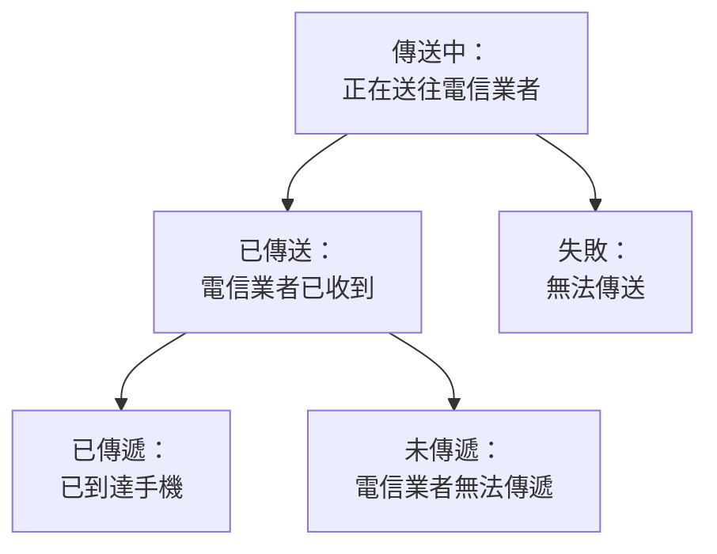

# 通知日誌

通知日誌列出 OneUptime 為您的專案傳送的每則訊息，每個管道一個分頁，並說明每則訊息的去向：是否送出、是否送達，以及未送達的原因。在 **專案設定 → 通知 → 通知日誌** 中開啟，或在事件、警示、維護事件、狀態頁面或待命策略的 **通知日誌** 中查看與其相關的傳送記錄。

:::cards
- [如何看懂狀態](#如何看懂狀態): 顏色表示訊息所在的位置，指向它即可看到它的含義。
- [簡訊](#簡訊): 依電信業者的回報，依序為傳送中、已傳送、已傳遞。
- [電話](#電話): 先是撥號中，然後是通話如何結束。
- [WhatsApp 與 Telegram](#whatsapp-與-telegram): 各應用程式接受訊息後會回報什麼。
- [電子郵件、推播、Webhook 與工作區](#電子郵件推播webhook-與工作區): 成功，或錯誤及其原因。
- [簡訊一直停在已傳送時](#簡訊一直停在已傳送時): 從不回報的電信業者，以及始終沒有到達的回報。
:::

## 如何看懂狀態

每個狀態都是一個帶顏色的標籤，顏色表示訊息所在的位置：

| 顏色 | 訊息所在的位置 |
| --- | --- |
| 灰色 | 已交出，但還沒有任何回報，例如 **傳送中**。 |
| 藍色 | 供應商已收到，但尚未說明結果，例如簡訊的 **已傳送** 或電話的 **撥號中**。 |
| 綠色 | 已送達對方，例如 **已傳遞**，或這是它最後的狀態。 |
| 黃色 | 已到達手機但無人接聽，例如 **未接來電**，或附帶警告送出。 |
| 紅色 | 未送達對方，例如 **未傳遞**、**失敗**、**錯誤** 或 **餘額不足**。 |

指向一個狀態、點按它或用 Tab 鍵移到它上面，它就會說明自己的含義與接下來會發生什麼。列選單中的 **檢視狀態訊息** 會顯示供應商的回覆，例如訊息的 ID 或失敗原因。每個分頁的 **狀態** 篩選器會依訊息經歷的順序，列出該分頁可能顯示的所有狀態。

## 簡訊

| 狀態 | 含義 |
| --- | --- |
| **傳送中** | OneUptime 已將簡訊交給 Twilio，Twilio 正將其轉交給電信業者。 |
| **已傳送** | 電信業者已接受該簡訊。電信業者回報後會變為 **已傳遞** 或 **未傳遞**。 |
| **已傳遞** | 電信業者已確認簡訊送達手機。這是已送達簡訊的最後狀態。 |
| **未傳遞** | 電信業者無法傳遞。原因見 **錯誤代碼**：`30003` 表示手機關機或不在服務範圍內，`30005` 表示號碼不存在，`30006` 表示市話，`30007` 表示電信業者過濾了該訊息。 |
| **失敗** | Twilio 無法傳送。原因見 **錯誤代碼**。 |
| **錯誤** | 未傳送，例如專案關閉了簡訊，或 Twilio 拒絕了該號碼。原因見 **檢視狀態訊息**。 |
| **餘額不足** | 未傳送：專案餘額不足以支付費用。 |
| **成功** | 在 OneUptime 追蹤傳遞之前傳送，且 Twilio 已接受。 |

伺服器自己的簡訊與電話閘道接受的簡訊會一直是綠色的 **已傳送**：閘道不回報傳遞狀況，因此這就是它最後的狀態。

Twilio 會在每次變化發生時向 OneUptime 回報，並以傳送該簡訊的帳戶的驗證權杖簽署，OneUptime 會拒絕任何不是來自 Twilio 的回報。為此，Twilio 必須能夠連線到您的伺服器：請參閱 [Twilio 整合](/docs/self-hosted/twilio-integration)。

## 電話

| 狀態 | 含義 |
| --- | --- |
| **撥號中** | Twilio 已撥打電話。Twilio 回報通話如何結束後，此狀態就會改變。 |
| **成功** | 電話已接聽，通話時長見 **檢視狀態訊息**。伺服器自己的簡訊與電話閘道接受的電話，在閘道接受後即為 **成功**。 |
| **未接來電** | 電話響鈴後無人接聽。 |
| **忙碌** | 線路忙碌，或電話被拒接。 |
| **語音信箱** | 語音信箱接聽了待命電話。是否留言見 **檢視狀態訊息**。 |
| **錯誤** | 無法撥打或接通電話。 |
| **餘額不足** | 未撥打：專案餘額不足以支付費用。 |

## WhatsApp 與 Telegram

WhatsApp 訊息在 OneUptime 交出時為 **排隊中**，WhatsApp 接受後為 **已傳送**，到達手機後為 **已傳遞**，若對方開啟已讀回條，開啟後為 **已讀**。**失敗** 是 WhatsApp 無法傳遞的訊息，**警告** 是附帶警告送出的訊息：WhatsApp 回報的內容見 **檢視狀態訊息**。**錯誤** 與 **餘額不足** 表示未傳送，與簡訊相同。

Telegram 接受訊息後不再回報任何內容，因此 Telegram 訊息的 **已傳送** 是綠色的：Telegram 已將其發佈到聊天中，這就是它最後的狀態。

## 電子郵件、推播、Webhook 與工作區

這些分頁顯示 **成功** 或 **錯誤**。**成功** 是最後的狀態：郵件伺服器已接受電子郵件，推播服務已接受通知，Webhook 位址回覆已收到請求，或工作區已完成所要求的操作。郵件伺服器接受電子郵件後，OneUptime 不再追蹤它；若推播服務之後回報推播通知未傳遞，它會變為 **錯誤**。訊息為 **錯誤** 的原因見 **檢視狀態訊息**，在 **工作區** 分頁上也可見於 **原因**。

## 簡訊一直停在已傳送時

**已傳送** 表示電信業者已收到簡訊，但尚未回報。大多數電信業者會在幾秒或幾分鐘內回報，但有些從不回報：這時 Twilio 也會將簡訊保留為 `sent`（其訊息日誌中也是如此），OneUptime 無法得知它是否送達。

簡訊一直停在 **傳送中** 則是另一回事：Twilio 的回報沒有到達 OneUptime。請檢查 Twilio 能否連線到您的伺服器，並在伺服器日誌中尋找以 `Twilio callback refused` 開頭的行：請參閱 [Twilio 整合](/docs/self-hosted/twilio-integration)。

## 後續步驟

:::cards
- [Twilio 整合](/docs/self-hosted/twilio-integration): 連接 Twilio，讓它的傳遞回報到達 OneUptime。
- [簡訊與電話閘道](/docs/self-hosted/sms-and-call-gateway): 透過您自己的閘道傳送簡訊與電話。
- [通知傳遞指標](/docs/self-hosted/notification-delivery-metrics): 統計整個安裝中傳遞成功的數量。
:::
