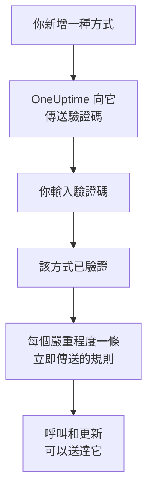

# 通知方式

通知方式是 OneUptime 在某個專案中可以聯絡你的地址：一個電子郵件地址、一個用於簡訊或電話的電話號碼、一個 WhatsApp 號碼、一個 Telegram 帳戶、你的 Slack 或 Microsoft Teams 帳戶、一支接收推播通知的手機或一個瀏覽器，或者一個 Webhook。你在 **使用者設定 → 通知方式** 中新增並驗證它們，OneUptime 就會立即開始用它們呼叫你。

:::cards
- [選擇通知方式](#選擇通知方式): 每種方式需要什麼，以及如何驗證。
- [新增並驗證通知方式](#新增並驗證通知方式): 郵件、簡訊、電話和 WhatsApp，使用 6 位數驗證碼。
- [Webhook](#webhook): 把呼叫傳送到你自己的端點，可選擇加上簽署。
- [為專案開啟管道](#為專案開啟管道): 為什麼可能看不到簡訊、電話、WhatsApp 或 Telegram。
:::

## 通知方式如何生效



未驗證的方式永遠不會被使用。推播裝置、Slack、Microsoft Teams 和 Webhook 不需要驗證碼：註冊裝置或連結帳戶就能證明它屬於你，而 Webhook 不需要證明。驗證一種方式會立即為它新增你的 [預設規則](/docs/notifications/on-call-rules#一開始擁有的規則)，因此新的電話號碼會在每個嚴重程度呼叫你，直到你修改它的規則。

## 選擇通知方式

**通知方式** 的每個分頁包含一張或多張卡片，每種方式一張：

| 卡片 | 分頁 | 你新增的內容 | 驗證方式 |
| --- | --- | --- | --- |
| **電子郵件 用於通知** | **Direct Contact** | 一個電子郵件地址 | 透過郵件傳送的驗證碼 |
| **電話號碼 用於簡訊通知** | **Direct Contact** | 一個電話號碼 | 透過簡訊傳送的驗證碼 |
| **用於來電通知的電話號碼** | **Direct Contact** | 一個電話號碼 | 在電話中唸出的驗證碼；已為簡訊驗證的號碼則不需要驗證碼 |
| **用於通知的 WhatsApp 號碼** | **Direct Contact** | 一個 WhatsApp 號碼 | 透過 WhatsApp 傳送的驗證碼 |
| **用於通知的 Telegram 帳戶** | **Direct Contact** | 你的 Telegram 帳戶 | 傳送一則訊息給 OneUptime 機器人 |
| **Slack Account for Notifications** | **Workspace Apps** | 你的 Slack 帳戶 | 將你的帳戶連結到專案的工作區 |
| **Microsoft Teams Account for Notifications** | **Workspace Apps** | 你的 Microsoft Teams 帳戶 | 將你的帳戶連結到專案的工作區 |
| **推送通知裝置** | **Push Notifications** | 安裝了 OneUptime On-Call 應用程式的手機，或一個瀏覽器 | 註冊該裝置 |
| **用於通知的 Webhook** | **Webhooks** | 你自己的 HTTPS 端點 | 不需要驗證 |

**Workspace Apps** 只有在專案已連線 Slack 或 Microsoft Teams 時才會顯示，而且只包含已連線的那些。簡訊、電話、WhatsApp 和 Telegram 可以在整個專案中關閉；請參閱 [為專案開啟管道](#為專案開啟管道)。

## 新增並驗證通知方式

電子郵件地址、簡訊號碼、電話號碼和 WhatsApp 號碼都使用 6 位數驗證碼進行驗證。

:::steps
### 開啟你的通知方式

前往 **使用者設定 → 通知方式**。 **Direct Contact** 是第一個分頁。

### 新增地址

在該方式的卡片中，點選其新增按鈕，例如 **新增電話號碼 用於簡訊通知**。輸入 **電子郵件**，或以國際格式輸入 **電話號碼**，例如 `+11234567890`，然後儲存。

### 輸入驗證碼

驗證對話方塊會自動開啟，並說明驗證碼傳送到了哪裡、在何時之前有效。在 **驗證碼** 中輸入驗證碼，然後點選 **驗證**。

### 檢查該列

該列現在標示為 **已驗證**。對話方塊關得太早？點選該列的 **驗證** 即可再次開啟。
:::

- 驗證碼的有效期限為 15 分鐘。輸錯五次會使其作廢，你需要取得新的驗證碼。
- 對話方塊中有 **Send a new code**，電話號碼則有 **Call me with a new code**。距離上一次要求一分鐘後，才能再次要求。
- 為簡訊驗證過的號碼也會視為已為電話驗證。將其新增到 **用於來電通知的電話號碼** 下不需要驗證碼，而驗證一個簡訊號碼也會驗證你為它新增的電話號碼。
- 從你加入專案的那天起，你的登入電子郵件就已在清單中，而且已驗證。

## 連結 Telegram

:::steps
### 新增帳戶

在 **用於通知的 Telegram 帳戶** 中，點選 **新增Telegram帳號**。 **Telegram 帳號 (選填)** 只是給你自己看的標籤，可以留空。

### 傳訊息給機器人

點選新列上的 **驗證**。 **驗證 Telegram 帳戶** 對話方塊提供三種聯絡 OneUptime 機器人的方式：用手機掃描 QR 碼、點選 **Open in Telegram**，或在 Telegram 中搜尋該機器人並傳送對話方塊中顯示的 `/start` 指令。

### 確認

回到 OneUptime，點選 **I've sent the message — check**。機器人收到你的訊息後，帳戶即完成驗證。
:::

**輪換驗證碼** 會為尚未驗證的帳戶產生新的驗證碼，先前的 QR 碼和你開啟過的連結將會失效。在自架的 OneUptime 上，需要伺服器管理員先連接一個 Telegram 機器人，其他人才能連結帳戶。

## Slack 和 Microsoft Teams

1. 將你自己的帳戶連結到專案的工作區： **使用者設定 → 工作區 → Slack** 或 **Microsoft Teams**。請參閱 [Slack](/docs/workspace-connections/slack) 和 [Microsoft Teams](/docs/workspace-connections/microsoft-teams)。
2. 在 **Workspace Apps** 分頁上，點選 **Add Slack Account** 或 **Add Microsoft Teams Account**。帳戶在新增時即完成驗證。
3. 點選其所在列的 **Send Test Message**。呼叫會以來自 OneUptime 應用程式的私人訊息形式送達。

## 推播通知

**Push Notifications** 分頁列出你的 **推送通知裝置**。

- **手機。** 安裝 OneUptime On-Call 應用程式，將其連接到你的 OneUptime，登入並允許通知：手機會自動加入此清單。請參閱 [應用程式概觀](/docs/mobile-desktop-apps/index)。
- **此瀏覽器。** 點選 **註冊裝置**，填寫 **裝置名稱**，並在瀏覽器詢問時允許通知。
- 裝置所在列的 **測試通知** 會立即傳送一則推播給它。
- **重大警示** 表示該手機上的呼叫是否會穿透靜音模式和勿擾模式響鈴。它在應用程式中開啟，從不在這裡開啟，而瀏覽器無法做到這一點。請參閱 [重大值班警示](/docs/self-hosted/push-notifications#重大值班警示穿透靜音模式)。
- 標示為 **未收到通知** 的裝置不會收到任何內容。在那支手機上開啟應用程式，或重新註冊瀏覽器，它就會恢復。

## Webhook

Webhook 會把每次呼叫以 JSON 形式傳送到你的 HTTPS 端點，供你自己的工具處理。

:::steps
### 新增 Webhook

在 **Webhooks** 分頁上，點選 **新增Webhook**。填寫一個便於辨識的 **名稱**、 **Webhook URL** 以及 **簽署密鑰（選填）**。

### 傳送測試

點選其所在列的 **傳送測試**。你的端點會收到一則 `eventType` 為 `test` 的訊息。

### 檢查收到的內容

呼叫是一個如下所示的 JSON `POST` 請求。請在 10 秒內以任意 `2xx` 狀態碼回應；不會跟隨重新導向。
:::

```json title="A page, as your endpoint receives it"
{
  "eventType": "on-call.incident.created",
  "timestamp": "2026-10-15T09:30:00.000Z",
  "projectId": "6a3f0d2e-1c4b-4e8a-9b7d-2f5c8e1a0b3c",
  "userId": "0c9e8d7f-6b5a-4c3d-8e2f-1a0b9c8d7e6f",
  "incident": {
    "id": "5b4a3c2d-1e0f-4a9b-8c7d-6e5f4a3b2c1d",
    "title": "Checkout API is down",
    "description": "Health check failed from 3 probes.",
    "incidentNumber": 42,
    "incidentNumberWithPrefix": "INC-42",
    "severity": "Critical Incident",
    "state": "Identified"
  },
  "onCallPolicyId": "7d6c5b4a-3e2f-4d1c-9b8a-7f6e5d4c3b2a",
  "onCallPolicyEscalationRuleId": "8e7d6c5b-4a3f-4e2d-8c1b-9a8f7e6d5c4b"
}
```

| `eventType` | 傳送對象 | 記錄的鍵 |
| --- | --- | --- |
| `on-call.incident.created` | 事件 | `incident` |
| `on-call.alert.created` | 警示 | `alert` |
| `on-call.incidentEpisode.created` | 事件片段 | `incidentEpisode` |
| `on-call.alertEpisode.created` | 警示片段 | `alertEpisode` |

你在 **通知設定** 中為 Webhook 開啟的更新也會傳送到同一個端點，其 `eventType` 為該設定的通知項目， `subject` 和 `message` 中是簡短摘要。

每個請求都帶有表示事件類型的 `X-OneUptime-Event`。設定了簽署密鑰時，還會帶有 `X-OneUptime-Signature`：即 `sha256=` 後接原始請求本文的 HMAC-SHA256 十六進位值。在信任請求之前請先驗證它：

```javascript title="verify-signature.js"
const crypto = require("crypto");

// rawBody: the request body exactly as it arrived, before any JSON parsing.
function isFromOneUptime(rawBody, signatureHeader, secret) {
  const expected =
    "sha256=" + crypto.createHmac("sha256", secret).update(rawBody).digest("hex");
  const received = Buffer.from(signatureHeader || "");
  const wanted = Buffer.from(expected);
  return received.length === wanted.length && crypto.timingSafeEqual(received, wanted);
}
```

Webhook 不需要驗證，因此新增後會立即新增其規則。私有地址和內部地址會遭到拒絕，除非自架伺服器的管理員允許它們：請參閱 [私有網路存取](/docs/self-hosted/private-network-access#webhook-和工作流程)。

## 為專案開啟管道

**SMS**、 **語音電話**、 **WhatsApp** 和 **Telegram** 在每個新專案中預設關閉，因為每則訊息都要花錢：在 OneUptime Cloud 上，費用從專案餘額中支付；如果專案的預設 Twilio 帳戶用於傳送簡訊和電話，它們會改為透過專案自己的 Twilio 帳戶傳送。郵件、推播、Slack、Microsoft Teams 和 Webhook 一律開啟。

管道關閉期間，專案中的任何人都無法在該管道上新增通知方式：它的卡片上沒有新增按鈕，並會說明誰可以開啟它。由專案擁有者、 **帳單管理員** 或擁有 **Manage Billing** 權限的人在 **專案設定 → 通知 → 通知設定** 的 **通知管道** 卡片中開啟。專案管理員無法開啟。在自架的 OneUptime 上，簡訊和電話還需要 Twilio 帳戶，Telegram 還需要伺服器管理員連接的機器人；請參閱 [Twilio 整合](/docs/self-hosted/twilio-integration)。

## 刪除通知方式

點選該方式所在列的 **刪除**。刪除一種方式會刪除所有使用它的待命規則，因此對話方塊會先計算這些規則，並列出刪除後將完全沒有規則的嚴重程度。

## 疑難排解

:::details 卡片上沒有新增按鈕
該管道在此專案中已關閉。卡片會說明誰可以開啟它；請參閱 [為專案開啟管道](#為專案開啟管道)。
:::

:::details 一直沒收到驗證碼
郵件可能需要幾分鐘，有時會進入垃圾郵件；簡訊可能需要一分鐘。請等待一分鐘，然後在對話方塊中點選 **Send a new code**。 **專案設定 → 通知 → 通知日誌** 會顯示該訊息的處理情況。
:::

:::details 新增我的 Slack 帳戶失敗
請先在 **使用者設定 → 工作區 → Slack** 下連結你的帳戶，然後再次點選 **Add Slack Account**。錯誤對話方塊中有一個按鈕可以帶你前往那裡。
:::

:::details 我的手機收不到推播通知
檢查該手機是否列在 **推送通知裝置** 下，並傳送一則 **測試通知** 給它。請參閱 [常見問題與疑難排解](/docs/mobile-desktop-apps/faq-troubleshooting#通知)。
:::

## 後續步驟

:::cards
- [個人待命規則](/docs/notifications/on-call-rules): 決定每次呼叫嘗試哪種方式，以及何時嘗試。
- [通知設定](/docs/notifications/notification-settings): 選擇你要收到的更新，以及透過哪些管道。
- [應用程式概觀](/docs/mobile-desktop-apps/index): 在手機或桌面上接收呼叫。
- [OneUptime 如何聯絡你](/docs/notifications/index): 通知方式、規則和設定如何搭配。
:::
