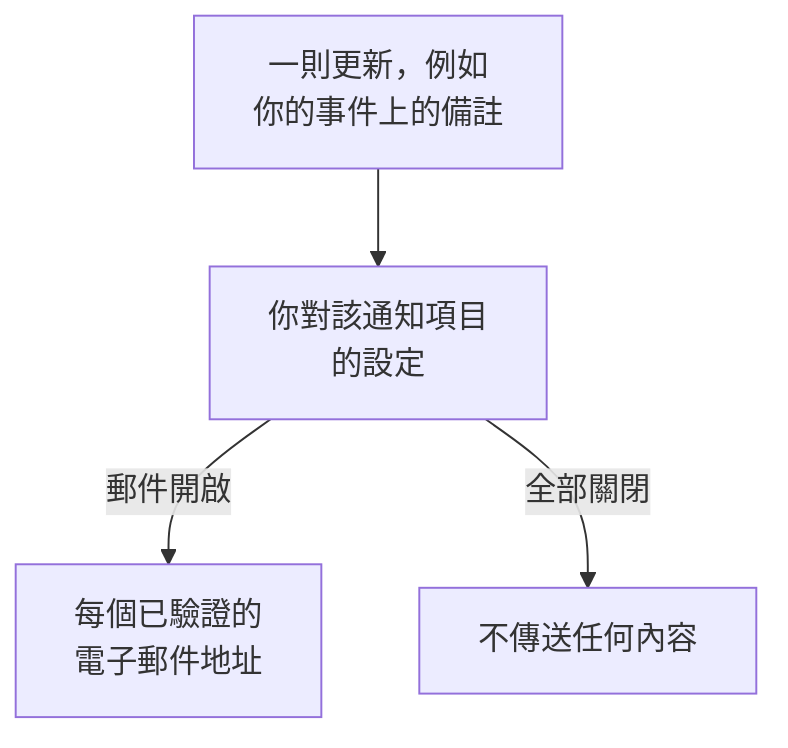

# 通知設定

通知設定決定你會收到哪些關於你所擁有記錄（例如事件、監測器或狀態頁面）以及你自己待命班次的更新，以及透過哪些管道收到。它們永遠不會呼叫你：呼叫是待命規則的工作。你在 **使用者設定 → 通知設定** 中設定它們，每個通知項目和管道各有一個開關。

:::cards
- [設定如何運作](#設定如何運作): 每個通知項目和管道一個開關，傳送到每種已驗證的方式。
- [修改設定](#修改設定): 點選三次，立即儲存。
- [新成員預設開啟的內容](#新成員預設開啟的內容): 預設值，逐個分頁說明。
- [減少郵件](#減少郵件): 彙總突發的更新，或去掉例行郵件。
:::

## 設定如何運作

- 每一列是一個通知項目，每一欄是一個管道：郵件、簡訊、電話、推播、WhatsApp、Telegram、Slack 和 Microsoft Teams，以及 Webhook。只有在專案已連線 Slack 和 Microsoft Teams 時，它們才會成為欄。
- 開啟的管道會傳送到你在此專案中該管道上的每種已驗證方式，而不只是其中一種。
- 開啟的管道如果背後沒有已驗證的方式，就不會傳送任何內容。 **Your setup checklist** 會在 **Staying informed** 下指出這一點。
- 更新會傳送給記錄的擁有者：被指定為擁有者的人，以及其擁有者團隊的成員。當記錄沒有擁有者時，會改為傳送給專案擁有者。關於被新增為擁有者的通知項目只會傳送給被新增的人。
- 安全案件沒有擁有者。新案件會依每個人各自選擇的優先順序，傳送給所有能檢視專案案件的人；已指派的案件則會傳送給被指派的人。請參閱 [安全案件](/docs/telemetry/security-cases#通知)。
- 每封寄給擁有者的郵件結尾都有一個返回此頁面的 "Manage notification preferences" 連結。

## 修改設定

:::steps
### 開啟你的設定

前往 **使用者設定 → 通知設定**。分頁有 **事件**、 **警示**、 **監控**、 **狀態頁面**、 **排定維護**、 **待命** 和 **安全性**。

### 找到通知項目

每個分頁包含一張或多張卡片，例如 **事件** 分頁上的 **事件 片段**。每一列是一個通知項目，並附有一行說明何時傳送。

### 點選管道

點選管道的圓圈將其開啟，再點選一次將其關閉。勾號表示開啟。變更會自動儲存。
:::

## 新成員預設開啟的內容

當你加入專案時，以下通知項目會透過郵件開啟。其他所有通知項目一開始都是關閉的，在你開啟某個管道之前不會傳送任何內容。

| 分頁 | 透過郵件開啟 | 關閉，直到你開啟 |
| --- | --- | --- |
| **事件** | **事件已建立**、 **事件狀態已變更**、 **Incident reminder**、 **事件 SLA 違約**、 **事件片段已建立**、 **事件片段狀態已變更**、 **事件已新增至事件片段** | **事件備註已張貼**、 **已新增為事件擁有者**、 **已指派至事件**、 **事件片段備註已張貼**、 **已新增為事件片段擁有者** |
| **警示** | **警示已建立**、 **警示狀態已變更**、 **Alert reminder**、 **警示片段已建立**、 **警示片段狀態已變更**、 **警示已新增至警示片段** | **警示備註已發布**、 **已新增為警示擁有者**、 **警示片段備註已發布**、 **已新增為警示片段擁有者** |
| **監控** | **您的監測器探測器狀態已變更**、 **監測器沒有作用中的探測器**、 **SLO status changed**、 **Added as SLO owner**、 **探測器狀態已變更**、 **已新增為探測器擁有者** | **監測器已建立**、 **監測器狀態已變更**、 **已新增為監測器擁有者**、 **AI 代理狀態已變更**、 **已新增為 AI 代理擁有者** |
| **狀態頁面** | 無 | **已建立狀態頁面**、 **已發布狀態頁面公告**、 **已新增為狀態頁面擁有者** |
| **排定維護** | **Maintenance reminder** | **維護事件已建立**、 **維護狀態已變更**、 **維護備註已張貼**、 **已新增為維護擁有者** |
| **待命** | **您開始待命**、 **您是下一位待命人員**、 **您結束待命**、 **已新增至待命策略**、 **已從待命策略中移除**、 **未接來電**，以及同時透過推播： **我的值班班次開始前**、 **我即將到來的值班班次被重新指派** | 無 |
| **安全性** | 同時透過推播： **新的安全案例**（High 和 Critical 案件）、 **指派給我的安全案例**、 **等待我核准的劇本步驟**、 **安全案例回應目標**、 **指派給我的安全案例任務**、 **獵捕發現了安全事件** | 無 |

> [!IMPORTANT]
> **監測器狀態已變更** 一開始是關閉的。若要在你擁有的監測器停止運作或恢復時收到通知，請在 **監控** 分頁上將其開啟。

## 你的班次

**待命** 分頁關注的是你本人，而不是你所擁有的記錄：

- **您開始待命**、 **您是下一位待命人員** 和 **您結束待命** 跟隨你在所屬待命排程中的輪值。
- **已新增至待命策略** 和 **已從待命策略中移除** 會在待命策略開始或停止指定你時通知你。
- **我的值班班次開始前** 會在你於 **使用者設定 → 行事曆 → 行事曆訂閱** 中選擇的時間傳送提醒， **我即將到來的值班班次被重新指派** 會在你收到過提醒的班次改由他人負責時通知你。請參閱 [行事曆訂閱源](/docs/on-call/calendar-feeds#提醒與重新指派通知)。
- **來電策略** 卡片上的 **未接來電** 會告知來電策略的擁有者，有來電者沒有聯絡到任何人。請參閱 [來電原則](/docs/on-call/incoming-call-policy#未接來電)。

## 安全案件

**安全性** 分頁關注的是你能檢視的安全案件：

- **新的安全案例** 的名稱下方有一個優先順序：會通知你的案件的最低優先順序。除非你選擇 **僅嚴重**、 **中及以上**、 **低及以上** 或 **所有案例**，否則它是 **高及以上**。
- **指派給我的安全案例** 會跟隨指派給你，以及指派給你所屬團隊的案件。
- **等待我核准的劇本步驟** 會請你核准或拒絕你有權核准的案件上的某個劇本步驟。

請參閱 [安全案件](/docs/telemetry/security-cases#通知)。

## 減少郵件

這些開關決定你會收到哪些更新，而不是這些更新會彙總成多少封郵件。為此， **使用者設定 → 郵件偏好設定** 提供了兩張卡片，都只對你本人、在此專案中生效：

- **Email Rollup** 會把一陣突發的更新合併成一封郵件：最開始的幾則仍會逐則送達，其餘的會在幾分鐘後一起送達。
- **Fewer routine emails** 透過 **Reduce routine emails** 關閉有關備註、新擁有者、新監測器和狀態頁面、片段新增內容以及待命策略變更的郵件。

請參閱 [通知彙總](/docs/emails/notification-rollup)。

## 疑難排解

:::details 開關已開啟，但什麼都沒收到
檢查你在 **使用者設定 → 通知方式** 下是否有該管道上的已驗證方式。對於簡訊、電話、WhatsApp 和 Telegram，專案也必須開啟該管道。
:::

:::details 我擁有一個監測器，但它停止運作時我從未收到通知
**監測器狀態已變更** 一開始是關閉的。請在 **監控** 分頁上為它開啟一個管道。
:::

:::details 關閉所有開關後我仍然收到郵件
呼叫遵循你的待命規則，而不是這些開關；登入、安全和帳單郵件也不屬於關於記錄的更新。每個專案都有自己的設定，因此請檢查寄出該郵件的專案。請參閱 [個人待命規則](/docs/notifications/on-call-rules)。
:::

## 後續步驟

:::cards
- [通知方式](/docs/notifications/notification-methods): 新增你的設定要傳送到的方式。
- [個人待命規則](/docs/notifications/on-call-rules): 決定呼叫如何送達你。
- [通知彙總](/docs/emails/notification-rollup): 在突發期間，郵件更少、內容更完整。
- [OneUptime 如何聯絡你](/docs/notifications/index): 通知方式、規則和設定如何搭配。
:::
