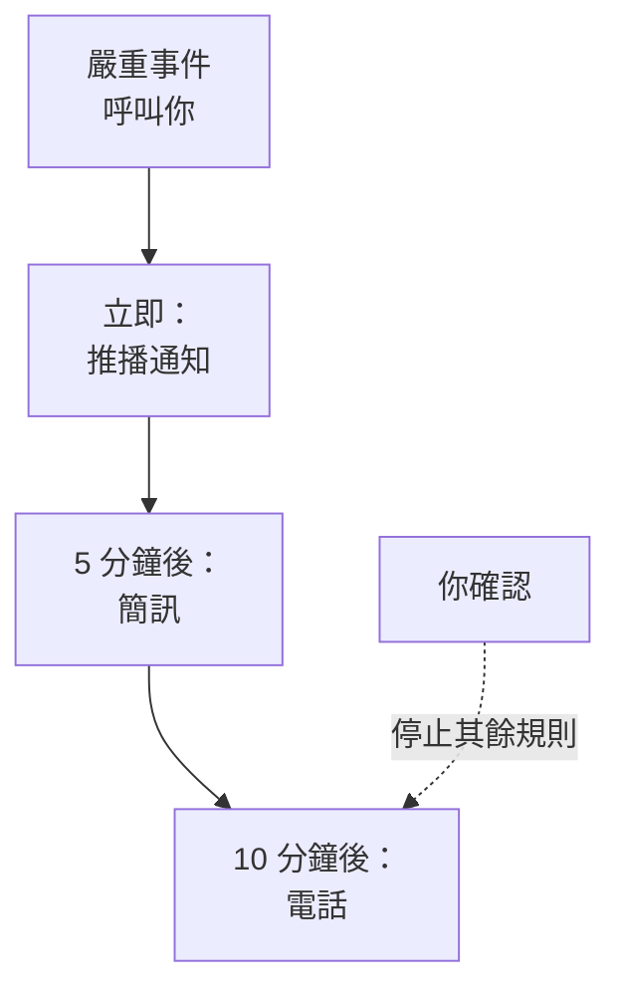

# 個人待命規則

你的待命規則決定呼叫如何送達你：OneUptime 嘗試你的哪些通知方式，以及在呼叫開始多久之後嘗試。每種呼叫都有自己的規則，每個嚴重程度一組，因此嚴重的事件可以立即打電話給你，而低嚴重程度的警示可以等一封郵件。你在 **使用者設定 → 待命規則** 中設定它們。

> [!NOTE]
> 這些規則只屬於你。 **事件 → 規則** 和 **警示 → 規則** 下的 **待命規則** 是另一回事：它們決定新事件或新警示執行哪些待命策略。

:::cards
- [呼叫如何送達你](#呼叫如何送達你): 一次呼叫中你的規則，逐步說明。
- [一開始擁有的規則](#一開始擁有的規則): 每種已驗證的方式會新增什麼，以及如何精簡。
- [新增規則](#新增規則): 為一個嚴重程度設定一種方式和一段延遲。
- [推播規則](#推播規則): 穿透靜音模式響鈴，並重複直到有人確認。
:::

## 呼叫如何送達你

當待命策略的某條上報規則指定了你、你所在的團隊，或你正在待命的排程時，該策略會呼叫你。接著 OneUptime 會依序執行你針對該呼叫類型及其嚴重程度的規則：每條規則在呼叫開始後經過其延遲時，透過它自己的方式傳送。無論是從任何訊息中還是在 OneUptime 中確認事件或警示，都會停止所有尚未傳送的規則。

大多數訊息都可以確認呼叫：郵件、簡訊，以及 WhatsApp、Telegram、Slack 和 Microsoft Teams 訊息都帶有確認連結，電話會請你按 1。如果你無法處理某次呼叫，可以透過同樣的訊息升級它，電話會請你按 2：策略會立即呼叫下一級，你也不會再因此被呼叫。參見 [升級呼叫](/docs/on-call/escalation-rules#升級呼叫) 。你收到的每次呼叫都列在 **使用者設定 → 待命日誌** 下，其中 **檢視時間軸** 會顯示它傳送的每則訊息以及是否已送達。

## 四個分頁

**使用者設定 → 待命規則** 為每種呼叫提供一個分頁。每個分頁為每個嚴重程度提供一張卡片，名稱和顏色與你的專案設定的一致：

| 分頁 | 呼叫來源 | 卡片對應 |
| --- | --- | --- |
| **事件** | 事件 | 事件嚴重程度 |
| **事件 片段** | 將事件分組的片段 | 事件嚴重程度 |
| **警示** | 警示 | 警示嚴重程度 |
| **警示 片段** | 將警示分組的片段 | 警示嚴重程度 |

片段透過自己的待命策略呼叫你，與其中的事件或警示分開，因此它的規則位於獨立的分頁上。頁面網址會標明目前開啟的分頁，例如 `/dashboard/{projectId}/user-settings/on-call-rules?type=alerts`；其他值為 `incident-episodes` 和 `alert-episodes`，沒有 `type` 時頁面會開啟 **事件**。

## 一開始擁有的規則

你驗證的每種方式都會在每個分頁的每張卡片上獲得一條規則，在你被呼叫時立即傳送。你的登入電子郵件從你加入的那天起就有這些規則，因此呼叫一定能送達你。驗證一個用於簡訊的電話號碼後，每次呼叫也會傳簡訊給你。

這是一個穩妥的起點，但通常太多了。請依每個嚴重程度的需要進行精簡：

| 嚴重程度 | 合理的組合 |
| --- | --- |
| 嚴重 | 立即推播，5 分鐘後打電話 |
| 重大 | 立即推播，10 分鐘後傳簡訊 |
| 輕微或低 | 立即寄郵件 |

你自己的規則沒有勿擾時段：把低嚴重程度留給郵件，或留給設定為 **一般** 的推播規則，這樣它們就永遠不會吵醒你。若要讓所有人的低嚴重程度呼叫都等到工作時間，請把呼叫它的待命規則設定為 **僅在工作時間內**：請參閱 [待命規則](/docs/alerts/settings#待命規則)。

## 新增規則

:::steps
### 開啟卡片

前往 **使用者設定 → 待命規則**，開啟對應呼叫類型的分頁，找到該嚴重程度的卡片。

### 選擇方式

點選 **新增通知 規則**。在 **通知方式** 中，選擇一種已驗證的方式；未驗證的方式不會出現在選項中。

### 選擇推播的提示方式

對於手機，在 **推播通知** 中選擇 **重大警示** 或 **一般**。對於任何推播裝置，選擇 **重複直到確認**。請參閱 [推播規則](#推播規則)。

### 設定延遲

選擇 **在此之後通知我**： **立即**、 **5 分鐘**、 **10 分鐘**、 **15 分鐘**、 **30 分鐘** 或 **1 小時**。然後點選對話方塊中的 **新增通知 規則**。
:::

卡片依延遲順序列出其規則，每條規則都顯示 **通知方式** 和 **通知延遲**。

## 修改或刪除規則

- 規則所在列的 **編輯** 用於修改其延遲。若要把規則改送到另一種方式，請刪除它並新增一條新規則。
- 對於推播規則，點選方式下方的標籤，可以在 **重大警示** 和 **一般** 之間切換，或修改其重複頻率。修改會立即儲存。
- **刪除** 會先要求確認，並說明該嚴重程度是否會因此沒有任何規則。沒有規則的嚴重程度會改用你已驗證的方式；請參閱 [某個嚴重程度沒有規則時](#某個嚴重程度沒有規則時)。

## 推播規則

呼叫手機的規則會指定其推播的提示方式：

| 選項 | 手機的行為 |
| --- | --- |
| **重大警示** | 只要在 OneUptime On-Call 應用程式中開啟了 Critical On-Call Alerts，即使手機處於靜音或勿擾模式也會響鈴。新的手機規則預設使用此選項。 |
| **一般** | 遵循手機的聲音、靜音和勿擾設定。 |

推播規則（無論針對手機還是瀏覽器）還可以重複傳送推播，直到有人確認： **不重複**（預設值），或 **每分鐘**、 **每 2 分鐘**、 **每 3 分鐘**、 **每 5 分鐘**、 **每 10 分鐘**、 **每 15 分鐘** 或 **每 30 分鐘**。它最多再重複 10 次，並在事件、警示或片段被確認後立即停止。請參閱 [重大值班警示](/docs/self-hosted/push-notifications#重大值班警示穿透靜音模式)。

## 某個嚴重程度沒有規則時

專案之後新增的嚴重程度會在幾分鐘內獲得規則，這些規則依據你在該分頁上已做的選擇產生：相同的方式，相同的延遲。如果你在該分頁上沒有任何規則，它會獲得你已驗證的電子郵件，立即傳送。

仍然找不到規則的呼叫依然會傳送到你已驗證的方式，而且你會收到一封相關郵件；請參閱 [沒有相符的規則時](/docs/notifications/index#沒有相符的規則時)。

:::details 刻意關閉某個嚴重程度
API 可以儲存一條退出規則，設定 `isOptOut` 且不指定方式：這樣你在該呼叫類型和嚴重程度下完全不會被呼叫，也不會改用其他方式。該列顯示 **Muted - notifications turned off for this rule**，刪除它即可重新開啟呼叫。當你在該分頁上的所有規則都是退出規則時，之後新增的嚴重程度也會被靜音。
:::

:::details 為整個專案關閉備援傳送
專案擁有者或擁有 **Manage Billing** 權限的人可以透過 API 設定專案的 `disableOnCallNotificationFallback`。此後找不到規則的呼叫將不會送達，其日誌會說明該使用者應在 **使用者設定 → 待命規則** 下新增規則。
:::

## 隊友的規則

專案擁有者和管理員可以為專案中的任何人查看和修改同一頁面：在 **使用者** 下開啟此人，然後開啟 **待命** 區段中的 **待命規則**。旁邊的 **就緒狀態** 顯示每個嚴重程度是否都能送達此人。當其他人新增、修改或刪除你的規則時，你會收到一封相關郵件，而且每次修改都會記錄在專案的稽核日誌中。

## 疑難排解

:::details 嚴重呼叫時我的手機沒有響
檢查規則的推播是 **重大警示** 而不是 **一般**，並檢查在 **使用者設定 → 通知方式** 的 **Push Notifications** 分頁上，該手機的 **重大警示** 已開啟。
:::

:::details 每個事件我都被呼叫兩次
每種已驗證的方式都有一條針對每個嚴重程度、立即傳送的規則。刪除你不需要的規則，或為它們設定延遲。片段中的事件可能透過兩個策略呼叫你：事件一次，片段一次。
:::

:::details 我的規則寫的是簡訊，卻收到了郵件
該呼叫找不到與其類型或嚴重程度相符的規則，因此改用了你的免費方式：請在正確的分頁和卡片上新增規則。或者，那封郵件是關於你所擁有的記錄的更新，這類更新遵循 **通知設定**，而不是你的規則。你的 **待命日誌** 只列出呼叫。
:::

## 後續步驟

:::cards
- [通知方式](/docs/notifications/notification-methods): 新增並驗證你的規則所指向的方式。
- [上報規則](/docs/on-call/escalation-rules): 待命策略如何逐級呼叫人員。
- [推播通知](/docs/self-hosted/push-notifications): 手機上的重大警示、警報聲和重複。
- [OneUptime 如何聯絡你](/docs/notifications/index): 通知方式、規則和設定如何搭配。
:::
