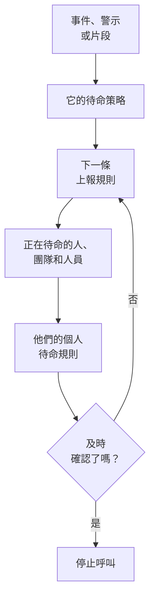

# 待命概觀

待命是 OneUptime 在任何時間把人帶到問題面前的方式。當事件、警示或片段需要有人處理時，它的待命策略會逐級呼叫人員，直到有人確認；每個人都會透過自己選擇的方式收到通知：推播通知、簡訊、電話、電子郵件或聊天訊息。本頁說明各個部分如何搭配，以及它們各自在哪裡。

:::cards
- [呼叫如何送達某人](#呼叫如何送達某人): 從新事件到做出回應的人。
- [組成部分](#組成部分): 策略、上報規則、待命排程、覆寫和個人規則。
- [設定待命](#設定待命): 從零開始到一個會被呼叫的團隊，共五個步驟。
- [待命在哪裡](#待命在哪裡): 待命選單，逐一介紹各個區段。
:::

## 呼叫如何送達某人

1. 新的事件、警示或片段會立即執行它的待命策略：在其上選定的策略，以及其待命規則新增的策略。每個策略各自執行。設定為 **僅在工作時間內** 的待命規則會讓它新增的策略等到工作時間開始。
2. 策略的第一條上報規則會立即呼叫：其待命排程中此刻正在待命的人、其團隊的每位成員，以及規則指定的人員。
3. 如果其中有人不在崗，使用者覆寫會把呼叫轉給代班的人，或者略過此人。
4. 每個人都透過其個人待命規則收到通知：先嘗試哪種方式，以及多久之後嘗試。沒有規則的呼叫仍會透過此人已驗證的方式送達。
5. 如果在規則的等待時間結束前無人確認，下一條規則就會呼叫。最後一條規則之後，如果策略設定為重複，就從頭再來，否則停止。

確認或解決事件、警示或片段，會停止所有仍在為其呼叫的策略。OneUptime 每分鐘推進一次正在執行的策略，並在 **執行日誌** 中依規則記錄每次執行。

呼叫第一次送達某人時，OneUptime 會把這一時刻以 `First Paged At` 記錄在事件、警示或片段上。測量可以從這一時刻開始計時：**呼叫後確認用時** 衡量的是人們被呼叫之後過了多久才做出回應，而不是這筆紀錄在有人被呼叫之前等了多久。請參閱 [呼叫後確認用時](/docs/incidents/settings#呼叫後確認用時)。

> [!NOTE]
> 建立時即已確認或已解決的事件、警示或片段不會執行任何策略，其動態會說明這一點。請參閱 [建立時即已確認或已解決](/docs/alerts/index#建立時即已確認或已解決)。

## 組成部分

| 部分 | 決定什麼 | 了解更多 |
| --- | --- | --- |
| 待命策略 | 針對事件或警示逐級呼叫誰 | [待命策略](/docs/on-call/policies) |
| 上報規則 | 策略的一個級別：呼叫誰，以及等待確認多久 | [上報規則](/docs/on-call/escalation-rules) |
| 待命排程 | 隨著大家輪流待命，任一時刻由誰待命 | [待命排程](/docs/on-call/schedules) |
| 使用者覆寫 | 某人不在崗時由誰代班 | [使用者覆寫](/docs/on-call/user-overrides) |
| 個人待命規則 | 如何聯絡到某個人：用哪種方式，多久之後 | [個人待命規則](/docs/notifications/on-call-rules) |
| 來電原則 | 撥打後會轉給待命人員的電話號碼 | [來電原則](/docs/on-call/incoming-call-policy) |

策略、上報規則、待命排程和覆寫屬於專案，位於 **待命** 下。通知方式和個人待命規則屬於每個人自己，位於 **使用者設定** 下：管理員可以查看某人的設定，但只有本人才能驗證自己的電話或電子郵件。請參閱 [OneUptime 如何聯絡你](/docs/notifications/index)。

## 設定待命

:::steps
### 建立待命排程

從 **產品** 選單開啟 **待命** ，前往 **待命排程** 。點選 **建立待命排程** ，為它命名，並在 **誰輪流待命？** 下依輪替順序選擇人員。請參閱 [待命排程](/docs/on-call/schedules)。

### 建立策略

前往 **待命策略** ，點選 **建立待命策略** 。在 **首先通知誰？** 下選擇該待命排程。它會成為策略的第一條上報規則 **Level 1** ，等待確認 30 分鐘。

### 新增後續級別

在策略的 **上報規則** 頁面，為第一級之後的每個級別點選 **新增上報規則** ：同一待命排程輪換中的下一個人、團隊負責人、經理。請參閱 [上報規則](/docs/on-call/escalation-rules)。

### 自動執行策略

專案中的第一個策略在建立時就能完成這一步：保持 **每個新事件與警示都觸發此策略** 為開啟狀態。對於其他策略，前往 **事件 → 規則 → 待命規則** 或 **警示 → 規則 → 待命規則** ，新增一條規則，為相符的事件或警示執行該策略，例如所有嚴重事件。請參閱 [什麼會執行策略](/docs/on-call/policies#什麼會執行策略)。

### 檢查每個人都能聯絡到

開啟 **待命 → 就緒狀態** 。你的策略可以呼叫的每個人都會顯示為 **就緒** 、 **需要設定** 或 **無法連線** ，並列出缺少的內容。請參閱 [就緒狀態與報告](/docs/on-call/readiness)。
:::

> [!NOTE]
> 在 OneUptime Cloud 上，待命策略和上報規則在所有方案中都可使用。待命排程、使用者覆寫、執行日誌和待命時間報告需要 **Growth** 方案。

## 待命在哪裡

從頂端列的 **產品** 選單開啟 **待命** 。它會在 `/dashboard/{projectId}/on-call-duty/policies` 開啟 **待命策略** ，側邊選單包含其餘內容：

| 區段 | 頁面 |
| --- | --- |
| **策略** | **待命策略** 和 **就緒狀態** ：你的策略實際能聯絡到誰 |
| **排程** | **待命排程** 、 **待命時間軸** 和 **行事曆訂閱** |
| **來電** | **來電策略** ：一個會轉給待命人員的電話號碼 |
| **進階** | **使用者覆寫** 、 **執行日誌** 和 **已封存策略** |
| **報告** | **使用者待命時間** ：每個人待命了多久 |
| **工作區** | **Slack** 和 **Microsoft Teams** ：把待命事件發布到頻道的規則 |
| **設定** | **自訂欄位** 、 **標籤規則** 和 **擁有者規則** |
| **開發者** | **Terraform** 、 **API** 和 **AI 助理** ：透過程式碼設定待命 |

**策略** 、 **排程** 和 **來電** 預設展開；其他區段一開始是收合的，當你位於其中某個頁面時會自動展開。 **工作區** 列出專案已連線的聊天工具，如果沒有，則顯示 **連線 Slack 或 Teams** 。

當你在某個策略中待命時，右上角的鈴鐺會顯示出來。點選它可開啟 **我的待命策略** ：你在所有專案中待命的每個策略，以及你是被直接指定、透過團隊還是透過待命排程。

## 疑難排解

:::details 新事件沒有呼叫任何人
開啟事件的 **待命執行** 頁面。如果是空的，表示該事件沒有待命策略：既沒有在事件上選擇策略，也沒有相符的待命規則。狀態為 **Execution Completed - No One Notified** 的執行經過了每條上報規則，卻沒有找到任何人：通常是某個待命排程中無人待命。請參閱 [執行日誌](/docs/on-call/policies#執行日誌)。狀態為 **等待中** 的執行正依設定為 **僅在工作時間內** 的待命規則等待工作時間，在工作時間開始前不會呼叫任何人。
:::

:::details 有人透過錯誤的管道被呼叫，或根本沒被呼叫
開啟 **待命 → 就緒狀態** ，點選此人所在列的 **Coverage** 。它會顯示此人已驗證的方式，以及此人沒有規則的每個嚴重性。只有本人才能在 **使用者設定** 中修正：可以在同一頁面寄送設定提醒給此人。請參閱 [就緒狀態與報告](/docs/on-call/readiness)。在 OneUptime Cloud 上，封鎖陌生來電的手機可能會讓呼叫靜音：請把 [OneUptime 的號碼](/docs/on-call/phone-number-whitelist) 加入手機的允許清單。
:::

:::details 休假的人仍在被呼叫
新增一個使用者覆寫，在 **誰不在崗？** 中選擇此人。在 **待命 → 進階 → 使用者覆寫** 下新增的覆寫適用於所有策略；在策略自己的 **使用者覆寫** 頁面新增的覆寫只適用於該策略。請參閱 [使用者覆寫](/docs/on-call/user-overrides)。
:::

## 後續步驟

:::cards
- [待命策略](/docs/on-call/policies): 建立策略，決定由什麼執行它，並查看它做了什麼。
- [上報規則](/docs/on-call/escalation-rules): 逐級呼叫人員，直到有人回應。
- [待命排程](/docs/on-call/schedules): 輪替、層和交接。
- [OneUptime 如何聯絡你](/docs/notifications/index): 決定如何聯絡每個人的方式和規則。
:::
