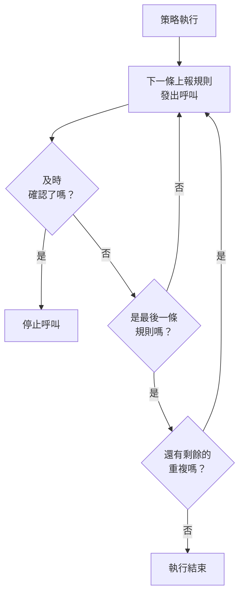

# 待命策略

待命策略決定針對事件或警示呼叫誰，以及如果無人確認，下一個是誰。它的上報規則就是它的級別，使用它的事件、警示和片段會執行它。本頁介紹如何建立策略、什麼會執行策略、策略頁面顯示什麼，以及每次執行如何被記錄。

:::cards
- [建立策略](#建立策略): 一個名稱，以及首先呼叫誰。
- [什麼會執行策略](#什麼會執行策略): 規則、範本、監測器、聊天和你自己。
- [執行日誌](#執行日誌): 每次執行，依規則逐條記錄，以及它為何停止。
- [封存或刪除策略](#封存或刪除策略): 讓策略停止服務。
:::

## 建立策略

:::steps
1. 前往 **待命 → 待命策略** ，點選 **建立待命策略** 。
2. 輸入 **名稱** ，例如「支付主要待命」。
3. 在 **首先通知誰？** 下點選 **新增回應者** ，選擇首先要呼叫的待命排程、團隊和人員。
4. 點選 **建立待命策略** 。策略會在其 **上報規則** 頁面開啟， **Level 1** 已經就位。
:::

**首先通知誰？** 是選填的，並且只會向可以新增上報規則的人顯示：留空時，策略在擁有規則之前不會呼叫任何人。 **描述** 和 **標籤** 位於 **更多欄位** 下。要新增後續級別，請參閱 [上報規則](/docs/on-call/escalation-rules)。

對於可以新增待命規則的人，表單還會詢問 **每個新事件與警示都觸發此策略**。它會在 **事件 → 規則 → 待命規則** 和 **警示 → 規則 → 待命規則** 下各新增一條規則，兩條規則都符合所有內容並執行此策略。在專案還沒有任何待命策略和待命規則時建立的第一個策略預設為開啟，之後的策略預設為關閉：每個新事件與警示都觸發兩個策略，需要你自己決定。保持關閉時，在規則、監測器或某個人執行它之前，策略不會呼叫任何人。

若想改為按步驟引導完成設定，從你的手機到一次測試呼叫，請點選 **引導式設定**：它位於空的 **待命策略** 清單上，或在 **運作方式** 中。請參閱 [透過電話、簡訊或推播接收呼叫](/docs/guides/paging)。

**待命策略** 清單顯示每個策略的 **名稱** 、 **描述** 、 **標籤** 和 **擁有者** 。選取策略後可以執行 **新增標籤** 、 **移除標籤** 、 **新增擁有者** 、 **移除擁有者** 、 **封存** 、 **匯出 JSON** 或刪除。 **匯入 JSON** 從匯出檔建立策略：匯出檔包含策略本身的設定，不包含其上報規則或擁有者。

## 什麼會執行策略

在有東西執行策略之前，策略不會呼叫任何人。每個事件、警示和片段在建立後會立即執行它擁有的策略：

| 來源 | 如何新增策略 | 了解更多 |
| --- | --- | --- |
| 記錄本身 | 建立事件或警示時的 **待命策略** 欄位、事件範本，或監測器條件中的 **待命** 收合區 | [宣告事件](/docs/incidents/declaring-incidents) |
| 待命規則 | **事件 → 規則 → 待命規則** 和 **警示 → 規則 → 待命規則** 會新增每條相符規則的策略 | [事件待命規則](/docs/incidents/settings#事件待命規則) |
| 分組規則 | 分組規則在開啟片段時執行它自己的策略 | [警示片段與分組規則](/docs/alerts/episodes) |
| 手動 | 動態的 **操作** 選單中，或 Slack、Microsoft Teams 訊息上的 **執行待命策略** | [事件動態](/docs/incidents/notes-owners-and-feed#事件動態) |
| 聊天和工作流程 | Slack 或 Microsoft Teams 中的 `/oneuptime page` ，以及工作流程的 **Page an On-Call Policy** 步驟 | [Paging](/docs/workflows/components#paging) |

多條規則新增的同一個策略只執行一次。嚴重性本身從不執行策略：執行策略的是與該嚴重性相符的待命規則。建立時即已確認或已解決的事件或警示不會執行任何策略。設定為 **僅在工作時間內** 的待命規則會讓它新增的策略等到工作時間開始。

## 策略的頁面

從清單中開啟一個策略。它的側邊選單包含關於它的一切：

| 區段 | 頁面 |
| --- | --- |
| **基礎** | **概覽** 、 **上報規則** 和 **擁有者** |
| **日誌** | **執行日誌** 和 **通知日誌** |
| **開發者** | **Terraform** 、 **API** 、 **CLI** 和 **AI 助理** |
| **進階** | **使用者覆寫** 、 **自訂欄位** 、 **設定** 、 **稽核日誌** 和 **刪除策略** |

**基礎** 預設展開；其他區段在你點選之前都是收合的。

- **概覽** 顯示 **待命策略詳細資訊** ，然後是 **策略概覽** ：策略有多少級別和回應者、到最後一級需要多久，以及重複多少次。 **回應者就緒狀態** 說明它能呼叫的每個人現在是否都能聯絡到， **待命策略動態消息** 列出變更：新增或移除的人員、團隊和待命排程，覆寫和交接。 其 Slack、Microsoft Teams 和 Mattermost 規則會把這些發布到您的頻道，每次交接一行：請參閱 [待命訊息](/docs/workspace-connections/slack#待命訊息)。
- **擁有者** 是對策略負責的人員和團隊。當策略發出的呼叫找不到某人的規則或無法送達時，他們會收到電子郵件；沒有擁有者的策略會改為寄電子郵件給專案擁有者。
- **通知日誌** 列出策略寄送的每則訊息，每個管道一個分頁。
- **使用者覆寫** 只在此策略中為人員安排代班。請參閱 [使用者覆寫](/docs/on-call/user-overrides)。
- **設定** 中有 **匯出待命策略** 和用於封存策略的卡片。

**概覽**中的**觸發此策略的內容**會列出待命規則、其條件會觸發此策略的監測器、觸發它的範本和其他規則，以及觸發它的工作流程，每項都附有連結。已關閉的規則會顯示**關閉**。如果沒有內容觸發此策略，卡片會說明這一點：在有內容觸發它之前，它不會呼叫任何人。刪除或封存此策略時，也會先說明同樣的內容。你無權開啟的內容只計數，不顯示名稱。

## 重複策略

當最後一級的等待時間結束仍無人確認時，策略會停止，除非它設定為重複。要選擇，請開啟策略的 **上報規則** 頁面，點選規則下方 **重複策略** 卡片上的 **編輯** 。 **編輯重複策略** 會詢問 **如果最後一個層級之後仍無人確認** 時怎麼做：

| 回答 | 作用 |
| --- | --- |
| **停止通知** | 不再通知任何人，因此策略只執行一次。新策略預設使用此回答。 |
| **從 Level 1 重新開始** | 依序再次通知每個層級。 **再重複幾次？** 決定次數：1 次或更多。 |

再重新開始三次的策略總共會走完四遍所有層級。如果某一遍中沒有任何層級有人可呼叫，就不會再重複：再走一遍也不會呼叫任何人，因此策略會停止。卡片上的 **最後一個層級之後** 一列說明策略會做什麼， **概覽** 上的 **策略概覽** 會用文字說明同樣的內容。

## 未解決時再次通知

確認會徹底停止策略的通知，即使之後無人解決該事件或警示。策略也可以改為再次通知：開啟策略的 **上報規則** 頁面，開啟底部的 **更多設定** ，然後點選 **確認後逾時** 卡片上的 **編輯** 。 **編輯確認後逾時** 會詢問 **如果已確認但未解決** 時怎麼做：

| 回答 | 作用 |
| --- | --- |
| **不再通知** | 確認後將徹底停止通知。新策略預設使用此回答。 |
| **再次通知** | 通知確認者和目前的待命人員。 **幾分鐘後？** 決定時間：5 到 1440 分鐘，初始為 30。 |

分鐘數從每次確認開始計算，同一策略針對同一事件、警示或片段最多再次通知 5 次。再次通知從確認時正在通知的層級開始，呼叫該層級目前的待命人員，然後像第一次執行一樣逐級進行。事件或警示保持已確認狀態：再次通知是一次獨立的執行，顯示在其動態和策略的執行日誌中，其 **狀態** 顯示「已再次通知（第 1 次，共 5 次）」。

被再次通知的人可以透過訊息，或在事件或警示頁面上點選 **再次確認** 來確認，分鐘數隨即重新計算； **升級** 會將其交給下一個層級。解決或刪除事件或警示、封存或刪除策略，或選擇 **不再通知** 都會停止它。卡片上的 **確認之後** 一列說明策略會做什麼，摺疊時 **更多設定** 也會顯示分鐘數。 **概覽** 上的 **策略概覽** 和 **上報摘要** 也會用文字說明同樣的內容。

## 多個策略同時呼叫時

事件、警示或片段會同時、各自獨立地執行它的每個策略。

- 在其中兩個策略裡待命的人只會被呼叫一次。當某個策略的層級輪到另一個策略已在呼叫的人時，該策略不會重複呼叫此人：其執行日誌會將此人顯示為 **已呼叫過** ，事件的動態以及該策略在 Slack 和 Microsoft Teams 中的訊息會寫明正在呼叫此人的策略。該層級仍會等滿它的分鐘數再進入下一個層級，就像對它呼叫過的任何人一樣。回應這一次呼叫，就同時回應了兩個策略。在同一個策略中，某個層級直接以及透過團隊或待命排程兩次指定的人，只會被呼叫一次。
- 直接發給人員的呼叫同樣算數。當某個策略的層級輪到一個已在被 Slack 或 Microsoft Teams 發出的呼叫、或工作流程的呼叫區塊為此呼叫的人時，該策略不會重複呼叫此人：其執行日誌會寫明發出那次呼叫的人，或那個工作流程。工作流程的呼叫區塊也不會重複呼叫一個策略或另一個呼叫已在呼叫的人。
- 確認事件或警示後，無論在哪裡確認（關於它的任何呼叫、它自己的頁面、行動應用程式，或 Slack、Microsoft Teams），為它執行的每個策略都會在一分鐘內停止：不會再呼叫下一個層級，仍在等待送出的電話或簡訊也不會傳送。已經傳送的通知不會撤回。

只被呼叫一次不會讓任何人漏接呼叫。此人的呼叫可能在其未回應的情況下結束：此人從呼叫的某則訊息中升級了它（這只會升級那次呼叫），呼叫無法傳送，或者它停止了。這時，另一個策略或工作流程的區塊會在一分鐘內自行呼叫此人，但不會重新傳送已經送達的內容。在事件頁面或行動應用程式中點選 **升級** ，會同時升級兩個策略。再次通知、手動啟動的策略，以及某人從 Slack 或 Microsoft Teams 發出的呼叫，總是自行呼叫各自的人員，即使是另一個策略正在呼叫的人。對觀察者的呼叫和對回應者的呼叫永遠不會合併。

有些呼叫在確認之後仍會繼續，直到被呼叫的人中有人回應，或者它被解決：再次通知、對觀察者的呼叫、某人從 Slack 或 Microsoft Teams 向他人發出的呼叫，以及手動啟動的策略。

手動啟動的策略，是指透過 **執行待命策略** 啟動的策略，或由 Slack、Microsoft Teams 中點名該策略的呼叫啟動的策略。它像任何執行一樣逐級呼叫，包括電話和重複的推播通知，別人確認事件也不會讓它停止：這樣您就能把另一個團隊呼叫到已經有人在處理的事件上。被它呼叫的人可以透過呼叫的訊息、電話或簡訊回應，也可以自己確認事件；事件被確認後，事件頁面會為他們顯示 **再次確認** 。 **升級** 會將其交給下一個層級。在已解決的事件、警示或片段上不會啟動任何內容，並會告訴您原因：儀表板會停用 **執行待命策略** 並顯示原因。它的通知會說明是誰啟動了哪個策略，並附上從 Slack 或 Microsoft Teams 發出呼叫時寫的訊息。

## 測試策略

策略上報規則中的 **測試此策略** 會以測試方式呼叫其第一層級，背後沒有任何事件：每則訊息都會註明 TEST，也不會通知任何狀態頁面、訂閱者或頻道。開啟 **逐一經過每個升級層級** 後，會依序呼叫每個層級，間隔最多 2 分鐘，直到有人確認。傳送之前，對話方塊會列出測試會呼叫誰、如何呼叫，以及在 OneUptime Cloud 上的費用。

只要測試無法聯繫到任何人，**傳送測試呼叫** 就保持關閉：它呼叫的每個人都選擇不接收該嚴重程度、沒有對應的規則且沒有可退回的方式，或者只有未經驗證或在專案中已關閉的方式。清單下方的一列會說明原因。當只有後續層級能聯繫到人時，這一列會提供 **逐一經過每個升級層級**，一鍵即可開啟。

被呼叫的人可以從測試的任意一則訊息確認：電子郵件、簡訊或聊天訊息中的連結，通話中按 1，或者在 1.6.0 之後版本的 OneUptime On-Call 應用程式中的推播通知。每個策略每 5 分鐘最多測試一次，一個專案每小時最多傳送 20 次測試。

### 對監測器進行故障演練

監測器 **停機時** 卡片上的 **執行故障演練** 會演練該監測器的一種故障：其某個條件會開啟的事件或警示，或者警示事件規則根據此類警示宣告的事件。它會測試該故障會呼叫的每個待命策略，每個都像 **測試此策略** 那樣測試，並且不會發生任何公開的事情：不會建立事件或警示，也不會通知任何狀態頁面、訂閱者或頻道。傳送之前，對話方塊會列出這種故障、每個策略，以及該策略目前會呼叫誰。對於宣告的事件，還會列出規則，以及警示在此之前保持開啟的時長：演練會立即測試該事件的策略，無需等待。

演練會呼叫每個策略的第一層級。在 **更多欄位** 下開啟 **逐一經過每個升級層級** 後，會依序呼叫每個策略的各個層級，間隔最多 2 分鐘，直到有人確認：此時對話方塊會列出每個策略到達的每個層級，以及逐一經過最多的費用。當第一層級都無人能收到、但後續層級可以時，清單下方的那一列會提供一鍵 **逐一經過每個升級層級**。

只要其中有你因無法編輯而無法測試的策略，或者它們呼叫的人都無法聯繫到，**開始故障演練** 就保持關閉。演練中的每個策略都算作一次單獨的測試：最近 5 分鐘內測試過的策略會讓整個演練無法開始，而包含三個策略的演練會占用專案每小時 20 次測試中的三次。

關閉對話方塊後，卡片上的 **上次故障演練** 會說明該監測器的上次演練演練了哪種故障、何時由誰開始，以及其中有多少個測試已被確認。 **顯示詳細資料** 會列出每個策略的測試：是否已確認、由誰確認、透過什麼方式以及多快。每個測試都會保留在其策略的執行日誌中，並標記為該監測器的故障演練。能夠讀取該監測器以及所有這些執行日誌的人才能看到演練結果。

## 執行日誌

策略每次執行都會寫入一筆執行日誌，日誌會隨著執行的推進經歷各個狀態：

| 狀態 | 含義 |
| --- | --- |
| **等待中** | 設定為 **僅在工作時間內** 的待命規則會讓執行等到工作時間開始：它會說明何時開始呼叫，在此之前不呼叫任何人；如果事件或警示先被確認或解決，它會不經呼叫就結束。如果事件或警示發生變化，從而與一條立即呼叫的待命規則相符，它會立刻開始呼叫。 |
| **已排定** 、 **已開始** | 正在準備執行。5 分鐘後仍處於此狀態的執行沒有完成啟動：它會轉為 **執行中** ，並從啟動停下的地方繼續呼叫。仍處於此狀態的直接呼叫或測試呼叫會以 **錯誤** 停止。 |
| **執行中** | 執行正在呼叫。OneUptime 每分鐘推進一次。短暫失敗的步驟（例如無法連線資料庫）會在一分鐘後重試，接著在 2 分鐘和 4 分鐘後重試，之後每 5 分鐘重試一次。 |
| **執行完成** | 有人確認了、事件或警示已解決、所有規則和重複都已用完，或者策略已封存。 |
| **執行完成 - 未通知任何人** | 執行經過了每條規則，卻沒有呼叫任何人：通常是某個待命排程中無人待命，或某個層級沒有回應者。 |
| **錯誤** | 執行失敗：某個步驟以重試無法修復的方式失敗（例如升級規則已被刪除），或者某個步驟在大約 37 分鐘內連續 10 次失敗。 **檢視狀態訊息** 會說明原因。 |

你可以在三個地方找到執行日誌：

- 策略自己的 **執行日誌** ，位於 **日誌** 下；
- **待命 → 進階 → 執行日誌** ，包含所有策略，來自工作流程和聊天的直接呼叫顯示為 **直接呼叫** ；
- 事件或警示的 **待命執行** 頁面。

每一列顯示是什麼觸發了執行、觸發時間、它的 **狀態** 以及誰確認了它。 **檢視時間軸** 會開啟它的 **執行時間軸** ：每條上報規則、它呼叫了誰、透過哪個待命排程，以及每次呼叫的結果。 **通知管道** 顯示每次呼叫透過什麼方式送達本人：電話、簡訊、電子郵件、推播通知等。無人待命的待命排程會顯示 **當時無人待命** ，而不是某個人。沒有呼叫任何人的層級會說明原因，並在下方顯示 **已立即繼續** ：策略沒有等待它。另一個策略或一次直接呼叫已在呼叫的人會顯示為 **已呼叫過** ：參見 [多個策略同時呼叫時](#多個策略同時呼叫時)。在 OneUptime Cloud 上，執行日誌需要 **Growth** 方案。

## 封存或刪除策略

封存會讓策略停止服務，同時保留所有內容：開啟策略的 **設定** ，在封存卡片上點選 **封存** ，或者在清單中選取策略並選擇 **封存** 。

- 已封存的策略不會呼叫任何人。使用它的事件和警示會略過它，仍在上報的執行會在下一步停止。
- 它會從 **待命策略** 清單移到 **待命 → 進階 → 已封存策略** ，在那裡點選 **取消封存** 可以讓它重新投入使用。

**進階** 下的 **刪除策略** 會刪除策略及其上報規則和使用者覆寫。從清單中刪除時會先要求確認，並建議改為封存。

## 誰可以變更策略

**專案擁有者** 、 **專案管理員** 、 **專案成員** 、 **待命管理員** 和 **待命成員** 可以建立、變更和刪除策略； **檢視者** 和 **待命檢視者** 可以檢視。在自訂角色中，權限名稱為 **Create On-Call Policy** 、 **Edit On-Call Policy** 、 **Delete On-Call Policy** 和 **Read On-Call Policy** ，限定於某些標籤的角色只能存取帶有這些標籤的策略。在 OneUptime Cloud 上，新增擁有者和自訂欄位需要 **Growth** 方案。

## API 和 Terraform

待命策略是 `/api/on-call-duty-policy` 資源，在 Terraform 中是 `oneuptime_on_call_policy` 資源：

| 設定 | API 欄位 |
| --- | --- |
| **名稱** | `name` |
| **描述** | `description` |
| **如果最後一個層級之後仍無人確認** | `repeatPolicyIfNoOneAcknowledges` |
| **再重複幾次？** | `repeatPolicyIfNoOneAcknowledgesNoOfTimes` |
| **幾分鐘後？** | `acknowledgementTimeoutInMinutes` |
| 已封存 | `isArchived` |

`repeatPolicyIfNoOneAcknowledges` 為 `false` 表示 **停止通知** ，為 `true` 表示 **從 Level 1 重新開始** 。為 `true` 時， `repeatPolicyIfNoOneAcknowledgesNoOfTimes` 必須是 1 或更大的整數：OneUptime 會拒絕 `0` 。以前以 `0` 儲存的策略永遠不會重複，儀表板會將其顯示為 **停止通知** 。

`acknowledgementTimeoutInMinutes` 為 `null` 表示 **不再通知** ，為 5 到 1440 之間的整數分鐘表示 **再次通知** 。OneUptime 會拒絕其他任何值。

要在一個請求中建立帶有第一級的策略，請參閱 [使用 API 或 Terraform 建立規則](/docs/on-call/escalation-rules#使用-api-或-terraform-建立規則)。

## 疑難排解

:::details 策略執行了，但沒有呼叫任何人
它的執行顯示 **執行完成 - 未通知任何人** 。開啟 **檢視時間軸** ：顯示 **當時無人待命** 的列指向有空缺的待命排程，而 **已略過** 列的狀態訊息會說明原因，例如某人不在崗且無人代班。 **待命 → 就緒狀態** 會顯示哪些人無法聯絡到。
:::

:::details 下一級在等待時間結束一分鐘後才被呼叫
OneUptime 每分鐘推進一次正在執行的策略，所以某一級會在等待時間結束後的第一次檢查時被呼叫。
:::

:::details 下一級被立即呼叫，沒有等待
前一級沒有人可呼叫：沒有回應者、其待命排程中無人待命，或者沒有能聯絡到的人。不呼叫任何人的層級沒有等待時間，所以策略一到達下一級就會呼叫它。 **檢視時間軸** 會顯示該層級為何沒有呼叫任何人。
:::

:::details 事件上列出了一個沒有呼叫任何人的策略
該策略已封存：已封存的策略仍會保留在使用它的事件和警示上，但不會呼叫任何人，其執行日誌會說明它未被執行。在 **待命 → 進階 → 已封存策略** 下取消封存。
:::

:::details 同一個事件讓某人被呼叫了兩次
在該事件執行的兩個策略中都在待命的人只會被呼叫一次，由最先輪到此人的策略呼叫；同時被策略和 Slack、Microsoft Teams 或工作流程發出的呼叫輪到的人也是如此。第二個策略在以下情況下也會呼叫此人：它是再次通知、手動啟動的策略、從 Slack 或 Microsoft Teams 發出的呼叫或對觀察者的呼叫，這些都會自行呼叫各自的人員；或者在它輪到此人之前，此人的第一次呼叫已經結束（此人升級了它，或者它已經停止）。第二次呼叫沒有重複呼叫的人，會在它的 **檢視時間軸** 中顯示為 **已呼叫過** 。
:::

:::details 事件確認後，某個策略仍在繼續呼叫
它是手動啟動的，或者是一次再次通知：它會一直繼續，直到被它呼叫的人中有人回應，或事件被解決。參見 [多個策略同時呼叫時](#多個策略同時呼叫時)。
:::

## 後續步驟

:::cards
- [上報規則](/docs/on-call/escalation-rules): 新增策略呼叫的各個級別，以及每一級等待多久。
- [使用者覆寫](/docs/on-call/user-overrides): 某人不在崗時，把其呼叫轉給同事。
- [就緒狀態與報告](/docs/on-call/readiness): 檢查策略呼叫的每個人都能聯絡到。
:::
