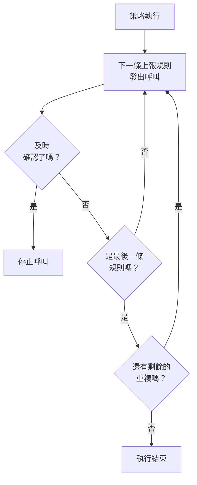

# 待命策略

待命策略決定針對事件或警示呼叫誰，以及如果無人確認，下一個是誰。它的上報規則就是它的級別，使用它的事件、警示和片段會執行它。本頁介紹如何建立策略、什麼會執行策略、策略頁面顯示什麼，以及每次執行如何被記錄。

:::cards
- [建立策略](#建立策略): 一個名稱，以及首先呼叫誰。
- [什麼會執行策略](#什麼會執行策略): 規則、範本、監測器、聊天和你自己。
- [執行日誌](#執行日誌): 每次執行，依規則逐條記錄，以及它為何停止。
- [封存或刪除策略](#封存或刪除策略): 讓策略停止服務。
:::

## 建立策略

:::steps
1. 前往 **待命 → 待命策略** ，點選 **建立待命策略** 。
2. 輸入 **名稱** ，例如「支付主要待命」。
3. 在 **首先通知誰？** 下點選 **新增回應者** ，選擇首先要呼叫的待命排程、團隊和人員。
4. 點選 **建立待命策略** 。策略會在其 **上報規則** 頁面開啟， **Level 1** 已經就位。
:::

**首先通知誰？** 是選填的，並且只會向可以新增上報規則的人顯示：留空時，策略在擁有規則之前不會呼叫任何人。 **描述** 和 **標籤** 位於 **更多欄位** 下。要新增後續級別，請參閱 [上報規則](/docs/on-call/escalation-rules)。

**待命策略** 清單顯示每個策略的 **名稱** 、 **描述** 、 **標籤** 和 **擁有者** 。選取策略後可以執行 **Add Labels** 、 **Remove Labels** 、 **Add Owner** 、 **Remove Owner** 、 **封存** 、 **匯出JSON** 或刪除。 **Import JSON** 從匯出檔建立策略：匯出檔包含策略本身的設定，不包含其上報規則或擁有者。

## 什麼會執行策略

在有東西執行策略之前，策略不會呼叫任何人。每個事件、警示和片段在建立後會立即執行它擁有的策略：

| 來源 | 如何新增策略 | 了解更多 |
| --- | --- | --- |
| 記錄本身 | 建立事件或警示時的 **待命策略** 欄位、事件範本，或監測器條件中的 **待命** 收合區 | [宣告事件](/docs/incidents/declaring-incidents) |
| 待命規則 | **事件 → 規則 → 待命規則** 和 **警示 → 規則 → 待命規則** 會新增每條相符規則的策略 | [事件待命規則](/docs/incidents/settings#事件待命規則) |
| 分組規則 | 分組規則在開啟片段時執行它自己的策略 | [警示片段與分組規則](/docs/alerts/episodes) |
| 手動 | 動態的 **操作** 選單中，或 Slack、Microsoft Teams 訊息上的 **執行待命策略** | [事件動態](/docs/incidents/notes-owners-and-feed#事件動態) |
| 聊天和工作流程 | Slack 或 Microsoft Teams 中的 `/oneuptime page` ，以及工作流程的 **Page an On-Call Policy** 步驟 | [Paging](/docs/workflows/components#paging) |

多條規則新增的同一個策略只執行一次。嚴重性本身從不執行策略：執行策略的是與該嚴重性相符的待命規則。建立時即已確認或已解決的事件或警示不會執行任何策略。設定為 **僅在工作時間內** 的待命規則會讓它新增的策略等到工作時間開始。

## 策略的頁面

從清單中開啟一個策略。它的側邊選單包含關於它的一切：

| 區段 | 頁面 |
| --- | --- |
| **基礎** | **概覽** 、 **上報規則** 和 **擁有者** |
| **日誌** | **執行日誌** 和 **通知日誌** |
| **開發者** | **Terraform** 、 **API** 和 **AI 助理** |
| **進階** | **使用者覆寫** 、 **自訂欄位** 、 **設定** 、 **稽核日誌** 和 **刪除策略** |

**基礎** 預設展開；其他區段在你點選之前都是收合的。

- **概覽** 顯示 **待命策略詳細資訊** ，然後是 **Policy at a glance** ：策略有多少級別和回應者、到最後一級需要多久，以及重複多少次。 **Responder readiness** 說明它能呼叫的每個人現在是否都能聯絡到， **待命策略動態消息** 列出變更：新增或移除的人員、團隊和待命排程，覆寫和交接。
- **擁有者** 是對策略負責的人員和團隊。當策略發出的呼叫找不到某人的規則或無法送達時，他們會收到電子郵件；沒有擁有者的策略會改為寄電子郵件給專案擁有者。
- **通知日誌** 列出策略寄送的每則訊息，每個管道一個分頁。
- **使用者覆寫** 只在此策略中為人員安排代班。請參閱 [使用者覆寫](/docs/on-call/user-overrides)。
- **設定** 中有 **匯出待命策略** 和用於封存策略的卡片。

## 重複策略

當最後一級的等待時間結束仍無人確認時，策略會停止，除非它設定為重複。要選擇，請開啟策略的 **上報規則** 頁面，點選規則下方 **重複策略** 卡片上的 **編輯** 。 **編輯重複策略** 會詢問 **如果最後一個層級之後仍無人確認** 時怎麼做：

| 回答 | 作用 |
| --- | --- |
| **停止通知** | 不再通知任何人，因此策略只執行一次。新策略預設使用此回答。 |
| **從 Level 1 重新開始** | 依序再次通知每個層級。 **再重複幾次？** 決定次數：1 次或更多。 |

再重新開始三次的策略總共會走完四遍所有層級。卡片上的 **最後一個層級之後** 一列說明策略會做什麼， **概覽** 上的 **Policy at a glance** 會用文字說明同樣的內容。

## 未解決時再次通知

確認會徹底停止策略的通知，即使之後無人解決該事件或警示。策略也可以改為再次通知：開啟策略的 **上報規則** 頁面，開啟底部的 **更多設定** ，然後點選 **確認後逾時** 卡片上的 **編輯** 。 **編輯確認後逾時** 會詢問 **如果已確認但未解決** 時怎麼做：

| 回答 | 作用 |
| --- | --- |
| **不再通知** | 確認後將徹底停止通知。新策略預設使用此回答。 |
| **再次通知** | 通知確認者和目前的待命人員。 **幾分鐘後？** 決定時間：5 到 1440 分鐘，初始為 30。 |

分鐘數從每次確認開始計算，同一策略針對同一事件、警示或片段最多再次通知 5 次。再次通知從確認時正在通知的層級開始，呼叫該層級目前的待命人員，然後像第一次執行一樣逐級進行。事件或警示保持已確認狀態：再次通知是一次獨立的執行，顯示在其動態和策略的執行日誌中，其 **狀態** 顯示「已再次通知（第 1 次，共 5 次）」。

被再次通知的人可以透過訊息，或在事件或警示頁面上點選 **再次確認** 來確認，分鐘數隨即重新計算； **升級** 會將其交給下一個層級。解決或刪除事件或警示、封存或刪除策略，或選擇 **不再通知** 都會停止它。卡片上的 **確認之後** 一列說明策略會做什麼，摺疊時 **更多設定** 也會顯示分鐘數。 **概覽** 上的 **Policy at a glance** 和 **Escalation summary** 也會用文字說明同樣的內容。

## 執行日誌

策略每次執行都會寫入一筆執行日誌，日誌會隨著執行的推進經歷各個狀態：

| 狀態 | 含義 |
| --- | --- |
| **等待中** | 設定為 **僅在工作時間內** 的待命規則會讓執行等到工作時間開始：它會說明何時開始呼叫，在此之前不呼叫任何人；如果事件或警示先被確認或解決，它會不經呼叫就結束。如果事件或警示發生變化，從而與一條立即呼叫的待命規則相符，它會立刻開始呼叫。 |
| **已排定** 、 **已開始** | 正在準備執行。5 分鐘後仍處於此狀態的執行會以 **錯誤** 停止。 |
| **Executing** | 執行正在呼叫。OneUptime 每分鐘推進一次。 |
| **Execution Completed** | 有人確認了、事件或警示已解決、所有規則和重複都已用完，或者策略已封存。 |
| **Execution Completed - No One Notified** | 執行經過了每條規則，卻沒有呼叫任何人：通常是某個待命排程中無人待命。 |
| **錯誤** | 執行失敗。 **檢視狀態訊息** 會說明原因。 |

你可以在三個地方找到執行日誌：

- 策略自己的 **執行日誌** ，位於 **日誌** 下；
- **待命 → 進階 → 執行日誌** ，包含所有策略，來自工作流程和聊天的直接呼叫顯示為 **直接呼叫** ；
- 事件或警示的 **待命執行** 頁面。

每一列顯示是什麼觸發了執行、觸發時間、它的 **狀態** 以及誰確認了它。 **View Timeline** 會開啟它的 **執行時間軸** ：每條上報規則、它呼叫了誰、透過哪個待命排程，以及每次呼叫的結果。無人待命的待命排程會顯示 **No one was on call** ，而不是某個人。在 OneUptime Cloud 上，執行日誌需要 **Growth** 方案。

## 封存或刪除策略

封存會讓策略停止服務，同時保留所有內容：開啟策略的 **設定** ，在封存卡片上點選 **封存** ，或者在清單中選取策略並選擇 **封存** 。

- 已封存的策略不會呼叫任何人。使用它的事件和警示會略過它，仍在上報的執行會在下一步停止。
- 它會從 **待命策略** 清單移到 **待命 → 進階 → 已封存策略** ，在那裡點選 **取消封存** 可以讓它重新投入使用。

**進階** 下的 **刪除策略** 會刪除策略及其上報規則和使用者覆寫。從清單中刪除時會先要求確認，並建議改為封存。

## 誰可以變更策略

**Project Owner** 、 **Project Admin** 、 **Project Member** 、 **On-Call Admin** 和 **On-Call Member** 可以建立、變更和刪除策略； **Viewer** 和 **On-Call Viewer** 可以檢視。在自訂角色中，權限名稱為 **Create On-Call Duty Policy** 、 **Edit On-Call Duty Policy** 、 **Delete On-Call Duty Policy** 和 **Read On-Call Duty Policy** ，限定於某些標籤的角色只能存取帶有這些標籤的策略。在 OneUptime Cloud 上，新增擁有者和自訂欄位需要 **Growth** 方案。

## API 和 Terraform

待命策略是 `/api/on-call-duty-policy` 資源，在 Terraform 中是 `oneuptime_on_call_policy` 資源：

| 設定 | API 欄位 |
| --- | --- |
| **名稱** | `name` |
| **描述** | `description` |
| **如果最後一個層級之後仍無人確認** | `repeatPolicyIfNoOneAcknowledges` |
| **再重複幾次？** | `repeatPolicyIfNoOneAcknowledgesNoOfTimes` |
| **幾分鐘後？** | `acknowledgementTimeoutInMinutes` |
| 已封存 | `isArchived` |

`repeatPolicyIfNoOneAcknowledges` 為 `false` 表示 **停止通知** ，為 `true` 表示 **從 Level 1 重新開始** 。為 `true` 時， `repeatPolicyIfNoOneAcknowledgesNoOfTimes` 必須是 1 或更大的整數：OneUptime 會拒絕 `0` 。以前以 `0` 儲存的策略永遠不會重複，儀表板會將其顯示為 **停止通知** 。

`acknowledgementTimeoutInMinutes` 為 `null` 表示 **不再通知** ，為 5 到 1440 之間的整數分鐘表示 **再次通知** 。OneUptime 會拒絕其他任何值。

要在一個請求中建立帶有第一級的策略，請參閱 [使用 API 或 Terraform 建立規則](/docs/on-call/escalation-rules#使用-api-或-terraform-建立規則)。

## 疑難排解

:::details 策略執行了，但沒有呼叫任何人
它的執行顯示 **Execution Completed - No One Notified** 。開啟 **View Timeline** ：顯示 **No one was on call** 的列指向有空缺的待命排程，而 **已略過** 列的狀態訊息會說明原因，例如某人不在崗且無人代班。 **待命 → 就緒狀態** 會顯示哪些人無法聯絡到。
:::

:::details 下一級在等待時間結束一分鐘後才被呼叫
OneUptime 每分鐘推進一次正在執行的策略，所以某一級會在等待時間結束後的第一次檢查時被呼叫。
:::

:::details 事件上列出了一個沒有呼叫任何人的策略
該策略已封存：已封存的策略仍會保留在使用它的事件和警示上，但不會呼叫任何人，其執行日誌會說明它未被執行。在 **待命 → 進階 → 已封存策略** 下取消封存。
:::

## 後續步驟

:::cards
- [上報規則](/docs/on-call/escalation-rules): 新增策略呼叫的各個級別，以及每一級等待多久。
- [使用者覆寫](/docs/on-call/user-overrides): 某人不在崗時，把其呼叫轉給同事。
- [就緒狀態與報告](/docs/on-call/readiness): 檢查策略呼叫的每個人都能聯絡到。
:::
