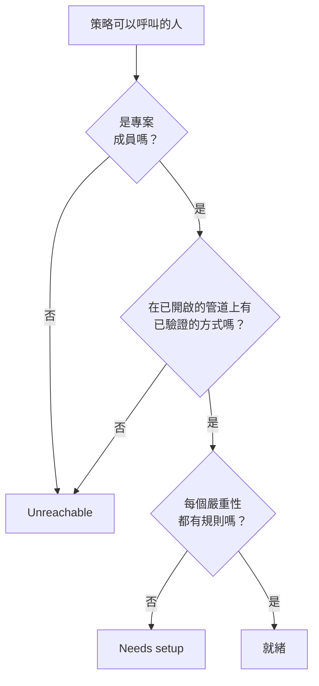

# 就緒狀態與報告

就緒狀態在事件發生之前回答一個問題：如果現在就有事情觸發，你的待命策略要呼叫的每個人真的能被聯絡到嗎？它列出專案中的每個回應者，說明誰已就緒、誰沒有，並讓你提醒大家完成設定。 **使用者待命時間** 報告則顯示每個人待命了多久。

:::cards
- [狀態如何判定](#狀態如何判定): 就緒、Needs setup 或 Unreachable，以及原因。
- [就緒狀態頁面](#就緒狀態頁面): 專案中的每個回應者，集中在一份清單中。
- [提醒大家完成設定](#提醒大家完成設定): 一封說明缺少什麼的電子郵件。
- [使用者待命時間](#使用者待命時間): 每個人待命了多久。
:::

## 狀態如何判定

回應者是待命策略可以呼叫的任何人：上報規則中指定的人、規則呼叫的團隊的成員、規則呼叫的待命排程中某一層裡的人，以及尚未結束的使用者覆寫中的代班人。沒有任何策略呼叫的待命排程不會新增任何人。

| 狀態 | 含義 |
| --- | --- |
| **就緒** | 此人在專案已開啟的管道上有已驗證的方式，並且在其待命規則的每個分頁上，每個嚴重性都有規則。 |
| **需要設定** | 可以聯絡到此人，但有些嚴重性沒有規則。該列會統計這些缺口。 |
| **無法連線** | 什麼都聯絡不到此人：沒有已驗證的方式、每個已驗證的方式都在專案已關閉的管道上，或者此人不是專案成員。 |

缺口是指在事件、事件片段、警示或警示片段分頁上沒有規則的嚴重性。刻意關閉某個嚴重性的規則不算缺口。遇到缺口的呼叫仍會透過已驗證的方式送達此人，除非專案關閉了這種備援行為：請參閱 [沒有相符的規則時](/docs/notifications/index#沒有相符的規則時)。

## 就緒狀態頁面

開啟 **待命 → 就緒狀態** 。 **On-call readiness** 卡片列出專案中任何待命策略能夠聯絡到的每個人，需要處理的人排在前面。專案中的任何人都可以開啟它。

清單上方的方塊統計 **回應者** 、 **就緒** 、 **需要設定** 和 **無法連線** 。點選 **就緒** 、 **需要設定** 或 **無法連線** 只列出這些回應者，再次點選則列出所有人。

| 欄 | 顯示內容 |
| --- | --- |
| **回應者** | 此人及其電子郵件地址。 |
| **狀態** | **就緒** 、 **無法連線** ，或此人有多少個缺口。 |
| **管道** | 每個管道一段：已驗證的方式為實心，尚未驗證的為空心。 |
| **Coverage** | 在每個分頁上都有規則的嚴重性數量，佔全部嚴重性的多少。 |
| **Reached via** | 策略如何聯絡到此人：透過上報規則呼叫此人的團隊顯示為其名稱，否則為 **Direct** 、 **排程** 或 **覆寫** 。 |

列上的 **Coverage** 會顯示此人的通知方式、此人為何是該狀態，以及顯示每個嚴重性有無規則的格線。漏斗圖示可依 **回應者** 、 **狀態** 、 **團隊** 或 **Reached via** 篩選清單。結果可能是一分鐘前的： **重新整理** 會重新判定。

## 提醒大家完成設定

只有本人才能新增和驗證自己的通知方式和規則，所以解決辦法是請他們去做。

:::steps
1. 在就緒狀態頁面，勾選要提醒的回應者。已就緒的回應者無法勾選：沒有需要提醒的內容。
2. 點選 **傳送設定提醒** 。確認框會列出即將收到電子郵件的每個人。
3. 確認。每個人都會收到一封電子郵件，說明其設定中缺少什麼，並附上修正它的頁面連結。
:::

隨後，橫幅會顯示有多少提醒已寄出、已略過或失敗，以及每個未寄出提醒的原因。同一個人在 24 小時內最多被提醒一次，一次最多提醒 250 人。寄送提醒需要 **專案擁有者** 、 **專案管理員** 或 **待命管理員** ，或者自訂角色中的 **Edit On-Call Duty Policy** 。

## 其他頁面上的就緒狀態

- 在策略的 **概覽** 上， **回應者就緒狀態** 列出該策略可以呼叫的、需要處理的每個人， **重新檢查** 會重新讀取。你自己的那一列有一個按鈕，通往修正它的頁面；其他人的那一列會在你自己的郵件應用程式中開啟一封寫給此人的電子郵件，其中附有修正方法。
- 在策略的 **上報規則** 上，如果某一級的回應者不能全部被呼叫，該級的卡片上會註明。請參閱 [上報概要](/docs/on-call/escalation-rules#上報概要)。
- 在 **使用者** 下開啟一位成員，然後開啟 **待命** 區段中的 **就緒狀態** ：此人的狀態、方式和嚴重性格線。
- 對於你自己的設定， **使用者設定 → 設定檢查清單** 會引導你逐步完成。請參閱 [設定檢查清單](/docs/notifications/index#設定檢查清單)。

## 每週就緒狀態電子郵件

OneUptime 每週檢查一次每個擁有待命策略的專案。當其中有人處於 **無法連線** 或 **需要設定** 時，專案擁有者會收到一封電子郵件，把這些人分成兩組列出：完全無法呼叫的人，以及可以聯絡到但有缺口的人，每組最多 20 個名字，並附上就緒狀態頁面的連結。

所有人都已就緒的那一週不會寄送任何內容，所以這封電子郵件總是代表有需要修正的地方。當有人完全無法呼叫時，郵件主旨以 `[Action Required]` 開頭。

## 使用者待命時間

**待命 → 報告 → 使用者待命時間** 顯示每個人在你選擇的時間範圍內待命了多久：初始為 **過去 1 個月** 。

| 欄 | 顯示內容 |
| --- | --- |
| **使用者** | 此人。 |
| **使用者待命的時間** | 此人在該時間範圍內的待命時間，以小時和分鐘計。 |

時間會在人員上崗和下崗時記錄：從規則呼叫的待命排程把班次交給此人，或此人被直接或透過團隊新增到規則時開始，直到交接或被移除為止。同時透過兩個策略待命的時間只計算一次，仍在進行的時間計算到現在。

**待命時間軸** 和行事曆訂閱依今天的輪替設定顯示過去的班次。此報告是在事情發生時寫入的，所以請將它用於公平性評估和待命津貼。

> [!NOTE]
> 在 OneUptime Cloud 上，此報告需要 **Growth** 方案，結束於 200 天以前的時間會被刪除。自行託管的安裝會保留全部資料。

## 疑難排解

:::details 有人顯示為無法聯絡，但有已驗證的電話號碼
此人的方式可能都位於專案已關閉的管道上：在新專案中，簡訊、電話、WhatsApp 和 Telegram 預設是關閉的。請參閱 [為專案開啟管道](/docs/notifications/notification-methods#為專案開啟管道)。
:::

:::details 清單中缺少某人
清單只包含待命策略可以呼叫的人。尚未接受邀請的團隊成員、位於沒有任何策略呼叫的待命排程中的人，以及其覆寫已結束的代班人都不在其中。
:::

:::details 擁有者從未收到每週電子郵件
只有在某一週有人處於 **無法連線** 或 **需要設定** 時才會寄送，並且只寄給專案擁有者。
:::

## 後續步驟

:::cards
- [OneUptime 如何聯絡你](/docs/notifications/index): 每個狀態背後的方式、規則和備援行為。
- [通知方式](/docs/notifications/notification-methods): 新增並驗證 OneUptime 聯絡某人的方式。
- [個人待命規則](/docs/notifications/on-call-rules): 逐個嚴重性補上缺口。
:::
