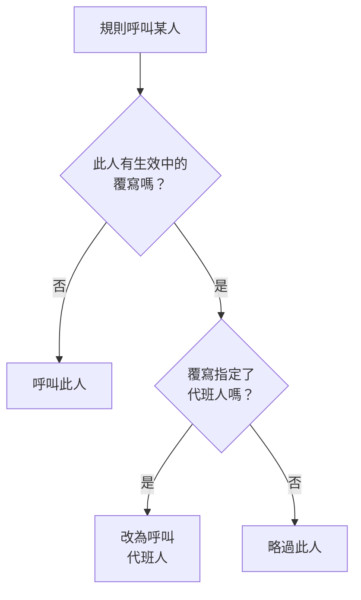

# 使用者覆寫

當某人不在崗時，使用者覆寫會在一段設定的時間內，把本應送給此人的呼叫轉給代班的人。如果沒有指定代班人，它會改為略過此人：此人在待命排程中的每個班次都會交給輪替中的下一個人。可用於休假、病假或換班。

:::cards
- [覆寫如何改變呼叫](#覆寫如何改變呼叫): 改為呼叫誰，以及何時。
- [新增覆寫](#新增覆寫): 誰不在崗、誰代班、從何時到何時。
- [所有策略，或單一策略](#所有策略或單一策略): 在哪裡新增覆寫，以及哪個優先。
- [其他新增方式](#其他新增方式): 從待命排程，以及從你即將到來的班次。
:::

## 覆寫如何改變呼叫



覆寫生效期間，從開始到結束：

- 如果 **誰代班？** 中指定了人，此人會收到不在崗者的全部呼叫，來自覆寫適用的每個待命排程、團隊和規則。呼叫會透過代班人自己的個人待命規則送達。
- 如果沒有代班人，就略過此人。在待命排程中，此人的每個班次都會交給輪替中下一個在崗的人；如果某一層的所有人都不在崗，則由下面的層接手。直接或透過團隊指定此人的規則不會呼叫此人，策略的執行會說明此人不在崗以及到何時為止。
- 覆寫不會連鎖。如果代班人自己也不在崗，被代班者的呼叫仍然會送給代班人。

覆寫結束後，呼叫重新歸此人所有。 **待命時間軸** 、待命排程的層和行事曆訂閱都會顯示每個被代的班次由誰負責。

## 新增覆寫

:::steps
### 開啟覆寫

要在所有待命策略中為某人安排代班，請前往 **待命 → 進階 → 使用者覆寫** ；要只在某個策略中安排代班，請前往該策略自己的 **使用者覆寫** 頁面，它位於 **進階** 下。點選 **新增使用者覆寫** 。

### 說明誰不在崗

**誰不在崗？** 預設是你自己，因為登記自己的休假是最常見的情況。選擇其他人即可為其安排代班。

### 說明誰代班

將 **誰代班？** 保留為 **輪換中的下一個人** 可以略過此人，或者選擇接手其全部呼叫的同事。不在崗的人不會出現在選項中。

### 設定時間

除非你選擇其他時間，否則 **開始** 為現在。把 **結束** 設為此人回來的時間：它必須晚於開始時間。點選 **新增使用者覆寫** 。
:::

每個覆寫是一列： **不在崗** 、 **代班人** 、 **開始** 和 **結束** ，可依開始和結束時間篩選。略過時， **代班人** 顯示為 **輪換中的下一個人** 。覆寫無法編輯：刪除它再新增一個新的，或者刪除它讓某人提早回來。

## 所有策略，或單一策略

| 新增位置 | 卡片 | 適用範圍 |
| --- | --- | --- |
| **待命 → 進階 → 使用者覆寫** | **全域使用者覆寫** | 專案中的所有待命策略 |
| 策略的 **使用者覆寫** | **待命策略的使用者覆寫** | 僅該策略 |

當同一個人的兩個覆寫重疊時，策略自己的覆寫優先於全域覆寫，指定了代班人的覆寫優先於略過。不經過策略發出的呼叫，例如來自工作流程或聊天的呼叫，只遵循全域覆寫。

## 其他新增方式

- 從待命排程：在待命排程的 **層** 頁面展開一層，點選某人旁邊的 **略過至…** 。它會開啟同一個表單，此人為不在崗，由輪替代班，作為全域覆寫。請參閱 [有人不在崗時](/docs/on-call/schedules#有人不在崗時)。
- 從你即將到來的班次：在 **使用者設定 → 行事曆 → 行事曆訂閱** 下，點選你某個班次上的 **找人代班** ，會開啟表單，你在該班次的時段內為不在崗，只剩下 **誰代班？** 需要填寫。請參閱 [即將到來的班次與代班](/docs/on-call/calendar-feeds#即將到來的班次與代班)。

當某人離開專案時，所有指定了此人且尚未結束的覆寫都會被刪除，無論此人在哪一方。

## 誰可以新增覆寫

**專案擁有者** 、 **專案管理員** 、 **專案成員** 、 **待命管理員** 和 **待命成員** 可以新增和刪除覆寫； **檢視者** 和 **待命檢視者** 可以檢視。在自訂角色中，權限名稱為 **Create On-Call Duty Policy User Override** 、 **Delete On-Call Duty Policy User Override** 和 **Read On-Call Duty Policy User Override** 。在 **待命時間軸** 上，只有可以讀取覆寫的人才能看到誰的班次正在被代。

在 OneUptime Cloud 上，使用者覆寫需要 **Growth** 方案。

## API

使用者覆寫是 `/api/on-call-duty-policy-user-override` 資源：

| 欄位 | 內容 |
| --- | --- |
| `overrideUserId` | 不在崗的人。必填。 |
| `routeAlertsToUserId` | 代班的人。省略它則改為略過此人。 |
| `startsAt`, `endsAt` | 覆寫的開始和結束時間。兩者都必填，且結束晚於開始。 |
| `onCallDutyPolicyId` | 它適用的策略。全域覆寫則省略。 |

```bash
curl -X POST https://oneuptime.com/api/on-call-duty-policy-user-override \
  -H "apikey: $ONEUPTIME_API_KEY" \
  -H "Content-Type: application/json" \
  -d '{
    "data": {
      "projectId": "<project-id>",
      "overrideUserId": "<away-user-id>",
      "routeAlertsToUserId": "<cover-user-id>",
      "startsAt": "2026-12-22T09:00:00Z",
      "endsAt": "2027-01-05T09:00:00Z"
    }
  }'
```

不在崗者與代班人為同一人的覆寫會被拒絕，在開始之前就結束的覆寫也會被拒絕。

## 疑難排解

:::details 休假的人還是被呼叫了
檢查覆寫是在哪裡新增的。在策略的 **使用者覆寫** 頁面新增的覆寫只適用於該策略，其他策略仍會呼叫此人：要涵蓋所有策略，請在 **待命 → 進階 → 使用者覆寫** 下新增。也要檢查 **開始** 和 **結束** ：時間依你的時區顯示。
:::

:::details 代班人也沒有被呼叫
代班人透過自己的個人待命規則和已驗證的方式收到通知。在 **待命 → 就緒狀態** 中查找此人，並在策略的 **執行日誌** 中檢查這次執行。
:::

:::details 我無法新增覆寫
新增覆寫需要上述角色之一，在 OneUptime Cloud 上還需要 **Growth** 方案。
:::

## 後續步驟

:::cards
- [待命排程](/docs/on-call/schedules): 輪替、層，以及在某一層中略過某人。
- [待命時間軸](/docs/on-call/schedule-timeline): 查看所有待命排程中每個被代的班次。
- [行事曆訂閱源](/docs/on-call/calendar-feeds): 為你自己的某個班次找人代班。
:::
