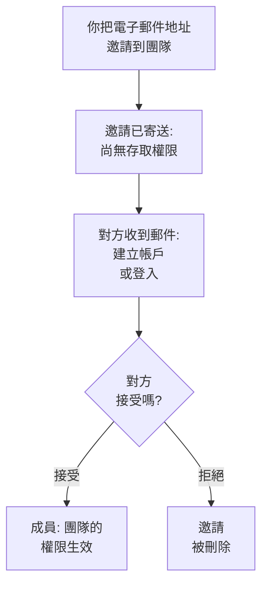

# 邀請成員

人們透過邀請加入專案。你把某人的電子郵件地址邀請到一個團隊，對方接受後，由該團隊決定其能做什麼。本頁說明如何邀請他人、對方會看到什麼，以及之後如何變更或終止其存取權限。

:::cards
- [邀請某人](#邀請某人): 一個電子郵件地址和一個團隊。
- [接受邀請](#接受邀請): 受邀者看到的內容和要做的事。
- [變更某人的團隊](#變更某人的團隊): 給予更多或更少的存取權限。
- [移除某人](#從專案中移除某人): 離開專案會帶走什麼。
:::

## 邀請如何運作

- **團隊決定對方能做什麼。** 沒有人擁有個人權限：一個人能做的，是其所在團隊允許的事。請參閱[使用者、團隊與權限](/docs/permissions/index)。
- **對方接受之前不會授予任何權限。** 待處理的邀請顯示為**邀請已寄送**，不授予對專案的任何存取權限。
- **一次接受涵蓋整個專案。** 接受一個邀請時，此人對同一專案的其他邀請也會全部被接受。之後你再把某位成員加入另一個團隊時，對方會立即加入，無需接受。

## 開始之前

- **可以邀請他人的角色。** Project Owner、Project Admin，或擁有 **Invite New Members** 權限的角色。你只能把人邀請到你自己擁有其權限的團隊，因為邀請會給予對方該團隊的存取權限。
- **在 OneUptime Cloud 上：方案中有空餘席次。** 專案中的每個人從被邀請那一刻起就是帳單上的一個席次。Free 方案只能容納一個人。請參閱[帳單與用量](/docs/configuration/billing#你的方案和席次)。
- **未使用 SCIM Push Groups。** 只要你的身分提供者透過 SCIM Push Groups 管理專案的團隊，就需要在身分提供者中邀請和移除人員，而不是在 OneUptime 中。

## 邀請某人

:::steps
### 開啟使用者清單

前往**產品 → 設定 → 使用者**。**使用者**清單顯示專案中的每個人、他們的團隊以及他們是否已加入。

### 開啟邀請對話方塊

點選**邀請使用者**。**邀請新使用者**對話方塊隨即開啟。

### 輸入電子郵件地址

在**電子郵件**中輸入地址。如果還沒有 OneUptime 帳戶使用該地址，對話方塊還會要求填寫**名稱**，新帳戶將以此名稱建立。

### 選擇團隊

**團隊**預設選取專案的成員團隊：在整個專案中擁有 Project Member 的團隊，否則是名為 Members 的團隊。選擇其他團隊可給予更多或更少的存取權限。如果專案沒有這樣的團隊，或者你自己無法邀請人員加入該團隊，**團隊**會留空。

### 傳送邀請

點選**邀請**。OneUptime 會透過電子郵件傳送邀請並開啟此人的頁面。在邀請被接受之前，此人顯示為**邀請已寄送**。
:::

> [!TIP]
> 把人邀請到能讓其完成工作的最小團隊。之後你可以把他們加入更多團隊，每加入一個團隊，他們能做的事就會增加。

## 接受邀請

邀請郵件會寫明專案名稱。對於還沒有 OneUptime 帳戶的人，郵件中的按鈕是 **Create Your Account**；對於已有帳戶的人，則是 **Sign In to OneUptime**。登入後，對方在以下兩個位置之一接受邀請：

| 對方所處情況 | 看到的內容 | 點選的按鈕 |
| --- | --- | --- |
| 尚未加入任何專案 | 登入後進入的頁面上的邀請 | **Accept & Join** 或 **Decline** |
| 已在另一個專案中 | 右上角鈴鐺上的待處理邀請，點選後開啟**專案邀請** | **接受** 或 **拒絕** |

接受後，對方會立即加入專案，獲得其團隊的權限以及每位成員一開始擁有的通知設定：請參閱[一開始擁有什麼](/docs/notifications/index#一開始擁有什麼)。拒絕會刪除邀請，之後要加入就需要新的邀請。

## 查看專案中的成員

**使用者**中每人一列：

| 欄 | 顯示內容 |
| --- | --- |
| **使用者** | 姓名和電子郵件地址。 |
| **團隊** | 此人所在或受邀加入的專案中的每個團隊。 |
| **狀態** | 加入後顯示**成員**，並附帶尚未接受的其他團隊邀請數量。在此之前顯示**邀請已寄送**。 |

可依**使用者**、**狀態**或**團隊**篩選清單。點選某一列可開啟此人的頁面：

| 頁面 | 用途 |
| --- | --- |
| **個人資料** | 姓名、電子郵件地址、大頭貼和使用者 ID。 |
| **團隊** | 此人所在的團隊。可在此新增或移除團隊。 |
| **就緒狀態**、**通知方式**、**待命規則** | 此人能否被呼叫以及如何呼叫。對 Project Owner、Project Admin、本人以及可以讀取他人通知規則的人顯示。請參閱[就緒狀態與報告](/docs/on-call/readiness)。 |
| **自訂欄位** | 專案為人員設定的自訂欄位（如果有）。 |
| **從專案中移除** | 將此人移出專案。 |

## 變更某人的團隊

:::steps
### 開啟其團隊頁面

在**使用者**中點選此人，然後點選**團隊**。

### 將其加入團隊

點選**邀請**，選擇**團隊**，然後在對話方塊中點選**邀請**。成員會立即加入新團隊。尚未加入的人會再收到一封邀請，接受其中任何一封都會同時接受兩封。

### 將其移出團隊

在該團隊所在列點選**移除**。如果這是此人已加入的最後一個團隊，移除後此人將離開專案，對話方塊會在任何變更發生前說明這一點。
:::

Owners 團隊始終至少保留一名已加入的成員，因此專案永遠不會失去最後一位擁有者。

## 從專案中移除某人

在**使用者**中開啟此人的列選單 **⋯**，然後點選**從專案中移除**。也可以開啟此人，在側邊選單中選擇**從專案中移除**。要一次移除多人，選取他們的列並刪除所選項目：每個人都會以同樣的方式被移除。

移除某人會將其移出專案的所有團隊。即使仍在登入狀態，對方也會立即失去存取權限，被移出專案的待命排程和上報規則，並且不再收到專案的通知。其 OneUptime 帳戶不會被刪除，你可以再次邀請。[使用者、團隊與權限](/docs/permissions/index#使用者)列出了離開專案會帶走的全部內容。

## 其他加入方式

- **單一登入。** 首次透過專案的身分提供者登入的人，會加入身分提供者指定的團隊。請參閱[SSO 使用者的角色和團隊](/docs/identity/sso#sso-使用者的角色和團隊)。
- **SCIM。** 你的身分提供者建立人員，並將其加入連線的預設團隊。請參閱[SCIM](/docs/identity/scim#專案使用者如何被佈建)。
- **Admin Dashboard。** 在自行託管的安裝中，主管理員可以把某人加入專案，並代其接受邀請。請參閱[使用者、團隊與權限](/docs/permissions/index#使用者)。

## 疑難排解

:::details "This user has already been invited to this team"
此人已經在該團隊中，可能是成員，也可能有尚未接受的邀請。在**使用者**中開啟此人查看其團隊，或將其邀請到其他團隊。
:::

:::details "You have reached the user limit for the free plan"
在 OneUptime Cloud 上，使用 Free 方案的專案只能容納一個人。請變更方案，然後再次邀請。請參閱[變更方案](/docs/configuration/billing#變更方案)。
:::

:::details "Too many invitations were sent to this email address in the last hour"
無論由誰寄出，一個地址每小時最多可收到 10 封邀請，專案和私人狀態頁合計。請等待一小時，然後再次邀請。
:::

:::details 邀請郵件沒有送達，或連結已過期
邀請並不依賴郵件。請對方用你邀請的地址註冊：OneUptime 會向該地址傳送一個新連結以完成帳戶建立。已有帳戶的人登入後即可看到等待中的邀請。
:::

:::details 邀請使用者提示使用者由 SCIM Push Groups 管理
你的身分提供者管理著專案的團隊。請在身分提供者中邀請或移除人員，或在**專案設定 → 安全性 → SCIM** 中關閉 Push Groups，以便在這裡管理。
:::

## 後續步驟

:::cards
- [使用者、團隊與權限](/docs/permissions/index): 決定每個團隊能做什麼。
- [專案設定](/docs/configuration/project-settings): 適用於整個專案的所有設定。
- [您的帳戶](/docs/introduction/your-account): 登入、個人資料以及你所屬的專案。
- [SCIM](/docs/identity/scim): 讓你的身分提供者管理人員和團隊。
:::
