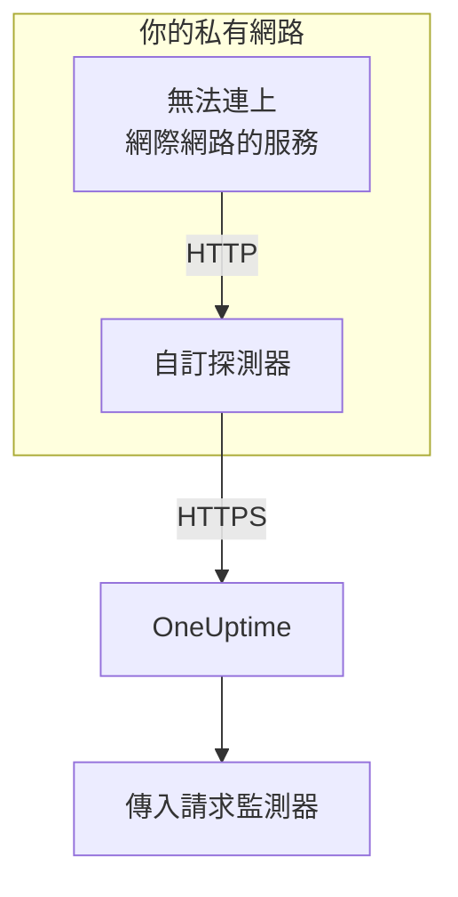

# 傳入請求 Ingress

無法連上網際網路的服務，同樣可以向 [傳入請求監控](/docs/monitor/incoming-request-monitor) 傳送心跳。它改為把心跳傳給同一網路中的 [自訂探測器](/docs/probe/custom-probe)，再由探測器轉送給 OneUptime。

:::cards
- [運作方式](#運作方式): 從你的服務經過探測器，到達監測器。
- [開啟監聽器](#開啟監聽器): 探測器上的一項設定，適用於 Docker、Docker Compose 或 Kubernetes。
- [向探測器傳送請求](#向探測器傳送請求): 只改服務傳送的目標 URL，其他都不用改。
- [疑難排解](#疑難排解): 請求沒有送達時，探測器會記錄什麼。
:::

## 運作方式



1. **你的服務把請求傳給探測器。** 也就是它原本會傳給 OneUptime 的同一個 `GET` 或 `POST`，帶著同樣的秘密金鑰，送往探測器監聽的連接埠。
2. **探測器立即回應。** 它在轉送請求之前就傳回 `200`，所以你的服務永遠不必等待 OneUptime。
3. **探測器轉送請求。** 它把請求連同方法、標頭和本文送給 OneUptime，並加上一個標示該探測器的 `OneUptime-Probe-Id` 標頭。
4. **OneUptime 照常讀取。** 監測器的條件看到的請求，就像服務直接傳送的一樣。

監聽器在自己專用的連接埠上執行，與探測器的健康檢查分開，因此你可以只把它開放給私有網路，而不開放其他任何東西。

## 何時使用

在以下情況下使用監聽器：

- 你的服務執行在沒有對外 HTTPS 存取的隔離網段中
- 你需要把所有監控流量都留在你的 VPC 或內部網路中
- 你希望只有一個出口（探測器）可以連到 OneUptime
- 你已經部署了 [自訂探測器](/docs/probe/custom-probe)，並想把它也用於傳入心跳

如果你的服務已經能直接連到 `https://oneuptime.com`（或你的自行託管網址），你 **不** 需要這個功能：直接從服務呼叫心跳 URL 即可。

## 開始之前

- **一個正在執行的自訂探測器。** 它的 **狀態** 顯示 **已連線** 。安裝方法請參閱 [自訂探針](/docs/probe/custom-probe)。
- **一個傳入請求監測器。** 它的心跳 URL 中包含你的服務要傳送的秘密金鑰：請參閱 [傳入請求監控](/docs/monitor/incoming-request-monitor)。
- **探測器主機上一個服務能連到的連接埠。** 範例中使用 `3875`。

## 開啟監聽器

把 `PROBE_INGRESS_PORT` 設為監聽器要使用的連接埠。任何大於 `0` 的值都會開啟它；不設定或設為 `0` 時保持關閉。

:::tabs
@tab Docker
```bash
docker run --name oneuptime-probe --network host \
  -e PROBE_KEY=<probe-key> \
  -e PROBE_ID=<probe-id> \
  -e ONEUPTIME_URL=https://oneuptime.com \
  -e PROBE_INGRESS_PORT=3875 \
  -d oneuptime/probe:release
```

不使用 `--network host` 時，請用 `-p 3875:3875` 發佈該連接埠。
@tab Docker Compose
```yaml title="docker-compose.yml"
services:
  oneuptime-probe:
    image: oneuptime/probe:release
    container_name: oneuptime-probe
    environment:
      - PROBE_KEY=<probe-key>
      - PROBE_ID=<probe-id>
      - ONEUPTIME_URL=https://oneuptime.com
      - PROBE_INGRESS_PORT=3875
    network_mode: host
    restart: always
```

不使用 `network_mode: host` 時，請在 `ports:` 下以 `"3875:3875"` 發佈該連接埠。
@tab Kubernetes
```yaml title="oneuptime-probe.yaml"
apiVersion: apps/v1
kind: Deployment
metadata:
  name: oneuptime-probe
spec:
  selector:
    matchLabels:
      app: oneuptime-probe
  template:
    metadata:
      labels:
        app: oneuptime-probe
    spec:
      containers:
        - name: oneuptime-probe
          image: oneuptime/probe:release
          env:
            - name: PROBE_KEY
              value: "<probe-key>"
            - name: PROBE_ID
              value: "<probe-id>"
            - name: ONEUPTIME_URL
              value: "https://oneuptime.com"
            - name: PROBE_INGRESS_PORT
              value: "3875"
          ports:
            - name: ingress
              containerPort: 3875
---
apiVersion: v1
kind: Service
metadata:
  name: oneuptime-probe-ingress
spec:
  selector:
    app: oneuptime-probe
  ports:
    - name: ingress
      port: 3875
      targetPort: 3875
  type: ClusterIP
```

之後，叢集內的服務向 `http://oneuptime-probe-ingress.<namespace>.svc.cluster.local:3875/heartbeat/<secret-key>` 傳送。
:::

監聽器啟動後，探測器的記錄中會出現 `Probe ingress listener started on port 3875 (heartbeat / incoming-request endpoints)`。

## 向探測器傳送請求

你的服務改為向探測器傳送，而不是 OneUptime。把公開的心跳 URL：

```text
https://oneuptime.com/heartbeat/<secret-key>
```

換成探測器的 ingress URL：

```text
http://<probe-host>:<PROBE_INGRESS_PORT>/heartbeat/<secret-key>
```

路徑、方法、本文和標頭在其他方面完全相同，所以現有的用戶端程式碼只需修改基礎 URL。探測器也接受 `/incoming-request/<secret-key>`，效果相同。

```bash
# GET heartbeat
curl http://probe.internal:3875/heartbeat/YOUR_SECRET_KEY

# POST heartbeat with JSON body
curl -X POST http://probe.internal:3875/heartbeat/YOUR_SECRET_KEY \
  -H "Content-Type: application/json" \
  -d '{"status": "healthy", "version": "1.2.3"}'

# Cron job
*/5 * * * * curl -s http://probe.internal:3875/heartbeat/YOUR_SECRET_KEY > /dev/null
```

## 請求如何轉送

| 項目 | 探測器如何處理 |
| --- | --- |
| 回應 | 在轉送請求之前，傳回帶空 JSON 物件（`{}`）的 `200`。與 OneUptime 一樣，無論之後發生什麼都會傳回：錯誤的秘密金鑰也會收到它。 |
| 方法 | `POST` 以 `POST` 轉送。`GET` 和 `HEAD` 以 `GET` 轉送。其他方法會從探測器收到 `404`。 |
| 標頭 | 除逐跳標頭（`Host`、`Connection`、`Content-Length`、`Transfer-Encoding`、`Keep-Alive`、`Proxy-Authenticate`、`Proxy-Authorization`、`TE`、`Trailer`、`Upgrade`）和 `Content-Encoding` 之外的全部標頭，因為探測器轉送的是未壓縮的本文。探測器會加上 `OneUptime-Probe-Id`。 |
| 本文 | 最大 50 MB 的 JSON 和表單本文，與直接傳給 OneUptime 時相同。同樣地，其他本文到達監測器時為空。 |
| 重試 | 轉送失敗時，探測器最多重試 `PROBE_INGRESS_FORWARD_RETRY_LIMIT` 次，依序等待 2 秒、4 秒、8 秒，最長不超過 15 秒。之後記錄失敗並捨棄該請求。 |
| Proxy | 設定了 `HTTP_PROXY_URL` 或 `HTTPS_PROXY_URL` 時，轉送會經過探測器的 Proxy。 |
| 轉送目標 | `ONEUPTIME_URL` 加上 `/incoming-request-ingest/incoming-request/<secret-key>`。 |

## 環境變數

| 變數 | 預設值 | 作用 |
| --- | --- | --- |
| `PROBE_INGRESS_PORT` | 未設定（關閉） | 監聽器使用的連接埠。任何大於 `0` 的值都會開啟它。 |
| `PROBE_INGRESS_FORWARD_TIMEOUT_MS` | `10000` | 每次轉送到 OneUptime 可用的時間，單位為毫秒。小於 `1000` 的值會回到預設值。 |
| `PROBE_INGRESS_FORWARD_RETRY_LIMIT` | `3` | 失敗的轉送重試的次數。`0` 會關閉重試。 |

探測器的一般變數（`PROBE_KEY`、`PROBE_ID`、`ONEUPTIME_URL` 和 Proxy 變數）全部適用：完整清單請參閱 [自訂探針](/docs/probe/custom-probe)。

## 安全性考量

- **此端點依設計不做身分驗證** ：URL 路徑中的秘密金鑰 *本身* 就是身分驗證，與公開的 `oneuptime.com` 端點相同。請像對待密碼一樣對待這個秘密金鑰。
- **把監聽器限制在私有網路內。** 它不應該能從網際網路連到。請用網路原則、防火牆規則或 `ClusterIP` 服務限制誰能連到它。
- **如果網路內需要加密，請在它前面加上 TLS。** 監聽器使用明文 HTTP。若要在這一段使用 TLS，請把它放在內部負載平衡器或 Ingress 控制器之後。當 `ONEUPTIME_URL` 以 `https://` 開頭時，從探測器到 OneUptime 的轉送使用 HTTPS。
- **如果 50 MB 太大，請自行限制本文大小。** 在監聽器前面放一個限制更低的反向 Proxy。

## 疑難排解

:::details 探測器記錄從未顯示監聽器已啟動
`PROBE_INGRESS_PORT` 未設定、為 `0` 或不是數字。請把它設為一個連接埠號碼，並重新啟動探測器。記錄行是 `Probe ingress listener started on port <port> (heartbeat / incoming-request endpoints)`。
:::

:::details 探測器記錄 `Probe ingress: failed to forward to <url> after N attempts`
探測器在重試之後仍無法連到 OneUptime。請檢查探測器的對外連線、Proxy 設定和 `ONEUPTIME_URL` 的值。如果探測器也顯示 **已中斷** ，請參閱 [自訂探針](/docs/probe/custom-probe)，找出它的請求卡在哪裡。
:::

:::details 探測器記錄 `Probe ingress: probe ID not available, forwarding without it`
探測器還沒有完成與 OneUptime 的連線，因此在沒有 `OneUptime-Probe-Id` 標頭的情況下轉送請求。請求仍會到達監測器。
:::

:::details 監測器收到了請求，但不是經過探測器
你的服務仍在向公開 URL 傳送。請確認它送往 `http://<probe-host>:<port>/...`：指向別處的 DNS 名稱或 `/etc/hosts` 項目是常見原因。
:::

:::details 監測器什麼都沒收到，探測器也什麼都沒記錄
請求從未到達探測器。請檢查服務能否透過該連接埠連到探測器的主機：可能是防火牆規則、未發佈的連接埠，或沒有選中探測器 Pod 的 Kubernetes Service。
:::

## 後續步驟

:::cards
- [傳入請求監控](/docs/monitor/incoming-request-monitor): 決定什麼樣的心跳算正常。
- [自訂探針](/docs/probe/custom-probe): 安裝探測器，並查看它讀取的每個設定。
:::
