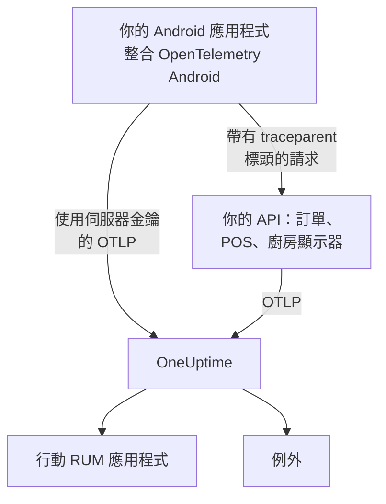

# Android 端設定

使用 OpenTelemetry Android 檢測原生 Android 應用程式，讓它以行動 RUM 應用程式的身分向 OneUptime 回報：當機和 ANR、緩慢影格和凍結影格、應用程式啟動、畫面、工作階段，以及一路追蹤到你的後端的網路請求。

:::cards
- [加入 OpenTelemetry Android](#加入-opentelemetry-android): 一個 Gradle 相依項目，以及應用程式啟動時執行的幾行程式碼。
- [回報的內容](#回報的內容): 當機、ANR、凍結影格、啟動和工作階段，以及它們各自出現在哪裡。
- [追蹤傳往後端的請求](#追蹤傳往後端的請求): 每個 OkHttp 呼叫一個 span，並在其上帶有 `traceparent` 。
- [追蹤你自己的工作流程](#追蹤你自己的工作流程): 從菜單到廚房的一筆訂單、付款終端機、印表機。
- [自助服務機及你擁有的其他裝置](#自助服務機及你擁有的其他裝置): 為每台裝置命名、透過 MDM 設定，離線時也保留資料。
:::

## 運作方式

OpenTelemetry Android 在你的應用程式內執行。它使用 **伺服器** 擷取金鑰，透過 OTLP 將追蹤、日誌和指標傳送到 OneUptime，並在應用程式發出的請求上加入 W3C `traceparent` 標頭，讓後端的 span 加入應用程式的追蹤。



## 開始之前

- 一個 `minSdk` 為 23 或更高、以 `compileSdk` 34 或更高版本建置的 Android 應用程式。如果 `minSdk` 低於 26，請開啟 [核心程式庫脫糖](https://developer.android.com/studio/write/java8-support#library-desugaring) ，並使用 Android Gradle Plugin 8.3.0 或更新版本，在 `gradle.properties` 中設定 `android.useFullClasspathForDexingTransform=true` 。
- 一個 **伺服器** 擷取金鑰，在 **專案設定 → 遙測與 APM → 擷取金鑰** 中以 **建立擷取金鑰** 建立。應用程式送出的 **瀏覽器** 金鑰會被拒絕：它要依 `Origin` 標頭檢查，而應用程式不會傳送這個標頭。
- 下列 OTLP 設定。如果你自行託管 OneUptime，請把 `https://oneuptime.com` 換成你自己的主機。

| 設定 | 值 |
| --- | --- |
| OTLP 端點 | `https://oneuptime.com/otlp` |
| 標頭 | `x-oneuptime-token: YOUR_TELEMETRY_INGESTION_TOKEN` |

> [!WARNING]
> 金鑰會隨應用程式一起發布，而應用程式可以被解開，所以請假設有人會複製它。在金鑰的頁面上設定 **固定的服務名稱** 、 **Requests Per Minute Limit** 和 **到期於** 日期，並隨每次發布輪替金鑰。

## 加入 OpenTelemetry Android

:::steps
### 加入相依項目

```kotlin title="app/build.gradle.kts"
dependencies {
    implementation("io.opentelemetry.android:android-agent:1.8.1")
}
```

代理程式本身就帶有當機、ANR、算繪緩慢、Activity、Fragment、網路和工作階段的檢測。請到 [它的發行版本頁面](https://github.com/open-telemetry/opentelemetry-android/releases) 查看是否有更新的版本。

### 在應用程式啟動時啟動它

```kotlin title="KioskApplication.kt"
import android.app.Application
import io.opentelemetry.android.OpenTelemetryRum
import io.opentelemetry.android.agent.OpenTelemetryRumInitializer

class KioskApplication : Application() {
    lateinit var otelRum: OpenTelemetryRum

    override fun onCreate() {
        super.onCreate()

        otelRum = OpenTelemetryRumInitializer.initialize(this) {
            httpExport {
                baseUrl = "https://oneuptime.com/otlp"
                baseHeaders = mapOf("x-oneuptime-token" to BuildConfig.ONEUPTIME_TOKEN)
            }
            resource {
                put("service.name", "kiosk-ordering")
                put("deployment.environment.name", "production")
            }
        }
    }
}
```

`baseUrl` 是不帶訊號的端點：代理程式會在其後加上 `/v1/traces` 、 `/v1/logs` 和 `/v1/metrics` 。請設定 `service.name` ，否則應用程式會以其啟動器標籤命名。它是應用程式在 OneUptime 中的識別，因此請在各個版本之間保持不變。

在資訊清單中 `<application>` 元素的 `android:name` 填入這個類別。 `BuildConfig.ONEUPTIME_TOKEN` 代表你的建置保存金鑰的位置；裝置群也可以改為從其 MDM 接收金鑰，如 [自助服務機及你擁有的其他裝置](#自助服務機及你擁有的其他裝置) 所示。

### 啟動應用程式並確認資料抵達

```bash
curl -i https://oneuptime.com/otlp/v1/validate \
  -H "x-oneuptime-token: YOUR_TELEMETRY_INGESTION_TOKEN"
```

`200` 加上 `"valid": true` 表示金鑰已被接受。接著啟動應用程式並使用一下：它會以其 `service.name` 命名，出現在 **產品 → 資源 → 真實使用者監測** 下。代理程式在傳送遙測之前會先把它寫入磁碟，因此第一批資料可能需要一分鐘才會抵達。
:::

## 回報的內容

OpenTelemetry Android 會自行記錄以上所有內容。它設定的裝置屬性 `device.model.identifier` 、 `device.model.name` 和 `device.manufacturer` 會把應用程式歸為行動 RUM 應用程式，並填入其 **用戶端** 頁面。它也會設定 `os.name` 、 `os.version` 以及每次安裝各自的 `app.installation.id` ，但不會設定 `device.id` 。

| 內容 | 代理程式如何傳送 | 在 OneUptime 中的位置 |
| --- | --- | --- |
| 當機 | 一個 `app.crash` 事件，包含例外的類型、訊息和堆疊追蹤 | **例外** ，作為未處理的例外 |
| ANR | 應用程式停止回應約 5 秒後傳送的 `device.anr` 事件，包含主執行緒的堆疊 | **例外** ，作為未處理的例外，類型為 `ANR` |
| 緩慢影格和凍結影格 | 帶有 `app.jank.frame_count` 的 `app.jank` 事件，也就是慢於 16 ms（ `app.jank.threshold` 為 `0.016` ）或 700 ms（ `0.7` ）的影格數 | **日誌** ，使用 `@event.name:app.jank` 查找 |
| 應用程式啟動 | 一個 `AppStart` span， `start.type` 設為 `cold` 、 `warm` 或 `hot` | **追蹤** |
| 畫面 | Activity 或 Fragment 生命週期中每個步驟各一個 span，以及每個 span 和日誌上的 `app.screen.name` | **追蹤** |
| 工作階段 | 每個 span 和日誌上的 `session.id` ，以及 `session.start` 和 `session.end` 事件 | **追蹤** 和 **日誌** ，以 `@session.id:` 搜尋 |
| 網路變更 | 一個 `network.change` 事件，以及每個 span 和日誌上的 `network.connection.type` | **日誌** |

當機和 ANR 會作為未處理的例外進入 **例外** ，依堆疊追蹤分組，並附上它們發生時所在的工作階段。代理程式會在應用程式終止時把當機儲存到磁碟，再從那裡傳送，因此離線時發生的當機，也會在應用程式再次連上網路執行時抵達。

應用程式的 **概覽** 會替你彙整這些資料： **工作階段** 、 **無當機工作階段** 、 **當機** 、 **ANR** 、 **應用程式啟動** 、 **冷啟動（p95）** 和 **凍結影格** ，每一項都能開啟它所計算的例外、span 或事件。在應用程式傳送應用程式啟動或影格資料之前，對應的圖表會說明如何開啟這些資料。它的 **建議** 提供針對當機、ANR、緩慢冷啟動、凍結影格，以及應用程式或其某台裝置停止回報的監測器。

**無當機工作階段** 下方的那一行顯示按安裝計算的同一比例：OpenTelemetry Android 1.1 及更新版本會在每個 span 和日誌上設定 `app.installation.id` ，這個 ID 在應用程式保持安裝期間都不會改變，因此可以代表應用程式的使用者。對於每小時有數百個工作階段、每天當機一次也屬正常的應用程式， **App Crash Rate** 和 **App ANR Rate** 會在一小時內當機或卡頓的工作階段佔比超過 Android vitals 的 1.09% 和 0.47% 時發出警示，而不是針對每一次當機或卡頓發出警示。

工作階段在背景停留 15 分鐘後結束，或在 4 小時後結束。從不進入背景的應用程式（例如自助服務機）會讓一個工作階段持續 4 小時，因此請把每位顧客的造訪追蹤為一個獨立的 span，如 [追蹤你自己的工作流程](#追蹤你自己的工作流程) 所示。

在下方的 OkHttp 模組旁加入 `android-log-library` 和 `android-log-agent` 後，應用程式自己的 `android.util.Log` 呼叫也會變成日誌：每次呼叫的標籤會放在 `android.log.tag` 中，帶有 Throwable 的呼叫會成為 **例外** 中的一個例外。OpenTelemetry Android 不會讀取 Logcat。

## 追蹤傳往後端的請求

加入 OkHttp 檢測，以及建置它所用的 ByteBuddy 外掛程式：

```kotlin title="app/build.gradle.kts"
plugins {
    // ...the plugins your app already applies, then:
    id("net.bytebuddy.byte-buddy-gradle-plugin") version "1.18.15"
}

dependencies {
    implementation("io.opentelemetry.android:android-agent:1.8.1")
    implementation("io.opentelemetry.android.instrumentation:okhttp3-library:1.8.1-alpha")
    byteBuddy("io.opentelemetry.android.instrumentation:okhttp3-agent:1.8.1-alpha")
}
```

這個外掛程式直接檢測 `OkHttpClient` 類別本身，因此應用程式中的每個用戶端都會被追蹤，包括程式庫建立的用戶端。每個請求都會成為一個以其方法命名的用戶端 span，帶有 URL、狀態碼和耗時，並攜帶 W3C `traceparent` 標頭。以 [OpenTelemetry](/docs/telemetry/open-telemetry) 檢測的後端會從這個標頭延續追蹤，因此點餐 API、POS 橋接服務和廚房顯示服務都會把它們的 span 加入與自助服務機上那次輕觸相同的追蹤。

- `HttpURLConnection` 也有同樣的一對模組： `httpurlconnection-library` 和 `httpurlconnection-agent` 。
- 不使用外掛程式時，請自行包裝用戶端：使用 `io.opentelemetry.instrumentation:opentelemetry-okhttp-3.0` 中的 `OkHttpTelemetry.builder(otelRum.openTelemetry).build().createCallFactory(client)` 。
- 在你的程式碼中開啟的 span（如下一節所示）是在其中發出之請求的父項。

## 追蹤你自己的工作流程

從代理程式取得一個 tracer，為一位顧客的一筆訂單建立一個 span，並為訂單的每個步驟建立一個子 span。這樣每個步驟都有自己的耗時和錯誤，訂單也會說明它是如何結束的：

```kotlin title="OrderTrace.kt"
import io.opentelemetry.api.trace.Span
import io.opentelemetry.api.trace.StatusCode
import io.opentelemetry.api.trace.Tracer
import io.opentelemetry.context.Context

class OrderTrace(private val tracer: Tracer) {
    // order.session: from the first tap to the order reaching the kitchen.
    private val order: Span = tracer.spanBuilder("order.session").startSpan()
    private val parent: Context = Context.current().with(order)

    // One step: menu.browse, cart.customize, payment.process, pos.inject.
    fun <T> step(name: String, block: (Span) -> T): T {
        val span = tracer.spanBuilder(name).setParent(parent).startSpan()
        return try {
            span.makeCurrent().use { block(span) }
        } catch (error: Throwable) {
            span.recordException(error)
            span.setStatus(StatusCode.ERROR)
            throw error
        } finally {
            span.end()
        }
    }

    fun complete() = finish("completed")

    fun abandon(reason: String) {
        order.setAttribute("order.abandon_reason", reason)
        finish("abandoned")
    }

    private fun finish(outcome: String) {
        order.setAttribute("order.outcome", outcome)
        order.end()
    }
}
```

```kotlin title="CheckoutFlow.kt"
val order = OrderTrace(otelRum.openTelemetry.getTracer("kiosk.ordering"))

order.step("cart.customize") { span ->
    span.setAttribute("cart.items", cart.size.toLong())
}
order.step("payment.process") { terminal.charge(cart.total) }
order.step("pos.inject") { posApi.submit(cart) } // its OkHttp span is a child
order.complete()
```

以同樣的方式包裝每一次對付款終端機、印表機、掃描器或 NFC 讀卡機 SDK 的呼叫，並註明是哪一台裝置，這樣緩慢或故障的裝置就會呈現為緩慢或失敗的 span：

```kotlin title="ReceiptPrinter.kt"
order.step("printer.print") { span ->
    span.setAttribute("peripheral.type", "printer")
    span.setAttribute("peripheral.model", printer.model)
    span.setAttribute("peripheral.connection", "usb")
    printer.print(receipt, timeoutMillis = 10_000)
}
```

屬性名稱由你決定：在每個應用程式中保持一致，這樣一個篩選條件就能找到每台印表機。請為每次呼叫設定逾時，因為 span 只有在其呼叫傳回時才會結束。橫跨多個畫面的步驟（例如瀏覽菜單）是一個在畫面開啟時開始、在畫面關閉時結束的 span，父項相同。對於沒有持續時間的事實（例如印表機缺紙），請傳送一個事件： `otelRum.emitEvent("printer.paper_low")` 。

在 **追蹤** 中，依步驟名稱篩選可以查看它耗時多久、多常失敗；依 `@order.outcome:abandoned` 篩選可以找到從未完成的訂單。

## 自助服務機及你擁有的其他裝置

### 為每台裝置命名

OneUptime 依應用程式而不是依裝置歸檔行動應用程式，因此安裝在成千上萬支手機上的應用程式絕不會列出其使用者的手機。對於你自己擁有的裝置，請在 `host.name` 中為每台裝置命名。這樣每台裝置都會以主機的身分出現在 **資產清單** 中，與你的其他機器並列，並顯示代理程式回報的廠牌、型號和作業系統版本、你在下方加入的資訊，以及最後出現的時間：

```kotlin title="KioskApplication.kt"
resource {
    put("service.name", "kiosk-ordering")
    put("host.name", deviceName)
    put("host.serial_number", serialNumber)
    put("device.type", "kiosk")
    put("device.location", "Store 0412")
}
```

應用程式的遙測仍歸屬於它的 RUM 應用程式，裝置也不會成為 **主機** 中的主機：應用程式不會回報主機指標，因此那裡沒有可顯示的內容。裝置在 **資產清單** 中的頁面會顯示它自己的日誌、追蹤和例外，而 `@resource.host.name:` 可以在 **追蹤** 和 **日誌** 中找到它們。30 天內沒有傳送任何資料的裝置會從 **資產清單** 中移除。若要查看裝置本身，也就是它的記憶體、儲存空間和重新啟動，以及其上每個應用程式的當機，請加入 [Android 代理程式](/docs/telemetry/android-agent) ，並在它的 `device_name` 中使用相同的名稱：這樣裝置也會成為 **主機** 中的一台主機，並且在 **資產清單** 中仍然只是一個項目。

### 在裝置沉默時收到通知

應用程式的 **建議** 提供 **Device Stopped Reporting** ：過去一週內傳送過 span 的裝置如果一小時沒有傳送任何 span，就為該裝置發出一個警示，裝置以代理程式設定的 `app.installation.id` 區分。每台裝置的警示都會寫明它的安裝，並在裝置重新回報後解決。當所有裝置同時沉默時（例如門市的網路中斷），不會有任何裝置發出警示： **App Stopped Reporting** 會為整個應用程式回報一次。

停留在同一個畫面上的自助服務機在有人使用之前不會傳送任何資料。請在應用程式執行期間每隔幾分鐘傳送一個 span，這樣閒置的自助服務機就不會被當成沉默的裝置：

```kotlin title="KioskHeartbeat.kt"
import android.os.Handler
import android.os.Looper
import io.opentelemetry.api.trace.Tracer

class KioskHeartbeat(private val tracer: Tracer) {
    private val handler = Handler(Looper.getMainLooper())

    private val beat = object : Runnable {
        override fun run() {
            tracer.spanBuilder("kiosk.heartbeat").startSpan().end()
            handler.postDelayed(this, 5 * 60 * 1000L)
        }
    }

    fun start() = handler.post(beat)

    fun stop() = handler.removeCallbacks(beat)
}
```

在代理程式啟動之後，用 `KioskHeartbeat(otelRum.openTelemetry.getTracer("kiosk.heartbeat")).start()` 啟動它。每五分鐘一個 span，能讓正常運作的自助服務機遠遠保持在一小時的期限之內。

### 從 MDM 設定裝置群

應用程式可以讀取 Android 的受管理設定，每個裝置管理服務都會把這種設定推送到它管理的裝置。請從中讀取金鑰和裝置名稱，而不是把它們建置進應用程式：

```kotlin title="KioskApplication.kt"
import android.content.RestrictionsManager

val restrictions = (getSystemService(RESTRICTIONS_SERVICE) as RestrictionsManager)
    .applicationRestrictions
val token = restrictions.getString("oneuptime_token").orEmpty()
val deviceName = restrictions.getString("device_name") ?: android.os.Build.MODEL
val serialNumber = restrictions.getString("device_serial").orEmpty()
```

接著用 `token` 取代 `BuildConfig.ONEUPTIME_TOKEN` 傳給 `baseHeaders` ，並把 `deviceName` 和 `serialNumber` 傳給上方的資源。在 Esper 中，把下方的設定貼到藍圖裡該應用程式的 **Managed Configuration** 下。使用 Esper Agent 8.00.0764 或更新版本時，Esper 會在每台裝置上填入預留位置：

```json title="Managed configuration"
{
  "oneuptime_token": "YOUR_TELEMETRY_INGESTION_TOKEN",
  "device_name": "${esper.deviceName}",
  "device_serial": "${esper.serialNumber}"
}
```

變更後對裝置執行 Converge，讓它們讀取新的值。如果你的 MDM 要求提供結構描述，請在 `app_restrictions.xml` 中宣告相同的鍵。Esper 會拒絕沒有 v1 簽章的 APK，因此除了 v2 或 v3 之外，也要以 v1 配置為發行版本簽署。

### 從 Esper 匯入裝置群

將你的 Esper 租用戶連線到資產清單後，Esper 註冊的每台裝置都會列在其中，包括應用程式從未啟動過的裝置，並帶有只有 Esper 才知道的資訊：它的群組、Android 版本、安全性修補程式等級、序號、電池、儲存空間、已安裝的應用程式和上次簽入。不再簽入的裝置會顯示為離線，並註明它上次簽入是多久以前。請參閱 [從 Esper 匯入裝置](/docs/inventory/overview#從-esper-匯入裝置)。

如果裝置上的應用程式依上文所述為其命名，該裝置就是一個項目，並帶有應用程式傳送的內容：`host.name` 就是它在 Esper 中的名稱。OneUptime 先依 `host.name` 尋找裝置的項目，再依 `host.serial_number` 尋找，因此請在每個從該裝置回報資料的應用程式中，以及在 Android Agent 的 `device_name` 和 `device_serial` 設定中，為每台裝置使用相同的名稱和序號。

### 保留離線期間記錄的資料

代理程式在傳送每個 span、日誌和指標之前，都會先寫入磁碟。網路中斷期間，它會把資料保留在那裡，並在網路恢復後傳送，最長可延後 18 小時。它會保留 10 MB；對於經常離線的裝置，請調高這個值：

```kotlin title="KioskApplication.kt"
diskBuffering {
    maxCacheSize = 50 * 1024 * 1024
}
```

## 疑難排解

:::details 應用程式出現在服務下，而不是真實使用者監測下
OpenTelemetry Android 會自行設定 `device.model.identifier` ，所以應用程式是用其他 SDK 設定的，或者它的資源被 `resource(Resource)` 取代了，這會捨棄代理程式自己的屬性。請使用 `resource { }` 區塊，它會在這些屬性之上加入。已建立的服務不會變成 RUM 應用程式，因此在 RUM 遙測抵達後，請在 **產品 → 服務** 下刪除它。
:::

:::details 沒有資料抵達，或金鑰被拒絕
執行 [加入 OpenTelemetry Android](#加入-opentelemetry-android) 中的金鑰檢查。 `401` 表示金鑰不明、已撤銷、已關閉或已過期。應用程式送出的 **瀏覽器** 金鑰會被拒絕：請使用 **伺服器** 金鑰。檢查 `baseUrl` 是否以 `/otlp` 結尾、不帶 `/v1/traces` ：代理程式會自行加上路徑。
:::

:::details 當機或 ANR 沒有出現在例外中
當機會在應用程式終止時儲存，ANR 會在主執行緒卡住約 5 秒後儲存。兩者都會在磁碟上等待，直到裝置能夠傳送它們，因此請在應用程式連上網路執行一分鐘後再查看。請在 `Application` 的 `onCreate` 最開頭啟動代理程式，早於任何可能當機的程式碼，這樣它的當機處理常式會最先就位。
:::

:::details 資產清單中少了某台裝置
只有應用程式設定了 `host.name` 的裝置才會被列出。請在 span 的資源屬性中檢查這個值：空值不會指向任何裝置，而名稱相同的兩台裝置會合併為一列。
:::

## 後續步驟

:::cards
- [行動端設定](/docs/rum/mobile-setup): iOS、React Native 和其他平台。
- [Android 代理程式](/docs/telemetry/android-agent): 監控裝置本身：它的健康狀態、重新啟動、已安裝的應用程式以及每個應用程式的當機。
- [例外](/docs/telemetry/exceptions): 分類處理你的應用程式回報的當機和 ANR。
- [追蹤瀏覽器](/docs/telemetry/traces-explorer): 追蹤一筆訂單從自助服務機到廚房的全程。
- [管理應用程式](/docs/rum/applications): 名稱、標籤、擁有者和保留期。
:::
