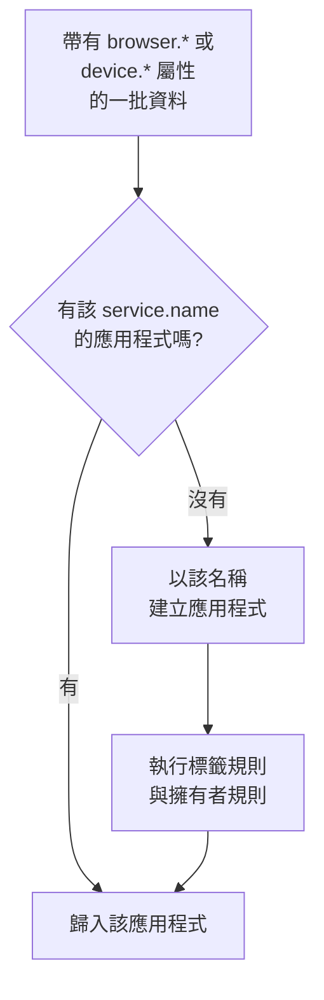

# 管理應用程式

當你的應用程式的遙測資料第一次抵達時，OneUptime 會建立一個 RUM 應用程式。本頁說明之後由你管理的內容：應用程式的名稱、標籤與擁有者、資料保留多久、封存、誰能看到它，以及警示。

:::cards
- [應用程式如何建立](#應用程式如何建立): 依 `service.name` 比對，隨第一批資料建立。
- [標籤](#標籤): 將應用程式分組，並決定誰能存取它們。
- [保留](#保留): 遙測資料與錄製保留多久。
- [權限](#權限): 誰能檢視應用程式，誰能觀看錄製。
:::

## 應用程式如何建立

你不必自行建立 RUM 應用程式。當一批帶有瀏覽器或裝置屬性與 `service.name` 的遙測資料抵達時，OneUptime 會把它歸入具有該 `service.name` 的應用程式；如果專案中還沒有，就建立一個。



- `service.name` 是應用程式的識別，比對時不區分大小寫： `Storefront-Web` 和 `storefront-web` 是同一個應用程式。
- 新的 `service.name` 會開始一個新的應用程式。舊的應用程式保留其歷史並變成 **已中斷** ，新的應用程式從空白開始，兩者永遠不會合併。
- 每個應用程式使用一個 `service.name` ，而不是每個環境一個。用 `oneuptime.label.env=production` 這類標籤區分環境，讓它們共用一個應用程式與一段歷史。

### 重新命名應用程式

**顯示名稱** 一開始與 `service.name` 相同。若要變更，請開啟應用程式的 **設定** 頁面，在 **應用程式詳細資料** 卡片上按一下 **編輯詳細資料** ，描述與標籤也在這裡編輯。遙測資料依卡片上顯示且永不變更的 **App 名稱 (service.name)** 比對，因此重新命名是安全的。

### 自行新增應用程式

如果你希望在第一位訪客到來之前，就先備妥應用程式的標籤、擁有者或重播策略，可以自行建立應用程式。

:::steps
#### 開啟應用程式清單

前往 **產品 → 資源 → 真實使用者監測** ，按一下 **建立RUM 應用程式** 。

#### 輸入 App 名稱

在 **App 名稱 (service.name)** 中填入你的應用程式將回報的 `service.name` ，與應用程式回報的完全相同。

#### 命名並儲存

與自動探索到的應用程式一樣，該應用程式以其 App 名稱命名。若要顯示其他名稱，請開啟 **更多欄位** 並輸入 **顯示名稱** ；描述與標籤也在那裡。然後儲存表單。
:::

隨後，它的設定指南會自動開啟，程式碼片段中的 `service.name` 即為該 App 名稱。指南的最後一步 **等待連線** 會在第一批資料送達時告訴你。

如果專案中已有具備該 `service.name` 的應用程式，無論是自動探索到的、先前新增的或已封存的，表單都會告訴你，而不會再建立一個。

## 連線狀態

遙測資料抵達期間，應用程式顯示 **已連線** ；15 分鐘內沒有任何資料後，顯示 **已中斷** 。OpenTelemetry 遙測與工作階段重播流量都會計算在內。

**上次出現** 每隔幾分鐘重新整理一次，而不是每批資料都更新，因此它可能比即時流量晚最多大約五分鐘，15 分鐘的時間為此預留了空間。OneUptime 本身停機或追趕擷取佇列的時間不會計算在內。

**已中斷** 本身並不是錯誤：夜間沒有訪客的內部工具確實處於中斷狀態。如果有人正在使用該應用程式，請參閱 [RUM 疑難排解](/docs/rum/troubleshooting) 。

## 標籤

標籤會在清單與篩選器中將應用程式分組。它們也決定僅限部分標籤的成員可以存取什麼：這樣的成員只會看到帶有其中某個標籤的應用程式。應用程式透過三種方式取得標籤：

| 方式 | 位置 |
| --- | --- |
| 手動 | 在建立表單的 **更多欄位** 下，或之後在應用程式 **設定** 頁面的 **應用程式詳細資料** 卡片上透過 **編輯詳細資料** 。 要一次為多個應用程式新增標籤，請在清單中選取它們，選擇 **Add Labels** ，它位於 **批次動作** 中。 |
| 來自遙測 | 名為 `oneuptime.label.<name>` 的資源屬性會新增標籤 `<name>:<value>` ，如下所示。 |
| 來自標籤規則 | 規則會為它比對到的每個新應用程式新增標籤。請參閱 [標籤規則與擁有者規則](#標籤規則與擁有者規則) 。 |

在與 `service.name` 相同的資源上設定這些屬性，例如在 [瀏覽器端設定](/docs/rum/browser-setup) 的 `src/telemetry.ts` 檔案中：

```ts
const resource = defaultResource().merge(
  resourceFromAttributes({
    [ATTR_SERVICE_NAME]: "storefront-web",
    "oneuptime.label.team": "payments",
    "oneuptime.label.env": "production",
  }),
);
```

這會新增標籤 `team:payments` 與 `env:production` ，如果專案中不存在則會建立它們。由於屬性名稱寫入了標籤， `oneuptime.label.team=prod` 和 `oneuptime.label.env=prod` 不會混在一起。超過 100 個字元的標籤會被截短為 100 個字元，空值或非字串值不會新增任何內容。

## 標籤規則與擁有者規則

規則會為它比對到的每個新應用程式新增標籤或擁有者。開啟 **真實使用者監測 → 設定 → 標籤規則** 或 **擁有者規則** ，分兩個步驟建立規則：

1. 在 **比對** 中，新規則預設的 **所有 RUM 應用程式** 會比對所有應用程式。要縮小範圍，請選擇 **僅符合條件的 RUM 應用程式** ，然後針對 **應用程式標籤** （具有所選標籤中的任何一個、全部或一個都沒有）、 **應用程式名稱** 或 **應用程式描述** （等於、包含、開頭為、結尾為或符合某個模式）新增條件。
2. 在 **標籤** 中（擁有者規則則是 **擁有者** ），選擇規則要新增的內容。新規則必須至少新增一個標籤或擁有者。在你輸入自己的名稱之前， **名稱** 會依你的選擇自動填入，例如 _Add team:payments_ 或 _Add Payments as owners_ 。 **描述** 以及擁有者規則的 **通知擁有者** 位於 **更多欄位** 下。

規則會在應用程式建立時執行，包括自動探索到的應用程式。若要將規則套用到已有的應用程式，請開啟該列的 **⋯** 選單並選取 **Run Now** ：請參閱 [對現有資源執行規則](/docs/configuration/run-rules-now) 。因編輯而沒有任何內容可新增的規則，會在清單中標示為 **不新增任何內容** 。 [標籤與擁有者規則](/docs/configuration/label-and-owner-rules) 完整說明了這些表單。

### 擁有者

擁有者是對應用程式負責的人員與團隊。擁有者規則會為新應用程式新增擁有者。要手動新增或移除擁有者，請在清單中選取應用程式，選擇 **Add Owner** 或 **Remove Owner** ，它們位於 **批次動作** 中；API 則透過 `/rum-application-owner-user` 與 `/rum-application-owner-team` 新增擁有者。在預設開啟 **通知擁有者** 時，規則新增的每位擁有者都會收到通知。如果不希望通知任何人，請在對大量應用程式執行規則之前將其關閉。

## 保留

應用程式的遙測資料與錄製保留的時間不同：

| 資料 | 保留時間 | 設定位置 |
| --- | --- | --- |
| 日誌、指標、追蹤與效能分析 | 專案的保留時間，除非應用程式覆寫它 | 應用程式的 **設定** 頁面 |
| 工作階段重播錄製 | 預設 7 天，或 1、14、30、90 天 | **Replay Policy** ，透過 **Edit Policy → Limits** |

### 遙測資料保留

預設情況下，應用程式的遙測資料依專案的保留時間保留，該保留時間在 **專案設定 → 遙測與 APM → 資料保留** 中設定。應用程式 **設定** 頁面上的兩張卡片可以覆寫它：

- **遙測資料保留** 包含 **遙測資料保留時間（天）** ，也就是適用於該應用程式所有遙測資料的一個值。留空則使用專案的保留時間。
- **依遙測類型的保留時間** 分別包含日誌、追蹤、指標與效能分析的預設值，以及依嚴重性區分的日誌與依狀態區分的追蹤的值。留空的值會退回應用程式的值，再退回專案的值。

保留覆寫屬於 [企業版](/docs/self-hosted/enterprise) ，在 OneUptime Cloud 上則屬於 Scale 方案以上。沒有這些功能時，卡片會顯示方案所增加的內容，應用程式則沿用專案的保留時間。

在較低的 Cloud 方案上，試用期留下的覆寫會繼續套用於新的遙測資料。 **設定** 頁面會在 **保留覆寫** 卡片上顯示它，並提供一個 **移除覆寫** 按鈕，此按鈕在所有方案上都可使用：之後應用程式沿用專案的保留時間，已儲存的資料則保持其儲存時的保留時間。再次設定覆寫需要 Scale 方案。

### 工作階段重播保留

錄製有自己的保留時間，在應用程式的 **Replay Policy** 頁面上透過 **Edit Policy → Limits** 設定：預設 7 天，也可選擇 1、14、30 或 90 天。這段保留時間刻意設得很短，因為錄製遠比 span 敏感，也遠比 span 大。 **設定** 頁面上的 **Session Replay Retention** 卡片會顯示它（ _Session replays are kept for 7 days._ ），其 **在 Replay Policy 中編輯** 按鈕會開啟該策略。

較長的遙測保留時間並不會讓錄製保留得更久。工作階段的計數、訊號與裝置會隨錄製一起到期；只有工作階段的日誌、span 與例外狀況會遵循遙測保留時間。請參閱 [保留與刪除](/docs/telemetry/session-replay#保留與刪除) 。

> [!TIP]
> RUM 往往是專案中資料量最大的遙測，因為它隨使用者成長，而不是隨伺服器成長。在這裡設定較短的保留時間，在後端服務上設定較長的保留時間，是常見的配置。

## 封存與刪除

**封存** 會把應用程式從 **所有應用程式** 中隱藏，同時繼續收集遙測資料。對於你不再關注、但希望保留其歷史的應用程式，可以將其封存。

- 在應用程式的 **設定** 頁面上按一下 **封存** ，或在清單中選取多個應用程式一起封存。
- 已封存的應用程式位於 **真實使用者監測 → 進階 → 已封存** 。側邊選單中的 **進階** 預設是摺疊的：按一下它以顯示 **已封存** 。可以在那裡對一個應用程式，或一次對多個應用程式 **取消封存** 。

應用程式側邊選單 **進階** 區段中的 **刪除應用程式** 會永久刪除該應用程式。如果應用程式仍在傳送遙測資料，下一批資料會重新建立該應用程式，且不帶任何設定，因此請先停止檢測。

若要抹除某個人的資料，而不是整個應用程式，請提交抹除請求：請參閱 [抹除工作階段](/docs/telemetry/session-replay#抹除工作階段) 。

## 權限

擁有專案 Viewer 角色的任何人都可以檢視 RUM 應用程式及其遙測資料。工作階段重播刻意排除在該角色之外：列出錄製、觀看錄製，以及查看誰觀看過，都是個別的權限。專案擁有者與管理員擁有全部權限。權限選擇器會依標題列出每項權限，此處以斜體顯示。

| 權限 | 允許成員 |
| --- | --- |
| `ReadRumApplication` (_Read RUM Application_) | 檢視應用程式及其遙測頁面。 |
| `CreateRumApplication`, `EditRumApplication`, `DeleteRumApplication` | 新增、編輯與刪除應用程式。 |
| `ReadRumSessionReplay` (_List Session Replays_) | 列出已錄製的工作階段及其詳細資料，但不能播放，也無法得知使用者是誰。 |
| `ReadRumSessionReplayPayload` (_Watch Session Replays_) | 播放錄製，並讀取已識別使用者的參照與特徵。 |
| `ReadRumSessionReplayAudit` (_Read Session Replay Audit_) | 讀取 **Replay Access Log** ：誰觀看了哪個錄製。 |
| `DeleteRumSessionReplay` (_Delete Session Replays_) | 刪除錄製。 |
| `CreateRumSessionErasureRequest`, `ReadRumSessionErasureRequest` | 提交抹除請求並追蹤其進度。 |
| `ReadRumApplicationLabelRule`, `ReadRumApplicationOwnerRule` （及其 Create、Edit 與 Delete） | 管理標籤規則與擁有者規則。 |
| `ReadRumApplicationOwnerUser`, `ReadRumApplicationOwnerTeam` （及其 Create、Edit 與 Delete） | 透過 API 新增與移除擁有者。 |

一種實用的分工方式：給支援工程師 `ReadRumApplication` 與 `ReadRumSessionReplay` 。他們可以看到哪些工作階段發生了錯誤，而不必觀看任何人的螢幕，也不會得知使用者是誰。只把 `ReadRumSessionReplayPayload` 授予需要的人；這樣，擁有 `ReadRumSessionReplayAudit` 的成員就能在應用程式的 **Replay Access Log** 頁面上看到每一次觀看。 [誰可以觀看錄製](/docs/telemetry/session-replay#誰可以觀看錄製) 說明了每項權限在工作階段清單與播放器中解鎖了什麼。

## 針對 RUM 資料設定警示

RUM 遙測就是一般的日誌、指標與追蹤，因此沒有獨立的 RUM 監控器：一般的監控器都適用於它。最快的入門方式是應用程式的 **Recommendations** 頁面，它會提供已限定到該應用程式的監控器：

| 群組 | 建議 |
| --- | --- |
| Core Web Vitals | Poor Largest Contentful Paint、Poor Interaction to Next Paint、Poor Cumulative Layout Shift、Slow First Contentful Paint 與 Slow Time to First Byte。請參閱 [Core Web Vitals](/docs/rum/web-vitals) 。 |
| 錯誤 | Failed User Operations 與 Unhandled Browser Exceptions。 |
| 工作階段重播 | 四個 [儲存預算警示](/docs/telemetry/session-replay#儲存預算警示) ，會在專案的每日上限或應用程式的每月預算用盡之前發出警告。應用程式錄製過重播後就會提供它們，每月那一組則在應用程式也設定了每月預算後提供。 |

若要自行建立監控器，請選擇讀取相應訊號的那一種：

- [指標監控](/docs/monitor/metrics-monitor) ：某個 Core Web Vitals 指標，或你的應用程式傳送的任何指標。
- [追蹤監控](/docs/monitor/traces-monitor) ：用戶端錯誤率或延遲。
- [日誌監控](/docs/monitor/logs-monitor) ：瀏覽器日誌中的某種模式。
- [例外狀況監控](/docs/monitor/exceptions-monitor) ：新出現或急遽增加的用戶端例外狀況。

將你建立的監控器限定到該應用程式，這樣具有類似特徵的後端服務就不會觸發它。

## 後續步驟

:::cards
- [工作階段重播](/docs/telemetry/session-replay): 錄製使用者看到的內容，並擁有自己的策略與保留時間。
- [標籤與擁有者規則](/docs/configuration/label-and-owner-rules): 兩種規則表單，逐步說明。
- [對現有資源執行規則](/docs/configuration/run-rules-now): 將新規則套用到已有的應用程式。
- [RUM 疑難排解](/docs/rum/troubleshooting): 當應用程式不見、為空或顯示已中斷時。
:::
