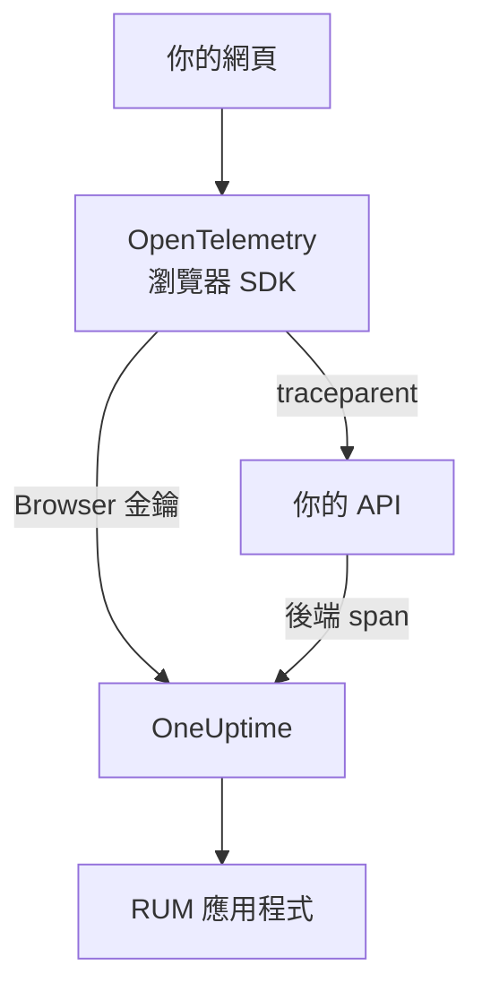

# 瀏覽器端設定

使用 OpenTelemetry 瀏覽器 SDK 檢測 Web 應用程式，讓它以 RUM 應用程式的身分向 OneUptime 回報。頁面載入和請求會以追蹤的形式抵達，同一套設定也能傳送你的錯誤、日誌、指標和 Core Web Vitals。

:::cards
- [設定步驟](#設定步驟): 從 Browser 金鑰到第一次頁面載入的六個步驟。
- [連結後端](#連結後端追蹤): 把瀏覽器 span 連到它們發起的後端追蹤。
- [回報錯誤](#回報未攔截的錯誤): 把未攔截的錯誤傳送到例外檢視。
- [疑難排解](#疑難排解): 什麼都沒有抵達時要檢查的項目。
:::

## 運作方式

SDK 在訪客的瀏覽器中執行。它會為每次頁面載入和請求記錄一個 span，並使用 **瀏覽器** 擷取金鑰直接匯出到 OneUptime，中間不需要你自己的收集器或代理伺服器。



## 開始之前

- 一個可以修改程式碼並重新部署、透過 npm 安裝相依套件的 Web 應用程式。
- 提供頁面的來源，例如 `https://app.example.com` 。Browser 金鑰只接受來自其所列來源的請求。
- 可以建立擷取金鑰的角色：專案擁有者和管理員可以建立，具有 **Create Telemetry Ingestion Key** 權限的任何人也可以。

## 設定步驟

:::steps
### 建立 Browser 擷取金鑰

1. 前往 **產品 → 專案設定** 。
2. 在側邊選單中開啟 **遙測與 APM** ，然後選取 **擷取金鑰** 。
3. 按一下 **建立擷取金鑰** ，並在 **金鑰類型** 中選擇 **瀏覽器** 。
4. 在 **瀏覽器設定** 步驟中，以 JSON 陣列的形式在 **允許的來源** 中列出你的來源，例如 `["https://app.example.com"]` ，然後建立金鑰。在 OneUptime Cloud 的 Free 方案中，最後一個 **帳單** 步驟會先顯示遙測價格。


新金鑰會在自己的頁面中開啟。複製它的 **密鑰金鑰** ：這就是 SDK 以 `x-oneuptime-token` 傳送的權杖。


### 安裝套件

```bash
npm install @opentelemetry/api \
  @opentelemetry/sdk-trace-web \
  @opentelemetry/resources \
  @opentelemetry/semantic-conventions \
  @opentelemetry/opentelemetry-browser-detector \
  @opentelemetry/exporter-trace-otlp-http \
  @opentelemetry/context-zone \
  @opentelemetry/instrumentation \
  @opentelemetry/instrumentation-document-load \
  @opentelemetry/instrumentation-fetch \
  @opentelemetry/instrumentation-xml-http-request
```

### 建立遙測檔案

建立 `src/telemetry.ts` 。 `browserDetector` 會加入讓遙測被歸類為 RUM 的 `browser.*` 屬性，而 `service.name` 則為應用程式命名。

```ts title="src/telemetry.ts"
import {
  WebTracerProvider,
  BatchSpanProcessor,
} from "@opentelemetry/sdk-trace-web";
import { OTLPTraceExporter } from "@opentelemetry/exporter-trace-otlp-http";
import { ZoneContextManager } from "@opentelemetry/context-zone";
import { registerInstrumentations } from "@opentelemetry/instrumentation";
import { DocumentLoadInstrumentation } from "@opentelemetry/instrumentation-document-load";
import { FetchInstrumentation } from "@opentelemetry/instrumentation-fetch";
import { XMLHttpRequestInstrumentation } from "@opentelemetry/instrumentation-xml-http-request";
import {
  defaultResource,
  detectResources,
  resourceFromAttributes,
} from "@opentelemetry/resources";
import { browserDetector } from "@opentelemetry/opentelemetry-browser-detector";
import { ATTR_SERVICE_NAME } from "@opentelemetry/semantic-conventions";

const ONEUPTIME_URL = "https://oneuptime.com";
// Public: it ships in your page. It must be a Browser ingestion key.
const ONEUPTIME_TOKEN = "YOUR_TELEMETRY_INGESTION_TOKEN";

/*
 * browserDetector supplies the browser.* attributes. Without them this
 * telemetry is classified as a backend Service, not a RUM application.
 * The attributes set last win, so service.name here overrides the
 * "unknown_service" that defaultResource() provides.
 */
const resource = defaultResource()
  .merge(detectResources({ detectors: [browserDetector] }))
  .merge(
    resourceFromAttributes({
      [ATTR_SERVICE_NAME]: "storefront-web",
    }),
  );

const provider = new WebTracerProvider({
  resource: resource,
  spanProcessors: [
    new BatchSpanProcessor(
      new OTLPTraceExporter({
        url: `${ONEUPTIME_URL}/otlp/v1/traces`,
        headers: { "x-oneuptime-token": ONEUPTIME_TOKEN },
      }),
    ),
  ],
});

provider.register({
  contextManager: new ZoneContextManager(),
});

registerInstrumentations({
  instrumentations: [
    new DocumentLoadInstrumentation(),
    new FetchInstrumentation({
      // See "Linking to your backend traces" before widening this.
      propagateTraceHeaderCorsUrls: [/^https:\/\/api\.example\.com/],
    }),
    new XMLHttpRequestInstrumentation({
      propagateTraceHeaderCorsUrls: [/^https:\/\/api\.example\.com/],
    }),
  ],
});
```

### 最先匯入它

讓它成為應用程式的第一個匯入。檢測會修補 `fetch` 和 `XMLHttpRequest` ，在修補之前發出的請求不會被追蹤。

```ts
// src/index.tsx (React), src/main.ts (Vue / Angular), etc.
import "./telemetry";
import React from "react";
// ... the rest of your app
```

### 檢查金鑰

在查看其他地方之前，先確認 OneUptime 是否接受該金鑰：

```bash
curl -i https://oneuptime.com/otlp/v1/validate \
  -H "x-oneuptime-token: YOUR_TELEMETRY_INGESTION_TOKEN"
```

`200` 加上 `"valid": true` 表示金鑰已被接受；若是 Browser 金鑰，訊息還會說明它只能在瀏覽器中、從其允許的來源之一使用。 `401` 表示金鑰不明、已撤銷、已關閉或已過期。

### 載入一個頁面

開啟你的網站。一分鐘內，應用程式會以其 `service.name` 命名，出現在 **產品 → 資源 → 真實使用者監測** 下。
:::

## Browser 金鑰允許什麼

程式碼片段中的所有內容都會傳給訪客，因此任何人都能從你的頁面複製權杖。Browser 金鑰會限制副本能做的事：

| 設定 | 作用 |
| --- | --- |
| **允許的來源** | 只接受來自這些來源的請求，每個來源都包含通訊協定和連接埠（如有）。主機可以用一個 `*.` 萬用字元開頭： `https://*.example.com` 涵蓋 `example.com` 的所有子網域，但不包括 `example.com` 本身。 |
| **Requests Per Minute Limit** | 所有使用該金鑰的訪客共用的一個上限：除非你自行設定，否則為每分鐘 6000 個請求。 |
| **固定的服務名稱** | 對金鑰寫入的所有資料強制使用 `service.name` ，因此副本無法把它的遙測偽裝成你的某個後端服務。 |
| **到期於** | 過了這個日期，金鑰就不再被接受。 |
| **已啟用** | 關閉它即可立刻停用外洩的金鑰。 |

Browser 金鑰只能寫入 OTLP 追蹤、日誌和指標，以及工作階段重播；其他所有擷取路由都會拒絕它。這些設定在金鑰自己的頁面上變更。金鑰建立後，金鑰類型無法變更。

> [!WARNING]
> 切勿把 **伺服器** 金鑰放進頁面。伺服器金鑰可以從任何地方寫入各種遙測，不做來源檢查，因此任何讀過你頁面的人都能寫入你的專案。

## 不使用偵測器設定 `browser.*`

`browserDetector` 會讀取 [UA Client Hints API](https://wicg.github.io/ua-client-hints/) ，而只有 Chromium 瀏覽器提供這個 API。在 Safari 和 Firefox 上，它會設定 `browser.language` 和 `user_agent.original` ，但不會設定 `browser.platform` 、 `browser.brands` 或 `browser.mobile` 。

這仍足以把遙測歸類為 RUM，因為光是 `browser.language` 就能把批次標記為瀏覽器 RUM。不過 **用戶端** 頁面依 `browser.platform` 列出平台，因此 Safari 和 Firefox 的造訪不會在那裡新增列。

若要略過偵測器，或讓每個瀏覽器都有平台，請自行設定這些屬性：

```ts
const resource = defaultResource().merge(
  resourceFromAttributes({
    [ATTR_SERVICE_NAME]: "storefront-web",
    // browser.language or browser.platform marks the telemetry as browser RUM.
    "browser.language": navigator.language,
    "browser.platform":
      (navigator as any).userAgentData?.platform ?? "unknown",
    "browser.mobile": (navigator as any).userAgentData?.mobile ?? false,
    "user_agent.original": navigator.userAgent,
  }),
);
```

讓 `browser.platform` 保持粗略。每個不同的值都會成為 **用戶端** 頁面上的一列，因此在其中放入完整的 user-agent 字串或依使用者而異的值，會讓清單無止盡地增長，也會造成隱私問題。

## 追蹤路由切換

`DocumentLoadInstrumentation` 只追蹤第一次載入。在單頁應用程式中，路由切換在你記錄之前都看不到，而記錄只需要在路由器中加幾行程式碼：

```ts
import { trace } from "@opentelemetry/api";

const tracer = trace.getTracer("app-router");

function onRouteChange(to: string): void {
  const span = tracer.startSpan("route-change", {
    attributes: { "app.route": to },
  });
  // End it when the route's data has loaded and the view has painted.
  requestAnimationFrame(() => {
    return span.end();
  });
}
```

加入 `@opentelemetry/instrumentation-user-interaction` ，也能追蹤點擊和其他 DOM 事件。關於每個路由的 INP，請參閱 [單頁應用程式](/docs/rum/web-vitals#單頁應用程式) 。

## 連結後端追蹤

`propagateTraceHeaderCorsUrls` 決定哪些跨來源請求要攜帶 W3C `traceparent` 標頭，這個標頭會把瀏覽器 span 連到它發起的後端追蹤。傳往頁面自身來源的請求不需設定就會攜帶它。

> [!WARNING]
> 不要把它設為 `/.*/` 。這個標頭會把簡單的跨來源請求變成需要預檢的請求，因此任何沒有在 `Access-Control-Allow-Headers` 中列出 `traceparent` 的第三方 API 都會開始失敗。

只列出你掌控並已設定好的來源：

```ts
new FetchInstrumentation({
  propagateTraceHeaderCorsUrls: [
    /^https:\/\/api\.example\.com/,
    /^https:\/\/auth\.example\.com/,
  ],
});
```

安裝 [工作階段重播](/docs/telemetry/session-replay) 後，傳往你自己來源的請求也會攜帶重播的工作階段 ID，讓後端遙測歸入該錄製：請參閱 [將追蹤與工作階段重播連結](#將追蹤與工作階段重播連結) 。

## 將追蹤與工作階段重播連結

如果你也使用 [工作階段重播](/docs/telemetry/session-replay) ，你的 **後端** 遙測不需要在這裡寫任何程式碼就會與錄製連結。工作階段上傳期間，錄製器會在頁面傳往自身來源的請求中，加入一個攜帶工作階段 ID 的 `tracestate` 成員，並把 `traceparent` 留給你的 `FetchInstrumentation` / `XMLHttpRequestInstrumentation` 。在每個延續 W3C 追蹤內容的服務中，後端 span 會在擷取時被標上工作階段 ID，其日誌和例外則透過追蹤 ID 連結到錄製。運作方式、不涵蓋的範圍以及關閉它的開關，請參閱 [與其他遙測建立關聯](/docs/telemetry/session-replay#與其他遙測資料關聯) 。

無論呼叫傳入的是 URL（帶或不帶 init 物件）還是 `Request` 物件，錄製器都會讀回你的檢測所設定的 `traceparent` ，因此重播中的每個請求列都會連到其後端追蹤。若 API 位於其他來源，請把它列在上面的 `propagateTraceHeaderCorsUrls` 中；它的請求不攜帶工作階段 ID，而是透過追蹤 ID 連結到錄製。對於 *沒有* 使用此 SDK 的頁面，應用程式重播政策中的 **追蹤傳播來源** 有同樣的作用。

標頭無法涵蓋的是此 SDK 自己的瀏覽器 span：文件載入、路由切換以及你回報的錯誤。若也要把它們歸入錄製，請在每個 span 開始時標上 `session.id` 。錄製器會透過 `onSessionChange` 告訴你 ID：如果工作階段已存在，它會立即觸發，之後每當 ID 變更時再次觸發：訪客閒置 30 分鐘後回來時、達到 4 小時上限時、 `identify()` 指定了另一位使用者時，或同一位訪客的另一個分頁先變更了它時。

```ts title="src/replaySession.ts"
import type { Context } from "@opentelemetry/api";
import type {
  ReadableSpan,
  Span,
  SpanProcessor,
} from "@opentelemetry/sdk-trace-web";

declare global {
  interface Window {
    OneUptimeReplayQueue?: Array<Array<unknown>>;
  }
}

let replaySessionId: string | null = null;

// The recorder script loads asynchronously. The queue is applied the
// moment it starts and stays live afterwards, so this works either way.
(window.OneUptimeReplayQueue = window.OneUptimeReplayQueue || []).push([
  "onSessionChange",
  (sessionId: string): void => {
    replaySessionId = sessionId;
  },
]);

export class ReplaySessionSpanProcessor implements SpanProcessor {
  public onStart(span: Span, _parentContext: Context): void {
    if (replaySessionId) {
      span.setAttribute("session.id", replaySessionId);
    }
  }

  public onEnd(_span: ReadableSpan): void {}

  public forceFlush(): Promise<void> {
    return Promise.resolve();
  }

  public shutdown(): Promise<void> {
    return Promise.resolve();
  }
}
```

接著在 `src/telemetry.ts` 中，把它放在提供者的 span 處理器的第一位：

```ts
import { ReplaySessionSpanProcessor } from "./replaySession";

const provider = new WebTracerProvider({
  resource: resource,
  spanProcessors: [
    new ReplaySessionSpanProcessor(),
    new BatchSpanProcessor(
      new OTLPTraceExporter({
        url: `${ONEUPTIME_URL}/otlp/v1/traces`,
        headers: { "x-oneuptime-token": ONEUPTIME_TOKEN },
      }),
    ),
  ],
});
```

此後開始的 span 都會帶有該 ID，重播播放器的 **追蹤** 分頁會依錄製的時間軸列出它們，儀表板中的每個 span 也都能連回重播中的那一刻。span 處理器會為每個 span 標上其開始時的目前 ID；若改為把 ID 寫入 `resource.attributes` ，工作階段輪替時，仍在匯出批次中等待的 span 也會被重新標記。錄製器一啟動，監聽器就會收到 ID，早於同意或擷取觸發條件，因此如果這點很重要，請在頁面取得同意後才標上 ID。

## Content Security Policy

如果你的網站會傳送 Content Security Policy，在你於 `connect-src` 中允許 OneUptime 之前，瀏覽器會封鎖匯出器的請求。你看不到任何失敗：頁面只是什麼都不回報。

```text
connect-src 'self' https://oneuptime.com;
```

把它合併到現有的 `connect-src` 指示詞中。如果你自行託管 OneUptime，請使用你自己的主機。

## 回報未攔截的錯誤

OpenTelemetry 瀏覽器 SDK 不會擷取未攔截的錯誤。自行回報後，它們就會和後端錯誤一起出現在 **例外** 下：

```ts
import { trace, SpanStatusCode } from "@opentelemetry/api";

const tracer = trace.getTracer("app-errors");

window.addEventListener("error", (event: ErrorEvent) => {
  const span = tracer.startSpan("window.onerror");
  span.recordException(event.error ?? new Error(event.message));
  span.setStatus({ code: SpanStatusCode.ERROR });
  span.end();
});

window.addEventListener("unhandledrejection", (event: PromiseRejectionEvent) => {
  const span = tracer.startSpan("unhandledrejection");
  span.recordException(
    event.reason instanceof Error ? event.reason : new Error(String(event.reason)),
  );
  span.setStatus({ code: SpanStatusCode.ERROR });
  span.end();
});
```

使用 [工作階段重播](/docs/telemetry/session-replay) 時，錄製器也會擷取未攔截的錯誤，並在重播的時間軸上標示出來。例外頁面接著會顯示 **Watch what the user saw** 卡片，從錯誤發生前十秒開啟重播。在預設政策下，無論是否發生錯誤，每個工作階段都會被錄製；錯誤只決定卡片從哪裡開啟。

## 加入日誌和指標

追蹤就足以填滿概覽。當你想在 OneUptime 中查看瀏覽器日誌，或要傳送 [Core Web Vitals](/docs/rum/web-vitals) 時，請加入日誌和指標管線：

```bash
npm install @opentelemetry/api-logs @opentelemetry/sdk-logs \
  @opentelemetry/exporter-logs-otlp-http \
  @opentelemetry/sdk-metrics @opentelemetry/exporter-metrics-otlp-http
```

```ts
import { LoggerProvider, BatchLogRecordProcessor } from "@opentelemetry/sdk-logs";
import { OTLPLogExporter } from "@opentelemetry/exporter-logs-otlp-http";
import { MeterProvider, PeriodicExportingMetricReader } from "@opentelemetry/sdk-metrics";
import { OTLPMetricExporter } from "@opentelemetry/exporter-metrics-otlp-http";
import { logs } from "@opentelemetry/api-logs";
import { metrics } from "@opentelemetry/api";

const headers = { "x-oneuptime-token": ONEUPTIME_TOKEN };

logs.setGlobalLoggerProvider(
  new LoggerProvider({
    resource: resource,
    processors: [
      new BatchLogRecordProcessor({
        exporter: new OTLPLogExporter({
          url: `${ONEUPTIME_URL}/otlp/v1/logs`,
          headers,
        }),
      }),
    ],
  }),
);

metrics.setGlobalMeterProvider(
  new MeterProvider({
    resource: resource,
    readers: [
      new PeriodicExportingMetricReader({
        exporter: new OTLPMetricExporter({
          url: `${ONEUPTIME_URL}/otlp/v1/metrics`,
          headers,
        }),
        exportIntervalMillis: 30000,
      }),
    ],
  }),
);
```

用同一個 `resource` 物件來建立它們。資源中缺少 `browser.*` 的日誌或指標管線，會被歸為一個獨立的後端服務。

## 端點參考

| 訊號 | 端點 | 標頭 |
| --- | --- | --- |
| 追蹤 | `POST {host}/otlp/v1/traces` | `x-oneuptime-token: <token>` |
| 指標 | `POST {host}/otlp/v1/metrics` | `x-oneuptime-token: <token>` |
| 日誌 | `POST {host}/otlp/v1/logs` | `x-oneuptime-token: <token>` |

`{host}` 是 `https://oneuptime.com` ，如果你自行執行 OneUptime，則是你自己的主機；請在 OTLP URL 和 Content Security Policy 項目中變更它。OneUptime 接受 OTLP/JSON 和 OTLP/protobuf。這些端點會回應來自任何來源的跨來源請求，並允許 `x-oneuptime-token` 標頭，因此瀏覽器可以直接匯出到這些端點。

## 疑難排解

:::details 網路分頁中沒有傳往 OneUptime 的請求
開啟瀏覽器的開發人員工具，進入網路分頁，以 `otlp` 篩選：你要找的是 `POST /otlp/v1/traces` 。完全沒有請求，表示 SDK 從未啟動：

- `telemetry.ts` 不是第一個匯入，或打包工具把它移除了。
- 批次處理器還沒有匯出。它會等幾秒來填滿一個批次，因此在斷定什麼都沒傳送之前，請稍候或切換到另一個頁面。
- 某個建置時的環境變數變成了 `undefined` ，導致匯出器的 URL 損壞。請在啟動時記錄一次 URL。
:::

:::details 瀏覽器封鎖了請求
- 主控台中出現 Content Security Policy 錯誤，表示 `connect-src` 還沒有允許 OneUptime：請參閱 [Content Security Policy](#content-security-policy) 。
- CORS 錯誤幾乎都表示請求根本沒有到達 OneUptime，因為 OneUptime 的端點允許任何來源：請檢查公司的代理伺服器、廣告封鎖程式或主機名稱的拼字錯誤。
:::

:::details OneUptime 拒絕了請求
- `422` 加上 `Origin https://app.example.com is not allowed for this browser ingestion key.` 表示頁面的確切來源（通訊協定、主機和連接埠）不在金鑰的 **允許的來源** 中。
- `422` 加上 `This telemetry ingestion key has been disabled.` 表示有人關閉了該金鑰。請重新開啟它，或改用另一個金鑰。
- `401` 表示金鑰不明、已撤銷或已過期。執行 [設定步驟](#設定步驟) 中的金鑰檢查，然後建立一個有效的 Browser 金鑰。
- `404` 表示 URL 錯誤。追蹤匯出器需要完整路徑 `/otlp/v1/traces` 。
:::

:::details 應用程式出現在服務下，而不是真實使用者監測下
資源沒有任何 `browser.*` 屬性，因此遙測被歸為後端服務。請加入 `browserDetector` ，或依照 [不使用偵測器設定 `browser.*`](#不使用偵測器設定-browser) 設定這些屬性。

在網路分頁中查看請求的承載，確認你傳送的內容： `resourceSpans[0].resource.attributes` 就是決定歸類的清單。已建立的服務不會變成 RUM 應用程式，因此在 RUM 遙測抵達後，請在 **產品 → 服務** 下刪除它。
:::

:::details Safari 或 Firefox 上的用戶端頁面是空的
用戶端列來自 `browser.platform` ，而 `browserDetector` 只在 Chromium 瀏覽器上設定它。若要列出 Safari 和 Firefox 的造訪，請自行設定：請參閱 [不使用偵測器設定 `browser.*`](#不使用偵測器設定-browser) 。
:::

## 後續步驟

:::cards
- [Core Web Vitals](/docs/rum/web-vitals): 從同一個頁面傳送 LCP、INP、CLS、FCP 和 TTFB。
- [工作階段重播](/docs/telemetry/session-replay): 錄製使用者看到的畫面，與這些追蹤並列。
- [管理應用程式](/docs/rum/applications): 名稱、標籤、擁有者和保留期。
- [RUM 疑難排解](/docs/rum/troubleshooting): 依問題通常發生的順序列出的所有檢查。
:::
