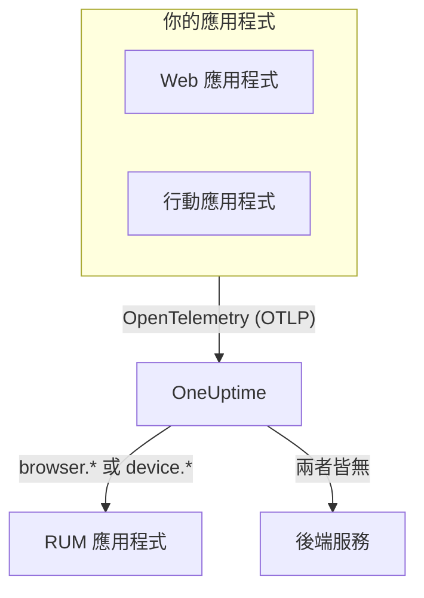

# RUM 概觀

真實使用者監測（RUM）呈現真實使用者在你的 Web 應用程式與行動應用程式中的體驗：頁面載入、請求、錯誤和 Core Web Vitals，這些資料由應用程式自己回報，而不是來自探針。OneUptime 會把這些遙測資料歸入一個 RUM 應用程式，讓你繪製圖表、搜尋並設定警示。

:::cards
- [運作方式](#運作方式): 一條 OpenTelemetry 管線，資料抵達時被歸類為 RUM。
- [OneUptime 如何辨識 RUM](#oneuptime-如何辨識-rum): 決定歸類的資源屬性。
- [你會得到什麼](#你會得到什麼): 概覽、Web Vitals、探索工具和重播。
- [開始使用](#開始使用): 從擷取金鑰到第一次頁面載入。
:::

## 運作方式

RUM 與 OneUptime 的其他部分使用同一條 OpenTelemetry 管線。沒有專屬的 RUM 代理程式，也沒有自己的傳輸格式：只要把 OpenTelemetry 瀏覽器或行動 SDK 指向 OneUptime，遙測資料抵達時就會被歸類為 RUM。

- **每個應用程式對應一個 RUM 應用程式。** 它的識別是 SDK 回報的 `service.name` ，OneUptime 會在收到第一批遙測資料時建立該應用程式。
- **絕不重複計算。** 用戶端遙測只屬於其 RUM 應用程式，不會同時列為後端服務。
- **工作階段重播是獨立的選用層。** 它有自己的程式碼片段和隱私控制：請參閱 [工作階段重播](/docs/telemetry/session-replay) 。

## 在哪裡找到它

開啟 **產品 → 資源 → 真實使用者監測** 。 **所有應用程式** 會列出你的應用程式及其 **用戶端類型** 、 **狀態** 和 **上次出現** 。側邊選單中另外兩個區段預設為摺疊：

- **設定**: **擁有者規則** 、 **標籤規則** ，以及整個專案的 **工作階段重播** 開關。
- **進階**: **已封存** ，也就是你封存的應用程式。

應用程式自己的側邊選單依下列方式組織頁面； **設定** 、 **開發者** 和 **進階** 預設為摺疊：

| 區段 | 頁面 |
| --- | --- |
| **基礎** | **概覽**, **建議**, **文件** |
| **可觀測性** | **指標**, **日誌**, **追蹤**, **用戶端** |
| **工作階段重播** | **工作階段重播**, **User Flows**, **Replay Users**, **健康狀況**, **Replay Policy**, **重播存取日誌**, **文件** |
| **設定** | **設定** |
| **開發者** | **Terraform**, **API**, **AI 助理** |
| **進階** | **刪除應用程式** |

## OneUptime 如何辨識 RUM

大多數「我的應用程式沒有出現」的問題都在這裡找到答案。OneUptime 在每批遙測資料抵達時，根據該批資料的 **資源屬性** 做出判斷：

1. 資源中含有 `browser.platform` 、 `browser.language` 或非空 `browser.brands` 的批次是 **瀏覽器** RUM。
2. 否則，含有 `device.id` 或 `device.model.identifier` 的批次是 **行動** RUM。
3. 否則，含有 `device.manufacturer` 且沒有主機識別（ `host.name` 、 `host.id` 或 `k8s.node.name` ）的批次也是 **行動** RUM。
4. 其他一切都是後端服務。

後端 SDK 從不設定 `browser.*` 、 `device.id` 或 `device.model.identifier` ，因此它們是明確的訊號。 `device.manufacturer` 是例外：主機清單也會用它回報機器的製造商，因此只有在資源沒有主機識別時才會採用。請參閱 [清單屬性](/docs/telemetry/host-otel-collector#清單屬性ipmac序號製造商型號韌體) 。

| 屬性 | 必要 | 作用 |
| --- | --- | --- |
| `service.name` | **是** | 應用程式的識別，例如 `storefront-web` 。沒有它就不會建立 RUM 應用程式。 |
| `browser.platform`, `browser.language`, `browser.brands` | Web 端需要其中之一 | 將批次標記為瀏覽器 RUM。 `browser.platform` 也會填入 **用戶端** 頁面。 |
| `device.id`, `device.model.identifier` | 行動端需要其中之一 | 將批次標記為行動 RUM。 `device.model.identifier` 也會填入 **用戶端** 頁面。 |
| `device.manufacturer` | 否 | 只有在資源不帶主機識別時，才將批次標記為行動 RUM。 |
| `telemetry.sdk.language` | 否 | 顯示在概覽上，例如 `webjs` 或 `swift` 。 |
| `telemetry.sdk.version` | 否 | 顯示為 SDK 版本；缺少時改讀 `oneuptime.agent.version` 。 |
| `oneuptime.label.<name>` | 否 | 為應用程式加上專案標籤 `<name>:<value>` 。 |

OneUptime 依 `service.name` 尋找應用程式（不分大小寫），專案中沒有時就建立一個。新的 `service.name` 會產生新的應用程式，因此請保持名稱穩定，並用標籤而不是新名稱來區分環境。名稱、標籤、擁有者和保留期在 [管理應用程式](/docs/rum/applications) 中說明。

> [!IMPORTANT]
> 除非你加入瀏覽器資源偵測器或自行設定，OpenTelemetry 瀏覽器 SDK 不會加入任何 `browser.*` 屬性。只有 `service.name` 時，遙測資料會成為後端服務，而不是 RUM 應用程式。 [瀏覽器端設定](/docs/rum/browser-setup) 說明了這兩種方式。

## 你會得到什麼

| 位置 | 顯示內容 |
| --- | --- |
| **概覽** | **頁面載入** 、 **頁面載入時間（p95）** 、 **事件** 、 **錯誤率** 、 **Event duration (p95)** 、 **例外** 、 **用戶端** 和 **Sessions recorded** 圖塊，以及你所選時間範圍內的趨勢圖。 |
| **Core Web Vitals** | 概覽上的一張卡片，顯示 LCP、INP、CLS、FCP 和 TTFB，每項都依 Google 的門檻評等，並為單頁應用程式顯示每個路由的 INP。請參閱 [Core Web Vitals](/docs/rum/web-vitals) 和 [單頁應用程式](/docs/rum/web-vitals#單頁應用程式) 。 |
| **指標**, **日誌**, **追蹤** | 只顯示此應用程式資料的遙測探索工具。 |
| **用戶端** | 應用程式曾被使用的瀏覽器平台與裝置型號：依平台列出的簡短清單，絕不會每位使用者一列。 |
| **工作階段重播** | 真實工作階段的錄製，與其錯誤、追蹤和日誌並列顯示：請參閱 [工作階段重播](/docs/telemetry/session-replay) 。 |
| **建議** | 為應用程式準備的現成監控器：Core Web Vitals 不佳、請求失敗、瀏覽器例外，以及開始錄製後的工作階段重播預算。 |

這些數字來自你的檢測所傳送的 span。 **頁面載入** 計算頁面載入檢測為每次完整載入記錄的 `documentLoad` span，因此單頁應用程式內的路由切換不算頁面載入。

遙測資料持續抵達時，應用程式顯示 **已連線** ；15 分鐘內沒有任何資料時則顯示 **已中斷** 。OneUptime 本身停機或在追趕擷取佇列的時間，不計入這 15 分鐘。

## 開始使用

:::steps
### 建立擷取金鑰

開啟 **專案設定 → 遙測與 APM → 擷取金鑰** ，按一下 **建立擷取金鑰** 。Web 應用程式需要 **瀏覽器** 金鑰，它只能從你列出的來源使用。行動應用程式需要 **伺服器** 金鑰，因為行動 SDK 不會傳送 `Origin` 標頭。

### 檢測你的應用程式

Web 應用程式請依照 [瀏覽器端設定](/docs/rum/browser-setup) 操作，Android、iOS、React Native 和其他平台請依照 [行動端設定](/docs/rum/mobile-setup) 操作。

### 開啟一個頁面

載入網站的一個頁面，或啟動你的應用程式。收到第一批遙測資料後，應用程式會以其 `service.name` 命名，出現在 **產品 → 資源 → 真實使用者監測** 下。不需要事先建立。

### 加入 Web Vitals 與重播

基本資料抵達後，傳送 [Core Web Vitals](/docs/rum/web-vitals) 並加入 [工作階段重播](/docs/telemetry/session-replay) 。兩者都是選用的。
:::

如果什麼都沒有出現， [RUM 疑難排解](/docs/rum/troubleshooting) 會依問題通常發生的順序逐一檢查原因。

## 後續步驟

:::cards
- [瀏覽器端設定](/docs/rum/browser-setup): 使用 OpenTelemetry 瀏覽器 SDK 檢測 Web 應用程式。
- [行動端設定](/docs/rum/mobile-setup): Android、iOS、React Native 以及其他任何 OpenTelemetry SDK。
- [Core Web Vitals](/docs/rum/web-vitals): 傳送 LCP、INP、CLS、FCP 和 TTFB，並逐一路由查看 INP。
- [工作階段重播](/docs/telemetry/session-replay): 查看使用者看到的畫面，與其錯誤和追蹤並列。
:::
