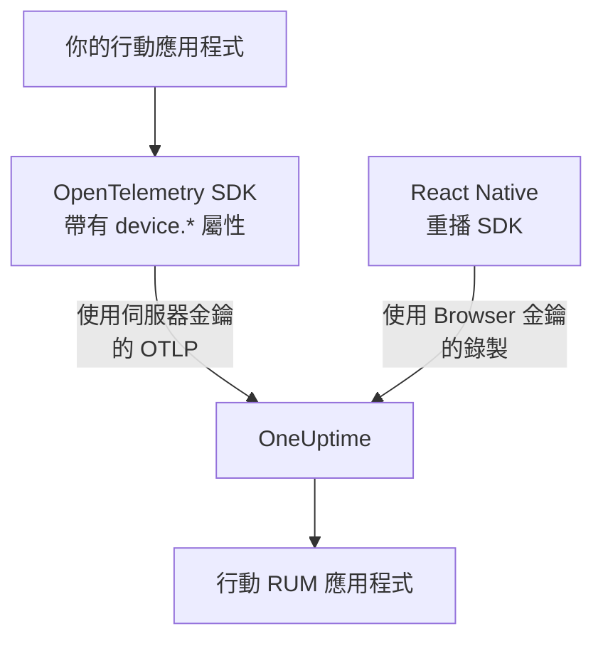

# 行動端設定

使用 OpenTelemetry 檢測 Android、iOS 或 React Native 應用程式，讓它以行動 RUM 應用程式的身分向 OneUptime 回報。任何其他具備 OpenTelemetry SDK 的平台都以相同方式運作。

:::cards
- [OneUptime 需要什麼](#oneuptime-需要什麼): 兩個資源屬性，以伺服器金鑰傳送。
- [設定你的平台](#設定你的平台): Android、iOS、React Native 及其他平台。
- [確認資料抵達](#確認資料抵達): 先測試金鑰，再找到應用程式。
- [行動端的工作階段重播](#行動端的工作階段重播): React Native 應用程式的錄製。
:::

## 運作方式

你的應用程式使用 **伺服器** 擷取金鑰，將 OTLP 直接匯出到 OneUptime。讓它被歸類為行動 RUM 而不是後端服務的，是其資源上的 `device.*` 屬性。



## OneUptime 需要什麼

應用程式匯出的每個批次都需要兩個資源屬性：

| 屬性 | 意義 |
| --- | --- |
| `service.name` | 應用程式的識別，例如 `storefront-android` 。 |
| `device.id` 或 `device.model.identifier` | 將遙測標記為行動 RUM。 `device.model.identifier` 也會填入 **用戶端** 頁面。 |

沒有裝置屬性時，遙測資料仍會抵達，你也可以查詢，但它會被歸為後端服務，而不是 RUM 應用程式。

`device.manufacturer` 也會把批次標記為行動端，但僅限於沒有主機識別的資源，因為主機清單也會用它回報機器的製造商。像下面每個範例一樣同時設定 `device.id` 或 `device.model.identifier` ，這點就無關緊要。

讓 `device.id` 成為以安裝為範圍的識別碼，絕不要使用廣告 ID 或任何其他能識別個人的值。OneUptime 讀取它只是為了辨識行動遙測。

## 開始之前

- 一個具備 OpenTelemetry SDK 的應用程式：OpenTelemetry Java SDK 或 OpenTelemetry Android、opentelemetry-swift，或用於 React Native 的 OpenTelemetry JavaScript SDK。
- 一個 **伺服器** 擷取金鑰，在 **專案設定 → 遙測與 APM → 擷取金鑰** 中以 **建立擷取金鑰** 建立。行動應用程式送出的 **Browser** 金鑰會被拒絕：它要依 `Origin` 標頭檢查，而行動 SDK 不會傳送這個標頭。
- 下列 OTLP 設定。如果你自行託管 OneUptime，請把 `https://oneuptime.com` 換成你自己的主機。

| 設定 | 值 |
| --- | --- |
| OTLP 端點 | `https://oneuptime.com/otlp` |
| 標頭 | `x-oneuptime-token: YOUR_TELEMETRY_INGESTION_TOKEN` |
| 追蹤 | `POST https://oneuptime.com/otlp/v1/traces` |
| 指標 | `POST https://oneuptime.com/otlp/v1/metrics` |
| 日誌 | `POST https://oneuptime.com/otlp/v1/logs` |

> [!WARNING]
> 金鑰會隨應用程式一起發布，而應用程式可以被解開，所以請假設有人會複製它。在金鑰的頁面上設定 **Pinned Service Name** ，讓副本無法以你的後端服務名稱寫入，再加上 **Requests Per Minute Limit** 和 **到期於** 日期，並隨每次發布輪替金鑰。

## 設定你的平台

這些程式碼片段呈現設定的大致樣貌。行動 OpenTelemetry SDK 的 API 會隨版本變動，因此請對照你鎖定的版本核對方法名稱。OneUptime 需要的東西從不改變：端點、標頭、 `service.name` 和一個 `device.*` 屬性。

:::tabs
@tab Android
使用可在 Android 上執行的 OpenTelemetry Java SDK 及其 OTLP 匯出器：

```kotlin title="app/build.gradle.kts"
dependencies {
    implementation(platform("io.opentelemetry:opentelemetry-bom:<latest>"))
    implementation("io.opentelemetry:opentelemetry-sdk")
    implementation("io.opentelemetry:opentelemetry-exporter-otlp")
}
```

```kotlin title="StorefrontApplication.kt"
import android.app.Application
import android.os.Build
import io.opentelemetry.exporter.otlp.http.trace.OtlpHttpSpanExporter
import io.opentelemetry.sdk.OpenTelemetrySdk
import io.opentelemetry.sdk.resources.Resource
import io.opentelemetry.sdk.trace.SdkTracerProvider
import io.opentelemetry.sdk.trace.export.BatchSpanProcessor

class StorefrontApplication : Application() {
    override fun onCreate() {
        super.onCreate()

        val resource = Resource.getDefault().toBuilder()
            .put("service.name", "storefront-android")
            .put("device.manufacturer", Build.MANUFACTURER)
            .put("device.model.identifier", Build.MODEL)
            .build()

        val exporter = OtlpHttpSpanExporter.builder()
            .setEndpoint("https://oneuptime.com/otlp/v1/traces")
            .addHeader("x-oneuptime-token", BuildConfig.ONEUPTIME_TOKEN)
            .build()

        OpenTelemetrySdk.builder()
            .setTracerProvider(
                SdkTracerProvider.builder()
                    .setResource(resource)
                    .addSpanProcessor(BatchSpanProcessor.builder(exporter).build())
                    .build()
            )
            .buildAndRegisterGlobal()
    }
}
```

[OpenTelemetry Android](https://github.com/open-telemetry/opentelemetry-android) 代理程式在此基礎上加入自動檢測，並在自己的資源上設定裝置屬性。如果你使用它，請把它的匯出器指向相同的端點和標頭，並確認在你的版本中 `device.model.identifier` 有進入資源。
@tab iOS
使用 [opentelemetry-swift](https://github.com/open-telemetry/opentelemetry-swift) ，並自行設定裝置屬性：各版本自行加入的資源在不同版本之間有所變動。

```swift
let resource = Resource(attributes: [
    "service.name": .string("storefront-ios"),
    "device.model.identifier": .string(UIDevice.current.model),
    "device.manufacturer": .string("Apple"),
    "telemetry.sdk.language": .string("swift"),
])

let exporter = OtlpHttpTraceExporter(
    endpoint: URL(string: "https://oneuptime.com/otlp/v1/traces")!,
    config: OtlpConfiguration(
        headers: [("x-oneuptime-token", oneUptimeToken)]
    )
)

OpenTelemetry.registerTracerProvider(
    tracerProvider: TracerProviderBuilder()
        .with(resource: resource)
        .add(spanProcessor: BatchSpanProcessor(spanExporter: exporter))
        .build()
)
```

`UIDevice.current.model` 會提供 `iPhone` 這類簡短名稱，讓 **用戶端** 頁面每種裝置只有一列。
@tab React Native
React Native 執行的是 OpenTelemetry JavaScript SDK，因此請依照 [瀏覽器端設定](/docs/rum/browser-setup) 建立提供者、OTLP 匯出器和批次處理器，並做三項變更：以 **伺服器** 金鑰傳送、拿掉 `browserDetector` 和 `DocumentLoadInstrumentation` ，以及自行設定裝置屬性。

```ts
import { Platform } from "react-native";
import * as Device from "expo-device"; // or react-native-device-info
import {
  defaultResource,
  resourceFromAttributes,
} from "@opentelemetry/resources";

const resource = defaultResource().merge(
  resourceFromAttributes({
    "service.name": "storefront-mobile",
    "device.manufacturer": Device.manufacturer ?? Platform.OS,
    "device.model.identifier":
      Device.modelId ?? Device.modelName ?? "unknown",
    "telemetry.sdk.language": "webjs",
  }),
);
```

`Device.modelId` 只在 iOS 上設定，因此 Android 會改用 `Device.modelName` 。
@tab 其他平台
Flutter、Unity、.NET MAUI、嵌入式用戶端或你自己撰寫的 OTLP 寫入器都可以，只要資源帶有 `service.name` 和一個 `device.*` 屬性。會讀取標準 OpenTelemetry 環境變數的 SDK 會原樣採用這些值：

```bash
OTEL_EXPORTER_OTLP_ENDPOINT="https://oneuptime.com/otlp"
OTEL_EXPORTER_OTLP_HEADERS="x-oneuptime-token=YOUR_TELEMETRY_INGESTION_TOKEN"
OTEL_RESOURCE_ATTRIBUTES="service.name=storefront-mobile,device.manufacturer=Acme,device.model.identifier=AC-100"
```

SDK 會自行在端點後加上 `/v1/traces` 、 `/v1/metrics` 和 `/v1/logs` 。
:::

## 確認資料抵達

:::steps
### 測試金鑰

在翻查 SDK 的設定之前，先確認 OneUptime 是否接受該金鑰：

```bash
curl -i https://oneuptime.com/otlp/v1/validate \
  -H "x-oneuptime-token: YOUR_TELEMETRY_INGESTION_TOKEN"
```

`200` 加上 `"valid": true` 表示金鑰已被接受。Browser 金鑰也會回傳 `200` ，但其訊息會說明它只能在瀏覽器中使用：行動應用程式需要伺服器金鑰。 `401` 表示金鑰不明、已撤銷、已關閉或已過期，任何 SDK 設定都無法解決。

### 啟動應用程式

執行應用程式並使用一下。收到第一批遙測資料後，它會以其 `service.name` 命名，出現在 **產品 → 資源 → 真實使用者監測** 下。

### 開啟用戶端頁面

開啟應用程式的 **用戶端** 頁面： `device.model.identifier` 中的每個裝置型號都有一列。如果 **追蹤** 有資料而這個頁面一直是空的，表示裝置屬性沒有進入資源。
:::

## 行動端的工作階段重播

React Native 應用程式可以使用 `@oneuptime/react-native-replay` 錄製工作階段。它會把原生檢視樹記錄為線框，絕不記錄螢幕截圖或畫面上的文字，其錄製與 Web 錄製在同一個播放器中開啟。它使用 **Browser** 金鑰傳送，該金鑰的 **Allowed Origins** 以 `app://` 加上 Android 應用程式 ID 或 iOS 套件組合 ID 的形式列出你的應用程式：這是一個獨立的金鑰，不同於 OpenTelemetry SDK 使用的伺服器金鑰。 [在 React Native 中安裝](/docs/telemetry/session-replay#install-in-react-native) 會逐步說明。

原生 Android 和 iOS 應用程式以及其他平台沒有工作階段錄製器：它們的 **Session Replay** 頁面會保持空白，而追蹤、日誌、指標、例外和 **用戶端** 頁面照常運作。

## 疑難排解

:::details 金鑰檢查回傳 401，或金鑰被拒絕
`401` 表示金鑰不明、已撤銷、已關閉或已過期：請建立伺服器金鑰，並用它重新建置應用程式。

Browser 金鑰能通過檢查，但行動應用程式的每次匯出都會被拒絕，回傳 `422` 和 `This request did not send an Origin header, so it cannot be checked against the allowed origins of this browser ingestion key. Use a server ingestion key for requests that are not sent by a browser.` 。請使用 **伺服器** 金鑰。
:::

:::details 應用程式出現在服務下，而不是真實使用者監測下
資源既沒有 `device.id` 也沒有 `device.model.identifier` ，因此遙測被歸為後端服務。請依照 [設定你的平台](#設定你的平台) 設定它們。

已建立的服務不會變成 RUM 應用程式，因此在 RUM 遙測抵達後，請在 **產品 → 服務** 下刪除它。
:::

:::details 用戶端頁面是空的
用戶端列只來自 `device.model.identifier` 。只設定 `device.id` 或 `device.manufacturer` 的 SDK 會把應用程式歸為行動 RUM，但不會列出任何用戶端：請同時設定 `device.model.identifier` 。
:::

:::details 有人在使用應用程式，狀態卻顯示已中斷
15 分鐘沒有遙測時，狀態會變成 **已中斷** 。如果有人正在使用應用程式：

- 取樣器可能丟棄了所有資料：檢查是否有 always-off 取樣器，或比例非常低的取樣器。
- 應用程式可能只為那段時間內沒有人執行過的動作傳送遙測。
- 發布之後，金鑰可能已被撤銷或已過期：請依照 [確認資料抵達](#確認資料抵達) 測試它。
:::

## 後續步驟

:::cards
- [工作階段重播](/docs/telemetry/session-replay): 錄製 React Native 工作階段，與其追蹤並列。
- [管理應用程式](/docs/rum/applications): 名稱、標籤、擁有者和保留期。
- [OpenTelemetry](/docs/telemetry/open-telemetry): OTLP 端點、限制和錯誤的完整說明。
- [RUM 疑難排解](/docs/rum/troubleshooting): 依問題通常發生的順序列出的所有檢查。
:::
