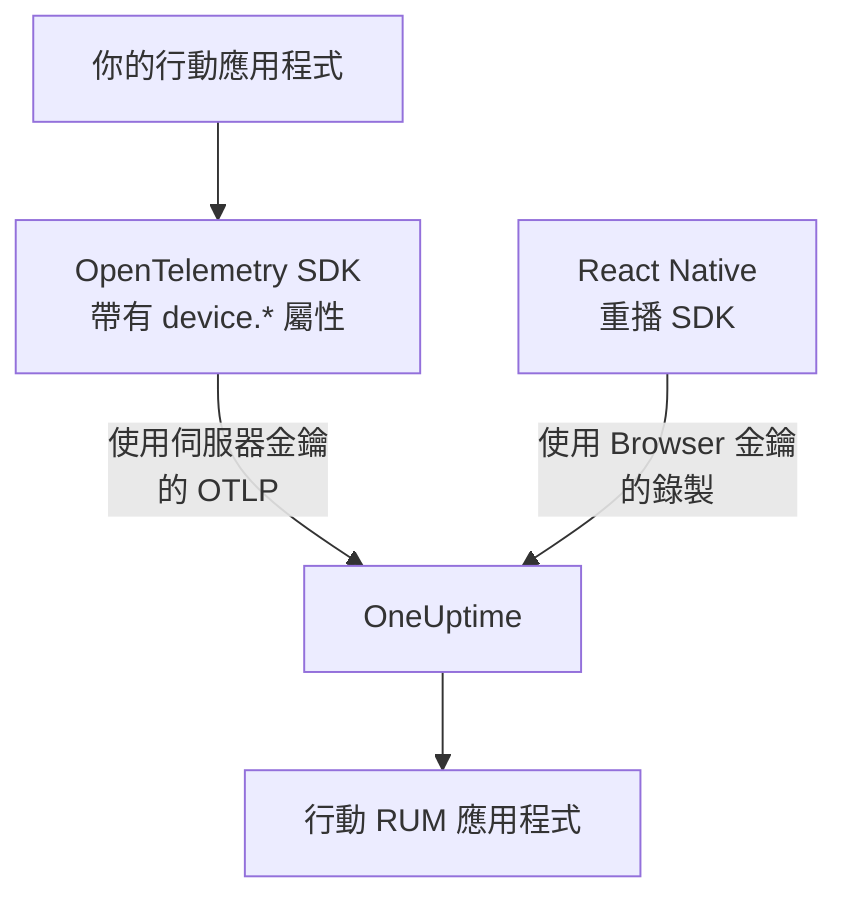

# 行動端設定

使用 OpenTelemetry 檢測 Android、iOS 或 React Native 應用程式，讓它以行動 RUM 應用程式的身分向 OneUptime 回報。任何其他具備 OpenTelemetry SDK 的平台都以相同方式運作。

:::cards
- [OneUptime 需要什麼](#oneuptime-需要什麼): 兩個資源屬性，以伺服器金鑰傳送。
- [設定你的平台](#設定你的平台): Android、iOS、React Native 及其他平台。
- [iOS 當機和卡頓](#ios-當機和卡頓): MetricKit 和 KSCrash 的報告，顯示在例外中，並由你的 dSYM 命名。
- [確認資料抵達](#確認資料抵達): 先測試金鑰，再找到應用程式。
- [行動端的工作階段重播](#行動端的工作階段重播): React Native 應用程式的錄製。
:::

## 運作方式

你的應用程式使用 **伺服器** 擷取金鑰，將 OTLP 直接匯出到 OneUptime。讓它被歸類為行動 RUM 而不是後端服務的，是其資源上的 `device.*` 屬性。



## OneUptime 需要什麼

應用程式匯出的每個批次都需要兩個資源屬性：

| 屬性 | 意義 |
| --- | --- |
| `service.name` | 應用程式的識別，例如 `storefront-android` 。 |
| `device.id` 或 `device.model.identifier` | 將遙測標記為行動 RUM。 `device.model.identifier` 也會填入 **用戶端** 頁面。 |

沒有裝置屬性時，遙測資料仍會抵達，你也可以查詢，但它會被歸為後端服務，而不是 RUM 應用程式。

`device.manufacturer` 也會把批次標記為行動端，但僅限於沒有主機識別的資源，因為主機清單也會用它回報機器的製造商。像下面每個範例一樣同時設定 `device.id` 或 `device.model.identifier` ，這點就無關緊要。

讓 `device.id` 成為以安裝為範圍的識別碼，絕不要使用廣告 ID 或任何其他能識別個人的值。OneUptime 讀取它只是為了辨識行動遙測。

## 開始之前

- 一個具備 OpenTelemetry SDK 的應用程式：OpenTelemetry Java SDK 或 OpenTelemetry Android、opentelemetry-swift，或用於 React Native 的 OpenTelemetry JavaScript SDK。
- 一個 **伺服器** 擷取金鑰，在 **專案設定 → 遙測與 APM → 擷取金鑰** 中以 **建立擷取金鑰** 建立。行動應用程式送出的 **瀏覽器** 金鑰會被拒絕：它要依 `Origin` 標頭檢查，而行動 SDK 不會傳送這個標頭。
- 下列 OTLP 設定。如果你自行託管 OneUptime，請把 `https://oneuptime.com` 換成你自己的主機。

| 設定 | 值 |
| --- | --- |
| OTLP 端點 | `https://oneuptime.com/otlp` |
| 標頭 | `x-oneuptime-token: YOUR_TELEMETRY_INGESTION_TOKEN` |
| 追蹤 | `POST https://oneuptime.com/otlp/v1/traces` |
| 指標 | `POST https://oneuptime.com/otlp/v1/metrics` |
| 日誌 | `POST https://oneuptime.com/otlp/v1/logs` |

> [!WARNING]
> 金鑰會隨應用程式一起發布，而應用程式可以被解開，所以請假設有人會複製它。在金鑰的頁面上設定 **固定的服務名稱** ，讓副本無法以你的後端服務名稱寫入，再加上 **Requests Per Minute Limit** 和 **到期於** 日期，並隨每次發布輪替金鑰。

## 設定你的平台

這些程式碼片段呈現設定的大致樣貌。行動 OpenTelemetry SDK 的 API 會隨版本變動，因此請對照你鎖定的版本核對方法名稱。OneUptime 需要的東西從不改變：端點、標頭、 `service.name` 和一個 `device.*` 屬性。

:::tabs
@tab Android
使用可在 Android 上執行的 OpenTelemetry Java SDK 及其 OTLP 匯出器：

```kotlin title="app/build.gradle.kts"
dependencies {
    implementation(platform("io.opentelemetry:opentelemetry-bom:<latest>"))
    implementation("io.opentelemetry:opentelemetry-sdk")
    implementation("io.opentelemetry:opentelemetry-exporter-otlp")
}
```

```kotlin title="StorefrontApplication.kt"
import android.app.Application
import android.os.Build
import io.opentelemetry.exporter.otlp.http.trace.OtlpHttpSpanExporter
import io.opentelemetry.sdk.OpenTelemetrySdk
import io.opentelemetry.sdk.resources.Resource
import io.opentelemetry.sdk.trace.SdkTracerProvider
import io.opentelemetry.sdk.trace.export.BatchSpanProcessor

class StorefrontApplication : Application() {
    override fun onCreate() {
        super.onCreate()

        val resource = Resource.getDefault().toBuilder()
            .put("service.name", "storefront-android")
            .put("device.manufacturer", Build.MANUFACTURER)
            .put("device.model.identifier", Build.MODEL)
            .build()

        val exporter = OtlpHttpSpanExporter.builder()
            .setEndpoint("https://oneuptime.com/otlp/v1/traces")
            .addHeader("x-oneuptime-token", BuildConfig.ONEUPTIME_TOKEN)
            .build()

        OpenTelemetrySdk.builder()
            .setTracerProvider(
                SdkTracerProvider.builder()
                    .setResource(resource)
                    .addSpanProcessor(BatchSpanProcessor.builder(exporter).build())
                    .build()
            )
            .buildAndRegisterGlobal()
    }
}
```

[OpenTelemetry Android](https://github.com/open-telemetry/opentelemetry-android) 代理程式在此基礎上加入當機、ANR、緩慢影格和凍結影格以及應用程式啟動，並在自己的資源上設定 `device.model.identifier` 和 `device.manufacturer` 。 [Android 端設定](/docs/rum/android-setup) 說明如何用它取代上面的程式碼進行設定。
@tab iOS
使用 [opentelemetry-swift](https://github.com/open-telemetry/opentelemetry-swift) ，並自行設定裝置屬性：各版本自行加入的資源在不同版本之間有所變動。

```swift
let resource = Resource(attributes: [
    "service.name": .string("storefront-ios"),
    "device.model.identifier": .string(UIDevice.current.model),
    "device.manufacturer": .string("Apple"),
    "device.id": .string(UIDevice.current.identifierForVendor?.uuidString ?? ""),
    "telemetry.sdk.language": .string("swift"),
])

let exporter = OtlpHttpTraceExporter(
    endpoint: URL(string: "https://oneuptime.com/otlp/v1/traces")!,
    config: OtlpConfiguration(
        headers: [("x-oneuptime-token", oneUptimeToken)]
    )
)

OpenTelemetry.registerTracerProvider(
    tracerProvider: TracerProviderBuilder()
        .with(resource: resource)
        .add(spanProcessor: BatchSpanProcessor(spanExporter: exporter))
        .build()
)
```

`UIDevice.current.model` 會提供 `iPhone` 這類簡短名稱，讓 **用戶端** 頁面每種裝置只有一列。 `identifierForVendor` 是 OneUptime 計算無當機安裝時所依據的安裝，詳見 [記錄工作階段](#記錄工作階段) 。
@tab React Native
React Native 執行的是 OpenTelemetry JavaScript SDK，因此請依照 [瀏覽器端設定](/docs/rum/browser-setup) 建立提供者、OTLP 匯出器和批次處理器，並做三項變更：以 **伺服器** 金鑰傳送、拿掉 `browserDetector` 和 `DocumentLoadInstrumentation` ，以及自行設定裝置屬性。

```ts
import { Platform } from "react-native";
import * as Device from "expo-device"; // or react-native-device-info
import {
  defaultResource,
  resourceFromAttributes,
} from "@opentelemetry/resources";

const resource = defaultResource().merge(
  resourceFromAttributes({
    "service.name": "storefront-mobile",
    "device.manufacturer": Device.manufacturer ?? Platform.OS,
    "device.model.identifier":
      Device.modelId ?? Device.modelName ?? "unknown",
    "telemetry.sdk.language": "webjs",
  }),
);
```

`Device.modelId` 只在 iOS 上設定，因此 Android 會改用 `Device.modelName` 。
@tab 其他平台
Flutter、Unity、.NET MAUI、嵌入式用戶端或你自己撰寫的 OTLP 寫入器都可以，只要資源帶有 `service.name` 和一個 `device.*` 屬性。會讀取標準 OpenTelemetry 環境變數的 SDK 會原樣採用這些值：

```bash
OTEL_EXPORTER_OTLP_ENDPOINT="https://oneuptime.com/otlp"
OTEL_EXPORTER_OTLP_HEADERS="x-oneuptime-token=YOUR_TELEMETRY_INGESTION_TOKEN"
OTEL_RESOURCE_ATTRIBUTES="service.name=storefront-mobile,device.manufacturer=Acme,device.model.identifier=AC-100"
```

SDK 會自行在端點後加上 `/v1/traces` 、 `/v1/metrics` 和 `/v1/logs` 。
:::

## iOS 當機和卡頓

opentelemetry-swift 2.3 及更新版本透過其 MetricKit 檢測回報 iOS 應用程式的當機和卡頓，這項檢測會把 Apple 的每則診斷以一筆日誌記錄的形式交給 OpenTelemetry。OneUptime 會像歸檔 OpenTelemetry Android 的當機和 ANR 那樣歸檔它們，因此它們會顯示在 **例外** 中和應用程式的 **概覽** 上：

| Apple 的診斷 | 事件名稱 | 在例外中 |
| --- | --- | --- |
| 當機 | `metrickit.diagnostic.crash` | 一個未處理的例外，其類型取決於結束應用程式的原因：在 iOS 17 及更新版本上為 Objective-C 例外，否則為 Mach 例外（ `EXC_BAD_ACCESS` ），再否則為訊號（ `SIGSEGV` ） |
| 卡頓 | `metrickit.diagnostic.hang` | 一個類型為 **Hang** 的未處理例外，也就是 iOS 上與 ANR 相對應的情況，它會記下卡頓持續了多久 |

概覽的 **當機** 圖塊會計算這些當機，其 **ANR** 圖塊會把卡頓與 Android 的 ANR 一起計算。每條堆疊追蹤都會像當機報告那樣依執行緒繪製，當機或卡頓的執行緒排在最前面。上傳某個建置的 dSYM 之後，你的應用程式程式碼中的框架會以其函式命名，例如 `CartViewController.checkout()` ，見 [上傳 dSYM](#上傳-dsym) 。其餘的框架會列出它所在的二進位檔，以及程式碼在其中的位移量， **Binary Images** 列出每個二進位檔的 UUID，據此可知是哪個建置的 dSYM 為它命名。

當機和卡頓會依當機或卡頓的執行緒上你的應用程式的框架分組：有 dSYM 命名的框架依函式分組，因此同一個當機從一個版本到下一個版本始終是同一個例外；沒有 dSYM 命名的框架依其在二進位檔中的位移量分組，而位移量每次建置都會改變。報告在送達時命名，所以請在發布某個建置之前上傳它的 dSYM：在 dSYM 之前送達的當機會保留其位移量。

:::steps
### 除了 span，也匯出日誌

MetricKit 以日誌記錄的形式回報診斷，因此請在追蹤器提供者旁邊註冊一個日誌記錄器提供者，並使用相同的資源、端點和標頭：

```swift
let logExporter = OtlpHttpLogExporter(
    endpoint: URL(string: "https://oneuptime.com/otlp/v1/logs")!,
    config: OtlpConfiguration(
        headers: [("x-oneuptime-token", oneUptimeToken)]
    )
)

OpenTelemetry.registerLoggerProvider(
    loggerProvider: LoggerProviderBuilder()
        .with(resource: resource)
        .with(processors: [
            BatchLogRecordProcessor(logRecordExporter: logExporter),
        ])
        .build()
)
```

### 註冊 MetricKit 檢測

加入 opentelemetry-swift 的 `MetricKitInstrumentation` 產品，並在日誌記錄器提供者註冊之後把它註冊到 MetricKit：

```swift
import MetricKit
import MetricKitInstrumentation

// MXMetricManager keeps only a weak reference: hold this for the app's lifetime.
let metricKitInstrumentation = MetricKitInstrumentation()
MXMetricManager.shared.add(metricKitInstrumentation)
```

### 記錄工作階段

**工作階段** 和 **無當機工作階段** 圖塊會計算你的 span 上的 `session.id` 。opentelemetry-swift 的 `Sessions` 產品會設定它：把 `SessionSpanProcessor` 加到追蹤器提供者，並用 `SessionLogRecordProcessor` 包裝日誌處理器，讓診斷也帶有工作階段。

**無當機工作階段** 下方的那一行顯示未當機的安裝所佔的比例， **Daily Crash Rate** 和 **Daily ANR Rate** 則根據當機的安裝所佔的比例發出警示。一次安裝就是上方資源中的 `device.id` ，也就是應用程式的供應商識別碼：每台裝置上你的所有應用程式共用一個，只要其中任何一個仍然安裝就會保留，因此重新安裝你唯一的應用程式會產生新的安裝，而重新安裝兩個應用程式中的一個則不會。設定了 `app.installation.id` 的 opentelemetry-swift 版本則改為依它計算。

### 上傳 dSYM

Xcode 在封存應用程式時會為應用程式的每個二進位檔寫出一個 dSYM，App Store Connect 也會在 **Download dSYMs** 下把它們交還給你。每次封存後，從 CI 或 Xcode 建置階段，用 [OneUptime CLI](/docs/cli/index) 和你的建置專用的伺服器金鑰上傳它們：設定了 **固定的服務名稱** 的金鑰（例如隨你的應用程式一起發布的金鑰）會被拒絕，因為一個 dSYM 會為專案中每個發布其二進位檔的應用程式的框架命名。

```bash
oneuptime dsym upload "$ARCHIVE_PATH/dSYMs" --app storefront-ios --url https://oneuptime.com --ingestion-key YOUR_TELEMETRY_INGESTION_TOKEN
```

CLI 會讀取 `.dSYM` 套件、包含它們的資料夾和 zip，以及所在位置的 DWARF 檔案，只傳送每個二進位檔的 UUID、架構和函式名稱：大型應用程式的 dSYM 有數百 MB，而其中的名稱只有幾 MB。不使用 CLI 時，請按原樣傳送 dSYM 的 DWARF 檔案，或 `.dSYM` 套件的 zip，每個檔案最大 50 MB：

```bash
curl --fail -X POST "https://oneuptime.com/dsyms/v1/upload" \
  -H "x-oneuptime-token: YOUR_TELEMETRY_INGESTION_TOKEN" \
  -F "appName=storefront-ios" \
  -F "dsym=@MyApp.app.dSYM/Contents/Resources/DWARF/MyApp"
```

每個二進位檔依其 UUID 保留 400 天，因此幾個月後仍裝在使用者手機上的版本依然會被命名，而再次上傳某個建置會取代為它保留的內容。dSYM 屬於專案，而不屬於某一個應用程式：你的兩個應用程式都內嵌的 framework 在兩個應用程式中都會被命名。
:::

> [!NOTE]
> Apple 會在應用程式之後的某次啟動時把 MetricKit 的診斷交給應用程式：在 iOS 15 及更新版本上會立即交付，更早的版本則每天一次。因此當機或卡頓可能在發生幾分鐘或一天後才送達，並在送達時才被計數。iOS 應用程式概覽上的「過去一小時 0 次當機」還不算好消息。診斷帶有的是回報它的工作階段，而不是它所結束的工作階段。

opentelemetry-swift 不會在應用程式啟動時記錄 span，因此在你的應用程式自行記錄一個之前， **應用程式啟動** 和 **冷啟動（p95）** 圖塊會一直是空的：這個 span 名為 `AppStart` ， `start.type` 設為 `cold` 、 `warm` 或 `hot` ，時間範圍從程序啟動到第一個畫面準備就緒。

### 當 KSCrash 也回報當機時

opentelemetry-swift 也可以透過 KSCrash 回報當機，KSCrash 會在應用程式下次開啟時，把報告以一筆 `device.crash` 日誌記錄的形式傳送，並附上應用程式當機的時間。同時註冊了兩者的應用程式會把每次當機回報兩次：KSCrash 在下次啟動時回報，MetricKit 在下次啟動時或最多一天後回報。OneUptime 只把這樣的當機計數一次：先送達的報告就是這次出現，第二份報告作為同一次當機的證據，保存在同一個例外中它的旁邊，不計入任何圖塊、圖表或監測器。在例外的 **發生次數** 中，這次出現會顯示 **回報了兩次** 。

只有在以下條件全部成立時，兩份報告才會被視為同一次當機：

- 它們來自兩個回報來源：KSCrash 和 MetricKit。兩者都不會把一次當機回報兩次，所以來自同一個來源的兩份報告就是兩次當機。
- 它們來自同一次安裝：相同的 `app.installation.id` 或 `device.id` 。
- 它們相隔不超過 26 小時：MetricKit 為當機標記的是它所回報那一天的結束時間，KSCrash 標記的是當機發生的時刻。
- 在訊號、Mach 例外和 Objective-C 例外上，凡是兩者都列出的，都必須一致。
- 當機的執行緒從執行緒開始處向內逐框架一致，依二進位檔和位移量比較，涵蓋任一報告列出的你的應用程式程式碼的每個框架。完全發生在 Apple 程式碼中的當機，必須至少有三個框架一致，而且所有框架都一致。

每份報告只配對一次，與時間上最接近的報告配對，因此同一次安裝上同一個錯誤相隔幾分鐘的兩次當機是兩次出現，各自帶有自己的第二份報告。當 OneUptime 無法把一份報告與同一安裝的其他報告比較時，就會計入它，因此一次當機最壞會被計數兩次，但絕不會遺失。

## 確認資料抵達

:::steps
### 測試金鑰

在翻查 SDK 的設定之前，先確認 OneUptime 是否接受該金鑰：

```bash
curl -i https://oneuptime.com/otlp/v1/validate \
  -H "x-oneuptime-token: YOUR_TELEMETRY_INGESTION_TOKEN"
```

`200` 加上 `"valid": true` 表示金鑰已被接受。Browser 金鑰也會回傳 `200` ，但其訊息會說明它只能在瀏覽器中使用：行動應用程式需要伺服器金鑰。 `401` 表示金鑰不明、已撤銷、已關閉或已過期，任何 SDK 設定都無法解決。

### 啟動應用程式

執行應用程式並使用一下。收到第一批遙測資料後，它會以其 `service.name` 命名，出現在 **產品 → 資源 → 真實使用者監測** 下。

### 開啟用戶端頁面

開啟應用程式的 **用戶端** 頁面： `device.model.identifier` 中的每個裝置型號都有一列。如果 **追蹤** 有資料而這個頁面一直是空的，表示裝置屬性沒有進入資源。
:::

## 行動端的工作階段重播

React Native 應用程式可以使用 `@oneuptime/react-native-replay` 錄製工作階段。它會把原生檢視樹記錄為線框，絕不記錄螢幕截圖或畫面上的文字，其錄製與 Web 錄製在同一個播放器中開啟。它使用 **瀏覽器** 金鑰傳送，該金鑰的 **允許的來源** 以 `app://` 加上 Android 應用程式 ID 或 iOS 套件組合 ID 的形式列出你的應用程式：這是一個獨立的金鑰，不同於 OpenTelemetry SDK 使用的伺服器金鑰。 [在 React Native 中安裝](/docs/telemetry/session-replay#在-react-native-中安裝) 會逐步說明。

原生 Android 和 iOS 應用程式以及其他平台沒有工作階段錄製器：它們的 **工作階段重播** 頁面會保持空白，而追蹤、日誌、指標、例外和 **用戶端** 頁面照常運作。

## 疑難排解

:::details 金鑰檢查回傳 401，或金鑰被拒絕
`401` 表示金鑰不明、已撤銷、已關閉或已過期：請建立伺服器金鑰，並用它重新建置應用程式。

Browser 金鑰能通過檢查，但行動應用程式的每次匯出都會被拒絕，回傳 `422` 和 `This request did not send an Origin header, so it cannot be checked against the allowed origins of this browser ingestion key. Use a server ingestion key for requests that are not sent by a browser.` 。請使用 **伺服器** 金鑰。
:::

:::details 應用程式出現在服務下，而不是真實使用者監測下
資源既沒有 `device.id` 也沒有 `device.model.identifier` ，因此遙測被歸為後端服務。請依照 [設定你的平台](#設定你的平台) 設定它們。

已建立的服務不會變成 RUM 應用程式，因此在 RUM 遙測抵達後，請在 **產品 → 服務** 下刪除它。
:::

:::details 用戶端頁面是空的
用戶端列只來自 `device.model.identifier` 。只設定 `device.id` 或 `device.manufacturer` 的 SDK 會把應用程式歸為行動 RUM，但不會列出任何用戶端：請同時設定 `device.model.identifier` 。
:::

:::details 有人在使用應用程式，狀態卻顯示近期無流量
15 分鐘沒有遙測時，狀態會變成 **近期無流量** 。如果有人正在使用應用程式：

- 取樣器可能丟棄了所有資料：檢查是否有 always-off 取樣器，或比例非常低的取樣器。
- 應用程式可能只為那段時間內沒有人執行過的動作傳送遙測。
- 發布之後，金鑰可能已被撤銷或已過期：請依照 [確認資料抵達](#確認資料抵達) 測試它。
:::

## 後續步驟

:::cards
- [工作階段重播](/docs/telemetry/session-replay): 錄製 React Native 工作階段，與其追蹤並列。
- [管理應用程式](/docs/rum/applications): 名稱、標籤、擁有者和保留期。
- [OpenTelemetry](/docs/telemetry/open-telemetry): OTLP 端點、限制和錯誤的完整說明。
- [RUM 疑難排解](/docs/rum/troubleshooting): 依問題通常發生的順序列出的所有檢查。
:::
