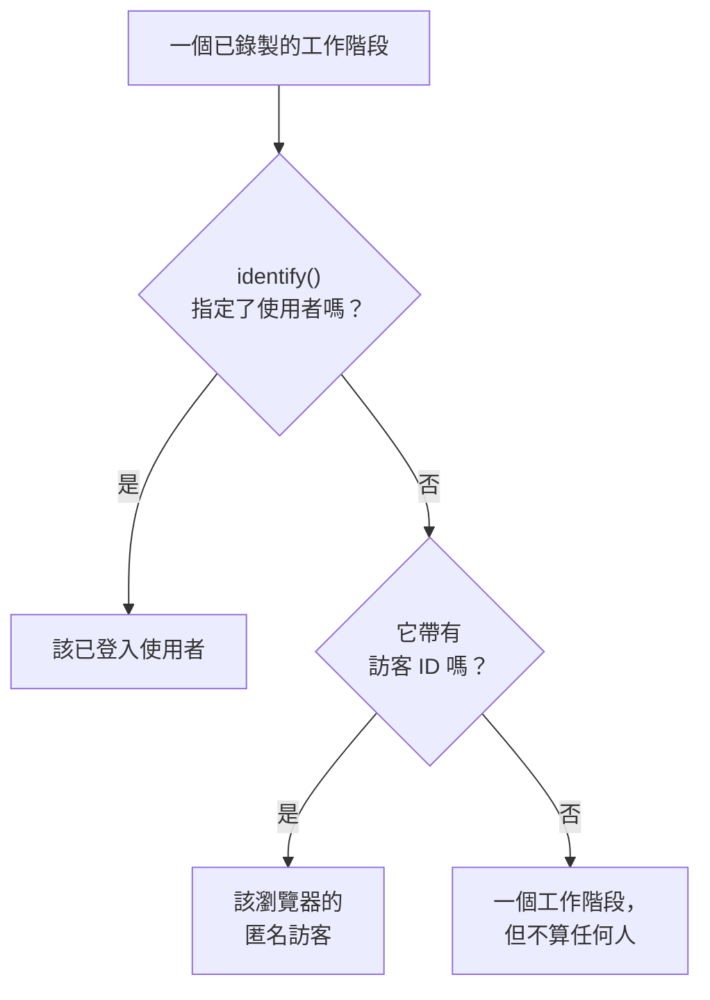

# 產品分析

產品分析會計算使用某個 RUM 應用程式的人，以及他們的工作階段情況：活躍、新、回訪、已登入和休眠使用者，以及依裝置、瀏覽器、國家和頁面劃分的工作階段。它計算 [工作階段重播](/docs/telemetry/session-replay) 錄製的工作階段，因此不需要專屬的程式碼片段，並會把數字保留 13 個月，遠比錄製的到期時間長。

:::cards
- [如何計算人數](#如何計算人數): 已登入使用者算一次，匿名瀏覽器也算一次。
- [使用者](#使用者): 活躍、新、回訪、已登入、全部和休眠使用者。
- [工作階段](#工作階段): 多少個、多長，以及依裝置、瀏覽器、國家和頁面劃分。
- [隱私與保留](#隱私與保留): 13 個月，不儲存姓名，可依要求抹除。
:::

## 如何計算人數

應用程式的側邊選單有一個 **產品分析** 區段，包含兩個頁面： **使用者** 和 **工作階段** 。兩者都計算工作階段重播錄製的工作階段，因此會在應用程式的錄製器開始運作時開始計算，重播政策沒有錄製的工作階段不會計入。每個工作階段要麼算作一個人，要麼不算作任何人：

- **已登入使用者只算一次** ，無論他們使用多少個瀏覽器和裝置：辨識依據是你的頁面傳給 `identify()` 的參照的單向雜湊（請參閱 [識別你的使用者](/docs/telemetry/session-replay#識別你的使用者) ）。
- **匿名瀏覽器只算一次** ，依據其 [匿名訪客 ID](/docs/telemetry/session-replay#匿名訪客) 。兩個瀏覽器就是兩個訪客，而某個瀏覽器在有人登入之前的工作階段仍歸其訪客所有。
- **來自舊版錄製器的工作階段** 不會傳送訪客 ID，因此算作工作階段，但不算作人。

天數依你自己的時區計算。

## 使用者

**使用者** 計算你所選時間範圍內的人：

| 卡片 | 計算什麼 |
| --- | --- |
| **活躍使用者** | 在該時間範圍內來過的每個人：每個已登入使用者算一次，每個匿名瀏覽器算一次。 |
| **新使用者** | 首次造訪發生在該時間範圍內的活躍使用者。 |
| **回訪使用者** | 在該時間範圍開始之前就來過的活躍使用者。 |
| **已登入使用者** | 你的應用程式透過 `identify()` 登入的活躍使用者，以及他們在全部活躍使用者中所占的比例。 |
| **使用者總數** | 應用程式在過去 13 個月裡見過的每個人。 |
| **休眠使用者** | 以前來過，但在過去 30 天內，或你選擇的 7、14、60 或 90 天內沒有來過的人。 |

前三張卡片也會顯示與上一個時段相比的變化。卡片下方， **活躍使用者** 依日繪製當天來過的人、截至當天的 7 天內來過的人和截至當天的 30 天內來過的人， **新使用者與回訪使用者** 則把每天的人分成兩部分。

**人員** 列出卡片計算的每個人，每人一列，最近見到的排在最前，其篩選器可以顯示某張卡片的人、匿名訪客或所有人。開啟某個人，可查看其首次和最近一次造訪，以及過去 13 個月裡的每個工作階段，錄製仍被保留的工作階段旁有 **觀看** 。

## 工作階段

**工作階段** 計算在該時間範圍內開始的工作階段： **工作階段** 、 **已登入工作階段** 、 **工作階段時長中位數** 、 **每個工作階段的頁面數** 、 **有錯誤的工作階段** 和 **受挫工作階段** 。卡片下方：

- **依裝置劃分的工作階段** 依日繪製來自桌上型裝置、手機和平板電腦的工作階段。行動應用程式在較短邊為 600 點或以上的螢幕上的工作階段算作平板電腦的工作階段。
- **工作階段時長** 依持續時間將已結束的工作階段分組，從不到 10 秒到超過 30 分鐘。仍在錄製的工作階段還沒有時長。
- **明細** 依裝置類型、瀏覽器、作業系統、國家、應用程式版本、入口頁面或頁面排列使用者和工作階段，使用者最多的排在最前。

## 隱私與保留

- **13 個月** 。某個月的數字會在其後第 13 個月的第一天刪除，因此最近 12 個完整月份始終都在，與錄製本身的保留期（預設 7 天）無關。
- **不儲存姓名** 。這些數字保存已登入使用者的單向金鑰和瀏覽器的訪客 ID，從不保存參照、特徵或 IP 位址。只有在此人的某個錄製仍被保留時，並且只對可以讀取身分的角色，列才會顯示已登入使用者的名字；否則顯示 **已登入使用者** 或 **匿名訪客** 以及 ID 的開頭。
- **依要求抹除** 。抹除要求也會刪除這裡對應的數字（請參閱 [抹除工作階段](/docs/telemetry/session-replay#抹除工作階段) ）。

## 誰可以查看

讀取這兩個頁面所需的權限與讀取工作階段清單相同： `ReadRumSessionReplay` (_List Session Replays_) 或 `ReadRumSessionReplayPayload` (_Watch Session Replays_)，專案擁有者和管理員擁有這些權限。要查看已登入使用者是誰，以及依姓名搜尋人，需要 [誰可以觀看錄製](/docs/telemetry/session-replay#誰可以觀看錄製) 中所述的身分權限。

## 後續步驟

:::cards
- [工作階段重播](/docs/telemetry/session-replay): 錄製這些頁面計算的工作階段，並觀看它們。
- [管理應用程式](/docs/rum/applications): 名稱、標籤、擁有者和保留。
- [RUM 概觀](/docs/rum/index): RUM 應用程式還會顯示什麼。
:::
