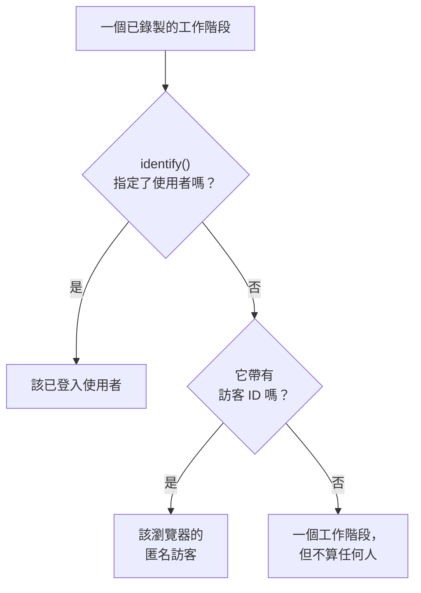

# 產品分析

產品分析會計算使用某個 RUM 應用程式的人、他們的工作階段情況以及他們做了什麼：活躍、新、回訪、已登入和休眠使用者，依裝置、瀏覽器、國家和頁面劃分的工作階段，以及你的應用程式傳送的事件，並以趨勢、漏斗和留存的形式呈現。它計算 [工作階段重播](/docs/telemetry/session-replay) 錄製的工作階段以及其錄製器傳送的事件，因此不需要專屬的程式碼片段，並會把數字保留 13 個月，遠比錄製的到期時間長。

:::cards
- [使用者](#使用者): 活躍、新、回訪、已登入、全部和休眠使用者。
- [工作階段](#工作階段): 多少個、多長，以及依裝置、瀏覽器、國家和頁面劃分。
- [傳送事件和指標](#傳送事件和指標): 人們做了什麼，以及你的頁面測量的數值。
- [事件](#事件): 某件事發生的頻率、誰做的以及在哪裡。
- [漏斗](#漏斗): 誰一步一步繼續下去，以及花了多久。
- [使用者留存](#使用者留存): 誰回來了，逐一依同期群來看。
:::

## 如何計算人數

應用程式的側邊選單有一個 **產品分析** 區段： **使用者** 、 **工作階段** 、 **事件** 、 **漏斗** 、 **使用者留存** 、 **使用者流程** 和 **分析設定** 。 **使用者** 和 **工作階段** 計算工作階段重播錄製的工作階段，因此會在應用程式的錄製器開始運作時開始計算，重播政策沒有錄製的工作階段不會計入。每個工作階段要麼算作一個人，要麼不算作任何人：



- **已登入使用者只算一次** ，無論他們使用多少個瀏覽器和裝置：辨識依據是你的頁面傳給 `identify()` 的參照的單向雜湊（請參閱 [識別你的使用者](/docs/telemetry/session-replay#識別你的使用者) ）。
- **匿名瀏覽器只算一次** ，依據其 [匿名訪客 ID](/docs/telemetry/session-replay#匿名訪客) 。兩個瀏覽器就是兩個訪客，而某個瀏覽器在有人登入之前的工作階段仍歸其訪客所有。
- **來自舊版錄製器的工作階段** 不會傳送訪客 ID，因此算作工作階段，但不算作人。

**事件** 、 **漏斗** 和 **使用者留存** 以同樣的方式計算人數，依據是錄製器從每個工作階段（無論是否錄製）傳送的事件（請參閱 [傳送事件和指標](#傳送事件和指標) ）。

天數依你自己的時區計算。

## 使用者

**使用者** 計算你所選時間範圍內的人：

| 卡片 | 計算什麼 |
| --- | --- |
| **活躍使用者** | 在該時間範圍內來過的每個人：每個已登入使用者算一次，每個匿名瀏覽器算一次。 |
| **新使用者** | 首次造訪發生在該時間範圍內的活躍使用者。 |
| **回訪使用者** | 在該時間範圍開始之前就來過的活躍使用者。 |
| **已登入使用者** | 你的應用程式透過 `identify()` 登入的活躍使用者，以及他們在全部活躍使用者中所占的比例。 |
| **使用者總數** | 應用程式在過去 13 個月裡見過的每個人。 |
| **休眠使用者** | 以前來過，但在過去 30 天內，或你選擇的 7、14、60 或 90 天內沒有來過的人。 |

前三張卡片也會顯示與上一個時段相比的變化。卡片下方， **活躍使用者** 依日繪製當天來過的人、截至當天的 7 天內來過的人和截至當天的 30 天內來過的人， **新使用者與回訪使用者** 則把每天的人分成兩部分。

**人員** 列出卡片計算的每個人，每人一列，最近見到的排在最前，其篩選器可以顯示某張卡片的人、匿名訪客或所有人。開啟某個人，可查看其首次和最近一次造訪，以及過去 13 個月裡的每個工作階段，錄製仍被保留的工作階段旁有 **觀看** 。

## 工作階段

**工作階段** 計算在該時間範圍內開始的工作階段： **工作階段** 、 **已登入工作階段** 、 **工作階段時長中位數** 、 **每個工作階段的頁面數** 、 **有錯誤的工作階段** 和 **受挫工作階段** 。卡片下方：

- **依裝置劃分的工作階段** 依日繪製來自桌上型裝置、手機和平板電腦的工作階段。行動應用程式在較短邊為 600 點或以上的螢幕上的工作階段算作平板電腦的工作階段。
- **工作階段時長** 依持續時間將已結束的工作階段分組，從不到 10 秒到超過 30 分鐘。仍在錄製的工作階段還沒有時長。
- **明細** 依裝置類型、瀏覽器、作業系統、國家、應用程式版本、入口頁面或頁面排列使用者和工作階段，使用者最多的排在最前。

## 傳送事件和指標

只要應用程式 **分析設定** 頁面上的 **傳送產品分析事件** 處於開啟狀態，就會傳送事件。新的應用程式一開始就是開啟的，而在它出現之前建立的應用程式則是關閉的，所以請在那裡開啟它。應用程式的工作階段重播也必須開啟，因為事件由它的錄製器傳送；React Native 錄製器目前還不會傳送事件。

瀏覽器錄製器執行的每個工作階段都會自動傳送其開始和它瀏覽的每個頁面，包括單頁應用程式的路由變更，無論重播的取樣和政策是否錄製該工作階段。你自己的事件和數值來自頁面的程式碼：

```js
OneUptimeReplay.track("Signed up", { plan: "pro" });
OneUptimeReplay.metric("cart.value", 42.5, { currency: "EUR" });
```

| 呼叫 | 傳送的內容 |
| --- | --- |
| `track(name, properties?)` | 一個由 **事件** 、 **漏斗** 和 **使用者留存** 計算的事件，在工作階段被錄製時還會成為重播時間軸上的一個標記。 `name` ≤ 64 個字元；≤ 20 個屬性，值為字串、數字或布林值，鍵 ≤ 40 個字元，值 ≤ 200 個字元。 |
| `metric(name, value, attributes?)` | 你的頁面測量的一個數值，作為應用程式某個指標的一個資料點（請參閱 [儀表板和警示](#儀表板和警示) ）。 `name` ≤ 100 個字元，由字母、數字、 `_` 、 `.` 、 `-` 和 `/` 組成，以字母開頭且不以 `oneuptime.` 開頭； `value` 為有限數字； `attributes` 與 `track()` 的屬性相同。 |

在錄製器載入之前，請把同樣的呼叫以 `["track", name, properties]` 和 `["metric", name, value, attributes]` 的形式推入 `window.OneUptimeReplayQueue` （請參閱 [JavaScript API](/docs/telemetry/session-replay#javascript-api) ）。

- **每個工作階段，無論是否錄製** 。重播的取樣和上傳政策決定哪些工作階段會被錄製，而不是哪些會被計算。在 Do Not Track 或 Global Privacy Control 下不會傳送任何內容，來自應用程式不允許的來源的內容也不會保留。當政策要求同意時，事件會等待 `grantConsent()` ，最多 500 個，而 `revokeConsent()` 會捨棄它們。
- **像錄製一樣遮罩** 。在 _Mask all text_ 下，事件屬性和指標屬性的值會在離開頁面之前被遮罩。頁面以其路徑傳送，不含查詢字串和片段。
- **小批次傳送** ，每 5 秒一次，以及在分頁被隱藏時。在發生 3 天之後才抵達 OneUptime 的事件會被捨棄，一個專案（所有應用程式合計）每分鐘最多可傳送 60,000 個事件和指標資料點；超過之後，錄製器會等待並重新傳送。

`metric()` 在事件關閉時不會傳送任何內容， `getDiagnostics().productAnalytics` 會說明事件是否開啟（請參閱 [`getDiagnostics()`](/docs/telemetry/session-replay#getdiagnostics) ）。

### 使用者屬性

若要依執行者對事件進行明細拆分和區隔，請在 **分析設定** 的 **用於分析的使用者屬性** 中列出 `identify()` 的特徵鍵，例如 `["plan", "role"]` ，最多 20 個，依書寫原樣比對。之後每個事件都會帶有已登入使用者的這些特徵，與頁面傳給 `identify()` 的一致。其他特徵從不離開頁面，而在 **擷取終端使用者身分** 關閉時，任何特徵都不會離開。不要列出包含個人資料的特徵，例如電子郵件地址。

## 事件

**事件** 一次顯示一個事件：在你選擇其他事件之前，顯示你的應用程式最常發生的事件；在應用程式還沒有傳送任何事件時，顯示瀏覽次數最多的頁面。選擇器還會列出 **工作階段已開始** 和每個被瀏覽的頁面，下方的 **所有事件** 列出時間範圍內的每個事件，以及它發生的次數和執行它的人數；選擇一個即可在上方查看。

- 卡片計算該事件的 **事件** （以及每人平均次數）、它的 **使用者** 和它的 **工作階段** 。
- **事件和使用者** 依日繪製該事件發生的次數，以及當天執行它的人數。
- **明細** 依裝置類型、瀏覽器、作業系統、國家、應用程式版本、頁面、事件屬性或使用者屬性排列該事件，並顯示每個值的事件數、使用者數和占比。選擇一個值即可只顯示它。

**區隔** 把頁面限定為欄位具有你所選值的事件：點選 **新增篩選條件** ，然後選擇欄位和值，完全比對。一個區隔最多包含 5 個篩選條件，事件必須全部符合。頁面網址會保留事件、時間範圍、區隔和明細，因此連結會開啟同樣的檢視。

## 漏斗

**漏斗** 依序追蹤人們走過 2 到 6 個步驟，每個步驟都是 **事件** 中列出的一個事件。在時間範圍內完成第一步的人當中，它計算之後有多少人完成了第二步，然後第三步，且都在你從其第一步起選定的時間內： **1 小時內** 、 **1 天內** 、 **7 天內** 、 **14 天內** 或 **30 天內** 。 **新增步驟** 會新增一個步驟。

**轉換** 下方顯示完成所有步驟的人所占的比例，以及每個步驟到達的人數、這占第一步人數的比例、自上一步以來流失的人數，以及他們從上一步開始所花時間的中位數。嘗試多次的人只算一次，以走得最遠的那次嘗試為準。

漏斗的區隔以及留存表的區隔，使用每個事件都帶有的欄位和使用者屬性，而不使用事件本身的屬性，因為它的各個步驟是不同的事件。

## 使用者留存

**使用者留存** 依人們在時間範圍內首次執行某個事件（ **初始行為** ）的日、週或月將人們分組，並顯示每組中有多少比例的人在該週期及之後的每個週期執行了另一個事件（ **回訪行為** ）。兩者在你選擇其他事件之前都是 **工作階段已開始** 。

**同期群** 設定週期： **按天** 、 **按週** 或 **按月** 。當時間範圍包含的週期多於一張表能顯示的數量（32 天、26 週或 13 個月）時，頁面會把同期群拉長並加以說明。

每一列是一個同期群及其人數，每個儲存格是其中在該週期回來的人所占的比例，人越多顏色越深。尚未開始的週期會留空。

## 儀表板和警示

每個事件也會依分鐘作為應用程式的一個指標來計算，而每次 `metric()` 呼叫都是其所給名稱下一個獨立指標的資料點。你可以在應用程式的 **指標** 頁面上繪製它們、把它們加入儀表板，或用指標監控對它們發出警示； **所有事件** 下的 **開啟指標** 會開啟該頁面。

| 指標 | 計算內容 | 維度 |
| --- | --- | --- |
| `oneuptime.rum.product.events` | 你的 `track()` 事件，每分鐘 | `event.name` |
| `oneuptime.rum.product.sessions` | 開始的工作階段，每分鐘 | `device.type` |
| `oneuptime.rum.product.page.views` | 瀏覽的頁面，每分鐘 | `device.type` |

這三個指標不計費，而且 `metric()` 會拒絕以 `oneuptime.` 開頭的名稱，因此你的頁面傳送的任何內容都不會冒充它們。你的 `metric()` 資料點會像應用程式的其他指標一樣被保留和計費。

## 隱私與保留

- **13 個月** 。某個月的數字會在其後第 13 個月的第一天刪除，因此最近 12 個完整月份始終都在，與錄製本身的保留期（預設 7 天）無關。事件也以同樣的方式保留。
- **不儲存姓名** 。這些數字保存已登入使用者的單向金鑰和瀏覽器的訪客 ID，從不保存參照或 IP 位址，特徵中也只保存你列出的使用者屬性。只有在此人的某個錄製仍被保留時，並且只對可以讀取身分的角色，列才會顯示已登入使用者的名字；否則顯示 **已登入使用者** 或 **匿名訪客** 以及 ID 的開頭。
- **依要求抹除** 。抹除要求也會刪除這裡對應的數字和事件（請參閱 [抹除工作階段](/docs/telemetry/session-replay#抹除工作階段) ）。

## 誰可以查看

讀取這些頁面所需的權限與讀取工作階段清單相同： `ReadRumSessionReplay` (_List Session Replays_) 或 `ReadRumSessionReplayPayload` (_Watch Session Replays_)，專案擁有者和管理員擁有這些權限。要查看已登入使用者是誰，以及依姓名搜尋人，需要 [誰可以觀看錄製](/docs/telemetry/session-replay#誰可以觀看錄製) 中所述的身分權限。

開啟或關閉事件需要 `EditRumApplication` (_Edit RUM Application_) 或專案擁有者、管理員或成員的角色。列出使用者屬性需要 `EditRumApplication` 或擁有者或管理員的角色，因為這決定了會保留已登入者的哪些資訊。

## 後續步驟

:::cards
- [工作階段重播](/docs/telemetry/session-replay): 錄製這些頁面計算的工作階段，並觀看它們。
- [管理應用程式](/docs/rum/applications): 名稱、標籤、擁有者和保留。
- [RUM 概觀](/docs/rum/index): RUM 應用程式還會顯示什麼。
:::
