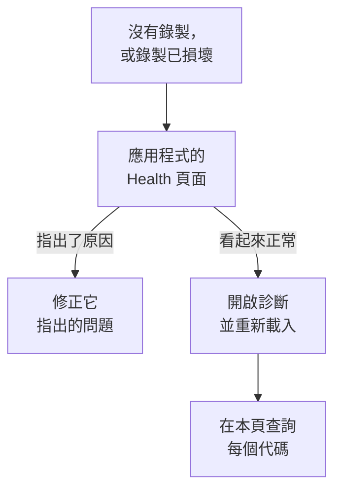

# 工作階段重播疑難排解

當錄製沒有抵達，或者抵達時已經損壞，本頁會幫你找出原因。工作階段重播預設會錄製每個工作階段並邊錄邊上傳，因此一個正常的頁面在使用者進行操作時，大約每 15 秒傳送一個區塊。閒置的分頁不會產生事件，也不會傳送任何內容；在沒有輸入五分鐘後，錄製器會完全暫停（ `recording-paused-idle` ），所以在根據 Network 分頁判斷安裝之前，請先移動滑鼠或按一下。如果即使如此也完全看不到傳往 OneUptime 的請求，原因就在下面某一項中。

:::cards
- [開啟診斷](#開啟診斷): 讓錄製器在主控台中說明它的每個決定。
- [代碼](#代碼): 錄製器輸出的每一行，以及如何處理。
- [OneUptime 前面的防火牆拒絕了區塊](#oneuptime-前面的防火牆拒絕了區塊): 要檢查的規則與要新增的排除項目。
- [重播中缺少圖片、圖示或樣式](#重播中缺少圖片圖示或樣式): 能播放、但與使用者所見不同的錄製。
:::



唯一一種靜默屬於正常的設定，是 _On error or frustration_ （ `OnErrorOrFrustration` ）上傳：此時錄製器在記憶體中保留一個滾動緩衝區，只在出問題時才上傳，在觸發器觸發之前，看起來與安裝損壞完全一樣。在排查其他問題之前，請先確認你用的是哪一種設定：下面說明的 `config-accepted` 行會輸出它。

如果可以，請從伺服器端開始。應用程式側邊選單 **工作階段重播** 區段中的 **健康狀況** 頁面，會在沒有資料抵達時說明原因：錄製器從未載入；已載入但沒有上傳任何內容，以及原因；上傳遭到拒絕，以及原因；或預算已用完。請參閱 [錄製健康狀態](/docs/telemetry/session-replay#錄製健康狀態) 。接下來是瀏覽器端：開啟診斷，重新載入一次，然後閱讀主控台。

錄製能抵達，但播放時圖片損壞、圖示遺失或某些區域沒有樣式？這是重播的問題，答案在 [重播中缺少圖片、圖示或樣式](#重播中缺少圖片圖示或樣式) 中。

## 開啟診斷

選擇你能用到的任一個開關。它們的作用都相同。

:::tabs
@tab 在瀏覽器中
在出問題的瀏覽器中操作。不需要重新部署，在正式環境中也能用，重新載入後仍然有效：

```js
localStorage.setItem("oneuptime.sessionReplay.debug", "true");
// then reload the page
```

用下列程式碼再次關閉：

```js
localStorage.removeItem("oneuptime.sessionReplay.debug");
```
@tab 透過連結
對於不熟悉技術的人，或無法開啟主控台的頁面，請在 URL 中加入 `oneuptime_debug=1` 。它在片段中也有效，因此即使伺服器會移除不認得的查詢參數，它也能保留下來：

```text
https://your-app.example.com/checkout?oneuptime_debug=1
https://your-app.example.com/checkout#oneuptime_debug=1
```
@tab 在指令碼標籤上
適用於希望對所有人開啟的預備環境：

```html
<script
  src="https://oneuptime.com/telemetry/session-replay/v1/recorder.js"
  data-oneuptime-token="YOUR_TELEMETRY_INGESTION_KEY"
  data-oneuptime-app-identifier="YOUR_RUM_APP_IDENTIFIER"
  data-oneuptime-debug="true"
  crossorigin="anonymous"
  async
></script>
```
@tab 在 init 全域物件中
如果你透過 init 全域物件設定錄製器：

```js
window.__ONEUPTIME_SESSION_REPLAY__ = {
  host: "https://oneuptime.com",
  token: "YOUR_TELEMETRY_INGESTION_KEY",
  appIdentifier: "YOUR_RUM_APP_IDENTIFIER",
  debug: true,
};
```
@tab 在部署上
在 OneUptime 部署上操作，這是唯一一個不需要有人守在出問題的瀏覽器前的開關。設定 `SESSION_REPLAY_DEBUG=true` 並重新啟動。之後，這個執行個體提供的每個錄製器都會在它執行的每個頁面上記錄日誌，所以請開啟它，收集一次重新載入的日誌，然後關閉。它不會變更任何策略：不變更取樣，不變更遮罩，也不變更同意。其他部署設定請參閱 [自行託管說明](/docs/telemetry/session-replay#自行託管說明) 。
@tab 執行階段
在錄製器載入之後：

```js
OneUptimeReplay.setDebug(true);
```
:::

輸出如下所示：

```text
[OneUptime Session Replay] loader-start: Loader running.
[OneUptime Session Replay] init-options-read: Init options read. {host: "https://oneuptime.com", appIdentifier: "checkout-web", …}
[OneUptime Session Replay] config-fetch-start: Requesting the policy. {url: "https://oneuptime.com/telemetry/session-replay/v1/config", …}
[OneUptime Session Replay] config-accepted: Policy accepted. {captureTrigger: "Always", samplePercentage: 100, …}
[OneUptime Session Replay] recording: Recording and uploading …
```

## 不必事先開啟任何東西即可取得時間軸

無論診斷是否開啟，錄製器都會保留它最近的 250 個決定。如果問題已經發生，你不需要在開啟日誌的情況下重現它，而是改為取得下列內容：

```js
copy(JSON.stringify(OneUptimeReplay.getDiagnostics(), null, 2));
```

它會傳回錄製器版本、工作階段 ID、它的 `state` （ `recording` 、 `uploading` 、 `not-sampled` 、 `stopped` …）、如果已停止則包括停止原因、 `bootstrapDecision` 、 `decisions` 下每道關卡的答案（是否被取樣、同意狀態、是否允許上傳以及是什麼在阻止上傳、伺服器的最後一個指示）、錄製器的 `capabilities` ，以及完整的記錄清單 — 包括載入器虛設常式的記錄，它在錄製器成品存在之前執行，大多數放棄錄製的決定都在這裡做出。依設計，它不包含任何頁面內容；請參閱 [診斷資訊從不包含的內容](#診斷資訊從不包含的內容) 。這些欄位在 [`getDiagnostics()`](/docs/telemetry/session-replay#getdiagnostics) 中有說明。

**如果出現 `OneUptimeReplay is not defined`** ，表示錄製器成品從未載入 — 這本身就是下面相當一部分代碼的答案，而這也正是你最需要時間軸的時候。記錄仍然存在，位於載入器虛設常式在成品存在之前寫入的一個全域物件上：

```js
copy(JSON.stringify(window.__ONEUPTIME_SESSION_REPLAY_DEBUG__.records, null, 2));
```

把其中任一個貼到你的支援票證中 — 或貼到應用程式 **健康狀況** 頁面上的 **Ask the browser** 中，它會說明其中的每個代碼。通常只要這樣就足夠了。

## 何時靜默是正常的：錯誤觸發的策略

只有當 `config-accepted` 輸出了 `captureTrigger: "OnErrorOrFrustration"` 時，本節才適用。在預設的 `Always` 策略下，錄製器邊錄製邊傳送，使用者正在互動的頁面如果保持靜默，就表示確實出了問題 — 請略過本節繼續閱讀。

如果主控台顯示如下內容：

```text
[OneUptime Session Replay] recording: Recording into memory. Nothing uploads until a trigger fires - call OneUptimeReplay.captureSession() to force one.
```

…那麼錄製器運作正常。在錯誤觸發的策略下，正常的頁面每次頁面載入只會向 OneUptime 送出一個請求（取得設定），在發生錯誤、5xx、挫折訊號或效能預算超標之前，不會傳送其他任何內容。

若要端對端驗證整條路徑，可以強制上傳一次：

```js
OneUptimeReplay.captureSession("installation test");
```

你應該會立即在 Network 分頁中看到一個 `POST /telemetry/session-replay/v1/chunk` ，並在主控台中看到一行 `chunk-accepted` 。如果看到了，表示安裝正確，重播會在大約一分鐘內出現在儀表板中，並在其時間軸上標示你提供的原因。

要找的是帶有 `chunk-accepted` 的 `202` 。 `204` 則會記錄 `chunk-not-recorded` ：請求沒有問題，是伺服器選擇不儲存它 — 預算超標、未被取樣，或應用程式已關閉。這是策略給出的答案，而不是安裝錯誤，旁邊的 `server-directive` 行會說明是哪一種。

若要重新錄製每個工作階段，請在應用程式的 **Replay Policy** 頁面上將 **何時上傳錄製** 設為 _Always_ ，並將 **取樣百分比** 設為大於 0。這是出廠預設值。

## 代碼

每一行都帶有一個穩定的 `code` 。在這裡查詢你遇到的代碼。

### 啟動

| 代碼 | 意義 |
| --- | --- |
| `loader-start` | 錄製器指令碼已執行。如果在開啟診斷時看不到這一行，表示指令碼本身從未執行 — 請檢查 Network 分頁中的 `<script>` 請求，以及 CSP 中的 `script-src` 。 |
| `init-options-read` | 找到了選項。請檢查詳細資料中的 `host` 與 `appIdentifier` ： `appIdentifier` 必須與 RUM 應用程式完全相符， `host` 必須是你的 OneUptime 來源，而不是你自己應用程式的來源。 |
| `init-options-incomplete` | 缺少必要的選項。詳細資料會說明 `hasHost` / `hasToken` / `hasAppIdentifier` 中哪一個為 false。如果 `hasHost` 為 false，表示指令碼標籤沒有可用來推導主機的 `src` — 請加入 `data-oneuptime-host` 。 |
| `privacy-signal` | 瀏覽器傳送了 Do Not Track 或 Global Privacy Control，而且該訊號受到遵守 — 由頁面（指令碼標籤上沒有其他說明）或伺服器的策略遵守。不會錄製任何內容；在 `stage: "before-config-fetch"` 時，也不會送出設定請求。這不是錯誤。只有當你的法律依據確實不取決於該訊號時，才設定 `data-oneuptime-respect-do-not-track="false"` 。 |
| `init-options-missing` | 頁面上沒有可讀取的內容：既沒有 `script[data-oneuptime-token]` 標籤，也沒有 `window.__ONEUPTIME_SESSION_REPLAY__` 。標記屬性拼錯了、程式碼片段放進了另一份文件，或者被標籤管理工具移除了。 |
| `loader-threw` | 這是錄製器本身的錯誤，而不是你的設定問題。請附上診斷輸出回報。 |

### 策略

| 代碼 | 意義 |
| --- | --- |
| `config-fetch-start` | 即將請求策略。詳細資料中的 `url` 是確切的 URL — 請檢查它能否在瀏覽器中回應。 |
| `config-fetch-rejected` | 端點傳回了非 2xx 的回應。請參閱下方的 [設定取得狀態](#設定取得狀態) 。 |
| `config-fetch-failed` | 請求從未完成：CSP 中的 `connect-src` 、廣告封鎖程式、DNS、TLS、沒有網路連線，或 5 秒逾時。瀏覽器通常會在這一行旁邊記錄它自己的一行。 |
| `config-body-unparseable` | 端點以 2xx 回應，但本文根本不是 JSON。與 `config-fetch-failed` 不同：請求 *已完成* ，所以是路徑上的某個東西 — Proxy、驗證入口網頁、SSO 中介頁面 — 代替 OneUptime 做出了回應。 |
| `config-unparseable` | 本文 *是* 有效的 JSON，但不是物件 — `null` 、字串、陣列。可能是會改寫內容的 Proxy，或在另一個路徑上回應的伺服器。 |
| `config-disabled` | 伺服器表示這裡關閉了重播。答案在詳細資料的 `disabledReason` 中：請參閱下方的 [disabledReason](#disabledreason) 。 |
| `config-recorder-version-invalid` | 策略沒有準確寫出小寫的 `latest` ，因此無法組出成品 URL。這是會改寫內容的 Proxy 或遭竄改的回應 — 沒有建置產物的部署會改為回報帶有 `recorder-not-built` 的 `config-disabled` 。 |
| `config-accepted` | 策略已被接受。詳細資料就是完整的策略 — `captureTrigger` 、 `samplePercentage` 、 `consentMode` 、 `maskingMode` 。 |
| `config-field-defaulted` | 伺服器沒有傳送某個策略欄位（詳細資料中會寫出）的值，因此這個錄製器使用了產品預設值。僅供參考：通常是伺服器比錄製器舊。如果儀表板顯示該欄位是另一個值，請更新 OneUptime。 |
| `config-value-unrecognised` | 伺服器傳送了這個版本的錄製器不認得的值，因此它退回最安全的值 — 這可能與儀表板顯示的值不同。通常是某個頁面仍在執行上一次部署的錄製器。 |
| `directive-stop` | 伺服器要求這個錄製器放棄錄製。請檢查應用程式的錄製健康狀態，看是否有預算、速率限制或緊急開關。 |

#### 設定取得狀態

| 狀態 | 處理 |
| --- | --- |
| `401` | 擷取權杖錯誤、已撤銷、已到期或屬於另一個專案。請在 **專案設定 → 遙測與 APM → 擷取金鑰** 下建立一個，並用 `GET /session-replay/v1/validate` 確認 — 像錄製器那樣傳送金鑰並加上 `x-oneuptime-app-identifier` 標頭，回應中還會包含該應用程式的 `isSessionReplayEnabled` 、在未開啟時指出關閉了哪個開關的 `sessionReplayDisabledDetail` 、 `isIngestEnabledOnThisInstance` 與 `keyType` 。 |
| `400` | 缺少 `data-oneuptime-app-identifier` 。 |
| `403` | 頁面的來源不在擷取金鑰的 **允許的來源** 中。請加入它，或使用允許清單涵蓋此頁面的金鑰。 |
| `404` | 在 OneUptime 來源上找不到該路徑。幾乎總是 `data-oneuptime-host` 錯誤 — 或是 OneUptime 前面的反向 Proxy 沒有轉送 `/telemetry/*` 。 |
| `5xx` | 伺服器端錯誤；請檢查 OneUptime 應用程式的日誌。 |

#### disabledReason

| 值 | 處理 |
| --- | --- |
| `not-enabled-for-application` | 這個 RUM 應用程式關閉了工作階段重播、識別碼與任何應用程式都不相符，或者專案不允許使用重播。 `disabledDetail` 會說明是哪一種： `application-not-enabled` （該應用程式的開關）、 `project-not-allowed` （位於 **真實使用者監測 → 設定 → 工作階段重播** 下的專案層級開關）、 `application-unknown` （沒有應用程式使用這個 `appIdentifier` — 請在應用程式的 **Replay Policy** 頁面上核對拼字），或 `project-killed` （此部署上維運人員的緊急開關）。 |
| `budget-exhausted` | 專案的每日位元組預算或應用程式的每月預算已經用完，因此錄製器被告知不要錄製，而不是上傳會被拒絕的區塊。 `disabledDetail` 為 `project-daily-budget-exhausted` 或 `app-monthly-budget-exhausted` ， `budgetResetsAt` 會說明何時解除。請在 **Replay Policy** 頁面上提高預算，或等待重設。 |
| `recorder-not-built` | **該部署沒有錄製器成品。** 用戶端無法修正這個問題。產生 `packages/App/FeatureSet/BrowserRecorder/public/dist/manifest.json` 的建置沒有執行，或者其輸出從未進入正在執行的映像。請重新建置並重新部署 OneUptime 應用程式。對於重播從未正常運作過的自行託管安裝，這就是典型的答案。 |
| `disabled-by-default` | 此部署上設定了 `SESSION_REPLAY_ENABLED_BY_DEFAULT=false` 。請將其設為 `true` — 如果是自行託管，請先設定 `SESSION_REPLAY_MAX_BYTES_PER_PROJECT_PER_DAY` ，因為重播是你最重的資料表。 |
| `ingest-disabled` | 此部署上設定了 `SESSION_REPLAY_INGEST_ENABLED=false` 。 |
| `policy-unavailable` | 伺服器無法決定策略 — 通常是 Redis 或 Postgres 的問題。這是刻意的失敗即關閉。請檢查 OneUptime 應用程式的日誌。 |
| `not-reported` | 伺服器比這個欄位舊。請改用儀表板中 **Replay Policy** 頁面上的 **Test your installation** 面板。 |

### 成品

| 代碼 | 意義 |
| --- | --- |
| `artifact-requested` | 正在注入最新的錄製器套件。 `url` 是確切的位址。 |
| `artifact-load-failed` | 它沒有載入。依可能性排序：CSP 中的 `script-src` 不允許你的 OneUptime 來源、SRI 不符（有 Proxy 改寫了套件），或者因為此部署沒有建置錄製器而傳回 404。 |
| `artifact-url-invalid` | 策略沒有準確寫出小寫的 `latest` ，因此沒有組出 URL。這是遭竄改或被 Proxy 修改過的設定回應。 |
| `artifact-api-missing` | 套件已載入，但沒有發佈 `window.OneUptimeReplay` — 頁面上的另一個指令碼覆寫了它。 |
| `bootstrap` | 錄製器成品正在啟動。 |
| `bootstrap-already-started` | 同一頁面上有兩份程式碼片段。請移除其中一份。 |
| `bootstrap-already-running` | 在錄製器已經執行時又呼叫了 `bootstrap()` 。無害；通常是重複的整合。 |
| `bootstrap-cancelled` | 在錄製器啟動之前，執行了 `window.OneUptimeReplayQueue` 佇列中的 `revokeConsent()` 或 `stop()` ，因此這個工作階段不會被錄製。如果你的橫幅已被拒絕，這是正確的。 |
| `prerender-wait` | 瀏覽器預先轉譯了這個頁面（Chrome 會對它預期接下來會被開啟的頁面這樣做），而且還沒有人開啟它。錄製器在訪客開啟頁面時才啟動，因此從未被開啟的頁面什麼也不會錄製；在此期間你的頁面發出的呼叫會在那時套用。 |
| `start-stopped` | 在獨立套件的路徑上， `start()` 沒有取得可用的策略。確切原因在緊鄰其上方的 `config-*` 行中。 |
| `rrweb-did-not-start` | DOM 錄製器拒絕啟動。請回報此問題。 |
| `rrweb-error` | DOM 錄製器在這個頁面上遇到了內部錯誤（錯誤名稱在詳細資料中；只記錄一次）。錄製可能在該處跳動或凍結，出現三次這類錯誤後，工作階段會帶有一則說明此情況的保真度通知。請附上頁面的架構與錯誤名稱回報。 |

### 錄製與上傳

| 代碼 | 意義 |
| --- | --- |
| `not-sampled` | 這個工作階段在取樣抽籤中落選，因此完全不會被錄製。取樣由工作階段 ID 決定，是確定性的，所以重新載入對這個工作階段沒有幫助。請提高取樣百分比。 |
| `recording` | 正在錄製。請閱讀詳細資料：在預設觸發器 `Always` 下， `uploading: true` 是正常狀態。 `captureTrigger: "OnErrorOrFrustration"` 時的 `uploading: false` 是另一種正常狀態，不會送出請求。 |
| `same-origin-propagation` | 錄製器啟動時記錄一次：它是否會在傳往頁面本身來源的請求中加入追蹤內容（ `traceparent` ，以及帶有工作階段 ID 的 `tracestate` ）。帶 `reason: "on"` 的 `enabled: true` 是預設值。 `reason: "policy-off"` 表示應用程式的 **Replay Policy** 頁面上關閉了 **同源追蹤傳播** ； `reason: "opaque-origin"` 表示頁面沒有自己的來源（沙箱化的 iframe、 `about:blank` 、 `srcdoc` 或 `file:` ），因此沒有任何東西算作同源。即使開啟，這些標頭也只會隨工作階段上傳期間送出的請求一起傳送，並且絕不會附加到路徑以 `/v1/traces` 、 `/v1/logs` 或 `/v1/metrics` 結尾的 `POST` 上（頁面本身的 OpenTelemetry 匯出）。當錄製器在一次頁面載入中第一次把同源請求的 `traceparent` 讓給某個代理程式時（因為該代理程式被設定為追蹤該請求；對 Datadog RUM 而言僅限它追蹤的工作階段），還會再記錄一次，帶有 `reason: "agent-stand-down"` 和一個 `agent` 欄位（ `DD_RUM` 、 `NREUM` 或 `elasticApm` ）；該請求仍會取得 `tracestate` 成員，而且只有在代理程式確實傳送了 `traceparent` 時才會被關聯，而 Datadog 只會在它所追蹤、且被取樣用於追蹤的 Datadog 工作階段中傳送。New Relic（ `NREUM` ）會傳送它自己的 `tracestate` 來取代該成員，因此它的請求只能透過追蹤 ID 關聯（請參閱 [Logs 與 Traces 分頁為空](#播放器的-logs-與-traces-分頁為空) ）。請參閱 [與其他遙測資料關聯](/docs/telemetry/session-replay#與其他遙測資料關聯) 。 |
| `same-origin-propagation-tripped` | 錄製器加入了追蹤內容的某個請求在網路層失敗，通常是一個被重新導向到另一個來源的同源請求，而那個來源不允許 `traceparent` 與 `tracestate` 。在本次頁面載入的剩餘時間裡，錄製器不再加入它們。 `retried: true` 表示它是不帶本文的 `fetch` `GET` 或 `HEAD` ，並已依你的頁面送出的原樣再傳送了一次； `false` 表示它無法重試並且失敗了：只有不帶本文的 `fetch` `GET` 或 `HEAD` 會被重試（不包括 XHR、其他方法和帶本文的請求）。你自己頁面的中止與逾時不會觸發它，瀏覽器回報離線期間的失敗也不會；下一次頁面載入會重新開始。請參閱 [啟用工作階段重播後下載或重新導向失敗](#啟用工作階段重播後下載或重新導向失敗) 。 |
| `trigger` | 發生了值得保留的事情。 `reason` 是 `error` 、 `frustration` 、 `performance` 、 `sampled` 或 `manual` 之一。 |
| `upload-started` | 正在清出緩衝區中的預錄內容。區塊 POST 從這裡開始。 |
| `upload-blocked-consent` | 觸發器已觸發，但由於從未取得同意，沒有上傳任何內容。在同意模式 `RequireExplicit` 下，你的頁面必須在橫幅被接受時呼叫 `OneUptimeReplay.grantConsent()` 。 |
| `chunk-discarded-consent` | 相同的原因，發生在下一層：一個已完成的區塊被捨棄了。 |
| `chunk-accepted` | 區塊已抵達並已儲存。安裝運作正常。 |
| `chunk-not-recorded` | 伺服器接受了請求，但刻意選擇不錄製它 — 預算超標、未被取樣、應用程式已停用，或達到每個工作階段的區塊上限。旁邊的 `server-directive` 行會說明原因。安裝是正確的；是策略或預算與你的預期不符。 |
| `chunk-post-failed` | 在這個頁面成功上傳任何內容之前，POST 從未抵達伺服器。原因是 CSP 中的 `connect-src` 、廣告封鎖程式、擷取來源上的 CORS — 或者頁面在第一次上傳之前就失去了連線。會計入斷路器。 |
| `chunk-held-offline` | 離線模式：裝置沒有網路連線（瀏覽器回報離線，或者請求從未抵達一個先前有回應的伺服器）。錄製會繼續，區塊排隊等待； `queueDepth` 是等待中的數量， `retryInMs` 是下一次嘗試的時間。不算作失敗，也不會遺失任何內容。 |
| `back-online` | 斷線後的第一個請求抵達了伺服器。佇列中的區塊正依從舊到新的順序上傳。 |
| `browser-offline` | 瀏覽器觸發了它的 `offline` 事件。錄製會繼續；錄製器會開啟它的離線儲存區，以便保留此刻被關閉的分頁中的區塊。 |
| `browser-online` | 瀏覽器觸發了它的 `online` 事件， `queuedChunks` 現在就會上傳，而不是等待重試計時器。 |
| `offline-queue-full` | 斷線時間超過了上傳佇列的容量（240 個區塊或 4 MB）：為了保留最新的區塊，最舊的 `dropped` 個區塊被捨棄。工作階段會在它們原本的位置顯示空缺。 |
| `offline-flush-stored` | 頁面在離線時被隱藏或關閉，因此它最後的區塊被寫入了瀏覽器的 IndexedDB，而不是傳送出去。 `storeOpen: false` 表示儲存區還沒有開啟完成，正在關閉的分頁仍可能遺失它們。應用程式的下一個頁面會上傳它們。 |
| `final-flush-deferred` | 最後的請求無法帶上所有區塊，剩餘的部分（ `kept` ）被寫入 IndexedDB 留給下一個頁面，而不是被捨棄。 |
| `offline-chunks-restored` | 這個頁面找到了先前某個頁面離線錄製但未能傳送的 `chunks` ，並在上傳自己的區塊之前先上傳它們。 |
| `offline-chunk-claimed-elsewhere` | 同一應用程式的另一個分頁已經上傳了這個分頁儲存的某個區塊，因此這個分頁略過了它。沒有遺失任何內容。 |
| `chunk-post-server-error` | 伺服器傳回了 5xx。錄製器會重試；比較詳細資料中的 `consecutiveFailures` 與 `maxFlushFailures` ，可以看出它離放棄還有多遠。 |
| `chunk-retry-scheduled` | 一次可重試的失敗（網路、5xx 或伺服器節流）把區塊放進了重試佇列；詳細資料中的 `inMs` 是下一次嘗試前的等待時間， `queueDepth` 是等待中的區塊數。目前還沒有遺失任何內容。 |
| `chunk-retry` | 等待結束，正在重新傳送佇列中的區塊。 |
| `chunk-abandoned` | 某個區塊失敗太多次而被捨棄；上傳從下一個區塊繼續。工作階段會在它原本的位置顯示空缺。請查看前面的 `chunk-post-*` 行了解原因。 |
| `final-chunk-carried-queue` | 頁面被隱藏或關閉時，重試佇列中仍有區塊，它們作為額外的框架，隨頁面隱藏時送出的那唯一一個請求一起傳送： `frames` 是該請求帶上的數量， `bytes` 是它的總大小。沒有遺失任何內容 — 放不下的部分由 `final-flush-partial` 回報。 |
| `final-flush-truncated` | 頁面消失時，緩衝區中的資料超過了 keepalive 請求能帶上的量，因此捨棄了最後一個區塊中最舊的事件，讓它放得下； `droppedEvents` 會說明捨棄了多少。保留下來的是工作階段的結尾 — 通常正是你要找的部分。 |
| `final-flush-partial` | 最後的請求無法帶上交給它的所有區塊：傳送了 `sent` 個框架，未傳送 `dropped` 個。封口區塊會優先被選中，所以遺失的是佇列中較舊的區塊，工作階段會在它們原本的位置顯示空缺。 |
| `chunk-too-large` | 某個區塊在壓縮後仍超過單一請求的上限 — 這是來自一個非常大的 DOM、無法拆分的整頁快照。只會傳送它宣告的大小，伺服器傳回 422，工作階段會用一則保真度通知取代該快照，而不是失敗。 |
| `envelope-trimmed` | 區塊的標頭 JSON 超過了伺服器 8 KB 的信封上限，因此依下列順序移除了選用欄位，直到放得下為止：追蹤 ID、路由、特徵、標籤、保真度通知（ `shed` 列出被移除的內容）。錄製不受影響；工作階段可能缺少部分關聯資料或標籤資料。通常是同一個工作階段中有 20 個最大長度的標籤和 20 個最大長度的特徵。 |
| `final-chunk-too-large` | 頁面消失時傳送的某個區塊，超過了錄製器在頁面隱藏清出時給自己的 56 KB 限額 — 刻意低於瀏覽器 64 KB 的 keepalive 總配額。如果是 `sealed: true` ，那就是最後一個區塊：它的事件被捨棄，錄製會提早幾秒結束，並改為傳送一個空的最後區塊，讓工作階段仍隨分頁一起結束，區塊序列也沒有空缺。如果是 `sealed: false` ，那就不是最後一個區塊：它被整個捨棄，沒有任何內容被封口，工作階段保持開啟狀態，並在該區塊原本的位置留下空缺。無論哪種情況，遺失的都是該區塊的事件；同一請求中放不下的排隊區塊由 `final-flush-partial` 另外回報。 |
| `upload-blocked-transport` | 觸發器觸發時，這個頁面的上傳已經被關閉了。上方的 `transport-disabled` 行會說明原因。 |
| `chunk-rejected-terminal` | 上傳已永久停止。 `status: 401` 是權杖錯誤； `status: 403` 是來源不在應用程式或金鑰的允許清單中； `status: 404` 是主機錯誤。修正後重新載入 — 錄製器不會自行重試。請先看 `answeredBy` ： `"not-oneuptime"` 表示拒絕根本不是來自 OneUptime — 是它前面的 Web 應用程式防火牆、CDN 或 Proxy 做出了回應，或者該主機不是 OneUptime。請參閱 [OneUptime 前面的防火牆拒絕了區塊](#oneuptime-前面的防火牆拒絕了區塊) 。 |
| `chunk-refused` | 某個區塊被拒絕（太大或無法讀取），錄製在沒有它的情況下繼續。 |
| `chunk-refused-terminal` | 上傳已停止，因為伺服器會拒絕這個錄製器的每一個區塊：要嘛詳細資料中的 `error` 是伺服器總會給出相同答覆的那一類（ `unsupported-wire-version` — 伺服器不再接受的錄製器； `app-identifier-mismatch` 或 `missing-app-identifier` — 區塊指向的應用程式與取得策略時的不同； `malformed-body` / `malformed-envelope` / `missing-envelope` — 改寫請求的 Proxy），要嘛最近的每個區塊都因格式錯誤被拒絕。請更新 OneUptime，讓發佈的錄製器與伺服器相符；如果問題仍然存在，請附上診斷資訊回報。 |
| `chunk-throttled` | 遭到節流。上傳會暫停，並自行恢復。 |
| `transport-disabled` | 斷路器在多次失敗後跳脫。 `reason` 會說明是哪一種失敗。 |
| `server-directive` | 伺服器在工作階段進行中變更了錄製器要做的事。 `reason` 來自一份封閉的詞彙表 — 請參閱下方的 [區塊 POST 狀態](#區塊-post-狀態) 。 |
| `recorder-stopped-by-server` | 伺服器要求錄製器停止。通常是因為每日位元組預算。 |
| `recorder-throttled-by-server` | 伺服器要求錄製器放慢速度。上傳會自行恢復；不需要做任何事。 |
| `recorder-stopped-transport` | 上傳永久失敗，因此錄製停止，緩衝區被釋放。 `reason` 與 `transport-disabled` 回報的相同。 |
| `recorder-stopped` | 錄製已結束，並附上工作階段的總計： `droppedEvents` 、 `droppedChunks` 、 `flushFailures` 。在正常的工作階段中，這三項都應為 0。 |
| `session-ended-idle` | 頁面上 30 分鐘內沒有發生任何事情，因此工作階段結束 — 結束時間記為最後一次活動的時間，而不是錄製器察覺的時間（ `idleForMs` 說明已過了多久）。在使用者回來之前，不會再上傳任何內容，傳往你自己來源的請求也不會帶有工作階段 ID；沒人看著的開啟中分頁不會每半小時就開始一個新的工作階段。 |
| `recording-paused-idle` | 5 分鐘內沒有人按鍵、點擊、移動滑鼠、捲動或觸碰頁面，因此錄製已暫停（ `idleForMs` 說明已過了多久）。在下一次輸入恢復同一個工作階段之前，不會擷取或上傳任何內容，傳往你自己來源的請求也不會帶有工作階段 ID — 請參閱 [閒置時間](/docs/telemetry/session-replay#閒置時間) 。對於任何無人操作的分頁，這都是正常的。 |
| `recording-resumed` | 錄製暫停期間使用者回來了，因此錄製在同一個工作階段中以新的快照恢復（ `pausedForMs` 說明暫停了多久）。播放器會略過中間的那一段。 |
| `session-rotated` | 開始了一個新的工作階段（使用者在閒置 30 分鐘後回來、工作階段達到 4 小時、 `identify()` 指定了與工作階段所屬使用者不同的使用者 — `rotationReason: "identity-change"` — 或同一位訪客的另一個分頁先開始了新的工作階段 — `rotationReason: "adopted"` ）。錄製以新的 ID 繼續， `onSessionChange` 監聽器會收到通知，此後傳往你自己來源的請求會帶有新的 ID。 |
| `command-queue-not-an-array` | `window.OneUptimeReplayQueue` 不是陣列，因此佇列中的所有命令都被忽略。它必須是由 `[command, ...arguments]` 項目組成的陣列。 |
| `command-queue-unknown-command` | 無法辨識佇列中某個命令的名稱 — 請對照 [JavaScript API](/docs/telemetry/session-replay#javascript-api) 檢查拼字。 |
| `command-queue-command-failed` | 佇列中的某個命令在套用時擲回了錯誤 — `command` 與錯誤的 `name` 在詳細資料中。佇列的其餘部分仍然執行了。通常是引數格式不對（在需要特徵物件的地方傳入了字串）。 |

#### 區塊 POST 狀態

擷取端點對區塊 `POST` 的回應，與你在 Network 分頁中看到的一致。只有 429 以外的 4xx 才表示安裝有誤。

| 狀態 | 意義 |
| --- | --- |
| `202` | 已接受並排入佇列等待儲存。如果它還帶有原因為 `session-chunk-cap` 的 `directive: "stop"` ，表示這個請求中位於每個工作階段上限內的區塊已經抵達，之後的內容將永遠不會抵達 — 這是一個長時間開啟的分頁達到了工作階段能容納的上限，而不是錯誤。 |
| `204` | 已收到，但刻意不儲存。204 沒有本文，因此指示透過標頭傳遞：當錄製器應該放棄錄製時（重播已關閉、未被取樣、預算超標、達到上限）， `x-oneuptime-replay-directive` 為 `stop` ；當只有這個請求被拒絕時為 `continue` ，而 `x-oneuptime-replay-reason` 帶有原因。隨 `continue` 傳回的是 `consent-required` ：同意模式為 _Require explicit_ ，而頁面尚未呼叫 `grantConsent()` ，因此錄製器繼續錄製並會再次嘗試。原因詞彙表為 `ingest-disabled` 、 `instance-not-offering-replay` 、 `policy-unavailable` 、 `not-enabled` 、 `origin-not-allowed` 、 `session-chunk-cap` 、 `not-sampled` 、 `rate-limited` 、 `rate-counter-unavailable` 、 `budget-exhausted` 、 `budget-counter-unavailable` 、 `app-monthly-budget-exhausted` 與 `consent-required` ， **健康狀況** 頁面會依名稱統計它們。 |
| `400` | 無法處理該框架，同一建置的下一個框架也同樣無法處理，因此本文帶有 `directive: "stop"` 和一個穩定的 `error` 代碼： `empty-body` 、 `missing-envelope` 、 `envelope-too-large` 、 `malformed-envelope` 、 `malformed-body` 、 `unsupported-wire-version` 、 `truncated-payload` 、 `too-many-frames` 、 `app-identifier-mismatch` 、 `missing-app-identifier` 或 `chunk-index-malformed` （ `chunkIndex` 遺失、為負、為小數或不合理）。其中六個 — `unsupported-wire-version` 、 `app-identifier-mismatch` 、 `missing-app-identifier` 、 `malformed-body` 、 `malformed-envelope` 、 `missing-envelope` — 會立即停止上傳（ `chunk-refused-terminal` ）；其他任何 400 都會被容忍一次，連續三次後停止上傳。幾乎總是改寫請求的 Proxy，或錄製器與伺服器的版本不一致。 |
| `401` | 擷取金鑰錯誤、已撤銷、已到期或屬於另一個專案。 |
| `403` | 頁面的來源不在擷取金鑰或應用程式的允許清單中。這是終止性的 — 錄製器不會重試。本文是 HTML 頁面或為空的 403 並非來自 OneUptime：是 Web 應用程式防火牆拒絕了請求 — 請參閱 [OneUptime 前面的防火牆拒絕了區塊](#oneuptime-前面的防火牆拒絕了區塊) 。 |
| `413` | 本文超過了單一請求的上限。錄製器拆分出的區塊遠小於這個上限，所以是某個 Proxy 解壓縮了壓縮過的本文。該區塊被捨棄；工作階段繼續。 |
| `422` | `snapshot-too-large` ：某個框架宣告的承載超過了上限 — 一個放不下、無法拆分的整頁快照。這只針對單一區塊，而不是終止性的：工作階段會保留下來，並帶有一則說明缺少該快照的保真度通知，重播從下一個快照繼續。請精簡 DOM，或預期那次頁面載入會出現空缺。 |
| `429` | 遭到節流。 `Retry-After` 說明要等多久；上傳會暫停並自行恢復。 |
| `503` | 無法連線到區塊儲存區。錄製器會重試。 |

### 你的頁面發出的呼叫

這些記錄了你自己的程式碼向錄製器提出的要求。它們用來確認同意橫幅或手動錄製確實抵達了錄製器，以及抵達的時間。

| 代碼 | 意義 |
| --- | --- |
| `api-capture-session` | 呼叫了 `captureSession()` 。 `hasReason` 說明它是否帶有用於時間軸的原因。 |
| `api-grant-consent` | 呼叫了 `grantConsent()` 。 |
| `api-revoke-consent` | 呼叫了 `revokeConsent()` 。緩衝區中的所有內容都被捨棄，上傳已停止；錄製器只在記憶體中繼續執行，因此之後呼叫 `grantConsent()` 會以一個新的工作階段繼續。 |
| `api-stop` | 呼叫了 `stop()` 。最後一個區塊已上傳，工作階段已封口；在頁面的剩餘生命週期內不會再錄製任何內容。 |
| `api-no-recorder` | 上面某個呼叫在沒有作用中錄製器的情況下執行了 — 通常是因為它在錄製器成品載入之前就執行了。請改為把 `[command, ...arguments]` 項目放入 `window.OneUptimeReplayQueue` ，它們會在成品抵達後立即套用。 |

## Network 分頁中完全沒有請求

請依序檢查這份清單；它依照每個原因成為答案的頻率排序。

1. **篩選 `session-replay` ，而不是應用程式的識別碼。** 設定請求是一個 `GET` ，也是一個沒有觸發器觸發的正常工作階段送出的唯一請求。
2. **有沒有 `GET .../session-replay/v1/config` ？**
   - **沒有，主控台中也沒有 `loader-start`** → 指令碼從未執行。請檢查 `<script>` 元素是否在 DOM 中、它的請求是否成功，以及 CSP 中的 `script-src` 。
   - **沒有，但主控台中有 `privacy-signal`** → Do Not Track 或 GPC。這是預期的行為。
   - **有，但不是 2xx** → 請參閱 [設定取得狀態](#設定取得狀態) 。
3. **沒有區塊 `POST` ？** 請先與頁面互動 — 閒置的分頁沒有東西可傳送。然後閱讀 `recording` 行。在預設觸發器 `Always` 下， `uploading` 應為 `true` ，並且在有活動時大約每 15 秒送出一個區塊；在 `OnErrorOrFrustration` 下 `uploading: false` 是正常的 — 呼叫 `OneUptimeReplay.captureSession()` 強制送出一個，確認路徑可用。
4. **呼叫 `captureSession()` 後仍然沒有任何請求？** 請尋找 `upload-blocked-consent` （呼叫 `grantConsent()` ）、 `not-sampled` 或 `transport-disabled` 。

## OneUptime 前面的防火牆拒絕了區塊

如果錄製器透過你自己的邊緣 — Azure Front Door 或 Application Gateway 之類的 Web 應用程式防火牆、Cloudflare，或 ModSecurity、Coraza Proxy — 存取 OneUptime，那麼在 OneUptime 看到每個區塊之前，防火牆都會先檢查它。當它拒絕區塊時，你會看到：

- 區塊 `POST` 以 `403` （有時是 `400` 或 `406` ）回應，帶有 HTML 頁面或空的本文，而不是 OneUptime 的 JSON；
- 主控台中出現帶有 `answeredBy: "not-oneuptime"` 的 `chunk-rejected-terminal` ，並且在頁面的剩餘時間裡停止上傳；
- 防火牆日誌中出現 `920420` （ _Request content type is not allowed by policy_ ）、 `921110` （ _HTTP Request Smuggling Attack_ ），然後是 `949110` （ _Inbound Anomaly Score Exceeded_ ）之類的規則 ID。

最快的檢查方式是看請求送往哪裡。如果錄製器的主機是你自己的網域（例如經 Proxy 轉送到 OneUptime 的 `https://app.example.com/telemetry/...` ），那麼你的防火牆就在路徑上。直接從你的 OneUptime 主機載入錄製器，可以讓防火牆完全離開這條路徑。

### 錄製器傳送什麼

每條排除規則都要精確地針對這些內容撰寫，不要更寬：

| 項目 | 內容 |
| --- | --- |
| 請求 | `GET /telemetry/session-replay/v1/config` 、 `POST /telemetry/session-replay/v1/chunk` ，以及瀏覽器為每個請求送出的 CORS 預檢 `OPTIONS` 。不帶 `/telemetry` 前置詞的相同路徑也有效。 |
| `Content-Type` | `application/octet-stream` 。在這項變更之前建置的錄製器傳送的是 `application/vnd.oneuptime.session-replay.v1` ，規則 920420 會拒絕它。 |
| 標頭 | 兩個請求都帶有 `x-oneuptime-token` 與 `x-oneuptime-app-identifier` ；當你的頁面識別了使用者時，設定請求還會帶有 `x-oneuptime-user-ref` 。沒有 `Content-Encoding` 。 |
| 本文 | 不是 JSON、表單或 XML：一個或多個框架，每個框架是 `<envelope JSON>` 後接錄製內容，通常經過 gzip 壓縮。防火牆會把它當作不透明的位元組讀取。 |

除此之外，錄製器還會在你的頁面傳往其自身來源的請求中加入 `traceparent` 與 `tracestate` 標頭（請參閱 [與其他遙測資料關聯](/docs/telemetry/session-replay#與其他遙測資料關聯) ）。這些標頭送往你的後端，而不是 OneUptime，所以只有當你自己網站前面的防火牆會拒絕或移除未知標頭時，它們才與此有關。

### OWASP Core Rule Set 3.3 與 Azure 的 DRS 2.x

不需要任何設定。 `application/octet-stream` 在該規則集預設的內容類型允許清單中，因此 920420 會放行它；這種類型的本文永遠不會被剖析成參數，因此注入規則永遠看不到其中的頁面 URL 與特徵值。唯一直接讀取這類原始本文的規則 921110，尋找的是形如 HTTP 請求行的文字：一個方法名稱（例如 `get` ）、空白字元，然後是換行或 `HTTP/1.1` 。錄製器寫入每個區塊時都會讓這種模式無法出現 — `%` 、 `&` 與 `http/` 以 JSON 逸出形式送出，不留下任何能被防火牆的 URL 與實體解碼變成換行的內容，每個框架自身的換行前面也都有一個空格。OneUptime 讀取區塊的方式與之前完全相同。

Azure Front Door 的 DRS 2.1 與 2.2 以 CRS 3.3.2 與 3.3.4 為基準，因此同樣適用。

如果某個頁面仍在執行這項變更之前的錄製器 — 一個開啟了很久的分頁，或一個尚未更新的行動應用程式版本 — 它的區塊會帶有舊的內容類型，在重新載入或更新之前都會被拒絕。若要在 Azure Front Door 上涵蓋這段期間，請新增一條自訂規則：比對包含 `/session-replay/v1/chunk` 的 `RequestUri` ，以及等於 `application/vnd.oneuptime.session-replay.v1` 的 `Content-Type` 請求標頭，動作為 _Allow_ 。這些用戶端消失後再移除它。

### OWASP Core Rule Set 4

CRS 4 從預設允許清單中移除了 `application/octet-stream` ，因此在你允許這種類型之前，920420 會拒絕區塊 — 只對區塊路由允許，而不是整個網站：

```apache
# REQUEST-900-EXCLUSION-RULES-BEFORE-CRS.conf
SecRule REQUEST_FILENAME "@endsWith /session-replay/v1/chunk" \
    "id:1000100,phase:1,pass,nolog,ctl:ruleRemoveById=920420"
```

區塊本文不需要其他任何設定：同樣的編碼讓 921110 在 CRS 4 下也保持安靜。

### 你的 OpenTelemetry 請求也被封鎖了

OpenTelemetry 瀏覽器 SDK 的 OTLP/HTTP 匯出工具傳送 `application/json` ，而防火牆確實會剖析它 — 於是每個 span 屬性都成了注入規則的一個參數。span 上一個帶查詢字串的 `http.url` 就足以觸發其中一條；防火牆日誌中提到 `JsonValue:resourceSpans.scopeSpans.spans.attributes.value.stringValue` 的那一行就是這種情況。OneUptime 無法改變那個 SDK 傳送的內容，所以修正要在防火牆上進行：僅在 OTLP 路徑（ `/otlp/v1/traces` 、 `/otlp/v1/logs` 、 `/otlp/v1/metrics` ）上將 OTLP 承載中的值排除在檢查之外。在 Azure Front Door 上，為提供這些路徑的路由附加一個單獨的 WAF 策略，並在其中新增受控規則排除項目，比對變數為 _Request body JSON arg names_ ，運算子為 _Starts with_ ，選取器為 `resourceSpans` 、 `resourceLogs` 與 `resourceMetrics` ，範圍限定為日誌中顯示被觸發的規則或規則群組。

## 工作階段清單顯示「N chunks missing」，或播放器繪製出空缺

錄製會按分頁以編號的區塊序列上傳。終結器會把每個從未抵達的索引回報為遺失的區塊，清單會將該工作階段顯示為 **部分** 並註明遺失的秒數，播放器會在序列跳躍處繪製一個帶標籤的空缺並跳過它 — 這是刻意的，因為否則就要在缺口之上播放變更，呈現一個使用者從未見過的 DOM。

所以這個數字始終說的是實話。它代表什麼，取決於缺口的位置：

- **最末端的缺口** 是常見且無害的情況：瀏覽器在清出過程中被關閉或導覽到其他頁面。請在主控台中尋找 `final-flush-partial` 或 `final-chunk-carried-queue` 。帶有 `sealed: true` 的 `final-chunk-too-large` 會遺失最後幾秒，但不會在區塊序列中留下空缺。
- **中間的缺口** 是伺服器拒絕或從未收到的區塊。主控台中的 `chunk-refused` 、 `chunk-abandoned` 、 `chunk-post-failed` 、 `chunk-not-recorded` 以及帶有 `sealed: false` 的 `final-chunk-too-large` 各自代表不同的原因，旁邊的 `server-directive` 行會帶出伺服器的原因。
- **在 DOM 很大的頁面上，每個工作階段都在同一位置出現同樣的空缺** ，這是舊錄製器的一個缺陷，已在這個 OneUptime 版本發佈的錄製器中修正。那些建置會把超過 256 KB 清出臨界值的整頁 rrweb 快照切成標記為 `snapshotPart` 的片段，而接收端從未把它們重新組合起來，所以每次頁面載入時，該快照 — 以及它佔用的每個區塊索引 — 都會被捨棄，客戶頁面上的任何做法都無法繞過它。目前的錄製器從不拆分快照。伺服器會統計它拒絕的內容，因此舊錄製器會在 **健康狀況** 頁面上顯示為原因是 `snapshot-fragment-unsupported` 的捨棄。請重新載入受影響的頁面，在不使用瀏覽器快取的情況下取得 `latest` ；已經錄製的內容維持原樣。

空缺與閒置區段不同：閒置區段是什麼都沒發生的錄製內容，在時間軸上以灰色繪製，可以略過；空缺是從未抵達的錄製內容，以琥珀色繪製。

## 播放器顯示 Buffering，或某個片段載入失敗

播放器會在播放位置接近時，按 15 秒一段取得錄製內容。 _Buffering_ 表示下一段還沒有抵達；八秒後它會提供 **重試** 。最終失敗的片段會顯示一個帶有 **重試** 與 **Copy diagnostic** 的錯誤 — 後者包含工作階段 ID、分頁、片段與世代，這正是支援團隊需要的資訊。錄製內容已到期的工作階段會在舞台的位置顯示一段說明，而 Logs、Traces 與 Errors 分頁仍會根據你的遙測資料運作。

## 重播中缺少圖片、圖示或樣式

錄製為每張圖片，以及錄製器無法讀取的每個樣式表，保存的是位址而不是檔案本身，播放器會在你觀看時於你的瀏覽器中從這些位址載入它們；請參閱 [重播中的圖片、樣式與字型](/docs/telemetry/session-replay#重播中的圖片樣式與字型) 。當其中某個沒有載入時，重播看起來就會與使用者所見不同：

- 損壞圖片的圖示，有時旁邊還有圖片的替代文字，例如「web」或「close」；
- 遺失的標誌或產品相片；
- 失去樣式的區域：純文字、堆疊的版面配置、瀏覽器預設外觀的控制項；
- 你的網站通常會隱藏的橫幅或對話方塊顯示了出來，因為隱藏它的規則位於沒有載入的樣式表中。Power Pages 入口網站的 _You're offline. This is a read only version of the page._ 橫條就是一例：它存在於入口網站的每個頁面上，由來自 `content.powerapps.com` 的樣式表隱藏。它是入口網站自己的元素，而不是 OneUptime 的 [離線模式](/docs/telemetry/session-replay#離線模式) ，也不代表使用者的網路連線狀況；
- 以另一種字型顯示的文字，可能會改變換行的位置；
- 顯示為空白方塊，或顯示為其所代表文字的圖示字型。

### 先檢查這些

1. **閱讀播放器下方的錄製說明。** 當圖片或樣式表無法在你的瀏覽器中載入時，第一則說明會指出這一點 — 例如 _2 images didn't load in this replay_ — 並列出它們來自哪些網站。它涵蓋自你開啟工作階段以來播放器播放過的每個分頁。 **工作階段詳細資料** （ `I` ）→ **Fidelity** → **Missing assets** 會列出每個位址，最多列出前 200 個。網頁字型、CSS 背景圖片以及你的頁面在瀏覽器中建立的圖片（ `blob:` 位址）不在該清單中；請在 DevTools 中尋找它們（見下文）。
2. **檢查遮罩模式。** 在 _Mask all text_ 下錄製的工作階段依設計既不載入圖片也不載入網頁字型（頁面以 `data:` URL 形式持有的圖片是錄製的一部分，仍會顯示），其錄製說明會寫著 _Images and web fonts are not loaded_ 。遮罩模式未被回報、或不是儀表板能辨識之模式的工作階段也是如此。兩種情況下樣式表仍會載入。 **工作階段詳細資料** → **隱私** 會顯示工作階段回報的模式，也就是其最近一次頁面載入的模式。
3. **檢查使用者那裡是否也失敗了。** 在那個時刻開啟事件面板的 **錯誤** 分頁：如果同一個檔案有一行 _Resource failed to load_ ，表示它在使用者的螢幕上也是壞的，重播只是忠實地呈現了這一點。

### 在 DevTools 中找出原因

在儀表板分頁上開啟瀏覽器的開發人員工具（F12，或在 Mac 上按 Cmd+Option+I），選擇 **Network** ，重新載入頁面並播放到缺少內容的位置。依錄製說明中提到的主機或依類型（ **Img** 、 **CSS** 、 **Font** ）篩選，然後查看失敗檔案的狀態； **Console** 會用文字說明瀏覽器拒絕它的原因。下面的字串是 Chrome 與 Edge 顯示的內容；Firefox 與 Safari 的措辭有所不同。

| 你看到的內容 | 檔案沒有載入的原因 | 要變更什麼 |
| --- | --- | --- |
| `401` 或 `403` | 檔案需要使用者登入，或者其伺服器拒絕了它：IP 允許清單、防火牆規則，或要求來自你自己網站之 `Referer` 的防盜連保護。過期的簽署連結通常也會傳回 `403` 。 | 不需要登入即可提供標誌、圖示與樣式表等靜態檔案，並讓防盜連保護接受不帶 `Referer` 的請求，以及 `Referer` 為你的 OneUptime 來源的請求：由 CSS 發出的請求（例如背景圖片與字型）在 Chrome 與 Edge 中會傳送它。只有已登入使用者才能取得的檔案，無法在重播中顯示。 |
| `404` 或 `410` | 檔案已經不存在了：某次部署變更了它的雜湊檔名，或者它被刪除了。重播請求的是檔案現在的樣子，而不是使用者當時看到的樣子。 | 在保留錄製的期間，讓先前部署的檔案保持上線。已經不存在的檔案無法找回。 |
| _CORS error_ ，並且主控台中顯示 _No 'Access-Control-Allow-Origin' header is present on the requested resource_ | 網頁字型，或你的頁面以 `crossorigin` 載入的圖片。瀏覽器只有在伺服器許可時才會在另一個網站上使用它們，而重播在 OneUptime 來源上執行。 | 為這些檔案傳送 `Access-Control-Allow-Origin: *` 或你的 OneUptime 來源。 |
| 主控台中出現 `ERR_BLOCKED_BY_RESPONSE.NotSameOrigin` 或 `ERR_BLOCKED_BY_RESPONSE.NotSameSite` ，Network 面板中出現 `(blocked:CORP not "same-origin")` 或 `(blocked:CORP not "same-site")` | 伺服器傳送了 `Cross-Origin-Resource-Policy: same-origin` 或 `same-site` ，從而拒絕向其他任何網站提供該檔案。 | 為靜態檔案傳送 `Cross-Origin-Resource-Policy: cross-origin` ，或者不傳送這個標頭。 |
| `(blocked:mixed-content)` ，並且主控台錯誤以 _This request has been blocked; the content must be served over HTTPS_ 結尾 | 在 `https` 儀表板上透過 `http://` 載入的樣式表、字型、 `srcset` 候選項目或 `<picture>` 中的圖片。其他 `http://` 圖片（一般的 `` 、影片海報、CSS 背景）則會被升級為 `https://` 並顯示 _Mixed Content_ 警告，如果主機不支援 `https` 就會失敗。 | 透過 `https` 提供這些檔案。 |
| `(blocked:csp)` ，並且主控台中有一行說該檔案 _violates the following Content Security Policy directive_ | 這一行寫明了拒絕它的指示詞。 `img-src data: blob:` 或 `font-src data:` 是重播本身針對不帶圖片與網頁字型播放的工作階段（ _Mask all text_ ，或未回報或無法辨識的遮罩模式）的策略，而 `object-src 'none'` 或 `media-src 'none'` 是它針對每個錄製中的內嵌內容、影片與音訊的策略：兩者都是刻意的。其他任何指示詞都來自 OneUptime 儀表板本身的 `Content-Security-Policy` ，它同樣適用於重播內部；在自行託管的安裝上，它通常由反向 Proxy 加入。 | 對於重播本身的策略，不需要任何動作。對於儀表板的策略，請在其 `img-src` 、 `style-src` 與 `font-src` 中允許 `https:` 或你的頁面使用的主機。 |
| 網路錯誤，例如 `ERR_NAME_NOT_RESOLVED` 或 `ERR_CONNECTION_TIMED_OUT` | 你的瀏覽器無法連線到該主機：內部網路主機名稱、只能透過 VPN 存取的主機、不包含你的 IP 允許清單。 | 從能夠連線到該主機的網路觀看重播。 |
| 主控台中出現 `ERR_BLOCKED_BY_CLIENT` ，Network 面板中出現 `(blocked:other)` | 你瀏覽器中的擴充功能（例如廣告或追蹤器封鎖程式）拒絕了該檔案。使用者很可能看到了它；錄製說明也會指出這個原因。 | 在該擴充功能中允許該網站，或在沒有該擴充功能的瀏覽器設定檔中觀看重播。你的網站不需要做任何變更。 |
| sprite 檔案上出現 `(blocked:origin)` （它的類型是 **Other** ，所以 **Img** 篩選器會把它隱藏），並且主控台中顯示 _Unsafe attempt to load URL … Domains, protocols and ports must match._ | 圖示是從 SVG sprite 檔案（ `<use href="/icons.svg#close">` ）繪製的。瀏覽器只允許 `<use>` 指向頁面本身來源上的檔案，而重播在 OneUptime 的來源上執行，因此這些圖示永遠不會呈現，即使來自你自己的網域也是如此。 | 把 sprite 內嵌到頁面中（ `<use href="#close">` ），或用 `` 或內嵌的 `<svg>` 繪製圖示。 |
| `blob:` 位址上出現 `(blocked:other)` ，並且主控台中顯示 _Not allowed to load local resource: blob:…_ | 你的頁面在瀏覽器中以 `URL.createObjectURL` 建立的圖片：上傳預覽，或以權杖取得的圖片。 `blob:` 位址只在建立它的分頁內有意義，因此這些圖片永遠不會在重播中載入，錄製說明也不會列出它們。 | 無法處理：重播無法顯示它們。 |

### Power Pages 入口網站

- 離線橫條的樣式表及其圖示 `web.png` 與 `close.png` 來自 `content.powerapps.com` ，它向任何網站提供這些檔案，因此播放器會載入它們，橫條會像在使用者那裡一樣保持隱藏。如果它仍然顯示，錄製說明會指出沒有在你的瀏覽器中載入的那個 `content.powerapps.com` 樣式表。請檢查你的網路，或自行託管儀表板上的策略，是否允許你連線到該主機； `404` 表示該版本的檔案已不再提供。
- 入口網站從自身網域提供的圖示字型，例如 Glyphicons（ `/fonts/glyphicons-halflings-regular.woff2` ），只有在入口網站透過 CORS 允許你的 OneUptime 來源時才會載入。請在 Portal Management 應用程式的網站設定 `HTTP/Access-Control-Allow-Origin` 中，或在 Power Pages 設計工作室的 **Security** → **Advanced settings** → **CORS** 下加入它（例如 `https://oneuptime.com` ）。
- 需要登入入口網站才能存取的頁面、Web 檔案與圖片 — 位於頁面或資料表權限之後，或在私人網站上 — 在重播中仍然是壞的，因為你的瀏覽器沒有使用者的入口網站工作階段。

在 OneUptime 開始於播放期間載入這些檔案之前錄製的入口網站工作階段，也就是每次重播都顯示離線橫條的那些，現在也會以隱藏橫條的方式播放，只要它們引用的樣式表仍在提供：錄製本身不需要任何變更。

## RUM 應用程式顯示「已中斷」

應用程式頁面上的狀態標籤與 **上次出現** 回報的是該應用程式最近一次收到遙測資料的時間。工作階段重播也算在內：取得策略的錄製器與被接受的區塊都會更新它們，因此只用重播程式碼片段檢測的應用程式會保持「已連線」。在較早的版本中，只有來自 OpenTelemetry 的 RUM 遙測會更新它們，所以只有重播的應用程式會顯示「已中斷」，上次出現是好幾天前，而它的錄製器其實運作得很好。

因此，「已連線」表示 *某些東西* 正在回報 — 而不是所有東西都在回報。頁面檢視次數、錯誤率、p95 持續時間與用戶端來自 OpenTelemetry 瀏覽器 SDK，它需要另外安裝；當這些數值為零而錄製仍在抵達時，應用程式的概觀頁面會直接說明這一點。

## RUM 遙測是獨立的

工作階段重播與 RUM 追蹤是兩條獨立的管線，有兩種獨立的失敗模式。錄製器正常運作並不代表 RUM 遙測正在抵達，而錄製器載入也不需要一個正常運作的 RUM 應用程式。

如果 Network 分頁中沒有你的 OTLP 請求，那是你頁面上的 OpenTelemetry 瀏覽器 SDK 的問題，而不是這個錄製器 — 請參閱 [RUM 疑難排解](/docs/rum/troubleshooting) ，它依序說明了 SDK 端的原因。

## 播放器的 Logs 與 Traces 分頁為空

這些分頁顯示與錄製關聯的後端遙測，不需要你撰寫任何程式碼：在擷取時根據錄製器加入你的頁面傳往其自身來源之請求的 `tracestate` 而被標記上工作階段 ID 的 span，以及同一批追蹤上的日誌與例外狀況，透過追蹤 ID 合併。請參閱 [與其他遙測資料關聯](/docs/telemetry/session-replay#與其他遙測資料關聯) 。如果它們一直是空的，請依序檢查這份清單：

1. **錄製器是否加入了標頭？** 開啟診斷後， `same-origin-propagation` 應顯示 `enabled: true` 。 `reason: "policy-off"` 表示該應用程式關閉了 **同源追蹤傳播** ； `"opaque-origin"` 表示頁面沒有自己的來源。出現 `same-origin-propagation-tripped` 行表示某個請求失敗，錄製器在本次頁面載入的剩餘時間裡不再加入這些標頭（請參閱 [下文](#啟用工作階段重播後下載或重新導向失敗) ）。在 DevTools 中，工作階段上傳期間送出的同源 `fetch` 會帶有 `tracestate: oneuptime=sid:…` 。在 _Require explicit_ 下取得同意之前，或在 _On error or frustration_ 下觸發之前，不會加入任何內容。
2. **有 `tracestate` 但沒有 `traceparent` ？** 一個在 DevTools 中顯示 `tracestate: oneuptime=…` 卻沒有 `traceparent` 的同源請求，表示頁面上的另一個追蹤代理程式讓錄製器讓步了，而它自己又沒有加入 `traceparent` 。你的後端會捨棄沒有這個標頭的 `tracestate` ，因此什麼都不會關聯。開啟診斷後，請尋找帶有 `reason: "agent-stand-down"` 的 `same-origin-propagation` ：它的 `agent` 會指出 Datadog RUM（ `DD_RUM` ）或 Elastic APM（ `elasticApm` ）。如果是 Datadog，通常是 Datadog 沒有為追蹤取樣的工作階段：當 `traceSampleRate` 低於 100 且使用預設的 `traceContextInjection: "sampled"` 時，它在其他工作階段中不會傳送 `traceparent` 。設定 `traceSampleRate: 100` 可以關聯它追蹤的每個工作階段； `traceContextInjection: "all"` 也會在那些工作階段中傳送 `traceparent` ，但會標記為未取樣，所以你後端預設的 `ParentBased` 取樣器仍會捨棄它們的追蹤。如果是 Elastic APM，請檢查它的 `disableInstrumentations` 沒有列出 `fetch` 或 `xmlhttprequest` 。否則，請將該代理程式設定為向你自己的來源傳播 W3C `traceparent` 。如果是 OpenTelemetry 瀏覽器 SDK，請檢查該 URL 不在其檢測的 `ignoreUrls` 中。New Relic（ `NREUM` ）表現出不同的症狀，在第 5 步中說明。
3. **你的 API 在另一個來源上嗎？** 除非該來源在 **追蹤傳播來源** 中，否則它的請求什麼也得不到，即使在其中也只會得到 `traceparent` ，透過追蹤 ID 比對。如果該請求在 Network 分頁中的那一行也沒有追蹤連結，表示該來源沒有列出，而你的頁面也沒有自行設定 `traceparent` 。
4. **你的後端是否延續了 W3C 追蹤內容？** 它的 OpenTelemetry 傳播器必須包含 `tracecontext` （Go SDK 在呼叫 `otel.SetTextMapPropagator(propagation.TraceContext{})` 之前不會傳播任何內容），而且它前面的 Proxy 或 CDN 都不能移除 `traceparent` 與 `tracestate` 。如果某個後端追蹤的 ID 與 Network 分頁那一行的追蹤 ID 一致，但它的 span 卻不在分頁中，問題就在這裡。
5. **請求是否已經帶有 `tracestate` ？** Datadog RUM、Elastic RUM 與某些 OpenTelemetry 設定會傳送它們自己的 tracestate。錄製器不會寫入其他廠商的標頭，因此那些 span 不會被標記，只能透過追蹤 ID 關聯。開啟分散式追蹤的 New Relic（ `agent-stand-down` 指出 `NREUM` ）會隨它加入的每個 `traceparent` 傳送它自己的 `tracestate` ，取代該成員：DevTools 中顯示一個 `traceparent` 與一個沒有 `oneuptime=` 項目的 `tracestate` 。它的 `XMLHttpRequest` 呼叫，以及用 `Request` 物件發起的 `fetch` 呼叫，會透過追蹤 ID 關聯；當 New Relic 先載入時，以 URL 呼叫的 `fetch` 完全不會被關聯，因為 New Relic 傳送的是請求選項的一個複本，錄製器從來看不到它。沒有任何 New Relic 設定能讓該成員回來；只有關閉它的分散式追蹤才行，屆時錄製器會自己產生 `traceparent` 。
6. **有追蹤，但日誌是空的？** 日誌透過追蹤 ID 合併，因此你的後端必須在請求的 span 內部寫入日誌，並使用會記錄目前追蹤 ID 的 OpenTelemetry 日誌功能。
7. **被取樣捨棄了？** 你的後端捨棄的追蹤永遠不會抵達 OneUptime；請參閱 [瀏覽器發起的追蹤的取樣](/docs/telemetry/session-replay#瀏覽器發起的追蹤的取樣) 。

顯示某項權限名稱的鎖定分頁，表示你的角色無法讀取 Logs 或 Traces。React Native 錄製本身不會關聯任何內容：SDK 不會檢測網路，所以請自行透過 `onSessionChange()` 附加 `session.id` 。

## 啟用工作階段重播後下載或重新導向失敗

傳往你自己來源、而伺服器又把它重新導向到另一個來源的請求（被轉送到 S3、GCS 或 Azure Blob 預先簽署 URL 的下載，從 CDN 提供的大頭貼），會帶著錄製器加入的 `traceparent` 與 `tracestate` 標頭一起過去。這時瀏覽器必須先透過 CORS 預檢向另一個來源請求許可，如果那個來源不允許這些標頭，請求就會失敗，並在主控台中顯示 CORS 錯誤。

錄製器在第一次出現這種失敗時就會觸發斷路器。它會記錄 `same-origin-propagation-tripped` ，在本次頁面載入的剩餘時間裡停止加入這些標頭，並把不帶本文的 `fetch` `GET` 或 `HEAD` 依你的頁面送出的原樣重試一次（詳細資料中的 `retried: true` ），因此你的頁面會得到重試的結果。除了不帶本文的 `fetch` `GET` 或 `HEAD` 之外的任何請求（任何 `XMLHttpRequest` 、任何其他方法、任何帶本文的請求）都不會重試，所以那個請求仍然會失敗，而下一次頁面載入又會重新加入這些標頭。若要徹底解決，可以：

- 在另一個來源的 CORS 設定中允許 `traceparent` 與 `tracestate` （在 S3 上是儲存貯體 CORS 的 `AllowedHeaders` ），或者
- 在應用程式的 **Replay Policy** 頁面上關閉 **同源追蹤傳播** ，如果你把自己的來源加入了 **追蹤傳播來源** ，也請把它移除，否則它的請求會繼續取得 `traceparent` 。這樣一來，只有 **追蹤傳播來源** 中的來源，以及你的頁面自行追蹤的請求，才會關聯後端遙測。

請參閱 [重新導向到其他來源](/docs/telemetry/session-replay#重新導向到其他來源) 。

## 清單中的每個工作階段都顯示 Anonymous 或 Visitor

除非你的頁面告訴錄製器，否則它不知道你的使用者是誰。一旦知道就呼叫 `OneUptimeReplay.identify(userRef, traits)` ，或者在指令碼載入之前把它放進 `window.OneUptimeReplayQueue` 佇列 — 請參閱 [識別你的使用者](/docs/telemetry/session-replay#識別你的使用者) 。在此之前，清單會把同一個瀏覽器的工作階段歸到 _Visitor a1b2c3_ 名下，這是錄製器為每個瀏覽器建立的隨機 [訪客 ID](/docs/telemetry/session-replay#匿名訪客) ，它跟隨的是瀏覽器，而不會跨裝置跟隨某個人； **Replay Users** 頁面與播放器的其他工作階段選單可以使用它， `user:` 搜尋則不行。

這些行能告訴你的五件事：

- **每一行都是 _Visitor_** — 錄製器是最新的，而你的頁面沒有呼叫 `identify()` ，或者只在工作階段結束後才呼叫。一旦帶有特徵的 `identify()` 抵達錄製器， `getDiagnostics()` 中的 `hasTraits` 就會變為 `true` 。
- **顯示 _Anonymous_ 而不是 _Visitor_** — 這些工作階段來自訪客 ID 出現之前建置的錄製器。請檢查 `getDiagnostics().capabilities` 中是否有 `visitor-id` ；如果沒有，請重新載入頁面以取得目前的 `latest` 錄製器。
- **同一個瀏覽器每次載入頁面都出現新的 _Visitor_ ID** — 錄製器無法寫入 `localStorage` （私密瀏覽、網站資料被封鎖），因此每次載入都產生了新的 ID。錄製仍然正常運作；只是跨造訪的分組遺失了。
- **你的頁面呼叫了 `identify()` ，卻仍顯示 _Visitor_** — 請檢查該應用程式是否開啟了 **擷取終端使用者身分** 。關閉時，參照依設計不會離開瀏覽器，工作階段仍是一位訪客的工作階段。顯示 _Hidden_ 的行則是另一回事：頁面識別了某個人，但你的角色無權讀取那是誰。
- **已登入使用者的某些工作階段顯示 _Visitor_ ，另一些顯示使用者名稱** — 只要工作階段中的任何一個頁面呼叫了 `identify()` ，工作階段就會以該使用者命名，此後該工作階段的每個頁面與分頁都帶有這個使用者，包括那些自己從不呼叫它的頁面（請參閱 [識別你的使用者](/docs/telemetry/session-replay#識別你的使用者) ）。 _Visitor_ 行是沒有任何頁面識別過任何人的工作階段：通常是一個開著沒動的登入頁面、一次在使用者登入前就結束的造訪，或者一個新的工作階段 — 在閒置 30 分鐘或達到 4 小時上限之後 — 開始於一個自己沒有呼叫 `identify()` 的頁面。在應用程式知道使用者的每次頁面載入時都呼叫 `identify()` ，而不只是在登入後立即呼叫，就能涵蓋最後一種情況。在同一個瀏覽器中，一個使用者登出、另一個使用者登入，會各自得到自己的工作階段：以不同的參照呼叫 `identify()` 會結束目前的工作階段並開始一個新的工作階段。

## 診斷資訊從不包含的內容

診斷資訊不帶有任何頁面內容，這是強制保證的，而不只是承諾：

- 每筆記錄的詳細資料在型別層級被限制為字串、數字、布林值與 null。從無型別的 JavaScript 傳入的 DOM 節點、Response 或任何其他物件，會在記錄建立之前（而不僅是在輸出之前）被替換為 `<object omitted>` 。
- 字串值會被截斷。
- 記錄中出現的 URL，要嘛是 OneUptime 自己的端點，要嘛已經由錄製本身使用的同一個清理工具移除了查詢字串與片段。

因此， `getDiagnostics()` 的輸出可以安全地貼到支援票證中。不安全的做法是讓正式環境網站的每位訪客都開著診斷 — 不是出於隱私原因，而是因為它會在終端使用者的主控台中製造雜訊。

## 仍然無法解決？

在尋求協助之前，請收集以下資訊：

- `OneUptimeReplay.getDiagnostics()` 的輸出。
- `session-replay/v1/config` 請求的狀態。
- 應用程式的 **健康狀況** 頁面，以及 **Replay Policy** 上的 **Test your installation** 面板顯示的內容。它們從伺服器端回答，也就是瀏覽器看不到的那一半。
- 對於遺失的圖片、圖示或樣式：一個未能載入之檔案的位址（ **Missing assets** 會列出它們），以及瀏覽器主控台為它輸出的那一行。

然後聯絡 support@oneuptime.com，或在 [GitHub](https://github.com/OneUptime/oneuptime) 上提出 issue。

## 後續步驟

:::cards
- [工作階段重播](/docs/telemetry/session-replay): 安裝、策略，以及本頁提到的每項設定。
- [RUM 疑難排解](/docs/rum/troubleshooting): 當遺失的是 OpenTelemetry 遙測而不是錄製時。
- [瀏覽器端設定](/docs/rum/browser-setup): 擷取金鑰、允許的來源與 Content Security Policy。
:::
