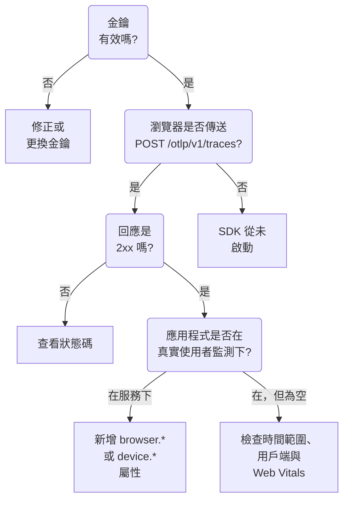

# RUM 疑難排解

當 RUM 應用程式不見、為空或顯示 **已中斷** 時，請依序檢查本頁。每項檢查都會排除從你的應用程式到 OneUptime 這條路徑中的一段，順序與這些問題通常發生的順序一致。

:::cards
- [檢查金鑰](#檢查金鑰): 最快的檢查，之後的一切都取決於它。
- [檢查離開瀏覽器的內容](#檢查離開瀏覽器的內容): 在瀏覽器的開發人員工具中查看匯出請求。
- [檢查遙測資料落在哪裡](#檢查遙測資料落在哪裡): RUM 應用程式，還是後端服務。
- [工作階段重播問題](#工作階段重播問題): 一條獨立的管線，有自己的頁面。
:::

## RUM 遙測在哪裡中斷

遙測資料在抵達 RUM 應用程式的途中會經過三項檢查。找出第一個失敗的檢查：



## 檢查金鑰

先檢查金鑰。這是最快的檢查，沒有 OneUptime 接受的金鑰，之後的一切都無法運作：

```bash
curl -i https://oneuptime.com/otlp/v1/validate \
  -H "x-oneuptime-token: YOUR_TELEMETRY_INGESTION_TOKEN"
```

| 回應 | 意義 |
| --- | --- |
| `200` 且 `"valid": true` | OneUptime 接受該金鑰。回應也會提供它的 `keyType` 與 `projectId` 。繼續下一項檢查。 |
| `401` 且 `"valid": false` | 金鑰遺失、未知、已撤銷、已關閉或已到期， `message` 會說明是哪一種。在 **專案設定 → 遙測與 APM → 擷取金鑰** 下建立一個有效的金鑰。 |

Web 應用程式需要 **瀏覽器** 金鑰，行動應用程式需要 **伺服器** 金鑰：請參閱 [瀏覽器端設定](/docs/rum/browser-setup) 與 [行動端設定](/docs/rum/mobile-setup) 。匯出端點也會依 OTLP 規格的要求，以 `401` 拒絕錯誤的金鑰，因此行為良好的 SDK 會記錄這次拒絕，而不是重試。這一行在瀏覽器主控台中很容易被忽略，而這項檢查會直接告訴你答案。

## 檢查離開瀏覽器的內容

在應用程式的頁面上開啟瀏覽器的開發人員工具，選取 Network 分頁並依 `otlp` 篩選。你要找的是以 `2xx` 狀態回應的 `POST /otlp/v1/traces` 。

### 完全沒有請求

SDK 從未啟動。幾乎總是下列原因之一：

- `telemetry.ts` 不是你的應用程式的第一個匯入，或者打包工具把它移除了。檢測會修補 `fetch` 與 `XMLHttpRequest` ，因此在修補之前送出的請求不會被追蹤，而被打包工具移除的檔案根本不會執行。
- 批次處理器還沒有匯出。 `BatchSpanProcessor` 會等待幾秒鐘來填滿一個批次，所以在斷定沒有傳送任何內容之前，請稍候，或切換到另一個頁面。
- 某個建置時的環境變數變成了 `undefined` ，導致匯出工具的 URL 損壞。在啟動時記錄一次 URL。

### 瀏覽器封鎖了請求

- **主控台中出現 Content Security Policy 錯誤。** 頁面的策略尚未允許 OneUptime。把它加入你現有的 `connect-src` 指示詞中，如果你自行執行 OneUptime，則使用你自己的主機：

  ```text
  connect-src 'self' https://oneuptime.com;
  ```

- **CORS 錯誤。** OTLP 端點接受來自任何來源的請求，並允許 `x-oneuptime-token` 標頭，因此真正的 CORS 失敗幾乎總是表示請求根本沒有抵達 OneUptime：請檢查公司的 Proxy、廣告封鎖程式或主機名稱的拼字錯誤。在 Network 分頁中檢查請求的 URL。

### 請求收到錯誤狀態

**`401`.** 金鑰未知、已撤銷或已到期。執行 [金鑰檢查](#檢查金鑰) ，然後使用有效的金鑰。

**`404`.** URL 錯誤。追蹤匯出工具需要完整路徑 `/otlp/v1/traces` 。常見的錯誤是把基底位址（ `https://oneuptime.com/otlp` ）交給預期完整 URL 的匯出工具，或把完整 URL 交給會自行加上路徑的匯出工具，結果請求到了 `/otlp/v1/traces/v1/traces` 。

**`413`.** 批次大於 Proxy 允許的大小。OneUptime 本身的輸入端在 `/otlp` 上最多接受 4 MB，但你放在 OneUptime 前面的 Proxy 可能更嚴格 — 例如 ingress-nginx 預設將 `proxy-body-size` 設為 1 MB — 所以如果你有這樣的 Proxy，也要提高它在 `/otlp` 上的上限。無論哪種情況，在 `BatchSpanProcessor` 上設定較小的 `maxExportBatchSize` 都會讓每次匯出變小：

```ts
new BatchSpanProcessor(exporter, { maxExportBatchSize: 100 });
```

除非 span 帶有很大的屬性，例如整段堆疊追蹤或回應本文，瀏覽器很少傳送這麼大的批次。精簡這些屬性是更好的解決方式。

**`422`.** OneUptime 在這裡拒絕了該金鑰，訊息會說明原因。 `Origin https://app.example.com is not allowed for this browser ingestion key.` 表示頁面的確切來源（包括配置與連接埠，如果有）不在該金鑰的 **允許的來源** 中。 `This telemetry ingestion key has been disabled.` 表示有人關閉了該金鑰。

**`429`.** 該金鑰的 **Requests Per Minute Limit** 已用完： `Too many telemetry requests for this ingestion key. Please retry later.` 除非你在金鑰上設定了自己的上限，否則 Browser 金鑰對你所有訪客合計每分鐘允許 6000 個請求。

**帶有 HTML 頁面或空本文的 `403`。** OneUptime 對每次拒絕都以 JSON 回應，所以這個回應來自它前面的某個東西，通常是你自己網域上的 Web 應用程式防火牆（如果你透過它代理 OneUptime）。防火牆會剖析 OTLP/JSON，並用它的注入規則檢查每個 span 屬性，因此 span 上一個帶有查詢字串的 URL 就足以被封鎖，防火牆的日誌會寫出是哪條規則。只在 OTLP 路徑上將 OTLP 承載排除在檢查之外： [你的 OpenTelemetry 請求也被封鎖了](/docs/rum/session-replay-troubleshooting#你的-opentelemetry-請求也被封鎖了) 說明了做法，也涵蓋了位於同一防火牆後面的重播錄製器。

## 檢查遙測資料落在哪裡

請求成功了，但應用程式出現在 **產品 → 服務** 下，而不是 **產品 → 資源 → 真實使用者監測** 下。這是最常見的回報，原因幾乎總是資源上沒有用戶端屬性。只有當一批資料的資源帶有下列屬性之一時，OneUptime 才會將其歸為 RUM：

| 類型 | 屬性 |
| --- | --- |
| 瀏覽器 | `browser.platform` 、 `browser.language` ，或非空的 `browser.brands` |
| 行動裝置 | `device.id` 或 `device.model.identifier` ，或是在沒有主機識別（ `host.name` 、 `host.id` 或 `k8s.node.name` ）的資源上的 `device.manufacturer` |

只有 `service.name` 會成為後端服務。OpenTelemetry 瀏覽器 SDK 不會新增任何 `browser.*` 屬性，除非你加入瀏覽器資源偵測器或自行設定它們：請參閱 [瀏覽器端設定](/docs/rum/browser-setup) 。

若要查看你實際傳送了什麼，請在 Network 分頁中開啟 OTLP 請求並查看其承載：起決定作用的是 `resourceSpans[0].resource.attributes` 清單。如果其中沒有 `browser.*` 屬性，那麼無論文件怎麼說，SDK 都沒有新增它。

新增這些屬性後，下一批資料就會建立 RUM 應用程式。最先建立的服務不會變成 RUM 應用程式，因為兩者是獨立的記錄，所以在 RUM 遙測抵達後，請在 **產品 → 服務** 下刪除它。

> [!NOTE]
> 如果資源唯一的用戶端屬性是 `device.manufacturer` ，而它同時還有主機識別，就會被當成一台機器而不是手機，因為主機的清查也用同一個屬性回報其製造商。新增 `device.id` 或 `device.model.identifier` ，無論這批資料還帶有什麼，都會被歸為行動裝置 RUM。

## 應用程式為空

應用程式存在，但其頁面沒有顯示任何內容。

- **檢查時間範圍。** 概觀預設顯示過去一小時，因此今天早上傳送的測試批次不在範圍內。
- **等待幾分鐘。** 擷取會經過佇列，而 **上次出現** 每隔幾分鐘重新整理一次，而不是每批資料都更新。
- **檢查專案。** 金鑰會寫入它自己的專案，因此用另一個專案的金鑰傳送的遙測資料在那個專案裡，而不在這裡。

## 用戶端頁面為空

**用戶端** 頁面在 Web 上列出 `browser.platform` ，在行動裝置上列出 `device.model.identifier` 。在其他一切都正常時它仍為空，有兩個原因：

- **Safari 與 Firefox。** `browserDetector` 會讀取 UA Client Hints API，而只有以 Chromium 為基礎的瀏覽器才有這個 API。在其他瀏覽器中，它會設定 `browser.language` ，這足以將遙測歸為 RUM，但不會設定 `browser.platform` 。若要列出這些用戶端，請自行設定 `browser.platform` 。
- **只設定 `device.manufacturer` 的行動 SDK。** 這會把遙測歸為行動裝置 RUM，但 **用戶端** 頁面需要 `device.model.identifier` 。

## Core Web Vitals 顯示「No web vitals reported yet」

這張卡片只會由你的應用程式傳送的指標填入，所以只有追蹤永遠填不滿它。請檢查你是否有匯出指標、指標名稱是否為 OneUptime 讀取的名稱，以及它們是否出現在應用程式的 **指標** 頁面上。 [卡片顯示「No web vitals reported yet」](/docs/rum/web-vitals#疑難排解) 逐一說明了每項檢查，包括訪客在下一次匯出前關閉分頁而遺失的值。

## 有人在使用應用程式，但狀態顯示已中斷

應用程式在 15 分鐘沒有遙測資料後會變成 **已中斷** 。如果有人正在使用該應用程式：

- **取樣器可能丟棄了所有資料。** 請檢查你沒有設定一律關閉的取樣器，或非常低的比例。
- **應用程式可能只在某些互動時傳送遙測**，而這段時間內沒有人進行這些互動。
- **金鑰可能在部署後被撤銷或關閉**：再次執行 [金鑰檢查](#檢查金鑰) 。

夜間沒有訪客的內部應用程式或低流量應用程式確實處於中斷狀態。這並不是故障。

## 工作階段重播問題

工作階段重播是一條獨立的管線，有它自己的問題：錄製器指令碼、來源允許清單、同意、Content Security Policy 與遮罩。 [工作階段重播疑難排解](/docs/rum/session-replay-troubleshooting) 涵蓋了這些問題。請從那裡開始，並先開啟錄製器的診斷，因為它的大多數失敗都是刻意靜默的：

```js
localStorage.setItem("oneuptime.sessionReplay.debug", "true");
// then reload the page
```

應用程式 **工作階段重播** 區段中的 **健康狀況** 頁面，以及 **Replay Policy** 上的 **Test your installation** 面板，會從伺服器端檢查金鑰、允許清單與策略，並說明為什麼沒有資料抵達。瀏覽器的主控台則告訴你伺服器看不到的那一半。

在預設策略下，使用者與頁面互動時，錄製器大約每 15 秒傳送一個區塊。閒置的分頁沒有東西可傳送，所以請先按一下或移動滑鼠；如果之後仍然完全沒有區塊請求，就是出了問題。如果應用程式只在 _On error or frustration_ 時上傳，那麼在出問題之前保持靜默是正常的。呼叫 `OneUptimeReplay.captureSession()` 強制上傳，無論哪種情況都能驗證這條路徑。

這兩條管線彼此獨立。錄製器載入並不需要一個正常運作的 RUM 應用程式，而錄製器正常運作也不代表 RUM 遙測正在抵達：兩者都可能各自失敗。

## 仍然無法解決？

在尋求協助之前，請先收集下列資訊。這樣可以省去一輪往返溝通：

- 一個實際 OTLP 請求承載中的 `resource.attributes` 清單。
- 該請求的 HTTP 狀態。
- 你傳送的確切 `service.name` ，以及專案中是否有該名稱的應用程式或服務。
- 對於已部署組建中的金鑰， `/otlp/v1/validate` 是否回應 `200` 。

然後聯絡 support@oneuptime.com，或在 [GitHub](https://github.com/OneUptime/oneuptime) 上提交 issue。

## 後續步驟

:::cards
- [瀏覽器端設定](/docs/rum/browser-setup): 這些檢查所依據的設定，逐步說明。
- [行動端設定](/docs/rum/mobile-setup): 行動應用程式需要的金鑰與屬性。
- [管理應用程式](/docs/rum/applications): 名稱、標籤、保留與狀態。
- [工作階段重播疑難排解](/docs/rum/session-replay-troubleshooting): 錄製器的每個代碼，以及如何處理。
:::
