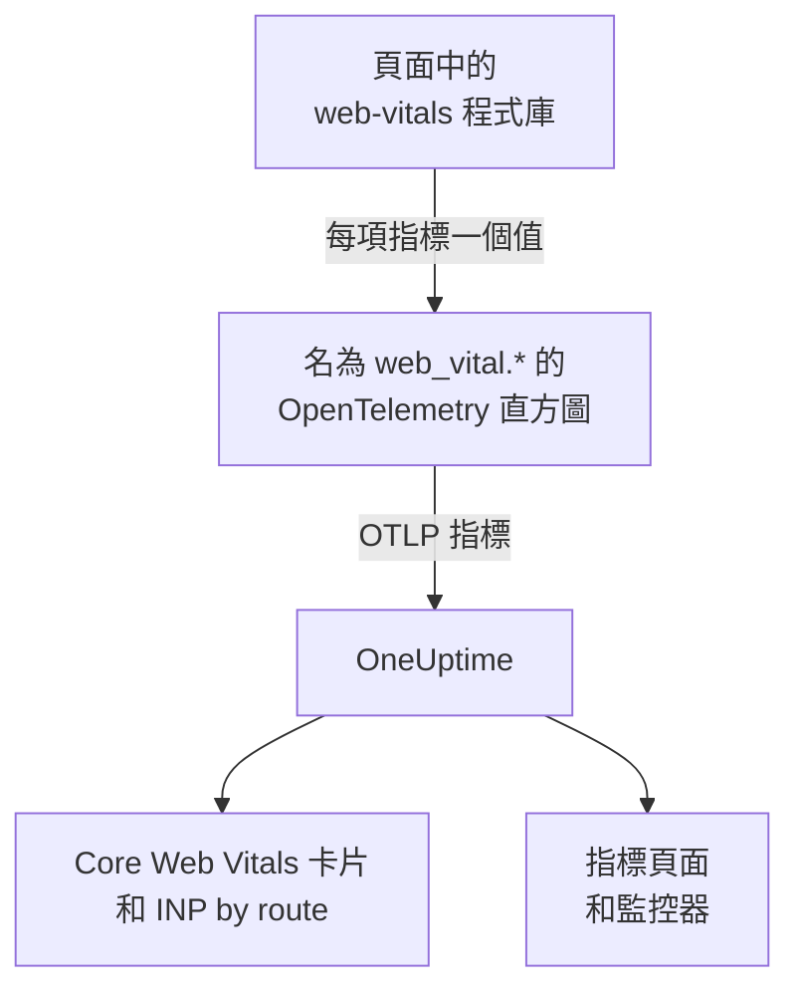
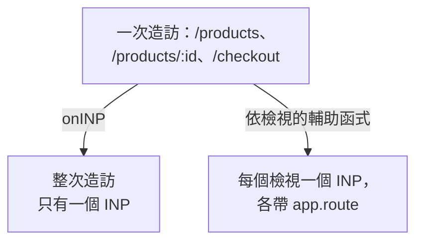

# Core Web Vitals

RUM 應用程式概覽上的 **Core Web Vitals** 卡片會顯示 LCP、INP、CLS、FCP 和 TTFB，每項都依 Google 的門檻評等。OneUptime 本身不測量其中任何一項：卡片只由你的瀏覽器檢測回報的指標填入，本頁說明如何傳送這些指標。

:::cards
- [傳送指標](#從應用程式傳送指標): 把 web-vitals 程式庫的值以 OpenTelemetry 指標轉送。
- [OneUptime 讀取的名稱](#oneuptime-辨識的指標名稱): 每項指標可能使用的指標名稱。
- [單頁應用程式](#單頁應用程式): 每個檢視一個 INP，而不是每次頁面載入一個值。
- [依指標設定警示](#依指標設定警示): 針對不佳指標的現成監控器。
:::

## 運作方式

[`web-vitals`](https://github.com/GoogleChrome/web-vitals) 程式庫會在頁面中測量每項指標，Chrome 自己的工具也使用這個程式庫。你的程式碼把每個值記錄到一個 OpenTelemetry 直方圖上，瀏覽器的指標管線再把它匯出到 OneUptime。



OpenTelemetry 還沒有 web vitals 命名的最終慣例，因此 OneUptime 會以多個名稱尋找每項指標，並使用第一個有資料的名稱。新的檢測請使用 `web_vital.*` 名稱。

## 開始之前

- 一個依照 [瀏覽器端設定](/docs/rum/browser-setup) 設定好、具備指標管線的 Web 應用程式：匯出這些值的是 [加入日誌和指標](/docs/rum/browser-setup#加入日誌和指標) 中的 `MeterProvider` 。

## 從應用程式傳送指標

:::steps
### 安裝程式庫

```bash
npm install web-vitals
```

### 把每項指標記錄到直方圖上

建立 `src/web-vitals.ts` 。每項指標都是一個直方圖，讓 **指標** 頁面之後能計算百分位數；桶的邊界設在 Google 的良好與不佳門檻上。

```ts title="src/web-vitals.ts"
// Import after ./telemetry
import { metrics } from "@opentelemetry/api";
import { onCLS, onFCP, onINP, onLCP, onTTFB, type Metric } from "web-vitals";

const meter = metrics.getMeter("web-vitals");

// Histograms, so the Metrics tab can compute percentiles later. The bucket
// edges sit on each vital's good / poor limits: a percentile is read from
// the buckets, and the defaults are far too coarse for these ranges.
const buckets = (...edges: number[]) => ({ advice: { explicitBucketBoundaries: edges } });

const lcp = meter.createHistogram("web_vital.lcp", { unit: "ms", ...buckets(0, 1000, 1500, 2000, 2500, 3000, 3500, 4000, 5000, 7500, 10000) });
const inp = meter.createHistogram("web_vital.inp", { unit: "ms", ...buckets(0, 50, 100, 150, 200, 250, 300, 400, 500, 750, 1000, 2000) });
const fcp = meter.createHistogram("web_vital.fcp", { unit: "ms", ...buckets(0, 600, 1200, 1800, 2400, 3000, 4000, 6000, 10000) });
const ttfb = meter.createHistogram("web_vital.ttfb", { unit: "ms", ...buckets(0, 200, 400, 600, 800, 1200, 1800, 2500, 4000) });
const cls = meter.createHistogram("web_vital.cls", { unit: "1", ...buckets(0, 0.025, 0.05, 0.1, 0.15, 0.2, 0.25, 0.4, 0.6, 1) });

function record(
  histogram: { record: (v: number, a?: Record<string, string>) => void },
) {
  return (metric: Metric): void => {
    histogram.record(metric.value, {
      // Keep attributes low-cardinality. Never put a full URL or a user id here.
      "web_vital.rating": metric.rating,
    });
  };
}

onLCP(record(lcp));
onINP(record(inp));
onCLS(record(cls));
onFCP(record(fcp));
onTTFB(record(ttfb));
```

### 在遙測設定之後匯入它

```ts
import "./telemetry";
import "./web-vitals";
```

### 檢查指標頁面

載入幾個頁面，然後在應用程式的 **指標** 頁面上搜尋 `web_vital.lcp` 。指標出現後， **Core Web Vitals** 卡片就會依你選擇的時間範圍填入資料。
:::

## 在頁面關閉前傳送最後的值

`onINP` 和 `onCLS` 會在頁面被隱藏時回報，而不是在造訪期間。使用 [瀏覽器端設定](/docs/rum/browser-setup) 中 30 秒的匯出間隔時，在最後一個值之後立刻關閉分頁的訪客，可能在值被匯出前就離開了。如果完整性很重要，請縮短 `exportIntervalMillis` ，或保留你在 `telemetry.ts` 中建立的 `MeterProvider` ，並在頁面隱藏時排清它：

```ts
// In telemetry.ts, export the provider you created:
export const meterProvider = new MeterProvider({ /* ... */ });

// Anywhere after setup:
import { meterProvider } from "./telemetry";

document.addEventListener("visibilitychange", () => {
  if (document.visibilityState === "hidden") {
    void meterProvider.forceFlush();
  }
});
```

## OneUptime 辨識的指標名稱

OneUptime 依此順序嘗試這些名稱，所選時間範圍內第一個有資料的名稱勝出。

| 指標 | 指標名稱（任選其一） | 單位 |
| --- | --- | --- |
| LCP: Largest Contentful Paint | `web_vital.lcp`, `browser.largest_contentful_paint`, `largest_contentful_paint`, `web.vitals.lcp` | 毫秒 |
| INP: Interaction to Next Paint | `web_vital.inp`, `browser.interaction_to_next_paint`, `interaction_to_next_paint`, `web.vitals.inp` | 毫秒 |
| CLS: Cumulative Layout Shift | `web_vital.cls`, `browser.cumulative_layout_shift`, `cumulative_layout_shift`, `web.vitals.cls` | 分數 |
| FCP: First Contentful Paint | `web_vital.fcp`, `browser.first_contentful_paint`, `first_contentful_paint`, `web.vitals.fcp` | 毫秒 |
| TTFB: Time to First Byte | `web_vital.ttfb`, `browser.time_to_first_byte`, `time_to_first_byte`, `web.vitals.ttfb` | 毫秒 |

其他名稱的存在，是為了讓已依社群慣例傳送資料的應用程式不需修改就能顯示。

## 評等門檻

卡片依 Google 公布的 Core Web Vitals 門檻為每個值評等：

| 指標 | **Good** | **Needs work** | **Poor** |
| --- | --- | --- | --- |
| LCP | 低於 2500 毫秒 | 2500 到 4000 毫秒 | 4000 毫秒以上 |
| INP | 低於 200 毫秒 | 200 到 500 毫秒 | 500 毫秒以上 |
| CLS | 低於 0.1 | 0.1 到 0.25 | 0.25 以上 |
| FCP | 低於 1800 毫秒 | 1800 到 3000 毫秒 | 3000 毫秒以上 |
| TTFB | 低於 800 毫秒 | 800 到 1800 毫秒 | 1800 毫秒以上 |

卡片顯示所選時間範圍內的 **平均值** ，而不是 Google 實地工具回報的第 75 百分位數。這是刻意的：OneUptime 從直方圖的桶讀取百分位數，因此百分位數的精確度取決於桶，而平均值來自直方圖精確的總和與計數。使用 OpenTelemetry 的預設桶（ `0, 5, 10, 25, 50, …` ）時，每個 CLS 值都會落在第一個桶，一個幾乎不位移的頁面，第 75 百分位數也會顯示為 2.5。

> [!TIP]
> 把卡片當成趨勢來看。若要查看第 75 百分位數，請以上面的桶邊界記錄，然後在 **指標** 頁面上以 **P75** 彙總繪製該指標。指標監控器也提供相同的選項。

## 單頁應用程式

`onINP` 依瀏覽器的定義測量 INP： **每次頁面載入一個值** 。單頁應用程式只載入一次，之後透過 `history.pushState` 切換路由，因此一次依序造訪 `/products` 、 `/products/42` 和 `/checkout` 的造訪，整個過程只會產生一個 INP。每個檢視的互動都在爭奪這一個數字，而附在它上面的路由屬性，指向的是回報當下正在顯示的頁面，而不是變慢的那個頁面。



若要依檢視查看 INP，就要依檢視測量：每次路由切換都會結束目前的檢視並開始新的檢視，每個檢視回報自己的 INP。下面的輔助函式透過瀏覽器的 Event Timing API（也就是 `onINP` 使用的資料）來做到這點，並處理容易出錯的部分： **引發** 導覽的那次點擊會在路由已經切換之後才送達，但它屬於被點擊的那個頁面。

```ts title="src/inp-per-route.ts"
// INP for each view of a single-page app.
type Report = (inpMs: number, route: string) => void;

interface View {
  route: string;
  path: string; // the URL path it was opened for
  start: number; // performance.now() when the view began
  latencies: Map<number, number>; // interactionId -> its slowest entry
}

// Long enough for the click that navigated to be delivered: its entry
// arrives after the next paint, i.e. after the route has changed.
const SETTLE_MS = 1000;

let views: Array<View> = [];
let report: Report = () => {};

// The path, plus the hash when a hash router keeps the route there.
const currentPath = (): string =>
  location.pathname + (location.hash.startsWith("#/") ? location.hash : "");

function close(view: View): void {
  if (!views.includes(view)) return; // already reported
  views = views.filter((v) => v !== view);

  const sorted = [...view.latencies.values()].sort((a, b) => b - a);
  if (sorted.length === 0) return; // nobody interacted: no INP, not 0

  // web-vitals' p98: skip one outlier for every 50 interactions.
  report(sorted[Math.min(sorted.length - 1, Math.floor(sorted.length / 50))]!, view.route);
}

function record(entries: PerformanceEntryList): void {
  for (const entry of entries as Array<PerformanceEventTiming & { interactionId?: number }>) {
    if (!entry.interactionId) continue; // hovers, scrolls: not interactions

    // The view the interaction STARTED in, so the click that navigated
    // counts towards the page it was clicked on.
    const view = [...views].reverse().find((v) => entry.startTime >= v.start);
    if (!view) continue;

    const slowest = view.latencies.get(entry.interactionId) ?? 0;
    view.latencies.set(entry.interactionId, Math.max(slowest, entry.duration));
  }
}

export function observeInpPerRoute(route: string, onReport: Report): void {
  if (typeof PerformanceObserver === "undefined" || !PerformanceObserver.supportedEntryTypes?.includes("event")) return;

  report = onReport;
  views = [{ route, path: currentPath(), start: 0, latencies: new Map() }];

  const observer = new PerformanceObserver((list) => record(list.getEntries()));
  observer.observe({ type: "event", durationThreshold: 40, buffered: true } as PerformanceObserverInit);

  // The tab may never come back: report every view now, then keep
  // measuring the current route as a fresh view.
  document.addEventListener("visibilitychange", () => {
    if (document.visibilityState !== "hidden") return;
    record(observer.takeRecords());
    const current = views[views.length - 1]?.route ?? route;
    [...views].forEach(close);
    views = [{ route: current, path: currentPath(), start: performance.now(), latencies: new Map() }];
  });
}

// Call after every navigation, with the route PATTERN ("/products/:id").
// Safe to call when nothing changed (a router's initial navigation, a
// query-string update): the view only ends when the path does.
export function startView(route: string): void {
  const closing = views[views.length - 1];
  if (!closing || closing.path === currentPath()) return;

  views.push({ route, path: currentPath(), start: performance.now(), latencies: new Map() });
  setTimeout(() => close(closing), SETTLE_MS);
}
```

兩個函式都接收路由 **模式** ，而不是 URL： `/products/42` 和 `/products/7` 必須是同一個路由，否則每個商品都會成為各自的序列。路由器有模式時就使用它；否則請自行合併 ID：

```ts
// "/products/42" -> "/products/:id", also for UUIDs.
export const toRoutePattern = (path: string): string =>
  path.replace(/\/(\d+|[0-9a-f]{8}-[0-9a-f-]{27})(?=\/|$)/gi, "/:id");
```

把輔助函式回報的值記錄到同一個 `web_vital.inp` 直方圖上，以 `app.route` 作為路由，並從上面的程式碼片段中 **拿掉 `onINP`** ：兩者都保留會讓每次互動被計算兩次。

```ts
// src/web-vitals.ts, in place of onINP(record(inp))
import { observeInpPerRoute } from "./inp-per-route";

observeInpPerRoute(toRoutePattern(location.pathname), (inpMs, route) => {
  inp.record(inpMs, {
    "app.route": route,
    "web_vital.rating": inpMs <= 200 ? "good" : inpMs <= 500 ? "needs-improvement" : "poor",
  });
});
```

接著在路由器宣告導覽完成的地方呼叫 `startView` 。URL 路徑沒有變化時，它會忽略呼叫，因此即使路由器也回報第一次載入或查詢字串更新，檢視也不會被拆分：

:::tabs
@tab Vue Router
```ts
router.afterEach((to) => startView(to.matched[to.matched.length - 1]?.path ?? toRoutePattern(to.path)));
```
@tab React Router
```tsx
// In a component that stays mounted inside the router
const { pathname } = useLocation();
useEffect(() => startView(toRoutePattern(pathname)), [pathname]);
```
:::

你會得到：

- 概覽上的 **INP by route** ，依 `app.route` 從最慢的開始排列；OneUptime 也會讀取 OpenTelemetry 的 `url.template` 。
- 用於警示的路由篩選器：在指標監控器中依 `app.route` 篩選 `web_vital.inp` ，即可單獨監看一個流程，例如 `/checkout` 。
- **Core Web Vitals** 卡片上的全應用程式 INP 照常運作：它仍是同一個指標，只是現在每個檢視一個值，而不是每次頁面載入一個。

Chromium 瀏覽器會回報這項功能所需的互動 ID。Safari 不會回報，這也是 `onINP` 在那裡什麼都不回報的原因。Chrome 的實驗性 Soft Navigations API 目標是原生做到這點，但尚未全面推出；這個輔助函式現在就能使用。

> [!NOTE]
> [工作階段重播](/docs/telemetry/session-replay) 錄製器已經不需任何程式碼就能依檢視測量 INP：每段錄製都會為使用者互動過的每個路由顯示一列 INP，包含緩慢的元素，以及其耗時如何分配在輸入延遲、處理和呈現之間。

## 控制基數

指標屬性會相乘。 `web_vital.rating` 有三個可能的值，這沒有問題，路由或頁面類型屬性通常也值得加入：

```ts
histogram.record(metric.value, {
  "web_vital.rating": metric.rating,
  "app.route": routePattern, // "/product/:id" — the PATTERN, not "/product/8842"
});
```

記錄具體的 URL 而不是路由模式，會為每個商品頁面建立一個時間序列，讓 **指標** 頁面變慢、儲存費用變高。使用者 ID、工作階段 ID 和螢幕尺寸也是如此。

## 依指標設定警示

應用程式的 **建議** 頁面為每項指標提供一個現成的監控器。每個監控器讀取其指標的五分鐘平均值，並在達到 Google 的不佳門檻時觸發：

| 建議 | 指標 | 觸發值 | 嚴重性 |
| --- | --- | --- | --- |
| **Poor Largest Contentful Paint** | `web_vital.lcp` | 4000 毫秒 | **嚴重** |
| **Poor Interaction to Next Paint** | `web_vital.inp` | 500 毫秒 | **嚴重** |
| **Poor Cumulative Layout Shift** | `web_vital.cls` | 0.25 | **嚴重** |
| **Slow First Contentful Paint** | `web_vital.fcp` | 3000 毫秒 | **Warning** |
| **Slow Time to First Byte** | `web_vital.ttfb` | 1800 毫秒 | **Warning** |

這些監控器只讀取 `web_vital.*` 名稱。如果你的應用程式以其他名稱傳送某項指標，請編輯所建立監控器的指標。若要針對單一路由警示，請為監控器加入 `app.route` 篩選器。你也可以根據這些指標中的任何一個建立自己的監控器：請參閱 [指標監控](/docs/monitor/metrics-monitor) 。

## 疑難排解

:::details 卡片顯示「No web vitals reported yet」
卡片只由你的應用程式傳送的指標填入。請依序檢查：

1. 你到底有沒有指標管線：只有追蹤永遠填不滿這張卡片。
2. 指標名稱是否是 OneUptime 讀取的名稱：請參閱 [OneUptime 辨識的指標名稱](#oneuptime-辨識的指標名稱) 。
3. 指標是否出現在應用程式的 **指標** 頁面上。如果有，表示匯出正常，問題出在名稱或時間範圍。
4. INP 和 CLS 會在頁面隱藏時回報，因此一次短暫的造訪可能在下一次匯出之前就結束：請參閱 [在頁面關閉前傳送最後的值](#在頁面關閉前傳送最後的值) 。

如果這些都沒有幫助， [RUM 疑難排解](/docs/rum/troubleshooting) 會檢查整條管線。
:::

:::details INP 有回報，但不是依路由
**INP by route** 卡片需要 `web_vital.inp` 上帶有 `app.route` 屬性或 `url.template` 。請依照 [單頁應用程式](#單頁應用程式) 為每個值記錄路由模式。
:::

:::details 數值與 Google 的報告不同
卡片顯示你所選時間範圍內的平均值，而 Google 回報的是其自身訪客的第 75 百分位數。在 **指標** 頁面上繪製 **P75** ，才能做同類比較。
:::

## 後續步驟

:::cards
- [瀏覽器端設定](/docs/rum/browser-setup): 承載這些指標的追蹤、日誌和指標管線。
- [指標監控](/docs/monitor/metrics-monitor): 針對任何指標設定警示，可涵蓋整個應用程式或單一路由。
- [工作階段重播](/docs/telemetry/session-replay): 不需程式碼，就能在錄製中依檢視查看 INP。
- [RUM 疑難排解](/docs/rum/troubleshooting): 依問題通常發生的順序列出的所有檢查。
:::
