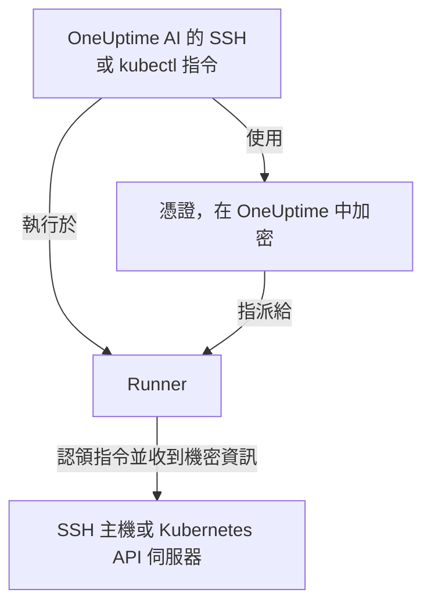

# AI 存取

AI 存取是 OneUptime AI 自己的指令到達 **不是** Runner 自身主機的目標的方式：透過 SSH 存取的伺服器，或未執行 Kubernetes 代理程式 chart 的 Kubernetes 叢集的 API 伺服器。每一項存取都是一個憑證：作為受管物件的存取權，靜態加密儲存，指派給特定的 Runner，並由 OneUptime AI 選擇，而不是寫進指令。Runbook 步驟不使用它們：SSH 或 kubectl 步驟使用機密 [Runbook 變數](/docs/runbooks/variables) 登入。早於此版本的 Runner 是例外：對於從操作遷移而來的 Kubernetes 步驟，在該步驟的指令碼或 kubeconfig 被變更之前，它會使用該步驟引用的憑證來執行。

在 **運行手冊 → Runbook 代理程式 → AI 存取** 下管理憑證。

:::cards
- [建立憑證](#建立憑證): 它的存取權，以及可以使用它的 Runner。
- [另一端的最小權限](#另一端的最小權限): 限制金鑰或權杖能做的事。
- [執行 OneUptime AI 指令的 Runner](#執行-oneuptime-ai-指令的-runner): 誰可以把 SSH 憑證交給這樣的 Runner。
:::

## 憑證的使用方式

OneUptime AI 使用指派給其執行所在 Runner 的某個 SSH 憑證來執行 SSH 指令，並使用繫結到叢集的 Kubernetes 憑證，為未執行 Kubernetes 代理程式 chart 的叢集執行 kubectl 指令，請參閱 [AI SRE](/docs/ai/ai-sre)。當 Runner 認領指令時，OneUptime 會檢查該憑證是否已指派給它，解密機密，並只在對這次認領的回應中交出。機密從不儲存在工作上，也永遠無法透過 API 讀取。

## 開始之前

- **能管理憑證的角色。** Project Owner 和 Project Admin，或擁有 **Create Runbook Credential** 權限的任何人。Runbook Admin 角色不包含此權限。把 SSH 憑證指派給執行 OneUptime AI 指令的 Runner 還需要 **Read Runbook Credential** ；請參閱 [執行 OneUptime AI 指令的 Runner](#執行-oneuptime-ai-指令的-runner)。
- **包含此功能的方案。** 在 OneUptime Cloud 上，Runbook 憑證需要 **Growth** 或更高方案。
- **一個 [Runner](/docs/runbooks/agents)** ，能透過網路連到目標主機或叢集的 API 伺服器。

## 建立憑證

:::steps
### 開啟 AI 存取

開啟 **運行手冊 → Runbook 代理程式 → AI 存取** ，點選 **建立Credential** 。

### 命名並選擇類型

在 **Credential** 步驟中輸入 **名稱** （例如 `prod-cluster`）、選用的 **描述** 以及 **類型** ： **SSH** 或 **Kubernetes** 。類型之後無法變更；如需變更，請建立新的憑證。

### 輸入存取資訊

:::tabs
@tab SSH
在 **SSH 主機** 下輸入 **主機名稱** 、 **連接埠** （留空則為 22）和 **使用者名稱** 。在 **SSH 驗證** 下選擇 **登入方式** ：可以選擇時更好的 **私密金鑰** ，然後貼上 **Private Key (PEM)** 及其 **Private Key Passphrase** （如果有）；或者為不支援金鑰存取的主機選 **密碼** ，然後輸入 **密碼** 。
@tab Kubernetes
在 **Kubernetes** 下輸入 **API Server URL** （例如 `https://10.0.0.1:6443`）、 **Service Account Token** 和 **CA Certificate (PEM)** ，讓 Runner 能驗證 API 伺服器。只有當 API 伺服器出示的憑證已受 Runner 信任時，才可以把 CA 留空。
:::

### 指派給 Runner

在 **Runbook 代理程式** 步驟中選擇可以使用此憑證的 Runner，然後點選 **建立Credential** 。未指派給任何 Runner 的憑證無法被任何指令使用。

### 讓 OneUptime AI 使用它

OneUptime AI 在自動補救規則為其指令選擇的 Runner 上，使用指派給該 Runner 的某個 SSH 憑證執行其 SSH 指令。Kubernetes 憑證一旦與它的某個 Runner 一起繫結到叢集就會被使用：請參閱 [AI SRE](/docs/ai/ai-sre)。
:::

## 儲存的內容

| 類型 | 欄位 |
| --- | --- |
| SSH | 主機名稱、連接埠（預設 22）、使用者名稱，以及 PEM 私密金鑰（可附複雜密碼）或密碼。 |
| Kubernetes | API 伺服器 URL、服務帳戶權杖和叢集的 CA 憑證。 |

## 機密值只能寫入

私密金鑰、複雜密碼、密碼和服務帳戶權杖都靜態加密儲存，API **永遠不會傳回它們** ：不會傳回給儀表板，不會傳回給工作流程，也不會出現在匯出中。表格可以告訴您憑證 *是什麼* ，但永遠不會顯示其中的內容。

因此，機密值沒有「檢視」，只有「取代」：重新輸入一個值就是輪替它的方式。如果您遺失了原始值，請在目標系統上核發新金鑰，然後更新憑證。

## 將憑證指派給 Runner

憑證只能由您指派給的 Runner 使用。引用了未指派給其 Runner 的憑證的指令會 **失敗而不是執行** ——一個悄無聲息什麼都不做的 Runner，看起來和一個成功執行的 Runner 完全一樣。

指派就是存取邊界，所以請讓範圍盡量小：一個只負責重新啟動某個叢集的 Runner，不需要您資料庫主機的 SSH 金鑰。

### 執行 OneUptime AI 指令的 Runner

Runner 一旦被選來執行 OneUptime AI 的指令，就會執行這些指令：作為自動補救規則的 Runner，或用於 Kubernetes 叢集的 AI 存取。在這樣的 Runner 上，OneUptime AI 會從指派給該 Runner 的 SSH 憑證中挑選，用於它在那裡執行的指令。因此，無論先儲存哪一方，SSH 憑證都只能經由有權讀取 Runbook 憑證的人（ **Read Runbook Credential** ，或 Project Owner、Project Admin）到達這樣的 Runner：

- **指派憑證。** 建立包含此類 Runner 的 SSH 憑證，或把此類 Runner 加入憑證，都需要該權限。沒有該權限時，儲存會被拒絕並指出該 Runner：請把憑證指派給不執行 AI 修復指令的 Runner，或請擁有該權限的人來指派。
- **選擇 Runner。** 首次為 OneUptime AI 的指令選擇持有 SSH 憑證的 Runner（作為規則的 Runner，或用於叢集）需要同樣的權限。

從憑證中移除 Runner、依憑證現有的 Runner 原樣儲存憑證，以及 Kubernetes 憑證，都不需要額外權限：OneUptime AI 的 kubectl 指令會使用繫結到其叢集的憑證執行。沒有該權限的人所做的憑證指派和 Runner 選擇，在一個專案中會逐一儲存，因此兩者無法一起通過檢查；在另一次儲存進行中到達的儲存會等待它完成，若等待太久，則會以 *Try again in a moment* 被拒絕。請再次儲存。儲存 Runner（例如編輯其描述）從不等待。

工作流程的步驟以 Project Admin 的身分執行，但不會借用 Project Admin 讀取 Runbook 憑證的權限：只有當最後儲存工作流程步驟的人擁有該權限時，步驟才擁有它。請參閱 [工作流程步驟可以做什麼](/docs/workflows/configuration#工作流程步驟可以做什麼)。

## 另一端的最小權限

OneUptime 無法限制您的憑證在目標系統上能做什麼：這是目標系統的職責，而且值得去做：

- **SSH** ——優先使用金鑰而非密碼，只給使用者它需要的指令（在可行時使用強制指令或受限的 Shell），不要重複使用管理員的個人金鑰。
- **Kubernetes** —— 把服務帳戶繫結到一個 Role，只允許您讓 OneUptime AI 做的事，並且只在它可以操作的命名空間中。只能讀取的服務帳戶讓 OneUptime AI 可以調查，但會拒絕每一次修復。

## 誰能看到它們

建立、編輯和刪除憑證需要 Runbook 憑證權限（或 Project Owner/Admin）。讀取憑證只會顯示其非機密欄位。

請注意，Runner 的 **代理程式金鑰** 等同於指派給該 Runner 的憑證：任何持有該金鑰的東西都能以該 Runner 的身分認領工作並收到憑證。因此，代理程式金鑰只能由 Project Owner、Project Admin 和 Runbook Admin 讀取：請像對待憑證本身一樣對待它們。

## 後續步驟

:::cards
- [Runbook 變數](/docs/runbooks/variables): SSH 和 kubectl 步驟登入所用的機密。
- [Runbook 代理程式](/docs/runbooks/agents): 安裝要指派憑證的 Runner。
- [Runbook 設定與安全](/docs/runbooks/configuration): 整個 Runbook 架構的權限和強化。
:::
