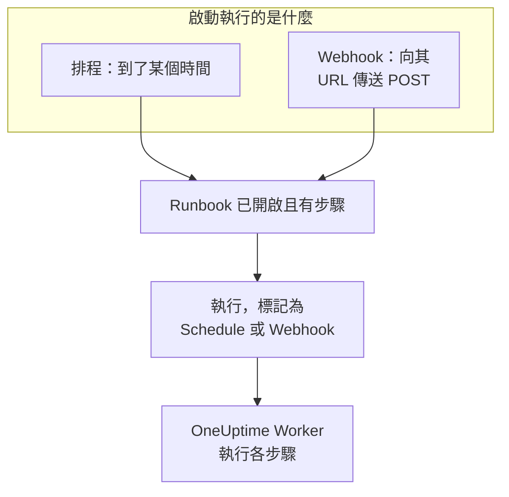

# Runbook 觸發器

Runbook 可以自行啟動：依排程，或在其他工具呼叫它的 Webhook URL 時。排程適合例行工作，例如每晚清理或每週檢查憑證；Webhook 適合從警示系統、CI 管線或指令碼啟動 Runbook。兩者都在 Runbook 的 **觸發器** 頁面設定。

:::cards
- [依排程執行](#依排程執行): 每隔幾分鐘、每天、每週的某幾天，或使用 cron 運算式。
- [呼叫 Webhook](#呼叫-webhook): 向 Runbook 的 URL 傳送 POST 要求來啟動一次執行。
- [Webhook 呼叫傳送的值](#webhook-呼叫傳送的值): 步驟如何讀取呼叫端傳送的 JSON。
- [疑難排解](#疑難排解): 不執行的排程、被拒絕的呼叫。
:::

## 觸發器如何啟動執行



觸發器啟動執行的方式與 **立即執行** 相同：這次執行跑的是 Runbook 目前的步驟，不關聯任何事件、警示或排程維護事件。每次執行都會記錄是什麼啟動了它。Runbook 的 **執行次數** 和 **運行手冊 → 執行次數** 會在 **觸發者** 中顯示這一點，並附上排程執行的預定時間或呼叫 Webhook 的位址，兩份清單都能依此篩選。

## 開始之前

- 一個至少有一個步驟的 Runbook，且其 **設定** 頁面上的 **執行此操作手冊** 開關已開啟。
- 編輯並執行該 Runbook 的權限。請參閱[誰可以設定觸發器](#誰可以設定觸發器)。

## 依排程執行

:::steps
### 開啟 Runbook 的觸發器頁面
從 **運行手冊** 開啟 Runbook，然後按一下其側邊選單中的 **設定 → 觸發器**。 **設定** 預設是摺疊的：按一下它以顯示 **觸發器**。

### 設定排程
按一下 **設定排程**。在 **執行時間** 下選擇 **重複** 以及它需要的內容。對話方塊會用一句話說出排程，例如「每個平日 09:00 執行」，並在你修改時列出接下來的幾次執行。

### 檢查時區
**時區** 預設為你自己的時區。排程中的時間依此時區的時鐘計算。

### 儲存
按一下 **儲存排程**。排程隨即開啟，卡片會用一句話顯示排程及其 **下次執行**。
:::

| **重複** | 你選擇的內容 | 範例 |
| --- | --- | --- |
| **每隔幾分鐘** | **每**：1、2、3、4、5、6、10、12、15、20 或 30 分鐘 | 每 15 分鐘 |
| **每隔幾小時** | **每**：1、2、3、4、6、8 或 12 小時，以及 **每小時的第幾分鐘** | 每 2 小時的第 30 分鐘 |
| **每天** | **時間** | 每天 09:00 |
| **依星期幾** | **在這些日子**，可用 **平日** 和 **每天** 快速選擇，以及 **時間** | 每個平日 09:00 |
| **自訂（cron 運算式）** | **cron 運算式** | `0 2 1 * *`：每月 1 日 02:00 |

cron 運算式有五個欄位：分鐘、小時、日期、月份和星期。Runbook 最多每分鐘執行一次，因此沒有秒欄位。對話方塊會說明它無法讀取的運算式，或永遠不會執行的運算式（例如 `0 0 31 2 *`），在能夠執行之前不會儲存任何內容。

之後，卡片會顯示排程、依時區時鐘的接下來三次執行、執行仍在進行或錯過某個時間時的處理方式，以及 **上次排程執行** 和 **檢視執行**。**編輯排程** 會開啟同一個對話方塊，**依此排程執行** 開關可以暫停排程而不會遺失它。

### 如果執行仍在進行

只要執行在佇列中、正在執行，或在等待有人完成或核准某個步驟，就算仍在進行，無論它是如何啟動的。排程的 **如果執行仍在進行** 設定收合在對話方塊的 **更多欄位** 中，它決定此時到來的時間如何處理：

| 設定 | 結果 |
| --- | --- |
| **略過該時間** （預設） | 不會啟動任何內容。排程等待下一個時間。 |
| **在其結束後執行** | 一次執行會等待，在進行中的執行結束後啟動。期間到來的其他時間不會啟動任何內容。 |

### 如果 OneUptime 錯過了某個時間

如果 OneUptime 在排程時間停機或正在升級，只要延遲超過 5 分鐘，該時間就算錯過。**如果 OneUptime 錯過了某個時間** 決定 OneUptime 恢復後會發生什麼：

| 設定 | 結果 |
| --- | --- |
| **OneUptime 恢復後執行一次** （預設） | 啟動一次執行，無論錯過了多少個時間，並標記為「為補上 OneUptime 錯過的時間而執行一次」。 |
| **略過錯過的時間** | 在下一個時間之前不會啟動任何內容。 |

排程或 Runbook 關閉期間經過的時間不算錯過：重新開啟其中任何一個後，會從下一個時間開始。

### 時區與日光節約時間

時間全年依時區的時鐘計算。Europe/London 中 09:00 的排程，無論冬夏都在倫敦時間 09:00 執行。在時鐘撥快的那一夜，當夜不存在的時間會在時鐘上晚一小時執行。時鐘撥回、某個小時出現兩次時，每小時執行的排程會在兩次中都執行，其他排程只在第一次執行一次。

## 呼叫 Webhook

:::steps
### 開啟 Webhook
在 Runbook 的 **觸發器** 頁面上，開啟 **呼叫此 URL 時執行**。Runbook 會取得自己的 URL。

### 複製 URL
**Webhook URL** 是遮蔽的：按一下 **顯示** 檢視，或按一下 **複製 URL** 複製完整 URL。**試試看** 提供一條可作為起點的 `curl` 命令。

### 從你的工具呼叫它
向該 URL 傳送 `POST` 要求，本文為 JSON 物件，或不帶本文：

```bash
curl -X POST "https://oneuptime.com/runbook/webhook/RUNBOOK_ID/SECRET_KEY" \
  -H "Content-Type: application/json" \
  -d '{"host": "web-1", "reason": "Disk almost full"}'
```

### 檢查執行
回應會指出它啟動的執行：`{"runbookExecutionId": "...", "status": "Scheduled"}`。這次執行會出現在 Runbook 的 **執行次數** 中，**觸發者** 顯示 **Webhook**，其頁面的 **輸入** 中會顯示呼叫傳送的內容。
:::

**傳送測試要求** 會像其他工具一樣，用你撰寫的本文向該 URL 傳送 `POST`，並連結到它啟動的執行。這是一次真實的 Runbook 執行。

### 呼叫會收到的回應

| 回應 | 情況 |
| --- | --- |
| `200` | 執行已啟動。本文會指出這次執行。 |
| `400` | 本文不是 JSON 物件、巢狀超過 32 層或包含 NUL 字元，或者 Runbook 沒有步驟。 |
| `403` | Webhook 或 Runbook 已關閉。 |
| `404` | 此 URL 上沒有 Runbook Webhook 回應：Runbook ID 或金鑰錯誤，或者 URL 已被重設。 |
| `405` | 要求是 `GET`。`GET` 永遠不會啟動執行，因此聊天應用程式中的連結預覽不會意外執行它。 |
| `413` | 本文大於 64 KB。 |
| `429` | Webhook 在最近一分鐘內啟動了 30 次執行，它有 10 次執行仍在進行，或者某個位址在一分鐘內呼叫 Runbook Webhook 超過 120 次，或者同一個 IPv6 /64 中的位址合計超過 1200 次。在可能的情況下，`Retry-After` 標頭會說明何時重試。 |
| `503` | OneUptime 目前無法計算呼叫次數。請一分鐘後重試。 |

被拒絕的呼叫不會啟動任何內容，其本文會用一句話說明原因，例如 "This runbook is turned off, so it was not started. Turn it on with Run this runbook, under the runbook's Settings."

### 妥善保管 URL

URL 中含有 Runbook 的祕密金鑰：任何取得它的人都能啟動該 Runbook。金鑰由 43 個隨機字元組成，以恆定時間比較，錯誤的金鑰得到的回應與該 Runbook 不存在時相同。

如果 URL 外洩，請按一下 **重設 URL**。Runbook 會取得新的 URL，舊 URL 立即失效，因此請把新 URL 交給每個呼叫它的工具。關閉再重新開啟 Webhook 時，URL 保持不變。

## Webhook 呼叫傳送的值

本文的頂層值會成為這次執行的輸入。它們一律以資料形式傳給步驟，絕不會作為文字貼進指令碼或命令：

| 步驟類型 | 如何讀取輸入 |
| --- | --- |
| Bash 和 kubectl | 環境變數：每個頂層值一個 `ONEUPTIME_INPUT_<NAME>`，`ONEUPTIME_INPUTS` 以 JSON 形式包含整個物件，`ONEUPTIME_TRIGGER` 表示啟動執行的方式，例如 `Webhook` 或 `Schedule`。 |
| JavaScript | `args.inputs`（依傳送時的樣子提供的物件）和 `args.trigger`。 |
| AI | 當 **包含觸發器脈絡** 開啟時，在其提示中標示為來自 OneUptime 外部的資料。 |
| HTTP request 和 SSH | 完全不讀取。它們的 URL、指令碼和目標就是 Runbook 中寫的內容，呼叫端傳送的任何內容都無法改變它們。 |

變數名稱是值的名稱轉為大寫，其中字母和數字以外的每個字元都寫成 `_`：`host-name` 會變成 `ONEUPTIME_INPUT_HOST_NAME`。文字依原樣傳遞，數字以及 `true` 或 `false` 依書寫方式傳遞，物件和清單以 JSON 傳遞。一個步驟最多取得 100 個這樣的變數，超過 100 個字元的名稱不會成為變數；所有值仍都在 `ONEUPTIME_INPUTS` 中。每個名稱都以 `ONEUPTIME_` 開頭，因此呼叫端無法設定 `PATH` 或 Runner 讀取的任何其他變數。

這些值由呼叫端決定，因此在據此採取行動之前請先檢查它們：

```bash
set -euo pipefail
case "$ONEUPTIME_INPUT_HOST" in
  web-1|web-2|web-3) ;;
  *) echo "Unknown host: $ONEUPTIME_INPUT_HOST"; exit 1 ;;
esac
curl -fsS -X POST "http://$ONEUPTIME_INPUT_HOST.internal:8080/restart"
```

```javascript
const host = args.inputs.host;
if (!["web-1", "web-2", "web-3"].includes(host)) {
  throw new Error(`Unknown host: ${host}`);
}
console.log(`Started by ${args.trigger} for ${host}`);
return { host };
```

## 誰可以設定觸發器

排程或 Webhook 會在無人在場時啟動執行，因此設定它們需要編輯並執行該 Runbook 的權限：Project Owner、Project Admin 或 Runbook Admin，或者 **Edit Runbook** 加上 Project Member、Runbook Member 或 **Create Runbook Execution**。與 **立即執行** 一樣，角色所限的標籤也會計入。檢視或重設 Webhook URL 需要同樣的權限。

關閉排程或 Webhook 不會啟動任何內容，因此只需要編輯該 Runbook 的權限。能編輯但不能執行該 Runbook 的人會看到 **設定排程** 被鎖定的 **觸發器** 頁面，並得知誰可以檢視 Webhook URL。

## 疑難排解

:::details 排程沒有執行任何內容
Runbook 已關閉或沒有步驟：卡片會說明是哪一種。在 Runbook 的 **設定** 頁面開啟 **執行此操作手冊**，或在其 **步驟** 頁面新增步驟。如果卡片顯示排程已暫停，請開啟 **依此排程執行**。
:::

:::details 某個排程時間沒有啟動任何內容
當時有執行仍在進行而排程會略過這類時間，或者 OneUptime 錯過了該時間而排程會略過錯過的時間。請參閱[如果執行仍在進行](#如果執行仍在進行)和[如果 OneUptime 錯過了某個時間](#如果-oneuptime-錯過了某個時間)。
:::

:::details 儲存排程失敗，顯示 "You do not have permission to set up this runbook's schedule or webhook."
設定觸發器除了需要編輯 Runbook 的權限，還需要執行它的權限。請申請 Runbook Admin，或者在 **Edit Runbook** 之外申請 Runbook Member 或 **Create Runbook Execution**。
:::

:::details 呼叫收到回應 "No runbook webhook answers at this URL."
URL 已被重設或複製錯誤。請從 Runbook 的 **觸發器** 頁面重新複製。
:::

:::details 呼叫收到回應 "This runbook's webhook is turned off, so the runbook was not started."
在 Runbook 的 **觸發器** 頁面上開啟 **呼叫此 URL 時執行**。URL 與之前相同。
:::

## 後續步驟

:::cards
- [執行 Runbook](/docs/runbooks/running): 執行會顯示什麼，以及如何推進它。
- [撰寫 Runbook](/docs/runbooks/authoring): 撰寫觸發器要執行的步驟。
- [Runbook 設定與安全](/docs/runbooks/configuration): 限制、權限和強化。
:::
