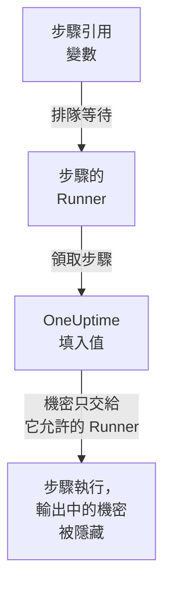

# Runbook 變數

Runbook 變數是步驟透過名稱使用、而不是自己保存的值：主機、namespace 或 URL，或者 SSH 金鑰、密碼、kubeconfig、API 權杖之類的機密。只需修改一次值，每個引用它的步驟下次執行時就會使用新值。機密會被加密，再也不會顯示，並在步驟輸出的內容中被隱藏。

:::cards
- [建立變數](#建立變數): 一般的值，或者機密以及可以使用它的 Runner。
- [在步驟中使用變數](#在步驟中使用變數): 在指令碼或 HTTP 請求中使用，或作為 SSH 步驟的登入憑據和 kubectl 步驟的 kubeconfig。
- [誰會收到機密](#誰會收到機密): 您的 Runner、您允許時的全域 Runner，以及 HTTP 請求步驟中的 OneUptime 本身。
:::

## 變數如何到達步驟



步驟保存的是變數的名稱，而不是它的值。當步驟的 Runner 領取它時，OneUptime 會填入值（填入指令碼、SSH 步驟的目標機器和登入方式，或 kubectl 步驟的 kubeconfig），並只交給那個 Runner。引用了不能使用的變數的步驟會帶著原因失敗，而不會在本該是值的地方帶著名稱執行。

Bash、JavaScript、SSH、kubectl 和 HTTP 請求步驟會使用變數。AI 步驟不會填入變數。HTTP 請求步驟由 OneUptime 自己發送，不經過 Runner，因此該步驟會得到它引用的每個變數，包括機密，並在它記錄的回應中隱藏這些機密。

## 全域變數和 Runbook 變數

| | 全域變數 | Runbook 自己的變數 |
| --- | --- | --- |
| 管理位置 | **運行手冊 → 設定 → 全域變數** | Runbook 的 **設定 → 變數** |
| 使用者 | 專案中的每個 Runbook | 只有該 Runbook 的步驟 |
| 在步驟中的寫法 | `{{global.variables.NAME}}` | `{{local.variables.NAME}}` |

一個名稱（不分大小寫）在專案的全域變數中只能使用一次，在一個 Runbook 自己的變數中也只能使用一次。Runbook 的變數可以和全域變數同名：兩者的寫法不同。

## 開始之前

- **管理變數的角色。** Project Owner 和 Project Admin，或擁有 **Create Runbook Variable** 權限。Runbook Admin 可以讀取變數，以便在自己撰寫的步驟中選擇它們，但不能修改。
- **包含此功能的方案。** 在 OneUptime Cloud 上，Runbook 變數需要 **Growth** 或更高的方案。

## 建立變數

:::steps
### 開啟變數

開啟 **運行手冊 → 設定 → 全域變數** 或某個 Runbook 的 **設定 → 變數** ，然後點擊 **建立變數** 。

### 命名並輸入值

在 **變數** 步驟中輸入 **名稱** ：字母、數字、連字號和底線，最多 100 個字元，例如 `PROD_DB_SSH_KEY`。 **密鑰** 預設為開啟：把金鑰、密碼、權杖或 kubeconfig 貼到 **密鑰值** 中，然後點擊 **下一步** 。對於任何人都可以讀取的值（例如主機），關閉 **密鑰** ，在 **值** 中輸入，然後點擊 **建立變數** 。選填的 **描述** 位於 **更多欄位** 下。

### 選擇誰可以使用機密

在 **誰可以使用** 步驟中，在 **可以使用它的 Runner** 下選擇您的 Runner。在有[全域 Runner](/docs/runbooks/agents#全域-runner) 的伺服器上， **全域 Runner 可以使用** 也允許本專案中在全域 Runner 上執行的步驟使用該機密：只要專案在使用全域 Runner，它預設就是開啟的。機密需要二者之一。點擊 **建立變數** 。
:::

變數是否為機密，之後無法變更。請改為刪除它，再用相同的名稱重新建立：步驟按名稱引用變數，所以它們會繼續運作。Kubernetes 代理程式 chart 安裝的叢集內 Runner 永遠不會收到機密。

## 機密值只能寫入

機密的值在儲存時加密，API **從不傳回它** ：不會傳回給儀表板、工作流程或匯出。清單中一般變數顯示值的位置會顯示 **密鑰** ，其 **Runbook 代理程式** 欄會顯示每個機密交給哪些 Runner。要變更它，請點擊其所在列的 **取代值** ：新值會被加密，舊值永久消失，步驟會在下次執行時取得新值。

當步驟印出它收到的機密時，Runner 會在輸出離開其主機之前把它取代為 `[REDACTED]`，OneUptime 在儲存輸出之前還會再取代一次。私密金鑰的某一行或 kubeconfig 中的權杖也會被隱藏。少於 4 個字元的機密不會被查找。

## 在步驟中使用變數

:::tabs
@tab 在指令碼中
在 Bash、JavaScript、SSH 或 kubectl 指令碼中，把引用寫在值應該出現的位置：

```bash
curl -s -X POST \
  -H "Authorization: Bearer {{global.variables.CDN_API_TOKEN}}" \
  "https://api.cdn.example.com/v1/purge"
```
@tab 在 HTTP 請求中
把引用寫在 [HTTP 請求步驟](/docs/runbooks/authoring#http-request)的 URL、標頭或本文中：

```json
{ "Authorization": "Bearer {{global.variables.API_TOKEN}}" }
```
@tab SSH 登入
[SSH 步驟](/docs/runbooks/authoring#ssh)在 **登入方式** 中選擇保存其私密金鑰或密碼的機密變數，並在 **更多欄位 → 金鑰複雜密碼** 中選擇其金鑰的複雜密碼。值本身表明它是金鑰還是密碼。
@tab Kubeconfig
[kubectl 步驟](/docs/runbooks/authoring#kubectl)在 **Kubeconfig** 中選擇保存叢集 kubeconfig 的機密變數，或選擇 **Runner 自身的存取權限** 來使用 Runner 自己的存取權限。
:::

在 Runbook 的 **步驟** 頁面上，每個指令碼和每個 HTTP 請求下方的 **變數 — 點擊複製** 會列出其步驟可以使用的變數；當步驟引用了不存在的變數，或其 Runner 不能使用的機密時，編輯器會提示。

## 誰會收到機密

| 誰執行步驟 | 一般變數 | 機密 |
| --- | --- | --- |
| 您的某個 Runner | 總是 | 當機密在 **可以使用它的 Runner** 中列出它時 |
| 全域 Runner | 總是 | 當 **全域 Runner 可以使用** 開啟時，且步驟屬於機密自己的專案 |
| OneUptime 本身（HTTP 請求步驟） | 總是 | 總是 |

引用了其 Runner 不能使用的機密的步驟會失敗，並指出該機密以及需要修改什麼，不會交出任何東西。

## Runbook 機密和憑證變成了變數

Runbook 變數取代了 Runbook 機密，以及 SSH 和 Kubernetes 步驟引用的憑證。在 OneUptime 升級時，每個專案已有的內容都被遷移了一次，因此每個 Runbook 都會像以前一樣執行：

- 每個 Runbook 機密都變成了同名的機密全域變數，具有相同的值、相同的 Runner 和相同的全域 Runner 開關；
- 指令碼中的 `{{runbookSecrets.NAME}}` 被改寫為 `{{global.variables.NAME}}`，舊寫法仍會讀取全域變數 `NAME`；
- 步驟引用的每個憑證都變成了具有相同 Runner 的機密全域變數，並以它命名：`<name>-ssh-key`（如果金鑰有複雜密碼，還有 `<name>-ssh-key-passphrase`）、`<name>-ssh-password` 或 `<name>-kubeconfig`；
- 每個引用憑證的 SSH 步驟都會用這些變數登入其目標機器，並把它的命令作為指令碼執行；每個 Kubernetes 步驟都變成了 kubectl 步驟，執行其操作原本執行的 `kubectl patch`，所需的存取權限不超過該步驟原有的權限。

早於此版本（14.0.79）的 Runner 無法執行 kubectl 指令碼：它會讓 kubectl 步驟失敗，並提示更新 Runner。每個以這種方式遷移的 Kubernetes 步驟起初還在指令碼旁為這樣的 Runner 保留了其憑證和操作；它們隨 Runbook 憑證一起移除，因此每個 kubectl 步驟都需要 14.0.79 或更新版本的 Runner。

此後 Runbook 憑證已被移除，仍引用憑證的步驟會先以同樣的方式遷移。引用憑證的步驟不再執行，其步驟頁面會提供 **轉換為指令碼步驟** ；透過 API 或 Terraform 儲存時若為步驟指定憑證會被拒絕。請參閱 [Runbook 憑證已移除](/docs/installation/upgrading#runbook-憑證已移除)。

## 後續步驟

:::cards
- [撰寫 Runbook](/docs/runbooks/authoring): 撰寫使用變數的 SSH 和 kubectl 步驟。
- [Runbook 代理程式](/docs/runbooks/agents): 安裝接收機密的 Runner。
- [Runbook 設定與安全](/docs/runbooks/configuration): 整個 Runbook 體系的權限和強化。
:::
