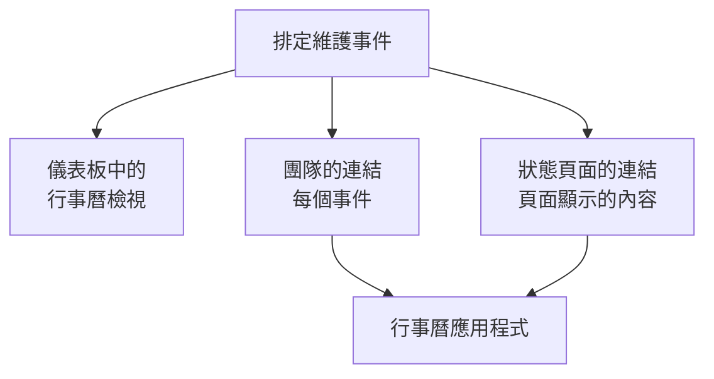

# 維護行事曆

維護行事曆依日期顯示你的排定維護：作為儀表板中的行事曆，透過一個秘密連結顯示在你團隊自己的行事曆應用程式中，也顯示在關注你狀態頁面的人的行事曆中。本頁說明行事曆檢視、團隊的行事曆連結、狀態頁面的行事曆，以及每個行事曆活動包含的內容。

:::cards
- [行事曆檢視](#行事曆檢視): 依月、週或天顯示每個事件，使用其狀態的顏色。
- [團隊的行事曆連結](#團隊的行事曆連結): 在 Google 日曆、Outlook 或 Apple 行事曆中顯示專案的每個事件。
- [狀態頁面的行事曆](#狀態頁面的行事曆): 把狀態頁面顯示的內容放進訪客的行事曆。
- [行事曆活動包含的內容](#行事曆活動包含的內容): 標題、時間區間、狀態和一個返回連結。
:::



## 行事曆檢視

開啟 **排定維護 → 所有事件** 。在篩選列的右端， **清單** 和 **行事曆** 會在事件表格與事件行事曆之間切換。瀏覽器會記住你的選擇，所以下次頁面會直接開啟行事曆。

- 行事曆開啟時顯示本月，並標出今天。 **月** 、 **週** 和 **天** 改變顯示的範圍， **返回** 、 **下一步** 和 **今天** 用來前後移動。時間依你自己的時區顯示。
- 每個事件是一個帶有其狀態顏色的區塊，各狀態的顏色在行事曆下方註明。點選事件即可開啟它。
- 行事曆上方的篩選器和清單中的作用相同：選擇一個狀態、標籤或擁有者，只看這些事件。
- 尚未到來的日子，在你把指標移到它所在的那一週時會顯示 **+** 。它會開啟 **建立排定維護事件** ，並把 **開始** 設為那一天，時間是表單今天會選的整點。只有能建立事件的人才看得到它。
- 一個檢視最多顯示 500 個事件。事件更多的月份會提示：用篩選器縮小範圍，或查看一週。

## 團隊的行事曆連結

行事曆下方或清單的 **⋯** 選單中的 **訂閱行事曆** 會開啟專案的行事曆連結：一個秘密的 iCalendar（`.ics`）連結，把專案的每個排定維護事件放進 Google 日曆、Outlook、Apple 行事曆，或任何能以 URL 訂閱行事曆的應用程式。

:::steps
### 發佈連結

點選 **發佈連結** 。一個專案只有一個供整個團隊使用的連結，所以只需發佈一次。

### 加入你的行事曆應用程式

**Google 日曆** 會開啟 Google 日曆，它會詢問是否加入該行事曆。 **Apple 行事曆 / Outlook** 會在你電腦或手機的行事曆應用程式中開啟連結。 **複製連結** 會複製連結，供其他任何應用程式使用。

### 確認是否生效

**狀態** 面板顯示行事曆應用程式最近一次讀取連結的時間，以及是哪個應用程式。新連結在有應用程式讀取之前顯示 **等待首次同步** 。
:::

連結的形式如下：

```text
https://<your host>/api/scheduled-maintenance-calendar/project/<token>/maintenance.ics
```

> [!WARNING]
> 任何擁有該連結的人，不必登入就能看到專案的每個排定維護事件。請像對待密碼一樣對待它，如果不小心分享出去，請重新產生。

### 誰可以看到連結

連結會顯示專案的每個事件，所以對話方塊只向能讀取每個事件的人顯示它。角色只允許其查看部分事件（依標籤，或只限自己擁有的事件）的人，會看到原因說明。

| 操作 | 誰可以執行 |
| --- | --- |
| 複製連結 | 能讀取專案每個排定維護事件的人 |
| **發佈連結** | 也能建立排定維護事件的人 |
| **重新產生連結** 、 **關閉連結** | 也能編輯排定維護事件的人 |

### 管理連結

**重新產生連結** 和 **關閉連結** 位於對話方塊頂端的 **⋯** 選單中。

| 操作 | 會發生什麼 |
| --- | --- |
| **重新產生連結** | 產生一個新連結。舊連結在 30 天內會傳回空的行事曆，讓持有它的應用程式清空自己的副本；之後就找不到了。請用新連結重新訂閱。 |
| **關閉連結** | 保留連結，但在 **開啟連結** 之前它會傳回空的行事曆。 |

行事曆包含從 90 天前到一年後的每個事件，最多 1,000 個。

## 狀態頁面的行事曆

關注某個狀態頁面的人可以把它的排定維護放進自己的行事曆。在狀態頁面的排定事件頁面上， **訂閱行事曆** 提供 Google 日曆、他們裝置上的行事曆應用程式，或可複製的連結。連結是頁面網址後面加上 `/maintenance.ics` ，例如 `https://status.example.com/maintenance.ics` 。

- **包含的內容。** 與頁面顯示的完全一致：頁面歷史期間內的事件、每個尚未開始的事件和每個進行中的事件，前提是 **於狀態頁面可見** 處於開啟狀態。每個事件影響的對象，依頁面為其資源取的名稱顯示，絕不使用你的監測器自己的名稱。
- **私人頁面。** 行事曆應用程式無法登入，所以私人頁面不提供 **訂閱行事曆** ，其連結會傳回空的行事曆，並說明該頁面是私人的。
- **單一事件。** 事件頁面上的 **加入行事曆** 只加入該事件：Google 日曆會開啟並預先填好它，或者它會以檔案下載，由裝置的行事曆應用程式開啟。已登入的訪客在私人頁面上也能使用，事件結束後就不再提供。

## 行事曆活動包含的內容

每個行事曆，無論是團隊的還是狀態頁面的，都以相同的方式寫入活動。

| 部分 | 包含的內容 |
| --- | --- |
| 標題 | 事件的標題 |
| 開始和結束 | 計畫的時間區間，使用 UTC；行事曆應用程式會依你自己的時區顯示 |
| 說明 | 純文字形式的說明、狀態、影響的對象，以及指向事件的連結；團隊的連結還會列出它的狀態頁面 |
| 狀態 | 事件被取消時顯示為已取消：從未進行就已完成 |
| 空閒或忙碌 | 空閒，因此維護時間區間絕不會占用你的空閒時間 |
| 類別 | 事件的標籤；狀態頁面的行事曆只有在頁面顯示標籤時才會顯示它們 |

在 OneUptime 中編輯的事件，會在包含它的每個行事曆中原地更新；被刪除或從狀態頁面移除的事件，會在下次重新整理時離開行事曆。

## 行事曆多久重新整理一次

行事曆應用程式依自己的時程讀取已訂閱的連結。Google 日曆每隔幾小時讀取一次，有時一天只讀取一次；Apple 行事曆和 Outlook 通常每小時讀取一次。OneUptime 最多保留一個行事曆五分鐘，所以你看到的等待來自行事曆應用程式。各應用程式的步驟見 [行事曆訂閱源](/docs/on-call/calendar-feeds#在行事曆應用程式中訂閱) ，對待命班次也以相同方式運作。

## 疑難排解

:::details 行事曆應用程式不再顯示新事件
連結已被重新產生或關閉：開啟 **訂閱行事曆** 查看它的狀態。重新產生的連結需要用新連結重新訂閱；已關閉的連結可以用 **開啟連結** 恢復。
:::

:::details Google 日曆無法加入連結
Google 日曆從 Google 的伺服器讀取連結，所以 OneUptime 伺服器必須能從網際網路存取。自行託管的伺服器請參閱 [行事曆訂閱源](/docs/on-call/calendar-feeds#疑難排解) 。
:::

:::details 狀態頁面的行事曆中缺少某個事件
頁面的行事曆包含頁面顯示的內容。請確認事件是否指定了該頁面， **於狀態頁面可見** 是否在其 **設定** 中開啟，以及它是否在頁面的歷史期間內開始。
:::

## 後續步驟

:::cards
- [建立維護事件](/docs/scheduled-maintenance/creating-events): 表單的每個欄位，以及之後會發生什麼。
- [訂閱者與公告](/docs/status-pages/subscribers#排定維護事件): 狀態頁面的訂閱者會收到哪些關於維護的通知。
- [行事曆訂閱源](/docs/on-call/calendar-feeds): 同樣類型的連結，用於待命班次。
:::
