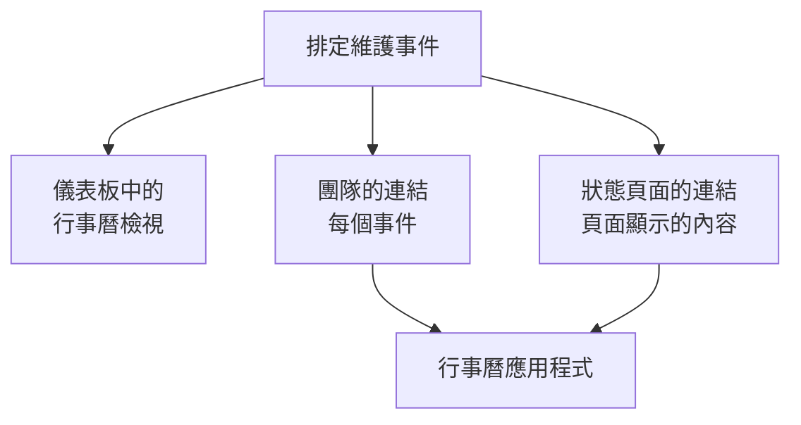

# 維護行事曆

維護行事曆依日期顯示你的排定維護：在儀表板中它自己的頁面上，透過一個秘密連結顯示在你團隊自己的行事曆應用程式中，也顯示在關注你狀態頁面的人的行事曆中。在它的頁面上，專案以外的行事曆（例如國定假日或變更凍結期）可以顯示在你的事件旁邊。本頁說明行事曆頁面、外部行事曆、團隊的行事曆連結、狀態頁面的行事曆，以及每個行事曆活動包含的內容。

:::cards
- [行事曆頁面](#行事曆頁面): 依月、週或天顯示每個事件，使用其狀態的顏色。
- [外部行事曆](#外部行事曆): 國定假日、變更凍結期或其他團隊的維護，顯示在你的事件旁邊。
- [團隊的行事曆連結](#團隊的行事曆連結): 在 Google 日曆、Outlook 或 Apple 行事曆中顯示專案的每個事件。
- [狀態頁面的行事曆](#狀態頁面的行事曆): 把狀態頁面顯示的內容放進訪客的行事曆。
- [行事曆活動包含的內容](#行事曆活動包含的內容): 標題、時間區間、狀態和一個返回連結。
:::



## 行事曆頁面

開啟側邊選單 **行事曆** 區段中的 **排定維護 → 維護行事曆** 。 **所有事件** 以清單顯示相同的事件。

- 行事曆開啟時顯示本月，並標出今天。 **月** 、 **週** 和 **天** 改變顯示的範圍，用箭頭移動，用 **今天** 返回。時間依你自己的時區顯示。
- 每個事件是一個帶有其狀態顏色的區塊，各狀態的顏色在行事曆下方註明。點選事件即可開啟它。
- 行事曆上方的篩選器和清單中的作用相同：選擇一個狀態、標籤或擁有者，只看這些事件。
- 尚未到來的日子，在你把指標移到它所在的那一週時會顯示 **+** 。它會開啟 **建立排定維護事件** ，並把 **開始** 設為那一天，時間是表單今天會選的整點。只有能建立事件的人才看得到它。
- 一個檢視最多顯示 500 個事件。事件更多的月份會提示：用篩選器縮小範圍，或查看一週。

**所有事件** 以前可以在清單和行事曆之間切換。如果你的瀏覽器上次停留在行事曆上， **所有事件** 會開啟一次 **維護行事曆** ，之後就是清單。

## 外部行事曆

行事曆頁面也可以顯示專案以外行事曆的事件：國定假日、公司在另一個行事曆中維護的變更凍結期，或其他團隊的維護。OneUptime 從每個行事曆的 iCalendar（`.ics`）連結讀取它，並把它的事件畫在你的事件旁邊，顏色較淺，使用該行事曆自己的顏色。它們是唯讀的：永遠不會變成維護事件，不會就它們通知任何人，也永遠不會出現在專案自己的行事曆連結中。

:::steps
### 新增行事曆

在行事曆的 **⋯** 選單中選擇 **新增外部行事曆** ，或開啟側邊選單 **設定** 區段中的 **排定維護 → 行事曆設定** 並點選 **新增外部行事曆** 。填寫 **名稱** ，並把連結貼到 **行事曆連結** 。 **更多欄位** 中有它的 **顏色** 和讀取頻率 **重新整理** ：除非你另選，否則為 **每小時** 。

### 確認已讀取

OneUptime 會立即讀取新行事曆。讀取後，它的 **狀態** 顯示 **正常** ， **上次讀取** 顯示讀取時間以及保留了多少個事件。讀取失敗時顯示 **異常** ，並提供原因和處理方式。

### 顯示或隱藏

每個外部行事曆在行事曆下方都有一個帶名稱的開關。隱藏一個行事曆只對你自己生效；你的瀏覽器會依專案記住這個選擇。
:::

從行事曆本身的共用設定中複製連結：在 Google 日曆中是它的 iCal 格式秘密網址；在 Outlook 中是已發佈行事曆的 ICS 連結；在其他應用程式中是它的 `.ics` 或 `webcal://` 連結。連結可以是私人的：OneUptime 會加密儲存它，不再顯示，並可用 **變更連結** 取代它。

| 操作 | 會發生什麼 |
| --- | --- |
| **立即讀取** | 立即讀取行事曆，而不是等到下次讀取。 |
| **變更連結** | 取代它的連結。舊連結的事件會被捨棄，新連結會立即讀取。 |
| **關閉** | 停止讀取，並對所有人隱藏它的事件，直到 **開啟** 。 |

每個行事曆保留從 90 天前到一年後的事件，最多 2,000 個，離今天最近的優先。大於 5 MB 的行事曆不會被讀取。重複事件、它們的例外和時區會依行事曆應用程式寫入的方式讀取，全天事件在任何時區都維持在它的日期上。一個專案最多可以有 20 個外部行事曆，行事曆的一個檢視最多繪製它們的 500 個事件。

能建立、編輯和刪除排定維護事件的角色可以新增、變更和移除外部行事曆，任何能讀取這些事件的人都能在行事曆上看到它們。OneUptime 從不讀取它自己伺服器上的位址或雲端中繼資料位址，OneUptime Cloud 會拒絕私人網路上的位址。自行託管的伺服器可以讀取你自己網路中的行事曆，除非 `DATA_SOURCE_BLOCK_PRIVATE_ADDRESSES` 為 `true` 。

## 團隊的行事曆連結

行事曆下方的 **訂閱行事曆** 會開啟專案的行事曆連結：一個秘密的 iCalendar（`.ics`）連結，把專案的每個排定維護事件放進 Google 日曆、Outlook、Apple 行事曆，或任何能以 URL 訂閱行事曆的應用程式。

:::steps
### 發佈連結

點選 **發佈連結** 。一個專案只有一個供整個團隊使用的連結，所以只需發佈一次。

### 加入你的行事曆應用程式

**Google 日曆** 會開啟 Google 日曆，它會詢問是否加入該行事曆。 **Apple 行事曆 / Outlook** 會在你電腦或手機的行事曆應用程式中開啟連結。 **複製連結** 會複製連結，供其他任何應用程式使用。

### 確認是否生效

**狀態** 面板顯示行事曆應用程式最近一次讀取連結的時間，以及是哪個應用程式。新連結在有應用程式讀取之前顯示 **等待首次同步** 。
:::

連結的形式如下：

```text
https://<your host>/api/scheduled-maintenance-calendar/project/<token>/maintenance.ics
```

> [!WARNING]
> 任何擁有該連結的人，不必登入就能看到專案的每個排定維護事件。請像對待密碼一樣對待它，如果不小心分享出去，請重新產生。

### 誰可以看到連結

連結會顯示專案的每個事件，所以對話方塊只向能讀取每個事件的人顯示它。角色只允許其查看部分事件（依標籤，或只限自己擁有的事件）的人，會看到原因說明。

| 操作 | 誰可以執行 |
| --- | --- |
| 複製連結 | 能讀取專案每個排定維護事件的人 |
| **發佈連結** | 也能建立排定維護事件的人 |
| **重新產生連結** 、 **停用連結** | 也能編輯排定維護事件的人 |

### 管理連結

**重新產生連結** 和 **停用連結** 位於對話方塊頂端的 **⋯** 選單中。

| 操作 | 會發生什麼 |
| --- | --- |
| **重新產生連結** | 產生一個新連結。舊連結在 30 天內會傳回空的行事曆，讓持有它的應用程式清空自己的副本；之後就找不到了。請用新連結重新訂閱。 |
| **停用連結** | 保留連結，但在 **啟用連結** 之前它會傳回空的行事曆。 |

行事曆包含從 90 天前到一年後的每個事件，最多 1,000 個。

## 狀態頁面的行事曆

關注某個狀態頁面的人可以把它的排定維護放進自己的行事曆。在狀態頁面的排定事件頁面上， **訂閱行事曆** 提供 Google 日曆、他們裝置上的行事曆應用程式，或可複製的連結。連結是頁面網址後面加上 `/maintenance.ics` ，例如 `https://status.example.com/maintenance.ics` 。

- **包含的內容。** 與頁面顯示的完全一致：頁面歷史期間內的事件、每個尚未開始的事件和每個進行中的事件，前提是 **於狀態頁面可見** 處於開啟狀態；如果你選擇了 **發布時間** ，則從該時間起包含。每個事件影響的對象，依頁面為其資源取的名稱顯示，絕不使用你的監測器自己的名稱。
- **私人頁面。** 行事曆應用程式無法登入，所以私人頁面不提供 **訂閱行事曆** ，其連結會傳回空的行事曆，並說明該頁面是私人的。
- **單一事件。** 事件頁面上的 **加入行事曆** 只加入該事件：Google 日曆會開啟並預先填好它，或者它會以檔案下載，由裝置的行事曆應用程式開啟。已登入的訪客在私人頁面上也能使用，事件結束後就不再提供。

## 行事曆活動包含的內容

每個行事曆，無論是團隊的還是狀態頁面的，都以相同的方式寫入活動。

| 部分 | 包含的內容 |
| --- | --- |
| 標題 | 事件的標題 |
| 開始和結束 | 計畫的時間區間，使用 UTC；行事曆應用程式會依你自己的時區顯示 |
| 說明 | 純文字形式的說明、狀態、影響的對象，以及指向事件的連結；團隊的連結還會列出它的狀態頁面 |
| 狀態 | 事件被取消時顯示為已取消：從未進行就已完成 |
| 空閒或忙碌 | 空閒，因此維護時間區間絕不會占用你的空閒時間 |
| 類別 | 事件的標籤；狀態頁面的行事曆只有在頁面顯示標籤時才會顯示它們 |

在 OneUptime 中編輯的事件，會在包含它的每個行事曆中原地更新；被刪除或從狀態頁面移除的事件，會在下次重新整理時離開行事曆。

## 行事曆多久重新整理一次

行事曆應用程式依自己的時程讀取已訂閱的連結。Google 日曆每隔幾小時讀取一次，有時一天只讀取一次；Apple 行事曆和 Outlook 通常每小時讀取一次。OneUptime 最多保留一個行事曆五分鐘，所以你看到的等待來自行事曆應用程式。各應用程式的步驟見 [行事曆訂閱源](/docs/on-call/calendar-feeds#在行事曆應用程式中訂閱) ，對待命班次也以相同方式運作。

## 疑難排解

:::details 行事曆應用程式不再顯示新事件
連結已被重新產生或停用：開啟 **訂閱行事曆** 查看它的狀態。重新產生的連結需要用新連結重新訂閱；已停用的連結可以用 **啟用連結** 恢復。
:::

:::details Google 日曆無法加入連結
Google 日曆從 Google 的伺服器讀取連結，所以 OneUptime 伺服器必須能從網際網路存取。自行託管的伺服器請參閱 [行事曆訂閱源](/docs/on-call/calendar-feeds#疑難排解) 。
:::

:::details 狀態頁面的行事曆中缺少某個事件
頁面的行事曆包含頁面顯示的內容。請確認事件是否指定了該頁面， **於狀態頁面可見** 是否在其 **設定** 中開啟，它的 **發布時間** （如果有）是否已到，以及它是否在頁面的歷史期間內開始。
:::

:::details 外部行事曆顯示異常
原因顯示在其 **狀態** 中的 **異常** 下方：連結上沒有行事曆、連結需要登入或已不再共用、它的伺服器回傳了錯誤、行事曆大於 5 MB，或它重複事件過於頻繁而無法處理。用 **變更連結** 修正連結，或在行事曆恢復後使用 **立即讀取** 。在此之前，行事曆顯示上次成功讀取時的事件。
:::

## 後續步驟

:::cards
- [建立維護事件](/docs/scheduled-maintenance/creating-events): 表單的每個欄位，以及之後會發生什麼。
- [訂閱者與公告](/docs/status-pages/subscribers#排定維護事件): 狀態頁面的訂閱者會收到哪些關於維護的通知。
- [行事曆訂閱源](/docs/on-call/calendar-feeds): 同樣類型的連結，用於待命班次。
:::
