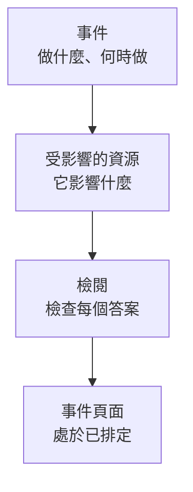

# 建立維護事件

只需兩個簡短步驟就能排定維護：說明要做什麼、何時做，然後說明它影響什麼、應該通知誰。只有標題需要輸入，其他內容都以合理的預設值開始。本頁介紹表單、建立事件那一刻會發生什麼、之後如何變更它，以及如何透過程式碼建立事件。

:::cards
- [建立事件](#建立事件): 兩個步驟和一次檢閱。
- [建立時會發生什麼](#建立時會發生什麼): 它的編號、規則、擁有者和第一批訊息。
- [之後變更事件](#之後變更事件): 它的時間範圍、資源、狀態頁面和備註。
- [透過程式碼建立事件](#透過程式碼建立事件): API、Terraform、工作流程和聊天。
:::

## 運作方式

表單每個步驟問一個問題，共兩個，然後在建立事件之前把所有內容顯示在檢閱頁上。事件從你的已排定狀態開始，並開啟它的頁面。



## 開始之前

- **你的角色。** 建立事件需要 **專案擁有者** 、 **專案管理員** 、 **專案成員** 、 **排定維護管理員** 或 **排定維護成員** ，或擁有 **Create Scheduled Maintenance** 權限的自訂角色。
- **你的狀態頁面。** 若要通知客戶，你需要一個顯示排定維護事件的狀態頁面。請參閱 [狀態頁概觀](/docs/status-pages/index)。

## 建立事件

:::steps
### 開啟表單

前往 **排定維護 → 所有事件** ，點選 **建立排定維護事件** 。表單會在第一個步驟 **事件** 上開啟。

### 說明要做什麼、何時做

輸入 **標題** ，若有幫助再加入 **描述** ：描述使用 Markdown，並會顯示在你的狀態頁面上。 **開始** 已經是你時鐘上的下一個整點， **結束** 則晚一個小時；只有在它們不對時才需要變更。移動 **開始** 時， **結束** 會隨之移動，時間範圍的長度保持不變。 **擁有者** 和 **標籤** 在收合的 **更多欄位** 下。

### 選擇它影響的內容

點選 **下一步** 進入 **受影響的資源** 。選擇工作涉及的 **監測器** 。選取一個後，它們下方會出現 **將監測器狀態變更為** ：事件開始時監測器切換到的狀態。接著選擇任何 **其他受影響的資源** ，例如主機、叢集、資料庫、網路站點或服務。

### 選擇通知誰

在 **在這些狀態頁面上顯示事件** 下選擇狀態頁面。收合的 **訂閱者通知** 用一行說明誰會在何時收到通知；展開它即可變更 **事件排定時** 、 **事件開始時** 、 **事件結束時** 或 **事件前提醒** 。

### 建立它

點選 **下一步** 查看檢閱頁，確認無誤後點選 **建立排定維護事件** 。事件本身的頁面會開啟。
:::

在你選擇狀態頁面之前不會傳送任何內容：不顯示在任何狀態頁面上的事件不會通知任何訂閱者。

## 表單欄位

| 欄位                                 | 步驟               | 初始值                          | 作用                                                                             |
| ------------------------------------ | ------------------ | ------------------------------- | -------------------------------------------------------------------------------- |
| **標題**                             | **事件**           | 空白，必填                      | 在各處為事件命名，包括你的狀態頁面。                                             |
| **描述**                             | **事件**           | 空白                            | 用 Markdown 向客戶說明這項工作。                                                 |
| **開始**                             | **事件**           | 下一個整點                      | 事件自動開始的時間。                                                             |
| **結束**                             | **事件**           | **開始** 之後一小時             | 事件自動結束的時間。必須晚於 **開始** 。                                         |
| **擁有者**                           | **事件**           | 無                              | 擁有該事件並收到相關通知的人員和團隊。                                           |
| **標籤**                             | **事件**           | 無                              | 規則和篩選器可以比對的標籤。                                                     |
| **監測器**                           | **受影響的資源**   | 無                              | 事件進行期間不檢查的監測器。                                                     |
| **將監測器狀態變更為**               | **受影響的資源**   | 不變更                          | 事件期間這些監測器顯示的狀態。選擇監測器後才會詢問。                             |
| **其他受影響的資源**                 | **受影響的資源**   | 無                              | 主機、叢集、資料庫、網路站點、服務等。                                           |
| **在這些狀態頁面上顯示事件**         | **受影響的資源**   | 無                              | 顯示該事件並通知其訂閱者的狀態頁面。                                             |
| **訂閱者通知**                       | **受影響的資源**   | 三個時間點全部開啟，無提醒      | 這些頁面的訂閱者何時收到通知。                                                   |

在你填寫時，有兩項內容會自動幫你填寫表單：

- **連結的資源。** 當你選擇一個監測器時，與它連結的主機、叢集、服務和其他資源會加入 **其他受影響的資源** 下，欄位下方會有一行列出它們。移除你不需要的即可。雲端資源不會加入，因為維護事件不包含雲端資源。
- **建議的狀態頁面。** 在 **在這些狀態頁面上顯示事件** 下，會建議顯示你的監測器的頁面：點選頁面名稱即可加入，或點選 **全部新增** 。不會替你自動選擇任何頁面。請參閱 [排定維護事件](/docs/status-pages/subscribers#排定維護事件)。

## 從資源或範本開始

在主機、Kubernetes、Proxmox、Ceph 或 Docker Swarm 叢集、Docker 或 Podman 主機、vCenter、儲存陣列、IoT 裝置群、資料庫、服務或網路站點的 **排定維護** 分頁上， **建立排定維護事件** 會開啟同一個表單，並已在 **其他受影響的資源** 下選好該資源；該分頁還會列出影響該資源的事件。資產清冊項目的分頁會選擇該項目指向的主機、服務或 Kubernetes 叢集。

建立按鈕旁邊的 **從範本建立** 會請你 **選擇排定維護範本** ，然後開啟用該範本填好的表單。請參閱 [範本與週期性事件](/docs/scheduled-maintenance/templates)。

## 建立時會發生什麼

在你點選 **建立排定維護事件** 的那一刻，OneUptime 會依下列順序執行這些步驟：

1. **它取得編號和狀態。** 編號來自每個專案的計數器，並帶上你的前綴顯示（`SM-42`）。無論請求指定什麼狀態，事件都從你的已排定狀態開始。
2. **你的聊天工具會收到訊息。** **工作區** 下的 Slack 和 Microsoft Teams 規則會把它發佈到各自的頻道，規則也可以為該事件建立頻道。它的動態消息會記錄它已建立。
3. **它的狀態時間軸開始。** 它的 **狀態時間軸** 的第一列是你的已排定狀態。
4. **加入擁有者和標籤**：先加入你選擇的，再加入符合的擁有者規則和標籤規則中的。
5. **Runbook 規則啟動** 與該事件相符的運行手冊。
6. **排定提醒**：當某條提醒規則相符時，為它的擁有者排定提醒。

一分鐘內，它的狀態頁面的訂閱者會收到事件已排定的通知，除非你關閉了 **事件排定時** 。工作流程觸發器 **On Create Scheduled Maintenance Event** 會啟動以它為基礎建立的所有工作流程；若擁有者開啟了相應通知，他們也會收到訊息：請參閱 [通知設定](/docs/notifications/notification-settings)。

## 之後變更事件

表單上的所有內容都可以在事件本身的頁面上變更，只有三個訂閱者通知時間點除外，它們在建立事件時一次性設定。

| 要變更的內容                                | 前往                                                                           |
| ------------------------------------------- | ------------------------------------------------------------------------------ |
| 標題、時間範圍或標籤                        | 它的 **概覽** 上 **Maintenance Details** 卡片中的 **編輯** ，步驟 **事件**      |
| 狀態頁面或提醒                              | 同一個 **編輯** ，步驟 **狀態頁面**                                             |
| 監測器、它們的狀態或其他資源                | **受影響的資源** 卡片上的 **編輯**                                             |
| 描述                                        | 它側邊選單中的 **描述**                                                        |
| 擁有者                                      | 它側邊選單中的 **擁有者**                                                      |

**將監測器狀態變更為** 在事件開始之前都可以變更。之後卡片會以唯讀方式顯示它，因為監測器已經處於該狀態。每次編輯都會在 **排定 維護 動態消息** 中加入一筆說明變更內容的紀錄；未做任何變更就儲存則不會加入。

## 在工作進行中發佈備註

- **公開備註** 是給客戶的更新：它們會顯示在事件的狀態頁面上，每則都可以透過 **Notify status page subscribers** 通知這些頁面的訂閱者。
- **私人備註** 僅供你的團隊查看。

在事件的 **公開備註** 或 **私人備註** 頁面上撰寫，或在 **排定 維護 動態消息** 的 **操作** 選單中透過 **Add Public Note** 或 **新增私人註記** 撰寫。同一個選單可以透過 **Execute Runbook** 執行運行手冊。備註範本會填入團隊經常撰寫的文字：請參閱 [維護規則與設定](/docs/scheduled-maintenance/settings#備註範本)。

## 透過程式碼建立事件

事件模型有標準 API，因此 `POST /api/scheduled-maintenance` 會建立一個事件。使用 **專案設定 → 進階 → API 金鑰** 中的 API 金鑰進行驗證，並透過 `apikey` 標頭傳送；金鑰決定了專案。

```bash
curl -X POST https://oneuptime.com/api/scheduled-maintenance \
  -H "apikey: $ONEUPTIME_API_KEY" \
  -H "Content-Type: application/json" \
  -d '{
    "data": {
      "title": "Database upgrade",
      "description": "Writes pause for a few minutes while the primary restarts.",
      "startsAt": "2030-06-01T02:00:00Z",
      "endsAt": "2030-06-01T04:00:00Z"
    }
  }'
```

| 欄位                                                  | 說明                                                                                      |
| ----------------------------------------------------- | ----------------------------------------------------------------------------------------- |
| `title`, `startsAt`, `endsAt`                          | 必填，與表單相同。                                                                        |
| `monitors`, `statusPages`, `labels`                   | 事件的監測器、狀態頁面和標籤，都必須來自 API 金鑰所屬的專案。                             |
| `changeMonitorStatusToId`                             | 事件開始時其監測器切換到的監測器狀態。                                                    |
| `currentScheduledMaintenanceStateId`                  | 會被忽略：每個事件都從你的已排定狀態開始。                                                |
| `shouldStatusPageSubscribersBeNotifiedOnEventCreated` | **事件排定時** 開關。另外兩個時間點各有自己的欄位。                                       |

以程式碼表示的同一個事件是 Terraform 資源 `oneuptime_scheduled_maintenance_event` ：請參閱 [範例](/docs/terraform/examples#排定維護)。工作流程透過其 **Create One Scheduled Maintenance Event** 步驟建立事件， `/oneuptime maintenance` 會在 Slack 中開啟表單：請參閱 [Slack](/docs/workspace-connections/slack#從-slack-建立事件和維護)。

## 疑難排解

:::details 提示結束必須晚於開始
時間範圍必須依序：事件在開始之後才結束。先移動 **開始** ，因為 **結束** 會隨之移動，然後再設定 **結束** 。
:::

:::details 表單中沒有將監測器狀態變更為
只有當事件有監測器時才會詢問它。在 **監測器** 下選擇一個，它就會出現在其正下方。
:::

:::details 將監測器狀態變更為無法再變更
事件已經開始，它的監測器已經處於該狀態。該狀態從事件開始的那一刻起一直適用到事件結束。
:::

## 後續步驟

:::cards
- [維護狀態](/docs/scheduled-maintenance/states): 什麼會開始和結束事件，以及如何手動推進它。
- [範本與週期性事件](/docs/scheduled-maintenance/templates): 儲存表單的答案以便下次使用。
- [訂閱者與公告](/docs/status-pages/subscribers#排定維護事件): 確切說明誰會在何時收到通知。
- [維護規則與設定](/docs/scheduled-maintenance/settings): 自動加入擁有者、標籤和提醒。
:::
