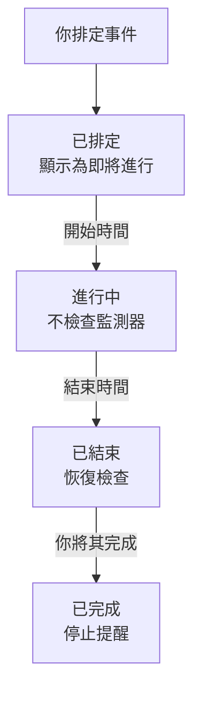

# 排定維護概觀

排定維護事件會在計畫內的工作開始之前通知所有人：資料庫升級、網路變更、遷移到新伺服器。OneUptime 會準時開始和結束事件，在工作進行期間停止檢查受影響的監測器，並在你的狀態頁面上顯示該事件，讓計畫內的停機絕不會看起來像故障。本頁說明事件如何推進、各項內容在儀表板中的位置，以及事件會改變 OneUptime 其他部分的哪些行為。

:::cards
- [事件如何推進](#事件如何推進): 從已排定到已完成，大多自動進行。
- [事件從何而來](#事件從何而來): 建立表單、範本、排程、表單功能、聊天和程式碼。
- [事件影響什麼](#事件影響什麼): 監測器、狀態頁面、訂閱者和警示。
- [事件本身的頁面](#事件本身的頁面): 概覽、時間軸、備註和設定。
:::

## 事件如何推進

每個事件都有一個計畫的時間範圍，也就是它的 **開始** 和 **結束** ，並沿著你的維護狀態清單往下推進。一個每分鐘執行的工作會在時間範圍的兩端推進它，因此你只需排定一次工作，其餘交給 OneUptime。

新事件從 **已排定** 開始。到了 **開始** 時間，它會變成 **進行中** ：OneUptime 停止檢查它的監測器，若你為監測器選擇了狀態，就以該狀態顯示它們。到了 **結束** 時間，它會變成 **已結束** ：檢查恢復，每個監測器都回到正常運作。 **已完成** 是最後一步，不會自動進入：由某個人、聊天按鈕或 API 將工作標記為已驗收，這也會停止傳給擁有者的提醒。

你可以提前開始或結束事件，也可以在這四個狀態之間加入自己的狀態。請參閱 [維護狀態](/docs/scheduled-maintenance/states)。

## 維護與公告

兩者都會讓狀態頁面的訪客知道某件事。有開始和結束的工作請使用維護事件，其他需要訪客閱讀的內容請使用公告。

|                              | 排定維護                                                                | 公告                                           |
| ---------------------------- | ----------------------------------------------------------------------- | ---------------------------------------------- |
| **它是什麼**                 | 有時間範圍的計畫內工作                                                  | 給狀態頁面訪客的訊息                           |
| **它的監測器**               | 進行期間不檢查，並以你選擇的狀態顯示                                    | 不變                                           |
| **如何推進**                 | 準時經過你的維護狀態                                                    | 從開始時間顯示到結束時間（若有結束時間）       |
| **何時通知訂閱者**           | 排定時、開始時和結束時，若有需要也在開始前                              | 開始顯示時通知一次                             |
| **新專案中的編號**           | `SM-42`                                                                 | 無                                             |

公告的介紹請見 [訂閱者與公告](/docs/status-pages/subscribers#公告)。

## 事件從何而來

- **建立表單。** 在事件清單中，或在主機、叢集、服務、網路站點等資源的 **排定維護** 分頁上點選 **建立排定維護事件** ；從資源分頁開啟時，會替你選好該資源。請參閱 [建立維護事件](/docs/scheduled-maintenance/creating-events)。
- **範本。** **從範本建立** 會用你為常做的工作儲存的範本填寫表單。請參閱 [範本與週期性事件](/docs/scheduled-maintenance/templates)。
- **排程。** 週期性範本會依排程建立新事件，例如每週或每月一次，不需要任何人開啟表單。
- **表單功能。** 提交後會建立維護事件的表單，會把變更請求變成事件。請參閱 [提交會建立什麼](/docs/forms/on-submit#提交如何成為排定維護活動)。
- **聊天。** 在 Slack 中輸入 `/oneuptime maintenance` ，或在 Microsoft Teams 中對 OneUptime 機器人輸入 `maintenance` ，即可在聊天工具中開啟表單。請參閱 [Slack](/docs/workspace-connections/slack#從-slack-建立事件和維護)。
- **程式碼。** 位於 `/api/scheduled-maintenance` 的 API、Terraform 資源 `oneuptime_scheduled_maintenance_event` ，以及工作流程的 **Create One Scheduled Maintenance Event** 步驟。

## 維護在儀表板中的位置

從頂端列的 **產品** 選單開啟 **排定維護** 。事件清單位於 `/dashboard/{projectId}/scheduled-maintenance-events` ，它的側邊選單包含與維護有關的一切：

| 區段          | 可以在其中做什麼                                                                                                           |
| ------------- | -------------------------------------------------------------------------------------------------------------------------- |
| **概覽**      | **所有事件** 和 **進行中的事件** ，後者的徽章顯示目前正在進行的事件數量。                                                   |
| **行事曆** | **維護行事曆** ：依月、週或天顯示每個事件，並與你新增的專案外部行事曆並列顯示。 |
| **工作區**    | 專案已連線的 **Slack** 和 **Microsoft Teams** ，若兩者都未連線，則為 **連線 Slack 或 Teams** 。                              |
| **規則**      | **擁有者規則** 、 **Runbook 規則** 、 **標籤規則** 、 **Reminder Rules** 。                                                 |
| **設定**      | **事件狀態** 、 **事件範本** 、 **備註範本** 、 **自訂欄位** 、 **測量** 、 **行事曆設定** 、 **編號規則** 。                                 |

**概覽** 和 **行事曆** 是展開的； **工作區** 、 **規則** 、 **設定** 和 **開發者** 一開始是收合的，當你位於某個區段的頁面上時，該區段會自動展開。 **開發者** 包含 **Terraform** 、 **API** 和 **AI 助理** ，用於透過程式碼管理維護。與維護有關的一切都在這裡，而不在 **專案設定** 中。

清單會顯示 **排定維護編號** 、 **標題** 、 **目前狀態** 、 **受影響的資源** 、 **顯示於狀態頁面** 、 **開始** 、 **持續時間** 、 **結束** 、 **標籤** 和 **擁有者** 。選取事件即可一次處理多個： **標記為「{{state}}」** 、 **變更狀態** 、 **指派給我** 、 **Add Owner** 、 **Remove Owner** 、 **Add Labels** 、 **Remove Labels** 或 **刪除** 。每個事件列末端的 **⋯** 選單可對該事件單獨執行相同的操作：在事件還能進入下一步時提供 **標記為「{{state}}」** 各步驟，以及 **變更狀態**、在你成為擁有者之前的 **指派給我** 和 **Add Owner**。

**行事曆** 區段中的 **維護行事曆** 依月、週或天顯示相同的事件，也可以在旁邊顯示專案以外的行事曆。請參閱 [維護行事曆](/docs/scheduled-maintenance/calendar)。

## 事件影響什麼

在事件進行期間，OneUptime 會把它所計畫的中斷視為預期之內：

- **不檢查它的監測器。** **監測器** 下的每個監測器都會停止檢查，每個監測器的頁面都會顯示 **此監測器已停用** 。若你選擇了 **將監測器狀態變更為** ，監測器會顯示該狀態，狀態頁面上也一樣。當事件結束或被刪除時，檢查會恢復，每個監測器都會回到正常運作，除非另一個進行中的事件仍然佔用它。
- **它的其他資源保持安靜。** 一個以每個資源一條序列的方式監看許多主機、叢集、資料庫或服務的遙測監測器，不會為事件所涵蓋資源的序列建立事件或警示，而其他序列會繼續發出警示。
- **網路站點和 SLO 也會暫停計算。** 事件涵蓋的網路站點不再把計畫內的中斷計入其上層站點，而只要 SLO 的任一監測器處於維護中，它的消耗率規則就不會建立任何內容。請參閱 [網路站點](/docs/monitor/network-sites#網路站點的排定維護) 和 [消耗率警示與事件](/docs/slo/burn-rate-alerts#排定的維護)。
- **你的狀態頁面會顯示它。** 事件會出現在你選擇的狀態頁面上，先顯示為即將進行，接著是進行中，最後是已結束，前提是它的 **設定** 中開啟了 **於狀態頁面可見** 。
- **訂閱者會收到通知。** 預設情況下，這些頁面的訂閱者會在事件排定時、開始時和結束時收到通知，若你設定了提醒，還會在開始前收到提醒。請參閱 [排定維護事件](/docs/status-pages/subscribers#排定維護事件)。
- **你的團隊會收到通知。** 它的擁有者會依照各自的 [通知設定](/docs/notifications/notification-settings) 收到通知， **工作區** 下的 Slack 和 Microsoft Teams 規則會把它發佈到你的頻道。

## 事件本身的頁面

從清單中開啟一個事件即可看到它的頁面。它的側邊選單包含：

| 側邊選單區段      | 頁面                                                                                          |
| ----------------- | --------------------------------------------------------------------------------------------- |
| **概覽** | **概覽** 、 **狀態時間軸** 、 **描述** 、 **運行手冊** |
| **團隊** | **擁有者** |
| **通知**          | **通知日誌** 和 **AI 日誌** ：關於該事件傳送的每則訊息，以及 AI 為它做了什麼                   |
| **備註**          | **私人備註** 和 **公開備註**                                                                   |
| **開發者**        | **Terraform** 、 **API** 和 **AI 助理** ：透過程式碼管理該事件                                 |
| **進階**          | **自訂欄位** 、 **設定** 、 **稽核日誌** 、 **刪除事件**                                       |

**概覽**、**團隊** 和 **備註** 是展開的；其他區段會保持收合，直到你點選它們。

- **概覽** — 標題區域顯示事件的編號、標題和狀態，距離開始還有多久或已經進行了多久，以及推進事件的按鈕。其下方的 **開始** 、 **結束** 和 **持續時間** 會以你的時區顯示計畫的時間範圍。 **排定 維護 動態消息** 記錄事件發生的一切，旁邊是 **Maintenance Details** 和 **受影響的資源** 卡片，若你的專案有相關內容，還有 **測量** 和 **自訂欄位** 卡片。
- **狀態時間軸** — 事件經歷過的每個狀態、時間以及持續多久。請參閱 [維護狀態](/docs/scheduled-maintenance/states#狀態時間軸)。
- **公開備註** — 給你的狀態頁面及其訂閱者的更新。 **私人備註** 僅供你的團隊查看。
- **設定** — **於狀態頁面可見** 用於在其狀態頁面上顯示或隱藏事件， **傳送提醒** 會在事件完成之前一直提醒它的擁有者。每個開關在你切換的那一刻就會儲存。

## 疑難排解

:::details 事件沒有在開始時間開始
開始事件的工作每分鐘執行一次，所以請等一分鐘。若標題區域顯示 **Start overdue** ，表示事件已錯過開始時間兩分鐘以上：用標題區域的按鈕開始它，該按鈕會完成工作所做的一切，然後開啟它的 **狀態時間軸** ，查看它停在哪個狀態。
:::

:::details 維護期間監測器仍在被檢查
只有事件在 **監測器** 下列出的監測器才會停止檢查，而且只在事件進行期間停止。事件在 **其他受影響的資源** 下列出的主機或服務的監測器仍會被檢查。編輯事件的 **受影響的資源** 卡片來加入該監測器。
:::

:::details 事件沒有出現在我的狀態頁面上
檢查事件是否在 **在這些狀態頁面上顯示事件** 中列出了該頁面，以及事件的 **設定** 中是否開啟了 **於狀態頁面可見** 。接著檢查狀態頁面本身：它必須顯示排定維護事件，而且開始時間早於該頁面歷史範圍（未修改時為 14 天）的事件不會再顯示。
:::

## 後續步驟

:::cards
- [建立維護事件](/docs/scheduled-maintenance/creating-events): 表單的每個欄位，以及之後會發生什麼。
- [維護狀態](/docs/scheduled-maintenance/states): 什麼會開始和結束事件，以及你自己的狀態。
- [範本與週期性事件](/docs/scheduled-maintenance/templates): 重複使用一個事件，或每週排定它。
- [維護規則與設定](/docs/scheduled-maintenance/settings): 自動加入擁有者、標籤、運行手冊和提醒。
:::
