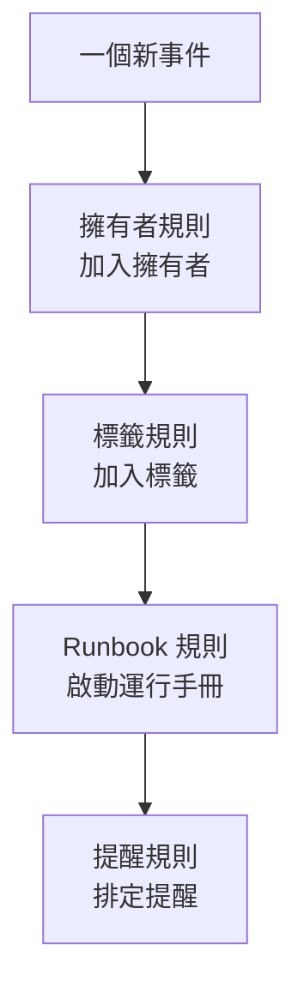

# 維護規則與設定

維護的設定位於 **排定維護** 中，而不在 **專案設定** 中：包括作用於每個新事件的規則，以及形塑專案中每個事件的設定。本頁是其中每一項以及誰可以變更它們的參考。

:::cards
- [新事件依序經過的規則](#新事件依序經過的規則): 依序列出，以及每條規則的作用。
- [提醒規則](#提醒規則): 在事件完成之前一直提醒擁有者。
- [設定](#設定): 備註範本、自訂欄位、測量和編號規則。
- [誰可以變更這些內容](#誰可以變更這些內容): 維護角色和方案。
:::

## 維護設定的位置

從頂端列的 **產品** 選單開啟 **排定維護** 。它側邊選單中的 **規則** 和 **設定** 區段預設收合，請先展開它們。這裡的每個頁面都作用於整個專案，網址以 `/dashboard/{projectId}/scheduled-maintenance-events/settings/` 開頭。

| 規則頁面           | 作用                                                                |
| ------------------ | ------------------------------------------------------------------- |
| **擁有者規則**     | 為符合的事件加入擁有者。                                            |
| **Runbook 規則**   | 為符合的事件啟動運行手冊。                                          |
| **標籤規則**       | 為符合的事件加入標籤。                                              |
| **Reminder Rules** | 依固定間隔提醒擁有者，直到事件完成。                                |

**設定** 區段包含 **事件狀態** （在 [維護狀態](/docs/scheduled-maintenance/states) 中介紹）、 **事件範本** （在 [範本與週期性事件](/docs/scheduled-maintenance/templates) 中介紹），以及 **備註範本** 、 **自訂欄位** 、 **測量** 、 **行事曆設定** 和 **編號規則** 。 **行事曆設定** 在 [維護行事曆](/docs/scheduled-maintenance/calendar#外部行事曆) 中介紹，其餘在下文介紹。

**工作區** 區段包含把事件發佈到頻道的 Slack 和 Microsoft Teams 規則。請參閱 [Slack](/docs/workspace-connections/slack#通知規則) 和 [Microsoft Teams](/docs/workspace-connections/microsoft-teams#通知規則)。

## 新事件依序經過的規則

各類規則在多條相符時的處理方式不同：

- **擁有者規則** 、 **標籤規則** 和 **Runbook 規則** 只要相符就都會生效。多條規則加入的擁有者和標籤只會加入一次。
- **Reminder Rules** 依清單由上而下檢查，第一條相符的規則生效。拖曳規則即可變更它的位置；新規則會放在最後。

新規則建立後即為啟用狀態；在編輯表單中關閉 **已啟用** 即可暫停它，清單會為每條規則顯示綠色的 **已啟用** 或紅色的 **已停用** 。擁有者規則、標籤規則和 Runbook 規則作用於儲存之後建立的事件。若要把擁有者規則或標籤規則套用到既有的事件，請使用 **立即執行** ：請參閱 [對現有資源執行規則](/docs/configuration/run-rules-now)。

## 擁有者規則和標籤規則

**擁有者規則** 為符合的新事件加入擁有者使用者和團隊， **標籤規則** 則加入標籤。建立一條規則需要兩個步驟：先在 **比對** 中設定條件，再在 **擁有者** 或 **標籤** 中設定規則要加入的內容。

| 條件                                                            | 符合                                                                       |
| --------------------------------------------------------------- | -------------------------------------------------------------------------- |
| **監測器** 、 **事件標籤** 、 **監測器標籤**                    | 帶有你所選任一監測器或標籤的事件。                                         |
| **事件標題** 、 **事件描述** 、 **監測器名稱** 、 **監測器描述** | 一個以規則運算式解讀、不區分大小寫的模式。                                 |

只有當你填寫的每個條件都成立時，規則才會相符；留空的條件會被略過。

- **規則可以繼承。** 在收合的 **繼承擁有者** 或 **繼承標籤** 下，有六個開關可以沿用事件的監測器、主機、Kubernetes 叢集、Docker 主機、Podman 主機和服務的擁有者或標籤。
- **新規則必須加入些什麼**：至少選擇一個擁有者或標籤，或開啟一個開關。
- 擁有者規則 **更多欄位** 下的 **通知擁有者** 決定是否通知被加入的人員。

[標籤與擁有者規則](/docs/configuration/label-and-owner-rules) 會針對每種資源逐步介紹該表單。

## Runbook 規則

**Runbook 規則** 會在新事件相符時啟動一個運行手冊，例如每次資料庫升級前的檢查清單。它們與擁有者規則和標籤規則比對的內容相同；事件沒有嚴重程度，因此維護的 Runbook 規則不提供嚴重程度。執行會連結到事件，顯示在它的 **運行手冊** 頁面上。請參閱 [Runbook 規則](/docs/runbooks/rules)。

## 提醒規則

**排定維護 → 規則 → Reminder Rules** 會一直提醒事件的擁有者，直到工作通過驗收。每個事件會採用清單中由上而下第一條與它相符的規則。

:::steps
### 選擇要提醒哪些事件

點選 **建立Scheduled Maintenance Reminder Rule** 。在 **比對** 中保持選取 **所有排定維護事件** ，則對每個事件都傳送提醒；選擇 **僅符合條件的排定維護事件** 後，再選擇它適用的 **標籤** 。

### 設定間隔

在 **提醒** 中設定 **提醒間隔（分鐘）**，也就是提醒擁有者的頻率，並在 **提醒擁有者** 中選擇何時提醒。在你輸入自己的名稱之前，**名稱** 會隨兩者變動，例如「進行期間每 30 分鐘提醒一次」；**描述** 在 **更多欄位** 中。然後建立規則。
:::

| 選項 | 何時提醒擁有者 |
| --- | --- |
| **進行期間** | 從事件開始起，直到事件結束。新規則預設選這一項。 |
| **開始之前** | 從事件排定起，直到事件開始。 |
| **開始之前和進行期間** | 從事件排定起，直到事件結束。 |

API 和 Terraform 會拒絕等事件開始又在開始時停止的規則：這樣的規則永遠不會傳送提醒。以前這樣儲存的規則會在清單中標示為 **從不提醒** ，它的表單會請你選擇何時提醒。

擁有者收到的每則提醒都是 **Maintenance reminder** ，它對每個新成員預設透過電子郵件開啟。儲存、變更或刪除提醒規則時，會重新比對每個尚未完成的事件。若要停止某個事件的提醒，請在它的 **設定** 頁面上關閉 **傳送提醒** ；切換的那一刻就會儲存。

這些提醒是給你的團隊的。狀態頁面訂閱者在事件開始前收到的提醒，是在事件本身的 **事件前提醒** 下設定的。

## 設定

### 備註範本

**排定維護 → 設定 → 備註範本** 保存用於維護更新的預寫文字。 **排定維護事件的公開或私人備註範本** 卡片列出這些範本； **建立排定 維護 備註 範本** 會要求填寫 **範本名稱** 、 **範本描述** 和 **備註** 。當有人在事件上撰寫公開或私人備註，或變更事件狀態時，會提供範本，且其文字在發佈前可以編輯。與故障事件的備註範本不同，維護備註範本不會填入任何變數。

### 自訂欄位

**排定維護 → 設定 → 自訂欄位** 會為每個事件加入你自己的欄位，例如變更工單或客戶等級。可以在事件的 **自訂欄位** 頁面上填寫，也可以透過 API 以 `customFields` 填寫。欄位也可以從監測器的自訂欄位複製值，而不必手動輸入：請參閱 [從監測器複製的欄位](/docs/incidents/settings#從監測器複製的欄位)，它對維護事件的作用方式相同。

### 測量

**排定維護 → 設定 → 測量** 會計算每個事件中各環節所花的時間。可以選擇 **開始延遲** （從計畫開始到事件實際開始）、 **超時** （從計畫結束到實際結束）或 **維護時長** （從開始到結束）；也可以用 **其他** 選擇你自己的兩個時間點。每項測量都會顯示在事件頁面上，並以 `oneuptime.scheduled-maintenance.measurement.<key>` 繪製成圖表。請參閱 [測量](/docs/incidents/settings#測量)，它對維護事件的作用方式相同。

### 編號規則

**排定維護 → 設定 → 編號規則** 設定事件編號前面的文字：新專案中為 `SM-` ，不設定時為 `#` 。 **更新** 會要求填寫 **排定維護編號前綴** ，並在你輸入時預覽編號。只有之後建立的事件才會使用新前綴；既有事件保留原來的編號。前綴的規則請見 [編號前綴](/docs/incidents/settings#編號前綴)。

其下方的 **下一個編號** 卡片設定下一個事件得到的編號，用來延續其他工具的編號： **更新** 會開啟 **下一個排定維護編號** ，它必須大於迄今的最大編號。請參閱 [下一個編號](/docs/incidents/settings#下一個編號)。

> [!NOTE]
> 在 OneUptime Cloud 上，自訂欄位需要 **Growth** 或更高的方案，加入和變更維護狀態及範本也是如此。

## 工作流程

每個維護模型都有以其命名的工作流程觸發器和操作： **On Create Scheduled Maintenance Event** 、 **On Update Scheduled Maintenance Event** 、 **On Create or Update Scheduled Maintenance Event** 和 **On Delete Scheduled Maintenance Event** ， **Scheduled Maintenance State Timeline** 及其他模型也有同樣的觸發器，還有 **Create One Scheduled Maintenance Event** 和 **Update One Scheduled Maintenance Event** 等操作。自訂欄位定義和測量值是例外：它們沒有工作流程步驟。請參閱 [工作流程概觀](/docs/workflows/index)。

## 誰可以變更這些內容

| 角色                              | 可以做什麼                                                                                           |
| --------------------------------- | ---------------------------------------------------------------------------------------------------- |
| **排定維護檢視者**  | 查看事件，不能變更任何內容。                                                                         |
| **排定維護成員**  | 建立、變更和刪除事件及其備註、狀態時間軸和擁有者，以及兩類範本。                                     |
| **排定維護管理員**   | 成員能做的一切，另外還能建立、變更和刪除維護狀態。                                                   |

規則、自訂欄位和測量需要 **專案擁有者** 或 **專案管理員** ，或擁有該頁面專屬權限（例如 **Create Scheduled Maintenance Owner Rule** ）的自訂角色。 Runbook 規則也可以由 **操作手冊管理員** 管理。 **專案成員** 與 **排定維護成員** 一樣可以處理事件和範本。請參閱 [使用者、團隊與權限](/docs/permissions/index)。

## 疑難排解

:::details 擁有者規則沒有為新事件加入任何人
開啟規則並檢查它的條件：你填寫的每個條件都必須成立。標題模式是規則運算式，因此 `db upgrade` 不會符合 "DB-Upgrade"；請寫成 `db.upgrade` 。另外，規則只作用於它儲存之後建立的事件：對於既有的事件，請使用 **立即執行** 。
:::

:::details 擁有者沒有收到提醒
檢查是否有提醒規則符合事件的標籤、事件的 **傳送提醒** 是否開啟，以及擁有者的通知設定中是否開啟了 **Maintenance reminder** 。設為 **進行期間** 的規則在事件開始前不會傳送任何提醒。
:::

## 後續步驟

:::cards
- [維護狀態](/docs/scheduled-maintenance/states): 事件狀態頁面，以及每個狀態的作用。
- [範本與週期性事件](/docs/scheduled-maintenance/templates): 深入介紹事件範本頁面。
- [標籤與擁有者規則](/docs/configuration/label-and-owner-rules): 逐步介紹規則表單。
- [通知設定](/docs/notifications/notification-settings): 每個擁有者如何選擇接收哪些通知。
:::
