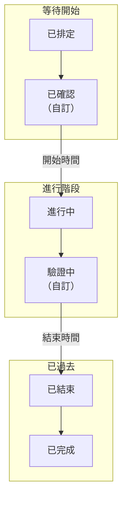

# 維護狀態

每個排定維護事件都處於一個 **狀態** ：表示工作進行到哪一步，從已排定到已驗收。狀態決定 OneUptime 如何處理事件：它的監測器何時停止檢查、你的狀態頁面顯示什麼、它的提醒何時停止。本頁介紹每個專案一開始都有的四個狀態、在它們之間推進事件的方式，以及如何加入你自己的步驟。

:::cards
- [初始狀態](#初始狀態): 已排定、進行中、已結束和已完成。
- [推進事件的方式](#推進事件的方式): 時鐘、標題區域、時間軸、聊天和 API。
- [自訂狀態](#自訂狀態): 工作開始前的一個步驟，或工作結束後的一次檢查。
- [狀態時間軸](#狀態時間軸): 事件經歷過的每個狀態，以及如何更正。
:::

## 運作方式

一個專案的維護狀態是一份有序清單，事件只會沿清單往下移動。狀態在清單中的位置決定了處於該狀態的事件被視為什麼：等待開始、進行中或已過去。

`ScheduledMaintenanceState` 模型有 `name`、`description`、`color` 和 `order`，以及四個旗標：`isScheduledState`、`isOngoingState`、`isEndedState` 和 `isResolvedState`。OneUptime 讀取的是旗標和順序，而不是名稱，因此你可以把 **已完成** 重新命名為「已驗收」，不會有任何問題。

> [!TIP]
> 這份清單位於 **排定維護 → 設定 → 事件狀態** 。 **設定** 在側邊選單中預設收合：請先展開它。

## 初始狀態

每個新專案都以下列四個維護狀態開始，順序如下：

| 狀態          | `order` | 旗標               | 顏色      | 意義                                                           |
| ------------- | ------- | ------------------ | --------- | -------------------------------------------------------------- |
| **已排定**    | `1`     | `isScheduledState` | `#000000` | 每個新事件都從這裡開始，等待它的開始時間。                     |
| **進行中**    | `2`     | `isOngoingState`   | `#ffbf53` | 工作正在進行，事件的監測器不會被檢查。                         |
| **已結束**    | `3`     | `isEndedState`     | `#4a4a4a` | 時間範圍已過，檢查恢復。                                       |
| **已完成**    | `4`     | `isResolvedState`  | `#2ab57d` | 有人驗收了工作，傳給擁有者的提醒停止。                         |

這四個帶旗標的狀態在設定頁上帶有 **內建** 標記。你可以重新命名、變更顏色和拖曳它們，但它們會保持自己的順序，而且無法刪除：它們的 **刪除** 保持鎖定，並說明原因。

**已結束** 和 **已完成** 都表示已過去。差別在於由誰推進事件：OneUptime 在事件的 **結束** 時間把它移到 **已結束** ，而在工作檢查完畢後，由某個人、聊天按鈕或 API 把它移到 **已完成** 。

## 推進事件的方式

| 方式             | 位置                                                                                        | 詢問的內容                                                                                                      |
| ---------------- | ------------------------------------------------------------------------------------------- | --------------------------------------------------------------------------------------------------------------- |
| **時鐘**         | 每分鐘執行一次的工作                                                                        | 不詢問：到了 **開始** 時間，它把等待中的事件移到 **進行中** ；到了 **結束** 時間，把進行中的事件移到 **已結束** 。 |
| **標題區域**     | 事件的 **概覽** ： **標記為「{{state}}」** 按鈕，以及其 **⋯** 選單中的 **Change state to**   | 一個簡短的對話方塊 **將排定維護標記為「{{state}}」** ，包含 **通知狀態頁面訂閱者** ，以及 **新增公開備註** 下的選用備註。 |
| **時間軸**       | 事件側邊選單中的 **狀態時間軸**                                                             | 你手動加入的一列，包含 **排定維護狀態** 和 **開始** 。                                                          |
| **清單列** | 事件清單中事件列上的 **⋯** 選單：**標記為「{{state}}」** 各步驟和 **變更狀態** | 與標題區域相同的對話方塊，並寫明事件的名稱。其間已被其他變更推進的事件維持不變，對話方塊會說明原因。 |
| **批次變更**     | 在事件清單中對選取的事件使用 **標記為「{{state}}」** 或 **變更狀態**                                                   | 狀態，以及加入每個事件的一則公開備註。已經處於該狀態或之後狀態的事件會被略過。                                  |
| **聊天**         | 事件在 Slack 和 Microsoft Teams 中的訊息上的按鈕                                            | 同樣的變更，以你的身分執行。請參閱 [Slack](/docs/workspace-connections/slack#從-slack-處理事件警示和活動)。 |
| **API**          | 在 `/api/scheduled-maintenance-state-timeline` 建立的一列                                   | 狀態，以及是否通知訂閱者。                                                                                      |

標題區域的按鈕以你的狀態命名。事件等待期間會提供兩個：一個用於開始，以你的進行中狀態命名；一個用於結束，以你的已結束狀態命名。事件進行期間只提供第二個。 **⋯** 選單會列出目前狀態之後的所有其他狀態。

## 開始和結束會做什麼

當事件從等待中的狀態移到 **進行中** ，或直接移到你放在 **進行中** 和 **已結束** 之間的自訂狀態時，事件開始。此時：

- **它的監測器停止檢查** ，若事件設定了 **將監測器狀態變更為** ，監測器會切換到該狀態。在事件進行期間加入事件的監測器也會切換。
- **它的狀態頁面把它顯示為進行中** ，並通知它的訂閱者：若開啟了 **事件開始時** ，則準時通知；手動推進時，依照對話方塊中 **通知狀態頁面訂閱者** 的設定通知。
- **它的擁有者會收到通知** ，前提是他們開啟了狀態變更通知，並且事件會出現在 **進行中的事件** 下。

當事件從進行中的狀態移到 **已結束** 、 **已完成** 或你放在 **已結束** 之後的自訂狀態時，事件結束。此時它的監測器會重新被檢查並回到正常運作，除非另一個進行中的事件仍然佔用它們；它的訂閱者也會以同樣的方式收到通知：若開啟了 **事件結束時** ，則準時通知；手動推進時，依照對話方塊的設定通知。

從 **進行中** 推進到「驗證中」，或從 **已結束** 推進到 **已完成** ，不會再次開始或結束任何東西：事件早已開始或結束。

## 標題區域的時鐘

開始之前，標題區域會倒數到開始；事件進行期間，它會計算已進行的時間；事件結束後，它會顯示花了多久。當事件錯過某個邊界超過兩分鐘時，會出現一則琥珀色提示：

- **Start overdue**：事件在其 **開始** 時間之後仍在等待。
- **Overrunning**：事件在其 **結束** 時間之後仍在進行。

提示會寫明計畫時間和事件尚未到達的狀態。剛過邊界時，推進事件的工作可能還沒執行，因此在接下來的幾分鐘內，標題區域會自行再次檢查，並在不重新整理頁面的情況下顯示新狀態。

## 順序是強制的

每次狀態變更都會對照清單進行檢查，無論由誰發起：儀表板、Slack、Microsoft Teams、API、Terraform、工作流程或 OneUptime 本身。

- **往回移動會被拒絕**，並顯示一則寫明兩個狀態的訊息："Scheduled Maintenance cannot transition to Scheduled state from Ongoing state because Scheduled is before Ongoing in the order of scheduled maintenance states."
- **移動到事件目前所處的狀態會被拒絕**："Scheduled Maintenance state cannot be same as previous state."
- **選擇器只提供目前狀態之後的狀態**，因此不會有人看到會被拒絕的移動選項。

若要更正誤設的狀態，請在事件的 **狀態時間軸** 頁面上刪除它對應的列；事件會回到前一列的狀態。

## 自訂狀態

你加入的狀態是團隊要經歷、而四個初始狀態沒有涵蓋的步驟：工作開始前的「已確認」，工作結束後的「驗證中」。

:::steps
### 開啟狀態清單

前往 **排定維護 → 設定 → 事件狀態** 。 **排定 維護 狀態** 卡片會依序列出你的狀態。每一列顯示它的顏色和名稱、處於該狀態的事件被視為什麼（ **視為** 欄），以及它的描述。

### 建立狀態

點選 **建立排定 維護 狀態** ，填寫它的 **名稱** 、 **描述** 和 **顏色** 。新狀態會加在已完成狀態的正上方。

### 拖曳到定位

拖曳某一列的把手即可移動它；放開時新的順序就會儲存。 **視為** 欄會隨你放置的位置而變化。
:::

你加入的狀態沒有旗標，因此它的位置就是它的意義：

| 放置位置                                | 處於該狀態的事件                                                                                                 |
| --------------------------------------- | ---------------------------------------------------------------------------------------------------------------- |
| **已排定** 與 **進行中** 之間           | 與 **已排定** 一樣等待它的 **開始** 時間，並準時從那裡開始。                                                    |
| **進行中** 與 **已結束** 之間           | 與 **進行中** 一樣處於進行中：它的監測器保持不檢查，並在它的 **結束** 時間結束。                                 |
| **已結束** 與 **已完成** 之間           | 已過去，但尚未完成：持續到完成為止的提醒會繼續傳送。                                                             |
| **已完成** 之下                         | 已完成，與 **已完成** 一樣。                                                                                     |

請把你的狀態放在 **已排定** 之下：每個新事件都從那裡開始，而事件永遠不會沿清單往上移動，因此它之上的狀態永遠不會被到達。你可以從事件標題區域的 **⋯** 選單中，在 **Change state to** 下把事件移到自訂狀態。

> [!NOTE]
> 在 OneUptime Cloud 上，加入或變更維護狀態需要 **Growth** 或更高的方案。所有方案都可以讀取、使用這些狀態，並刪除你加入的狀態。

## 封存狀態

對於您自己新增且團隊不應再使用的狀態，請將其封存而不是刪除。封存不會變更任何事件：處於該狀態的事件會維持該狀態並照常推進，其狀態時間軸仍會顯示它。

- **封存** 位於該列的 **⋯** 選單中。它會先要求確認，並列出設定為使用該狀態的測量和工作流程。
- **任何人都無法再選擇它。** 事件標題列、**變更狀態**、Slack 和 Microsoft Teams 都不會提供它，API、Terraform 和 MCP 會拒絕它。您仍可依它篩選事件。
- **已封存的狀態會另外列出**，位於表格下方摺疊的 **已封存的排定維護狀態** 區段。**取消封存** 會將其恢復原樣。
- **四個內建狀態無法封存**：OneUptime 會將事件移入這些狀態。它們的 **封存** 已鎖定，並說明原因。

## 狀態時間軸

事件的 **狀態時間軸** 頁面記錄了它經歷過的每個狀態。它的卡片 **狀態時間軸** 把這些狀態繪製成時間軸：一條色帶，每個狀態的長度與它持續的時間相同，下方依從新到舊列出每次變更。卡片標題中的 **表格** 會改為以列的形式列出它們，包含 **排定維護狀態** 、 **開始** 、 **結束** 、 **持續時間** 、是否需要通知訂閱者，以及通知的結果。

在儀表板中，列可以加入和刪除，但不能編輯，而且事件始終至少保留一列。透過 API 可以更正某一列的 `startsAt`，根據時間軸計算的每項測量都會隨之更新。刪除最新的一列會讓事件回到前一列的狀態。

> [!WARNING]
> 刪除一列會改寫事件的歷史，以及據此計算出的每項測量。請用它來更正錯誤，而不是用來整理。

## 疑難排解

:::details 標題區域顯示 Start overdue
事件在其 **開始** 時間過了兩分鐘以上後仍在等待，表示開始事件的工作還沒有推進它。請用標題區域的按鈕自行開始：手動開始會完成工作所做的一切，包括對監測器的處理。
:::

:::details 無法把事件移回它曾經處於的狀態
狀態只沿清單往下移動。請在事件的 **狀態時間軸** 頁面上，從最新的一列開始，刪除你想要的狀態之後的各列。
:::

:::details 標題區域的按鈕中沒有已完成狀態
標題區域的按鈕用於開始和結束事件。若要完成事件，請使用 **⋯** 選單中 **Change state to** 下的選項。
:::

## 後續步驟

:::cards
- [排定維護概觀](/docs/scheduled-maintenance/index): 各項內容的位置，以及事件影響什麼。
- [建立維護事件](/docs/scheduled-maintenance/creating-events): 表單的每個欄位。
- [維護規則與設定](/docs/scheduled-maintenance/settings): 在事件完成之前一直提醒擁有者。
- [事件狀態與嚴重程度](/docs/incidents/states-and-severities): 同樣的有序清單，用於故障事件。
:::
