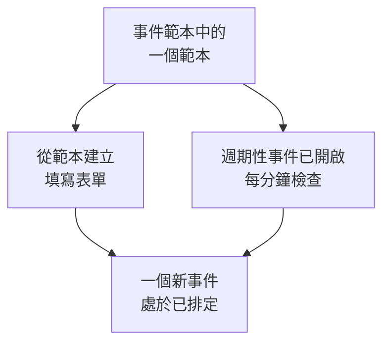

# 範本與週期性事件

排定維護範本會儲存你經常排定的事件：它的標題和描述、它暫停的監測器、它顯示在哪些狀態頁面上，以及通知誰。使用範本可以一鍵填寫表單；把它設為週期性，OneUptime 就會每週、每月或依你選擇的任何間隔替你排定事件。

:::cards
- [建立範本](#建立範本): 表單的步驟，開頭是名稱，結尾是排程。
- [使用範本](#使用範本): 用它填寫一個新事件。
- [週期性事件](#週期性事件): 讓 OneUptime 自行排定事件。
- [變更或停止範本](#變更或停止範本): 編輯它、暫停它的排程或刪除它。
:::

## 運作方式

範本是一個起點。用它建立的事件是一份擁有自己數值的副本：之後變更範本，只會影響此後建立的事件。

## 開始之前

- **你的方案。** 在 OneUptime Cloud 上，範本需要 **Growth** 或更高的方案。
- **你的角色。** 建立範本需要 **專案擁有者** 、 **專案管理員** 、 **專案成員** 、 **排定維護管理員** 或 **排定維護成員** ，或可以建立排定維護範本的自訂角色。

## 建立範本

:::steps
### 開啟範本

前往 **排定維護 → 設定 → 事件範本** 。 **設定** 在側邊選單中預設收合：請先展開它。點選 **建立排定 維護 範本** 。

### 為範本命名

在 **範本資訊** 中填寫 **範本名稱** 和 **範本描述** ，讓團隊知道何時使用它。兩者都是必填。

### 描述事件

在 **事件** 中填寫用它建立的每個事件初始的 **標題** 和 **描述** 。 **擁有者** 和 **標籤** 在 **更多欄位** 下。

### 選擇它影響的內容

在 **受影響的資源** 中選擇 **監測器** 、它們的 **將監測器狀態變更為** 、任何 **其他受影響的資源** 、 **在這些狀態頁面上顯示事件** 下的狀態頁面，以及 **訂閱者通知** 。

### 決定是否重複

在 **週期性** 中，對於手動使用的範本，保持 **週期性事件** 關閉；或者開啟它並填寫排程。點選 **下一步** 查看檢閱頁，然後建立範本。
:::

即使範本沒有指定任何監測器，它也會詢問 **將監測器狀態變更為** ：該狀態同樣適用於你用它排定事件時加入的監測器。在 **其他受影響的資源** 下，範本可以接受主機、Kubernetes 叢集、Docker 主機、Podman 主機和服務。

## 範本會填寫什麼

| 事件的部分                                        | 從範本建立                           | 週期性事件                      |
| ------------------------------------------------- | ------------------------------------ | ------------------------------- |
| **標題** 和 **描述**                              | 已填寫，你可以修改                   | 複製                            |
| **監測器** 和 **將監測器狀態變更為**              | 已填寫                               | 複製                            |
| **其他受影響的資源**                              | 已填寫                               | 複製                            |
| 狀態頁面和 **訂閱者通知**                         | 已填寫                               | 複製                            |
| **擁有者** 和 **標籤**                            | 已填寫                               | 複製                            |
| **開始** 和 **結束**                              | 下一個整點起，持續一小時             | 依排程計算                      |

## 使用範本

:::steps
### 選擇範本

在 **排定維護 → 所有事件** 上點選 **從範本建立** ，並在 **選擇排定維護範本** 下選擇一個範本。

### 檢查表單

點選 **從範本建立** 。建立表單會開啟，範本的答案已經填好。設定時間範圍，並修改此事件需要變更的任何內容。

### 建立事件

用 **下一步** 完成各個步驟，然後在檢閱頁上點選 **建立排定維護事件** 。
:::

當專案還沒有任何範本時， **從範本建立** 會提示這一點，並連結到 **事件範本** 。

## 週期性事件

週期性範本會依排程建立事件。你設定第一個事件何時建立、何時開始以及何時結束；之後的每個事件都保持相同的間隔，依次延後一個週期。

| 欄位                                                     | 意義                                                                                               |
| -------------------------------------------------------- | -------------------------------------------------------------------------------------------------- |
| **週期性事件**                                           | 開啟排程。                                                                                         |
| **第一個事件排定於**                                     | OneUptime 建立第一個事件的時間，也就是它的訂閱者得知事件已排定的時間。                             |
| **第一個事件開始於**                                     | 第一個事件開始的時間。                                                                             |
| **第一個事件結束於**                                     | 第一個事件結束的時間。                                                                             |
| **您希望此事件以多久的頻率重複？**                       | 一個數字和一個單位：小時、天、週、月或年。                                                         |

例如，一個每週的時間範圍，第一個事件在星期一建立，用於其後的星期六：

| 事件         | 建立時間           | 開始               | 結束               |
| ------------ | ------------------ | ------------------ | ------------------ |
| 第一個       | `2030-06-03 09:00` | `2030-06-08 02:00` | `2030-06-08 04:00` |
| 第二個       | `2030-06-10 09:00` | `2030-06-15 02:00` | `2030-06-15 04:00` |

把 **第一個事件排定於** 設定為比開始時間提前多久，取決於你希望客戶提前多久得知這項工作。建立範本時，三個時間都必須在未來，事件必須在開始和結束之前建立，並且必須在結束之前開始；表單會指出某個時間違反了哪條規則。

一個工作每分鐘檢查一次週期性範本。當某個範本的下一個時間到來時，它會把該時間延後一個週期，然後建立事件。範本清單會在 **週期性事件** 欄中顯示該時間，不重複的範本則顯示 **否** 。依排程建立的事件與其他事件一樣：它的規則會執行，它的擁有者會被加入，它的訂閱者會得知事件已排定。

## 變更或停止範本

從清單中開啟一個範本即可看到它的頁面：

- **排定維護範本詳細資訊** 顯示新事件的初始內容。它的 **編輯** 會依序經過 **範本資訊** 、 **事件** 、 **狀態頁面** 和 **週期性** 。
- **受影響的資源** 包含它的 **監測器** 、它們的 **將監測器狀態變更為** ，以及它的 **其他受影響的資源** ，並有自己的 **編輯** 。
- **擁有者** 列出擁有用它排定的每個事件的人員和團隊。

變更只適用於儲存之後建立的事件；已經建立的事件保留自己的數值。若要停止排程，請在 **編輯** 中關閉 **週期性事件** ，或刪除該範本。關閉的範本會保留它的排程：重新開啟後，它從排程的下一個時間繼續，並跳過關閉期間的時間。刪除範本不會刪除它已經建立的事件。

## 疑難排解

:::details 建立週期性範本時提示時間必須在未來
建立時，三個第一次的時間都必須晚於目前時間。把它們往後移：之後排程會從第一個事件開始繼續。
:::

:::details 週期性範本沒有建立事件
檢查 **週期性事件** 是否仍然開啟，並查看清單中 **週期性事件** 欄的時間：事件在那個時間建立，而不是在它開始時建立。工作每分鐘執行一次，所以請等一分鐘。
:::

:::details 用範本建立的事件缺少我選擇的資源
在 **其他受影響的資源** 下，範本只接受主機、Kubernetes 叢集、Docker 主機、Podman 主機和服務。其他類型的資源請透過事件 **受影響的資源** 卡片上的 **編輯** 加入事件本身。
:::

## 後續步驟

:::cards
- [建立維護事件](/docs/scheduled-maintenance/creating-events): 範本所填寫的表單。
- [維護狀態](/docs/scheduled-maintenance/states): 每個事件建立後如何推進。
- [維護規則與設定](/docs/scheduled-maintenance/settings): 自動為每個新事件加入擁有者和標籤。
- [排定維護概觀](/docs/scheduled-maintenance/index): 範本在整個維護功能中的位置。
:::
