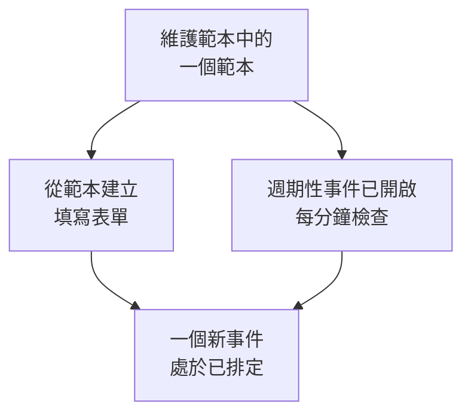

# 範本與週期性事件

排定維護範本會儲存你經常排定的事件：它的標題和描述、它暫停的監測器、它顯示在哪些狀態頁面上，以及通知誰。使用範本可以一鍵填寫表單；把它設為週期性，OneUptime 就會每週、每月或依你選擇的任何間隔替你排定事件。

:::cards
- [建立範本](#建立範本): 表單的步驟，開頭是名稱，結尾是排程。
- [使用範本](#使用範本): 用它填寫一個新事件。
- [週期性事件](#週期性事件): 讓 OneUptime 自行排定事件。
- [變更或停止範本](#變更或停止範本): 編輯它、暫停它的排程或刪除它。
:::

## 運作方式

範本是一個起點。用它建立的事件是一份擁有自己數值的副本：之後變更範本，只會影響此後建立的事件。

## 開始之前

- **你的方案。** 在 OneUptime Cloud 上，範本需要 **Growth** 或更高的方案。
- **你的角色。** 建立範本需要 **專案擁有者** 、 **專案管理員** 、 **專案成員** 、 **排定維護管理員** 或 **排定維護成員** ，或可以建立排定維護範本的自訂角色。

## 建立範本

:::steps
### 開啟範本

前往 **排定維護 → 設定 → 維護範本** 。 **設定** 在側邊選單中預設收合：請先展開它。點選 **建立排定維護範本** 。

### 為範本命名

在 **範本資訊** 中填寫 **範本名稱** 和 **範本描述** ，讓團隊知道何時使用它。兩者都是必填。

### 描述事件

在 **維護詳細資料** 中填寫用它建立的每個事件初始的 **標題** 和 **描述** 。 **擁有者** 和 **標籤** 在 **更多欄位** 下。

### 選擇它影響的內容

在 **受影響的資源** 中選擇 **監測器** 、它們的 **將監測器狀態變更為** 、任何 **其他受影響的資源** 、 **在這些狀態頁面上顯示事件** 下的狀態頁面，以及 **訂閱者通知** 。

### 決定是否重複

在 **週期性** 中，對於手動使用的範本，保持 **週期性事件** 關閉；或者開啟它，選擇重複頻率和 **時區** ，並在 **第一個事件** 中設定第一個事件的時間。點選 **下一步** 查看檢閱頁，然後建立範本。
:::

即使範本沒有指定任何監測器，它也會詢問 **將監測器狀態變更為** ：該狀態同樣適用於你用它排定事件時加入的監測器。在 **其他受影響的資源** 下，範本可以接受主機、Kubernetes 叢集、Docker 主機、Podman 主機和服務。

## 範本會填寫什麼

| 事件的部分                                        | 從範本建立                           | 週期性事件                      |
| ------------------------------------------------- | ------------------------------------ | ------------------------------- |
| **標題** 和 **描述**                              | 已填寫，你可以修改                   | 複製                            |
| **監測器** 和 **將監測器狀態變更為**              | 已填寫                               | 複製                            |
| **其他受影響的資源**                              | 已填寫                               | 複製                            |
| 狀態頁面和 **訂閱者通知**                         | 已填寫                               | 複製                            |
| **擁有者** 和 **標籤**                            | 已填寫                               | 複製                            |
| **開始** 和 **結束**                              | 下一個整點起，持續一小時             | 依排程計算                      |

## 使用範本

:::steps
### 選擇範本

在 **排定維護 → 所有維護事件** 上點選 **從範本建立** ，並在 **選擇排定維護範本** 下選擇一個範本。

### 檢查表單

點選 **從範本建立** 。建立表單會開啟，範本的答案已經填好。設定時間範圍，並修改此事件需要變更的任何內容。

### 建立事件

用 **下一步** 完成各個步驟，然後在檢閱頁上點選 **建立維護事件** 。
:::

當專案還沒有任何範本時， **從範本建立** 會提示這一點，並連結到 **維護範本** 。

## 週期性事件

週期性範本會依排程建立事件。你設定它的重複頻率、它遵循的時區，以及第一個事件何時建立、何時開始以及何時結束；之後的每個事件都是第一個事件在該時區的日曆上按整個週期推移的結果，時刻保持不變。

| 欄位                                                     | 意義                                                                                               |
| -------------------------------------------------------- | -------------------------------------------------------------------------------------------------- |
| **週期性事件**                                           | 開啟排程。                                                                                         |
| **您希望此事件以多久的頻率重複？**                       | 一個數字和一個單位：小時、天、週、月或年。                                                         |
| **時區**                                 | 事件保持其時刻所依據的時區。新範本預設使用你的時區。                                                |
| **第一個事件排定於**                                     | OneUptime 建立第一個事件的時間，也就是它的訂閱者得知事件已排定的時間。                             |
| **第一個事件開始於**                                     | 第一個事件開始的時間。                                                                             |
| **第一個事件結束於**                                     | 第一個事件結束的時間。                                                                             |

前三項位於 **週期性** 步驟。第一個事件的時間位於 **第一個事件** 步驟，開啟 **週期性事件** 後才會出現。

例如，一個每週的時間範圍，第一個事件在星期一建立，用於其後的星期六：

| 事件         | 建立時間           | 開始               | 結束               |
| ------------ | ------------------ | ------------------ | ------------------ |
| 第一個       | `2030-06-03 09:00` | `2030-06-08 02:00` | `2030-06-08 04:00` |
| 第二個       | `2030-06-10 09:00` | `2030-06-15 02:00` | `2030-06-15 04:00` |

每個事件都在範本的時區中保持第一個事件的時刻，日光節約時間調整時鐘時也一樣：柏林 02:00 到 04:00 的維護時段，無論夏季還是冬季，在當地都是 02:00 到 04:00。有幾種日子是這樣處理的：

- **當月沒有的日期。** 在 29、30 或 31 日的每月事件，在較短的月份會落在該月最後一天，例如 4 月 30 日或 2 月 28 日，在有這一天的月份則回到原來的日期。2 月 29 日的每年事件在其他年份落在 2 月 28 日。
- **時鐘撥快的那一夜。** 當夜不存在的時間，例如 02:00 跳到 03:00 時的 02:30，會順延跳過的時長，變為 03:30。開始時間因此晚於結束時間的事件，保持第一個事件的時長。
- **時鐘撥回的那一夜。** 當夜出現兩次的時間，例如紐約的 01:30，取兩次中的第一次。
- **每隔幾小時。** 小時按實際經過的時間計算，所以每隔幾小時重複的範本在時鐘調整時，在鐘面上會移動一小時。
- **沒有日光節約時間的時區。** 不再調整時鐘的時區，例如自 2026 年 11 月起的英屬哥倫比亞省（America/Vancouver），保持相同的時差，因此不會有任何移動。

在範本還沒有時區之前建立的範本顯示 **UTC** ，這是先前計算其事件所用的時區。選擇其時間原本所指的時區後，從下一個事件起，每個事件都會在那裡保持第一個事件的時刻。

把 **第一個事件排定於** 設定為比開始時間提前多久，取決於你希望客戶提前多久得知這項工作。建立範本時，三個時間都必須在未來，事件必須在開始和結束之前建立，並且必須在結束之前開始；表單會指出某個時間違反了哪條規則。

一個工作每分鐘檢查一次週期性範本。當某個範本的下一個時間到來時，它會建立事件，並把該時間推到排程中的下一個事件。範本清單會在 **週期性事件** 欄中顯示該時間，不重複的範本則顯示 **否** 。依排程建立的事件與其他事件一樣：它的規則會執行，它的擁有者會被加入，它的訂閱者會得知事件已排定。

## 變更或停止範本

從清單中開啟一個範本即可看到它的頁面：

- **排定維護範本詳細資訊** 顯示新事件的初始內容。它的 **編輯** 會依序經過 **範本資訊** 、 **維護詳細資料** 、 **狀態頁面** 和 **週期性** ，週期性範本還會接著經過 **第一個事件** 。
- **受影響的資源** 包含它的 **監測器** 、它們的 **將監測器狀態變更為** ，以及它的 **其他受影響的資源** ，並有自己的 **編輯** 。
- **擁有者** 列出擁有用它排定的每個事件的人員和團隊。

變更只適用於儲存之後建立的事件；已經建立的事件保留自己的數值。若要停止排程，請在 **編輯** 中關閉 **週期性事件** ，或刪除該範本。關閉的範本會保留它的排程：重新開啟後，它從排程的下一個時間繼續，並跳過關閉期間的時間。刪除範本不會刪除它已經建立的事件。

## 疑難排解

:::details 建立週期性範本時提示時間必須在未來
建立時，三個第一次的時間都必須晚於目前時間。把它們往後移：之後排程會從第一個事件開始繼續。
:::

:::details 週期性範本沒有建立事件
檢查 **週期性事件** 是否仍然開啟，並查看清單中 **週期性事件** 欄的時間：事件在那個時間建立，而不是在它開始時建立。工作每分鐘執行一次，所以請等一分鐘。
:::

:::details 時鐘調整後，週期性範本的事件早了或晚了一小時
開啟範本並檢查它的 **時區** ：它的事件在該時區中保持第一個事件的時刻。在範本還沒有時區之前建立的範本顯示 **UTC** ：請選擇其時間原本所指的時區。已建立的事件保持原來的時間。
:::

:::details 用範本建立的事件缺少我選擇的資源
在 **其他受影響的資源** 下，範本只接受主機、Kubernetes 叢集、Docker 主機、Podman 主機和服務。其他類型的資源請透過事件 **受影響的資源** 卡片上的 **編輯** 加入事件本身。
:::

## 後續步驟

:::cards
- [建立維護事件](/docs/scheduled-maintenance/creating-events): 範本所填寫的表單。
- [維護狀態](/docs/scheduled-maintenance/states): 每個事件建立後如何推進。
- [維護規則與設定](/docs/scheduled-maintenance/settings): 自動為每個新事件加入擁有者和標籤。
- [排定維護概觀](/docs/scheduled-maintenance/index): 範本在整個維護功能中的位置。
:::
