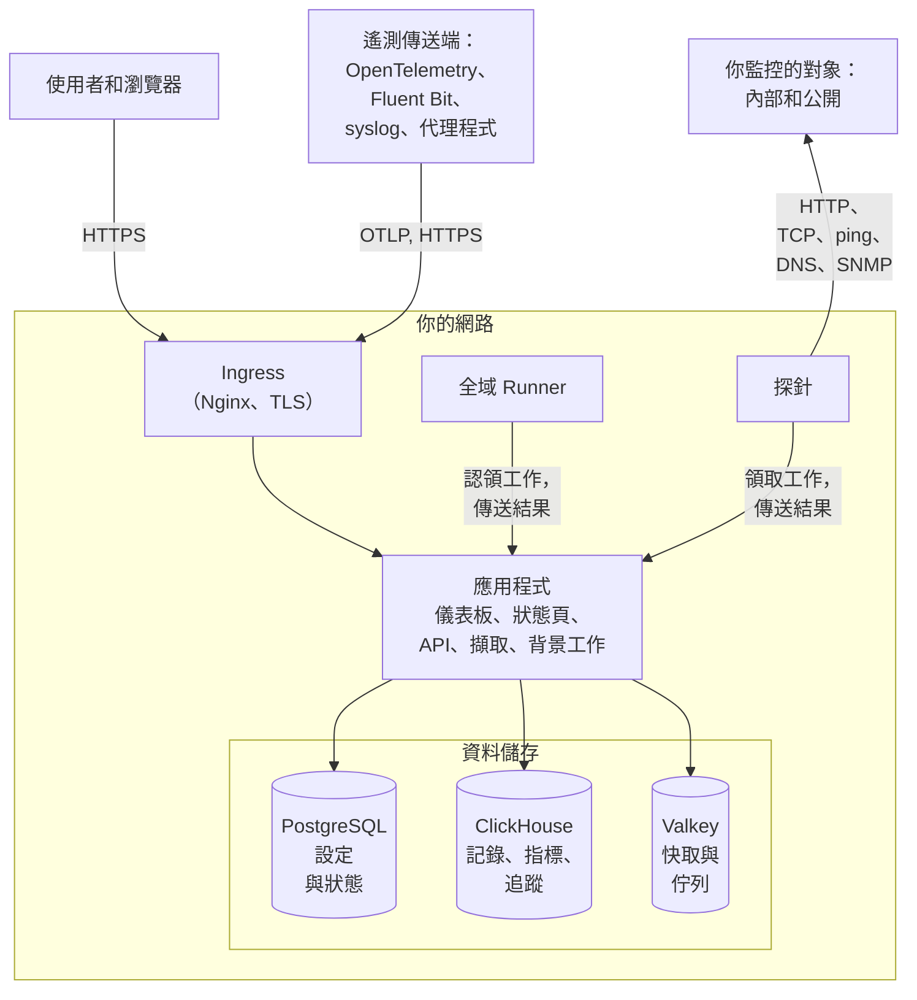

# 架構

自架的 OneUptime 由少數幾個容器組成：每個請求都從它進入的一個 ingress、負責處理工作的一個應用程式映像檔、執行監視器檢查的探針，以及三個資料儲存。本頁說明它們如何組合在一起、各自做什麼，以及哪些連線會跨越你的網路邊界。

## 圖中呈現了什麼

- 使用者透過 **ingress** 存取 OneUptime。ingress 終止 TLS，並把每個請求路由到應用程式：Dashboard、狀態頁、API，以及接收遙測資料的每個擷取端點。
- **應用程式** 在 PostgreSQL 中讀寫自己的狀態，把遙測資料保存在 ClickHouse 中，並使用 Valkey（Redis 7.2 的 BSD 授權分支）作為快取，以及承載其背景工作所處理的佇列。
- **探針** 可以執行在你的叢集內（建議），也可以執行在你網路中的其他位置。它們可以監控：
  - 防火牆後方的內部/私有服務。
  - 網際網路上的外部/公開資源。
- 探針的結果傳送到應用程式，在 Valkey 中排入佇列，再由背景工作處理並寫入你的資料儲存。位於你網路中其他位置的探針，會透過 ingress 以你的 OneUptime URL 連到應用程式。
- 遙測資料（指標、追蹤、記錄等）由同一個應用程式擷取，並儲存在 ClickHouse 中。

> [!NOTE]
> 如果你使用外部的 PostgreSQL、Valkey（或 Redis）或 ClickHouse，而不是內建的，應用程式會改為連線到你的外部端點。邏輯流程維持不變。

## 元件

| 元件 | Docker Compose 服務 | Helm Chart | 作用 |
| --- | --- | --- | --- |
| Ingress | `ingress` | `nginx` | 終止 TLS，為你的主機名稱與狀態頁網域提供服務，並把每個請求路由到應用程式。 |
| 應用程式 | `app` | `app` | Dashboard、狀態頁、API 與擷取端點，以及（除非你把它們拆分出去）背景工作。 |
| Worker | `app` 的一部分 | `worker`（預設關閉） | 在獨立的 Pod 中執行背景工作，讓繁重的佇列處理永遠不與 API 請求爭搶資源。 |
| Telemetry writer | `app` 的一部分 | `telemetryWriter`（預設關閉） | 一個固定規模的層，執行每一次 ClickHouse 插入，使插入量無論 worker 擴展到多大都維持在限度內。 |
| 探針 | `probe-1` | `probes` | 執行監視器檢查並把結果傳回。每個內建探針都是所有專案都能使用的全域探針。 |
| 全域 Runner | `global-runner` | `globalRunner` | 一個[全域 Runner](/docs/runbooks/agents#全域-runner)：它會執行所有未選擇自己 Runner 的專案的 JavaScript 步驟，每個步驟都在只能存取網際網路的沙箱中執行，並在每個未選擇 Runner 的程式碼儲存庫中執行 OneUptime AI 的程式碼修正。它持有自己的金鑰，不持有伺服器的任何其他東西。Bash、SSH 與 kubectl 步驟執行在你安裝到相應位置的 [Runner](/docs/runbooks/agents) 上。 |
| PostgreSQL | `postgres` | `postgresql`，或 `postgresOperator.cnpg` | 專案、監視器、事件、使用者以及其他所有設定與狀態。 |
| ClickHouse | `clickhouse` | `clickhouse`，或 `clickhouseOperator.altinity` | 記錄、指標、追蹤、例外、效能剖析與監視器記錄。 |
| Valkey | `valkey` | `valkey` | 快取、工作佇列，以及待處理的推播回執之類的短期狀態。 |

應用程式的所有角色都是同一個映像檔：Docker Compose 在一個 `app` 容器中執行它們，而 Helm Chart 可以把 worker 與 telemetry writer 作為各自獨立的部署來執行。如何為每一層決定規模，請參閱[規模估算與容量規劃](/docs/installation/sizing)。

## 從你的網路向外的連線

除非你變更設定，否則會建立以下四個連線：

- 應用程式每天一次向 GitHub 的 API（`api.github.com`）詢問是否有更新的版本。要關閉它，請在 Helm Chart 中設定 `updateCheck.disabled: true`，或在 Docker Compose 的 `config.env` 中設定 `DISABLE_UPDATE_CHECK=true`。
- 應用程式每天一次把你的安裝位址與它執行的版本告知 `oneuptime.com`，以便 OneUptime 知道哪些安裝仍在執行有安全問題的版本。不會傳送任何關於你的使用者、專案或監控資料的內容。要關閉它，請在 Helm Chart 中設定 `instanceCheckIn.disabled: true`，或在 Docker Compose 的 `config.env` 中設定 `DISABLE_INSTANCE_CHECK_IN=true`。
- 勾選「通知我有關安全修補程式與新版本」註冊時（此選項預設已勾選），會把此人的姓名與電子郵件、其填寫的公司與電話號碼，以及你的安裝位址與版本傳送到 `oneuptime.com`。在無法存取網際網路的網路中，請取消勾選。
- 在 Kubernetes 上，探針在你叢集本身的 DNS 之後會改用公用解析器 `8.8.8.8` 與 `1.1.1.1`。將 `dnsConfig.nameservers` 設為 `[]`，即可讓所有查詢都留在你自己的 DNS 上。

其他一切只有在你開啟時才會向外連線，並且每一項都有一個頁面列出需要放行的確切位址：

| 對外連線 | 用途 | 了解更多 |
| --- | --- | --- |
| 電子郵件（SMTP，或 SendGrid 的 API） | 通知與邀請 | [SMTP](/docs/emails/smtp) |
| Twilio | 簡訊與電話 | [Twilio 整合](/docs/self-hosted/twilio-integration) |
| OneUptime 的推播中繼，或 Expo | 行動推播通知 | [推播通知](/docs/self-hosted/push-notifications) |
| Slack 與 Microsoft Teams | 工作區通知與動作 | [Slack 整合](/docs/self-hosted/slack-integration) |
| LLM 供應商，例如 OpenAI、Anthropic、Microsoft Foundry，或你自己執行的模型 | OneUptime AI | [LLM 供應商](/docs/ai/llm-provider) |
| `oneuptime.com` | 線上啟用 Enterprise 授權 | [企業版](/docs/self-hosted/enterprise) |

反方向的連線——SendGrid 投遞傳入郵件、Slack 與 Microsoft Teams 回呼——需要 ingress 能從網際網路連到。應用程式和探針可以連到哪些私有位址由你決定：請參閱[私有網路存取](/docs/self-hosted/private-network-access)。

OneUptime 的標誌就在它寄出的每封郵件之中，因此即使在無法連上網際網路的網路中也能顯示，開啟郵件時也不會向其他任何主機請求內容。你自己上傳的圖片，例如你自己的標誌或狀態頁的標誌，會從你的 OneUptime URL 顯示，因此閱讀這些郵件的人需要能夠連到它。

## 後續步驟

:::cards
- [Docker Compose](/docs/installation/docker-compose): 在一台機器上安裝所有元件。
- [規模估算與容量規劃](/docs/installation/sizing): 每一層需要多少 CPU、記憶體和磁碟。
- [自訂探針](/docs/probe/custom-probe): 在另一個網路中執行探針。
- [企業版](/docs/self-hosted/enterprise): Enterprise 映像檔增加了什麼，以及授權如何運作。
:::
