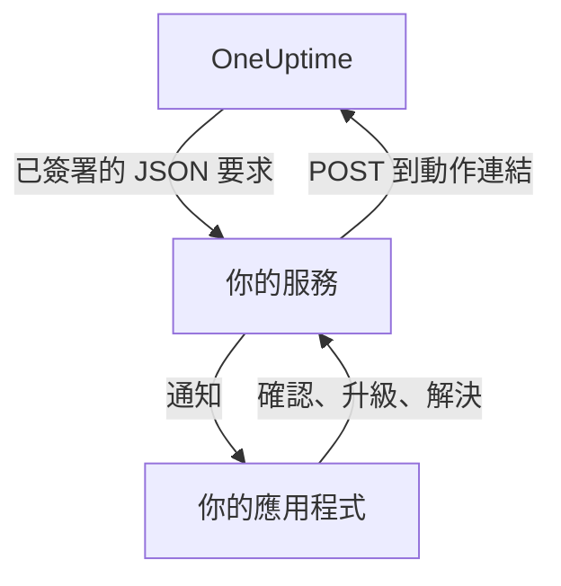

# 自訂通知管道

自訂管道會把值班呼叫傳送到你自己執行的服務：你公司自己的應用程式、呼叫器系統，或檢查離開你網路之內容的閘道。你只需為整個伺服器新增一次，所有人不必做任何設定就能透過它接收呼叫。在 Admin Dashboard 中，它們稱為 **Custom Channels**。

> [!NOTE]
> 自訂管道屬於 [OneUptime Enterprise Edition](/docs/self-hosted/enterprise)，需要包含此功能的 Enterprise 授權。Community Edition 沒有 **Custom Channels** 頁面，也不會傳送任何內容到管道。請參閱 [沒有授權時](#沒有授權時)。

:::cards
- [新增管道](#新增管道): 一個名稱、一個 URL 和一個簽署密鑰。
- [你的服務會收到什麼](#你的服務會收到什麼): 每次呼叫為每人傳送一個已簽署的 JSON 要求。
- [處理呼叫](#處理呼叫): 在你自己的應用程式中確認、升級或解決。
- [傳遞與重試](#傳遞與重試): 你的服務停擺時會發生什麼。
- [其他通知](#其他通知): 負責人通知、附註和班次，傳給想要的人。
- [沒有授權時](#沒有授權時): 哪些會停止，哪些會保留。
:::

## 運作方式



當待命策略呼叫某人，而此人的待命規則使用該管道時，OneUptime 會向管道的 URL 傳送要求。要求說明這次呼叫是傳給誰的（姓名和電子郵件）、與什麼有關，並附帶連結，供此人在你的應用程式中確認、升級或解決呼叫時由你的服務呼叫。

## 新增管道

1. 在 Admin Dashboard 中，開啟 **設定**，再開啟側邊選單中的 **通知 > Custom Channels**（**通知** 預設為摺疊），然後選擇 **Add**。
2. 在 **Channel** 步驟中填寫：
   - **名稱**：人們在通知方式和待命規則中看到的名稱，例如 `CorpoApp`。
   - **Webhook URL**：OneUptime 傳送每次呼叫的位址。它可以位於你的私人網路中。
   - **Signing Secret**：OneUptime 會為你產生一個。把它複製到你的服務中，服務會用它驗證每個要求。編輯管道時可以再次查看。
3. 在 **Delivery** 步驟中儲存，然後選擇 **Send test**，向你的服務傳送一個 [測試要求](#測試要求)。

在 **Delivery** 步驟中，**Page everyone through this channel** 預設為開啟。此時 OneUptime 會把該管道新增到每個專案中所有人的待命規則裡，以及之後加入專案的每個人的規則裡，並用它聯絡那些對已觸發的事項沒有規則的回應者。關閉它，即可讓人們自行把管道新增到自己的規則中。

人們可以在 **使用者設定**、**通知方式**、**Custom Channels** 下看到該管道和一個 **Send test** 按鈕，並在待命規則中以 `Custom Channel: CorpoApp` 的形式選擇它。他們不必做任何設定：每次呼叫是傳給誰的，你的服務都會知道。

若要在不變更任何人規則的情況下停止傳送，請編輯管道並關閉 **開啟**。原本會傳往該管道的呼叫，會在待命日誌中記錄為未傳送。刪除管道會刪除所有使用它的待命規則。

## 你的服務會收到什麼

每次呼叫都是一個帶有 JSON 本文的 `POST` 要求：

| 標頭 | 內容 |
| --- | --- |
| `Content-Type` | `application/json` |
| `X-OneUptime-Event` | 事件，例如 `on-call.incident.created` |
| `X-OneUptime-Signature` | `sha256=` 加上原始本文的十六進位 HMAC-SHA256，以管道的簽署密鑰計算 |

```json title="An incident page"
{
  "version": 1,
  "event": "on-call.incident.created",
  "notificationId": "5f2c8a1e-6b1d-4c3a-9e7f-2a4b6c8d0e1f",
  "sentAt": "2026-10-27T03:14:15.000Z",
  "channel": { "id": "0b7e…", "name": "CorpoApp" },
  "title": "New Incident INC-42: API latency high",
  "message": "A new incident has been created: INC-42 (API latency high) in Agency A. Click to view details.",
  "project": { "id": "8d1f…", "name": "Agency A" },
  "team": { "id": "2c9a…", "name": "SRE" },
  "user": { "id": "4e6b…", "name": "Jane Tan", "email": "jane@example.com" },
  "recordType": "incident",
  "record": {
    "id": "9a3c…",
    "number": "INC-42",
    "title": "API latency high",
    "description": "p95 latency above 2 seconds for 5 minutes.",
    "severity": "Critical",
    "state": "Created",
    "url": "https://oneuptime.example.com/dashboard/8d1f…/incidents/9a3c…"
  },
  "onCallPolicy": { "id": "1d4e…", "name": "Primary" },
  "escalationRule": { "id": "7b2f…", "name": "Level 1" },
  "isPageAgain": false,
  "actions": {
    "acknowledge": "https://oneuptime.example.com/api/custom-notification-channel/page/5f2c…/acknowledge?token=…",
    "escalate": "https://oneuptime.example.com/api/custom-notification-channel/page/5f2c…/escalate?token=…",
    "resolve": "https://oneuptime.example.com/api/custom-notification-channel/page/5f2c…/resolve?token=…"
  }
}
```

| 欄位 | 意義 |
| --- | --- |
| `version` | `1`。這個版本只會新增欄位。 |
| `event` | `on-call.incident.created`、`on-call.alert.created`、`on-call.incidentEpisode.created`、`on-call.alertEpisode.created`，[其他通知](#其他通知) 為 `notification`，或 `test` |
| `notificationId` | 每次呼叫每人一個。用它捨棄你已處理過的要求。 |
| `title`、`message` | 可直接顯示，與推播通知顯示的內容相同 |
| `user` | 這次呼叫傳給誰。在你的應用程式中依 `email` 或 `id` 找到其帳戶。 |
| `team` | 呼叫此人所經由的團隊；直接呼叫時為 `null` |
| `recordType`、`record` | 呼叫涉及的對象：`incident`、`alert`、`incidentEpisode` 或 `alertEpisode` |
| `onCallPolicy`、`escalationRule` | 呼叫此人的策略和級別 |
| `isPageAgain` | 當記錄在一段時間前已被確認但仍未解決時為 `true` |
| `actions` | 你的服務為 [處理呼叫](#處理呼叫) 而呼叫的連結 |

傳給多人的呼叫會為每人傳送一個要求，每個要求都帶有該人自己的連結，這樣 OneUptime 就知道是誰做出回應。標題、訊息和描述合計不超過 16,384 個字元；較長的描述會被截斷，並以「… (truncated — see OneUptime for the full text)」結尾。

### 驗證簽章

在剖析之前，計算原始要求本文的 HMAC，並與標頭比較：

```javascript title="Node.js"
const crypto = require("crypto");

function isFromOneUptime(rawBody, signatureHeader, secret) {
  const expected =
    "sha256=" + crypto.createHmac("sha256", secret).update(rawBody).digest("hex");
  const received = String(signatureHeader || "");

  return (
    received.length === expected.length &&
    crypto.timingSafeEqual(Buffer.from(received), Buffer.from(expected))
  );
}
```

## 處理呼叫

當此人在你的應用程式中按下按鈕時，你的服務會向 `actions` 中對應的連結傳送一個 `POST` 要求。不需要 API 金鑰：每個連結都帶有僅用於這次呼叫的權杖，有效期 7 天，動作會記錄為被呼叫的人所做。

| 動作 | 作用 |
| --- | --- |
| `acknowledge` | 確認此人的呼叫，並隨之確認事件、警示或片段 |
| `escalate` | 此人無法處理：立即呼叫待命策略的下一級，並停止呼叫此人 |
| `resolve` | 在此人自己的權限允許時，解決事件、警示或片段 |

```bash title="Acknowledge a page"
curl -X POST "https://oneuptime.example.com/api/custom-notification-channel/page/5f2c…/acknowledge?token=…"
```

回應會說明發生了什麼，其中的文字可以由你的應用程式原樣顯示：

```json title="The answer"
{
  "action": "acknowledge",
  "result": "acknowledged",
  "message": "Acknowledged."
}
```

`result` 是 `acknowledged`、`alreadyAcknowledged`、`escalated`、`notEscalated`、`resolved` 和 `alreadyResolved` 之一。過期或錯誤的連結會以 4xx 狀態和一則訊息被拒絕。

## 其他通知

呼叫並不是人們收到的唯一通知：當他們負責的事件狀態變更、有人發布附註、他們的待命班次開始等情況下，OneUptime 也會通知他們。每個人在 **使用者設定 > 通知設定** 中選擇這些通知分別傳往哪裡；只要有管道處於開啟狀態，那裡就會有 **Custom Channels** 欄。在每個人自己開啟之前，該欄對所有人都是關閉的。

通知會傳往每個已開啟的管道，每個管道一個要求，`event` 設為 `notification`：

```json title="A notification"
{
  "version": 1,
  "event": "notification",
  "notificationId": null,
  "sentAt": "2026-10-27T03:20:00.000Z",
  "channel": { "id": "0b7e…", "name": "CorpoApp" },
  "title": "Incident INC-42 acknowledged",
  "message": "Incident INC-42 (API latency high) was acknowledged in Agency A.",
  "project": { "id": "8d1f…", "name": "Agency A" },
  "team": null,
  "user": { "id": "4e6b…", "name": "Jane Tan", "email": "jane@example.com" },
  "recordType": null,
  "record": null,
  "onCallPolicy": null,
  "escalationRule": null,
  "isPageAgain": false,
  "actions": null,
  "notificationType": "Send incident state changed notification when I am the owner of the incident",
  "url": "https://oneuptime.example.com/dashboard/8d1f…/incidents/9a3c…"
}
```

`title` 和 `message` 就是此人的推播通知會顯示的內容。`notificationType` 是傳送這則通知所依據的設定名稱，`url` 連結到通知涉及的對象，或為 `null`。沒有需要處理的動作，所以 `actions` 為 `null`。

## 傳遞與重試

當你的服務在 10 秒內以 2xx 狀態回應時，要求即視為已傳遞。沒有回應，或以 408、429 或 5xx 狀態回應的要求，會在 1 秒後以及再過 4 秒後重新傳送：總共三次嘗試。其他任何 4xx 狀態都不會重新傳送。

每次嘗試的結果都會記錄在此人的待命日誌中，包括管道名稱和你的服務回應的狀態，但絕不包括 URL。未傳遞的呼叫不會停止待命策略：如果沒有人確認，它會照常升級。如果你的服務是聯絡人們的唯一途徑，請在規則較後的位置保留一條電子郵件或簡訊規則。

## 測試要求

Admin Dashboard 頁面上或個人通知方式中的 **Send test** 會傳送一個要求，其中 `event` 為 `test`，按下按鈕的人作為 `user`，`notificationId`、`record` 和 `actions` 為 `null`。可以用它在真正的呼叫到來之前試用你的服務。

## 沒有授權時

自訂管道在 Enterprise Edition 的 14 天試用期內，以及授權到期後 30 天的寬限期內都能運作。在此之後，或使用不包含此功能的授權時：

- **不會傳送任何內容到自訂管道。** 原本會傳往管道的呼叫，會在此人的待命日誌中記錄為未傳送，測試也是如此。
- **不再提供管道。** 管道會從人們的通知方式、待命規則和通知設定中消失，就緒狀態和備援傳送也不再計入它們。
- **頁面變為唯讀。** 你可以檢視和刪除管道，但不能新增或變更，任何人也不能讓規則或通知設定指向某個管道。
- **不會刪除任何內容。** 管道以及使用它們的待命規則和設定都會保留。

一旦啟用授權，一切都會立即恢復，不必重新啟動。在自訂管道停止期間加入專案的人，其規則中不會新增呼叫所有人的管道：他們可以自行新增。
