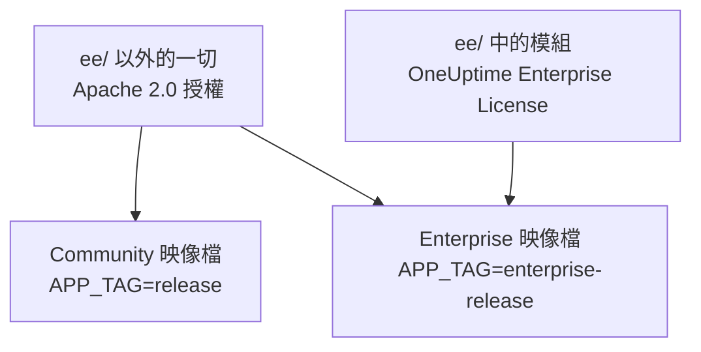
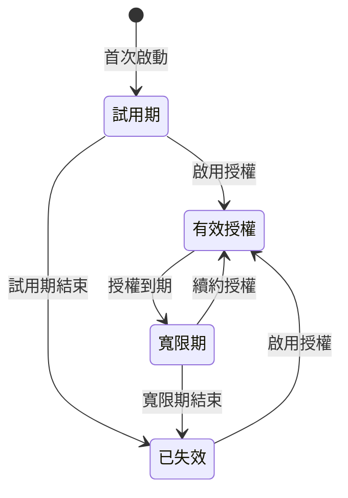

# 企業版

OneUptime 由同一個存放庫建置，並以兩個版本提供：

- **Community Edition**：完整的監控、事件與可觀測性平台，包括 SAML 與 OpenID Connect 單一登入，採用 Apache 2.0 授權開源，可免費自行託管，規模不限。
- **Enterprise Edition**：Community Edition 加上存放庫 [`ee/`](https://github.com/OneUptime/oneuptime/tree/master/ee) 目錄中的企業模組。這些模組加入 SCIM 佈建，以及治理與執行個體管理功能。它們依據 [OneUptime Enterprise License](https://github.com/OneUptime/oneuptime/blob/master/ee/LICENSE) 授權，在正式環境中使用需要符合您使用者人數的 Enterprise 授權。

兩個版本是各自獨立的容器映像檔。Community 映像檔不包含任何來自 `ee/` 的程式碼。OneUptime Cloud 執行的是 Enterprise Edition，在雲端由您的方案決定您能取得其中哪些功能。



> [!NOTE]
> **每個版本都有單一登入。** 專案與狀態頁面的 SAML 和 OIDC 登入、全域 SSO 以及「Require SSO for login」都屬於 Community Edition，任何授權狀態都不會將其關閉。

本頁說明每個版本包含的內容、如何執行 Enterprise Edition、授權如何運作，以及切換版本時會發生什麼事。

:::cards
- [比較兩個版本](#各版本包含的內容): Enterprise Edition 加入了什麼。
- [執行 Enterprise 映像檔](#執行-enterprise-edition): 只需一項設定，適用於 Kubernetes 或 Docker Compose。
- [啟用授權](#授權): 使用金鑰線上啟用，或使用簽署的權杖離線啟用。
- [授權到期時](#授權到期或缺少時): 哪些會停止、哪些永遠不會停止，以及如何恢復。
:::

## 各版本包含的內容

| 功能 | Community | Enterprise | OneUptime Cloud |
| --- | --- | --- | --- |
| 監控、警示、事件、待命、狀態頁面、日誌、指標、追蹤、例外、儀表板、工作流程、AI 功能、API 與 Terraform | 是 | 是 | 所有方案 |
| 密碼登入、雙重驗證、團隊、角色與 API 金鑰 | 是 | 是 | 所有方案 |
| 用於專案登入的 [SAML SSO 與 OpenID Connect](/docs/identity/sso) | 是 | 是 | Scale 方案以上 |
| 用於私人狀態頁面登入的 SAML SSO 與 OpenID Connect | 是 | 是 | Scale 方案以上 |
| [全域（整個執行個體範圍的）SSO 與 OIDC](/docs/identity/global-sso) | 是 | 是 | 不適用 |
| 用於專案與狀態頁面的 [SCIM 佈建](/docs/identity/scim) | 否 | 是 | Scale 方案以上 |
| 團隊合規設定 | 否 | 是 | Scale 方案以上 |
| 稽核日誌 | 否 | 是 | Enterprise 方案 |
| 保留期覆寫：依遙測類型設定保留期（日誌、追蹤、指標、效能剖析，可依日誌嚴重性與追蹤狀態設定規則），以及依服務與依資源設定保留期 | 否 | 是 | Scale 方案以上 |
| 管理端的 **Health** 儀表板：執行個體概覽、背景佇列、執行個體日誌、PostgreSQL、Valkey、ClickHouse 叢集、診斷日誌與遙測擷取 | 否 | 是 | 不適用 |
| 管理端的 **Query Console** | 否 | 是 | 無法使用 |
| PostgreSQL 與 Valkey（Redis）健康警示 | 否 | 是 | 不適用 |
| ClickHouse 容量檢視、容量警示與磁碟自動清理 | 是 | 是 | 不適用 |
| 管理員儀表板中的移轉狀態、支援套件與全域探測器 | 是 | 是 | 不適用 |
| Enterprise 授權、席位與執行個體管理 | 否 | 是 | 不適用 |

在兩個版本中，單一登入都包括針對專案、私人狀態頁面與整個執行個體的「Require SSO for login」。

每個版本都有專案的預設遙測保留期，位於 **專案設定 > 遙測與 APM > 資料保留**。保留期覆寫是 Enterprise Edition 在此之上加入的功能。

在 OneUptime Cloud 上，付費功能在任何方案中都能隨時關閉。試用（或降到較低的方案）後仍維持設定的保留期覆寫，會繼續套用到新的遙測資料，因此在低於 Scale 的方案中，保留期頁面會在升級卡片下方顯示它，並附上 **移除覆寫** 按鈕。在任何方案中都可以移除；再次設定則需要 Scale 方案。已經儲存的遙測資料會維持儲存時的保留期。同樣地，只要專案仍要求 SSO，**專案設定 > 安全性 > SSO** 就會在其升級卡片下方顯示 **登入時要求使用 SSO** 開關，以便將其關閉。

「不適用」的列是執行個體管理功能。在 OneUptime Cloud 上，由 OneUptime 為您營運執行個體。

## 執行 Enterprise Edition

兩個版本使用相同的設定、相同的資料庫與相同的資料。切換版本只會改變您執行的映像檔，其他一概不變。無論哪個方向都不需要移轉。

:::tabs
@tab Kubernetes
在您的 `values.yaml` 中設定映像檔類型：

```yaml title="values.yaml"
image:
  type: enterprise-edition
```

然後照常升級：

```bash
helm upgrade my-oneuptime oneuptime/oneuptime -f values.yaml
```

之後 chart 會拉取每個映像檔標籤的 `enterprise-` 變體，例如 `oneuptime/app:enterprise-release`，或在您固定 `image.tag` 時拉取 `enterprise-<version>`。設定 `image.type: community-edition`（預設值）即可執行 Community Edition。
@tab Docker Compose
在您的 `config.env` 中設定 `APP_TAG`：

```bash title="config.env"
APP_TAG=enterprise-release
```

使用 `enterprise-<version>` 固定某個版本。然後拉取映像檔並重新啟動：

```bash
npm run update
```

要回到 Community Edition，請設定 `APP_TAG=release` **和** `IS_ENTERPRISE_EDITION=false`。只要設定了 `IS_ENTERPRISE_EDITION=true`，`npm run update` 就會把 `APP_TAG` 改回 `enterprise-release`，而 Community 映像檔會拒絕啟動。
:::

### `IS_ENTERPRISE_EDITION` 已淘汰

決定版本的是您執行的映像檔。`IS_ENTERPRISE_EDITION` 不再啟用企業功能，並會在未來的版本中移除。您可以不設定它。

在 Community 映像檔上設定 `IS_ENTERPRISE_EDITION=true` **不會** 啟用企業功能。相反地，應用程式會 **拒絕啟動**，如此一來，落到 Community 映像檔上的升級就永遠不會悄悄停止 SCIM 佈建（包括取消佈建）與稽核日誌記錄。錯誤訊息會告訴您該設定什麼：設定 `APP_TAG=enterprise-<version>` 以保留 Enterprise Edition，或設定 `IS_ENTERPRISE_EDITION=false` 以執行 Community Edition。使用 Helm 時不會發生這種情況：chart 會根據 `image.type` 推導出這個變數。

`ONEUPTIME_EDITION=community` 會讓 Enterprise 映像檔以 Community Edition 的方式執行。這方便您在實際降級之前先試試看。Enterprise 映像檔會自行設定 `ONEUPTIME_EDITION=enterprise`；除了 `community` 之外，請勿以其他值覆寫它。

## 授權

存放庫根目錄中的 [`LICENSE`](https://github.com/OneUptime/oneuptime/blob/master/LICENSE) 檔案規定了哪個授權涵蓋哪些內容：`ee/` 目錄中的所有內容都適用 [OneUptime Enterprise License](https://github.com/OneUptime/oneuptime/blob/master/ee/LICENSE)，第三方元件保留其擁有者提供它們時所用的授權，其餘所有內容都適用 Apache 2.0 授權。

新的 Enterprise Edition 安裝會以 **14 天試用期** 執行，從該安裝首次啟動 Enterprise Edition 時開始計算。試用期用於評估：在正式環境中使用 Enterprise Edition 需要依據 OneUptime Enterprise License 訂閱。請在試用期結束前啟用授權：試用期結束後，SCIM、稽核日誌記錄與保留期覆寫都會停止，企業設定會變為唯讀（請參閱[授權到期或缺少時](#授權到期或缺少時)）。如需授權，請聯絡 [sales@oneuptime.com](mailto:sales@oneuptime.com)。

授權透過 **版本標籤** 管理，主管理員可以在管理員儀表板的頁首與 Dashboard 的頁尾看到它。它會顯示授權狀態、席位使用情形，並向主管理員顯示執行個體 ID。

### 線上啟用（授權金鑰）

:::steps
1. 以主管理員身分登入並開啟版本標籤。
2. 輸入您的授權金鑰並加以驗證。
:::

安裝會向 OneUptime 核對金鑰，並儲存收到的授權。此後，它會透過每日同步讓授權保持最新。若要立即取得額外席位或續約之類的變更，請在版本標籤上使用 **Refresh license**。

線上啟用需要從 OneUptime 伺服器到 `https://oneuptime.com` 的對外 HTTPS。如果伺服器只能透過中繼連上網際網路，請將 `ENTERPRISE_LICENSE_SERVER_URL` 設為中繼的 `https://` 位址。中繼必須把 `/api/enterprise-license/` 轉送到 oneuptime.com。

### 離線啟用（與網路隔離的安裝）

沒有通往網際網路之路由的安裝，可以使用 **簽署的授權權杖** 代替金鑰：

:::steps
1. 以主管理員身分登入，開啟版本標籤並記下 **執行個體 ID**。
2. 向 OneUptime（[sales@oneuptime.com](mailto:sales@oneuptime.com)）申請該執行個體 ID 的離線授權權杖。
3. 將權杖貼到版本標籤的權杖欄位中並啟用。
:::

安裝會依據內建在您所用版本中的 OneUptime 簽署金鑰自行驗證權杖。它從不聯絡 OneUptime。為某個執行個體 ID 簽發的權杖會被其他所有安裝拒絕，未指定執行個體 ID 簽發的權杖（例如線上啟用的安裝收到的權杖）也會被拒絕。若要續約或增加席位，請在目前的權杖到期前啟用新的權杖。

> [!IMPORTANT]
> **離線啟用需要一個信任 OneUptime 授權簽署金鑰的版本。** 如果您的版本尚未包含該金鑰，啟用會失敗並顯示「this build does not trust the key that signed this token」。這種情況下，請線上啟用，或升級到包含該金鑰的版本。

### 每日授權同步會傳送的內容

線上啟用的安裝每天會向 OneUptime 傳送一次報告。報告包含：

- 授權金鑰；
- 執行個體 ID（由安裝產生的隨機識別碼）以及安裝所設定的主機名稱（`HOST`）；
- 安裝執行的 OneUptime 版本；
- 安裝中的使用者人數；
- 每位使用者轉為小寫的電子郵件地址的 **SHA-256 雜湊**。OneUptime 用這些雜湊把在您多個安裝中都有帳戶的同一個人計為一個席位。一般使用者的原始電子郵件地址從不傳送；
- 安裝的 **主管理員** 的電子郵件地址，以便 OneUptime 就續約與席位上限與您聯絡。

回應包含 OneUptime 當天所知的授權資訊：公司名稱、到期時間、席位上限、您所有安裝合計的使用者人數，以及在該授權下登記的安裝。安裝的其他複本會在大約一分鐘內取得變更。

當您啟用或重新整理授權時，安裝只會傳送授權金鑰、執行個體 ID、主機名稱與版本。

除此之外不會傳送任何內容。監控資料、遙測、日誌與設定都不會離開安裝。Community Edition 不會傳送其中任何內容，離線啟用的安裝也不會。

### 授權到期或缺少時

在 14 天試用期內，以及授權到期後的 30 天內（寬限期），所有企業功能都能正常運作。在其中任何一個結束之前，版本標籤都會發出警告。此後，在啟用授權之前，**SCIM、稽核日誌記錄與保留期覆寫都會停止**，與 Community Edition 相同，企業設定也會變為唯讀。單一登入不是企業功能：SAML 和 OIDC 登入、全域 SSO 以及「Require SSO for login」在任何授權狀態下都一樣運作。



| 狀態 | 會發生什麼事 |
| --- | --- |
| **有效授權** | 所有企業功能都能正常運作。新增使用者不能超過授權的席位數。現有使用者永遠不會被移除。 |
| **試用期或寬限期**（沒有授權之安裝的前 14 天，或授權到期後的 30 天），或持有從未記錄到期時間之授權的安裝 | 所有企業功能都能正常運作，版本標籤會顯示警告。在到期後的寬限期內，席位上限仍然適用。持有未記錄到期時間之授權的安裝，會和沒有授權的安裝一樣經歷相同的 14 天試用期，且不強制執行席位上限，因為它持有的授權記錄本身就不完整。 |
| **試用期或寬限期之後**（授權已到期、缺少或無效，或授權不包含該功能） | SCIM 佈建、稽核日誌記錄與保留期覆寫 **停止**（見下文）。企業設定變為 **唯讀**：您可以檢視和刪除它，但不能建立或變更它。為了讓您能夠因應事件，有一項變更始終可以進行：替換 SCIM 持有人權杖。在其他一切都唯讀時，SCIM 設定頁面仍提供這項操作：在 SCIM 設定上使用 **重設 Bearer Token**，它會顯示一次新的權杖。透過 API，只傳送 `bearerToken`（至少 32 個字元）。稽核日誌記錄無法開啟或擴大範圍。企業版 Health 儀表板與 Query Console 會被鎖定。席位上限不再強制執行。 |

授權失效時會停止的內容：

- **SCIM 佈建停止。** 您的身分識別提供者的 SCIM 要求會被拒絕，包括取消佈建，而 SCIM 團隊鎖定會被解除，因此由 SCIM 推送群組管理的團隊可以手動編輯。
- **稽核日誌記錄停止記錄。** 此前已記錄的稽核日誌會被保留。
- **保留期覆寫不再生效。** 新的遙測資料會依專案的預設保留期保存。已經儲存的遙測資料會維持寫入時的保留期。您仍然可以透過 API 清除覆寫，但不能設定覆寫。

**不會** 停止的內容：

- **單一登入。** 專案、私人狀態頁面、整個執行個體（全域 SSO）與行動應用程式的 SAML 和 OIDC 登入，以及「Require SSO for login」，都屬於每個版本。授權失效不會改變其中任何一項，單一登入設定也仍可編輯。
- **核心監控永遠不受影響**：監測器、警示、事件、待命、狀態頁面與遙測都會繼續運作。
- **主管理員始終可以用自己的密碼登入。**
- **不會刪除任何內容。** SCIM 設定、稽核日誌與保留期覆寫都會維持原樣。

**一旦啟用授權，一切立即恢復**，無需重新啟動：SCIM 佈建、稽核日誌記錄與保留期覆寫會帶著您現有的設定回來。只有在 OneUptime 確知授權已失效時，才會關閉它們。在它無法讀取授權狀態時，例如伺服器啟動的片刻，SCIM、稽核日誌記錄與保留期覆寫會保持開啟。

> [!WARNING]
> **如果您的身分識別提供者透過 SCIM 取消佈建使用者，請在試用期或寬限期結束前啟用授權。** 之後，SCIM 不再為您在身分識別提供者處移除的人員取消佈建：他們的 OneUptime 帳戶會保留下來，除非「Require SSO for login」適用於他們，否則任何仍能存取這類帳戶電子郵件收件匣的人都可以設定密碼並登入。如果您讓授權失效，請自行在 OneUptime 中移除這些使用者。

## 從 Enterprise 切換到 Community

您的設定會保留在資料庫中。只要安裝持有有效授權，或仍處於試用期或寬限期，切換回 Enterprise 映像檔就會把一切恢復原樣。單一登入不會改變：SAML 和 OIDC 登入、全域 SSO 以及「Require SSO for login」在兩個映像檔上的運作方式相同。在 Community 映像檔上：

- **SCIM 停止。** 它的佈建端點不再存在，因此由 IdP 發起的 SCIM 呼叫會失敗。這包括 SCIM 取消佈建。
- **SCIM 團隊鎖定會被解除**，因此曾由 SCIM 推送群組管理的團隊可以手動編輯。啟動時，伺服器會記錄哪些專案的 SCIM 團隊鎖定已被解除。
- **稽核日誌記錄停止。** 此前已記錄的稽核日誌會被保留，但稽核日誌頁面會顯示升級提示。
- **保留期覆寫不再生效。** 新的遙測資料會依專案的預設保留期保存，**專案設定 > 遙測與 APM > 資料保留** 以及每個服務與每個資源設定頁面上的保留期卡片都會顯示升級提示。覆寫會保留在資料庫中，切換回來後會再次生效。
- **企業設定頁面會顯示升級提示。** 透過 API，您仍然可以讀取和刪除企業設定、重設 SCIM 持有人權杖，但不能建立或變更其他任何內容。稽核日誌記錄無法開啟。
- **企業版 Health 儀表板、Query Console 以及 PostgreSQL 與 Valkey 健康警示會停止。** ClickHouse 容量監控與清理、移轉狀態與支援套件會繼續運作。

> [!CAUTION]
> **在把身分識別提供者透過 SCIM 取消佈建使用者的安裝切換到 Community 映像檔之前，請檢查誰擁有存取權。** 沒有 SCIM，您在身分識別提供者處移除的人員會保留他們的 OneUptime 帳戶，除非「Require SSO for login」適用於他們，否則任何仍能存取這類帳戶電子郵件收件匣的人都可以設定密碼並登入。請先移除這些使用者。

## 疑難排解

:::details 升級後應用程式拒絕啟動
Community 映像檔上設定了 `IS_ENTERPRISE_EDITION=true`。設定 `APP_TAG=enterprise-<version>` 以保留 Enterprise Edition，或設定 `IS_ENTERPRISE_EDITION=false` 以執行 Community Edition，然後再次執行 `npm run update`。
:::

:::details 離線啟用失敗並顯示「this build does not trust the key that signed this token」
您的版本是在信任 OneUptime 授權簽署金鑰之前建置的。請線上啟用，或升級到包含該金鑰的版本。
:::

:::details 您的身分識別提供者的 SCIM 要求被拒絕
在 Enterprise 映像檔上，表示授權已失效：啟用一個授權，佈建就會恢復，無需重新啟動。在 Community 映像檔上，SCIM 端點根本不存在。
:::

## 後續步驟

:::cards
- [升級](/docs/installation/upgrading): 移轉到新版本，以及在兩個版本的映像檔之間切換。
- [SSO](/docs/identity/sso): 單一登入，每個版本都有。
- [全域 SSO](/docs/identity/global-sso): 為整個執行個體使用一個身分識別提供者。
- [SCIM](/docs/identity/scim): 從您的身分識別提供者佈建使用者與團隊。
:::
