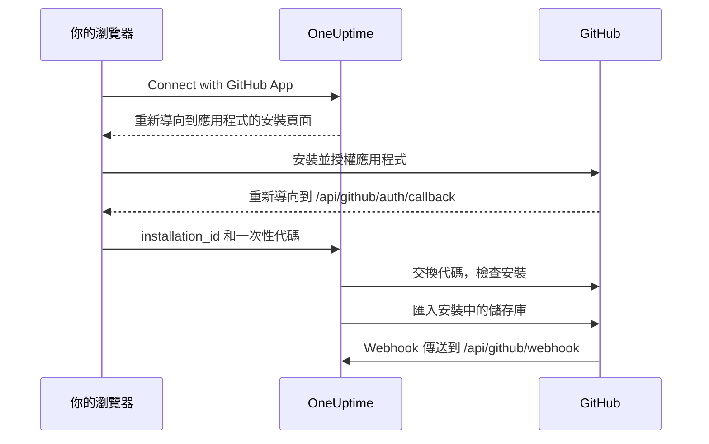

# GitHub 整合

使用你自己擁有的 GitHub App 將自行託管的 OneUptime 連接到 GitHub。從 OneUptime 安裝應用程式後，安裝中的儲存庫會匯入到你的專案並保持同步，AI 修正任務會建立 pull request，團隊也可以在 GitHub 中提及該應用程式，把工作交給它。

本頁面向執行 OneUptime 伺服器的人員：你只需建立一次應用程式，之後每個專案都從 **程式碼儲存庫** 連接它。

:::cards
- [建立 GitHub App](#建立-github-app): 使用正確的 URL、權限和事件註冊應用程式。
- [設定 OneUptime](#設定-oneuptime): 把應用程式的六個值交給伺服器。
- [連接儲存庫](#連接儲存庫): 從 OneUptime 安裝應用程式。
- [疑難排解](#疑難排解): 程式碼儲存庫中的訊息代表什麼。
:::

## 運作方式

安裝從 OneUptime 開始，而不是從 GitHub 開始：OneUptime 把你送往 GitHub 時使用的連結，正是把安裝與你的專案綁在一起的關鍵。



- 瀏覽器重新導向帶有安裝資訊和一次性 OAuth 代碼。OneUptime 交換該代碼，以確認安裝應用程式的 GitHub 帳號管理著這個安裝，然後匯入其中的儲存庫。
- Webhook 讓儲存庫清單保持同步，並把工作交給應用程式：提及、指派、觸發標籤和審查請求。GitHub 以 webhook secret 簽署每個 Webhook，無法驗證的 Webhook 會被 OneUptime 拒絕。

## 開始之前

- 一個能為要安裝應用程式的組織或使用者建立 GitHub App 的 GitHub 帳號。要在組織中安裝，你必須是該組織的擁有者，或請擁有者核准請求。
- 一個 GitHub 能連到的 OneUptime 公開 HTTPS 主機名稱，用來接收 Webhook。請參閱 [網路存取](#自行託管部署的網路存取)。
- 伺服器設定的存取權限：Docker Compose 使用 `config.env`，Kubernetes 使用你的 Helm values。

## 建立 GitHub App

:::steps
### 開啟 GitHub App 設定

- **組織：** `https://github.com/organizations/YOUR_ORG/settings/apps`
- **個人帳號：** `https://github.com/settings/apps`

選擇 **New GitHub App**。

### 填寫註冊表單

| 欄位 | 值 |
| --- | --- |
| **GitHub App name** | 任意唯一名稱，例如 `OneUptime`。請準確記下它：它就是 `GITHUB_APP_NAME`。 |
| **Homepage URL** | `https://your-oneuptime-domain.com` |
| **Callback URL** | `https://your-oneuptime-domain.com/api/github/auth/callback` |
| **Request user authorization (OAuth) during installation** | 開啟。**這是必要的**：請參閱下方說明。 |
| **Setup URL** | 如果 GitHub 允許填寫，則為 `https://your-oneuptime-domain.com/api/github/auth/callback`（見下文）。 |
| **Redirect on update** | 選用。有人在 GitHub 上變更安裝後，OneUptime 會把他們帶到 **程式碼儲存庫**。 |
| **Webhook URL** | `https://your-oneuptime-domain.com/api/github/webhook`，並將 Webhook 設為 **Active**。 |
| **Webhook secret** | 一個較長的隨機字串。請記下它：它就是 `GITHUB_APP_WEBHOOK_SECRET`。**必要**：OneUptime 會拒絕未簽署的 Webhook，因此不設定 `GITHUB_APP_WEBHOOK_SECRET` 會讓儲存庫同步停止，而不是接受未經驗證的內容。 |

根據 GitHub 的文件，開啟 **Request user authorization (OAuth) during installation** 後 [無法填寫 Setup URL](https://docs.github.com/en/apps/creating-github-apps/registering-a-github-app/about-the-setup-url)：使用者安裝應用程式後會改為被送到 Callback URL。兩者指向同一個 OneUptime 位址，所以無論哪種方式，重新導向都會抵達正確的位置。

> [!IMPORTANT]
> **為什麼「Request user authorization (OAuth) during installation」是必要的。** 安裝後，GitHub 會在 URL 中帶上 `installation_id` 重新導向。光憑這個數字無法證明安裝屬於誰——任何人都可以輸入另一個數字。開啟此選項後，GitHub 還會傳回一個與執行安裝的 GitHub 帳號綁定的一次性 OAuth `code`，OneUptime 會交換它，確認該帳號確實管理這個安裝，然後才把它連接到你的專案。
>
> 若未開啟，OneUptime 會拒絕連接該安裝，儀表板會顯示錯誤，要求你開啟此設定。這是刻意的設計：不經驗證就接受安裝 ID，會讓一個 OneUptime 專案佔用另一個組織的儲存庫。

### 設定權限

在 **Permissions & events** 下，設定下列 **Repository permissions**：

| 權限 | 存取 | OneUptime 的用途 |
| --- | --- | --- |
| Contents | Read and write | 讀取儲存庫檔案，並推送 AI 修正 pull request 的分支 |
| Pull requests | Read and write | 建立和更新 pull request，並發布審查 |
| Issues | Read and write | 發布應用程式的留言——**包括在 pull request 上**，GitHub 透過 issues API 處理 pull request 的對話 |
| Checks | Read-only | 選用。讀取修正 pull request 的 CI 結果。沒有它，這些 pull request 的 CI 狀態會維持未驗證 |
| Metadata | Read-only | 儲存庫的基本中繼資料（GitHub 要求） |

**讓應用程式具備互動能力的是 Issues: Read and write。** 沒有它，提及會被接收，但應用程式嘗試回覆時會無聲失敗——GitHub 透過 issues API 提供 pull request 對話中的留言，因此應用程式寫出的每一則回覆都取決於這一項權限。請參閱 [在 GitHub 中使用 OneUptime](/docs/ai/github-app)。

OneUptime 不需要組織或帳號層級的權限。

### 訂閱 Webhook 事件

OneUptime 使用兩組事件，它們負責不同的工作。

**儲存庫同步**：`installation` 和 `installation_repositories`。GitHub App 會自動收到這些事件；它們讓已連接的儲存庫集合與應用程式的安裝範圍保持一致。

**互動式應用程式**：這些事件必須明確訂閱，每一個都啟用一種把工作交給應用程式的特定方式：

| 事件 | 啟用的功能 |
| --- | --- |
| **Issue comment** | 在 issue **和** pull request 上的 `@mention` 指令 |
| **Issues** | 把 issue 指派給應用程式，以及儲存庫的觸發標籤 |
| **Pull request** | 請應用程式進行審查 |
| **Pull request review** | 已送出審查本文中的提及 |
| **Pull request review comment** | diff 中行內留言裡的提及 |

如果一個都沒有訂閱，GitHub App 仍然會連接儲存庫，也仍然會從 OneUptime 建立修正 pull request——只是對在 GitHub 中寫下的任何內容都不會回應。這是「機器人不理我」最常見的原因。指令有哪些、誰可以使用，請參閱 [在 GitHub 中使用 OneUptime](/docs/ai/github-app)。

其他事件（**Push**、**Workflow run**）會被確認後忽略；訂閱它們不會啟用通知或 CI/CD 自動化。

### 選擇應用程式可以安裝的位置

在 **Where can this GitHub App be installed?** 下選擇：

- **Only on this account** - 供私人/內部使用
- **Any account** - 如果你希望其他人也能安裝你的應用程式

### 建立應用程式並記下其 ID

選擇 **Create GitHub App**。GitHub 會開啟應用程式的設定頁面。記下頁面頂端的 **App ID**，以及 **About** 區段中的 **Client ID**。

### 產生 client secret

在 **Client secrets** 下選擇 **Generate a new client secret**。請立即複製：GitHub 只會顯示一次。

### 產生私密金鑰

在 **Private keys** 下選擇 **Generate a private key**。GitHub 會下載一個 `.pem` 檔案。請妥善保管：OneUptime 用它以應用程式身分進行驗證。
:::

## 設定 OneUptime

:::tabs
@tab Docker Compose
`config.env` 每行一個值，因此請把私密金鑰以 base64 編碼後寫在一行中。OneUptime 會將其解碼：

```bash
base64 < private-key.pem | tr -d '\n'
```

```bash title="config.env"
GITHUB_APP_ID=YOUR_APP_ID
GITHUB_APP_NAME=YOUR_APP_NAME
GITHUB_APP_CLIENT_ID=YOUR_CLIENT_ID
GITHUB_APP_CLIENT_SECRET=YOUR_CLIENT_SECRET
GITHUB_APP_PRIVATE_KEY=YOUR_BASE64_ENCODED_PRIVATE_KEY
GITHUB_APP_WEBHOOK_SECRET=YOUR_WEBHOOK_SECRET
```

用 `npm run start` 套用變更，它會重新建立容器。`docker compose restart` 不會重新讀取 `config.env`。
@tab Kubernetes
```yaml title="values.yaml"
gitHubApp:
  id: "YOUR_APP_ID"
  name: "YOUR_APP_NAME" # The exact name of your GitHub App
  clientId: "YOUR_CLIENT_ID"
  clientSecret: "YOUR_CLIENT_SECRET"
  privateKey: "<BASE64_ENCODED_PRIVATE_KEY_CONTENT>"
  webhookSecret: "YOUR_WEBHOOK_SECRET"
```

`privateKey` 也可以直接使用 PEM 本身，寫成多行區塊（`privateKey: |`）。用 `helm upgrade` 套用變更。
:::

OneUptime 恢復執行後，**程式碼儲存庫** 會顯示 **Connect with GitHub App**，而不是 **GitHub App is not configured on this server**。

### 環境變數參考

| Docker Compose (`config.env`) | Helm (`values.yaml`) | 值 |
| --- | --- | --- |
| `GITHUB_APP_ID` | `gitHubApp.id` | **App ID**。用來以應用程式身分驗證。 |
| `GITHUB_APP_NAME` | `gitHubApp.name` | 應用程式的確切名稱。安裝連結和應用程式的 `@mention` 代號（小寫，空格換成連字號）由它產生。沒有它，**程式碼儲存庫** 無法連接。 |
| `GITHUB_APP_CLIENT_ID` | `gitHubApp.clientId` | **Client ID**。用來驗證是誰安裝了應用程式。 |
| `GITHUB_APP_CLIENT_SECRET` | `gitHubApp.clientSecret` | 你產生的 client secret。需要與 client ID 一起使用。 |
| `GITHUB_APP_PRIVATE_KEY` | `gitHubApp.privateKey` | 私密金鑰：PEM，或以 base64 編碼的 PEM。 |
| `GITHUB_APP_WEBHOOK_SECRET` | `gitHubApp.webhookSecret` | webhook secret。每個 Webhook 都以它驗證，沒有它就不接受任何 Webhook。 |

六個值都是必要的。

## 連接儲存庫

請從 OneUptime 而不是 GitHub 上的應用程式頁面開始連接：OneUptime 把你送往 GitHub 時使用的連結，正是把安裝與你的專案綁在一起的關鍵。

:::steps
1. 登入你的 OneUptime 儀表板
2. 前往 **產品** > **任務** > **程式碼儲存庫**
3. 點選 **Connect with GitHub App**。OneUptime 會帶你前往 GitHub
4. 選擇要安裝應用程式的組織或帳號，並選擇它可以存取哪些儲存庫：**All repositories**（所有現有及未來的儲存庫）或 **Only select repositories**
5. 點選 **Install**（如果應用程式已安裝在那裡，則點選 **Save**）
6. GitHub 會把你送回 **程式碼儲存庫**，安裝中的每個儲存庫都會被匯入。之後加入安裝或從中移除的儲存庫會自動保持同步。
:::

**誰可以連接。** 連接會把安裝中的儲存庫匯入專案，因此需要新增程式碼儲存庫的權限：**Project Owner**、**Project Admin**、**Project Member**、**Settings Admin**、**Settings Member**，或擁有 **Create Code Repository** 的團隊。封鎖該權限的團隊會收回它。在 OneUptime Cloud 上，程式碼儲存庫需要 Growth 方案或更高方案。對其他人來說，卡片會被鎖定，並說明需要什麼。

**請在 15 分鐘內以同一個瀏覽器完成。** 連結只能在發起它的瀏覽器中使用一次，有效 15 分鐘。GitHub 把你送回時，OneUptime 會在匯入任何內容前再次檢查權限。

## 自行託管部署的網路存取

### 流量方向與端點

| 流量 | 所需存取 |
| --- | --- |
| OneUptime 到 GitHub | DNS，以及透過 TCP 443 到 `api.github.com` 的輸出 HTTPS（用於 GitHub App 權杖和儲存庫 API 呼叫），和到 `github.com` 的輸出 HTTPS（用於 OAuth 權杖交換和 HTTPS Git 操作） |
| GitHub 到 OneUptime | 透過 TCP 443 到 `POST /api/github/webhook` 的公開 HTTPS，用於同步安裝和儲存庫存取，以及互動式應用程式 |
| 使用者瀏覽器到 OneUptime | 儀表板存取，以及用於安裝/授權重新導向的 `GET /api/github/auth/callback`；這些可以維持只透過使用者的 VPN 存取 |

callback 是一次 [瀏覽器重新導向](https://docs.github.com/en/apps/creating-github-apps/registering-a-github-app/about-the-user-authorization-callback-url)，而 Webhook 是來自 GitHub 伺服器的請求。使用者的 VPN 連線並不能讓 GitHub 存取 Webhook。上述網域涵蓋整合的核心請求；額外的儲存庫工具、下載、LFS 或套件可能需要其他目的地。這些設定描述的是 GitHub.com；變更防火牆並不會設定對 GitHub Enterprise Server 主機名稱的支援。

### 私人部署與回呼安全性

透過一個公開閘道公開 `/api/github/webhook`，該閘道應具備公開 DNS、含完整憑證鏈的公開受信任 HTTPS 憑證，以及通往 OneUptime ingress 的私人路由。允許到閘道的輸入 TCP 443，並把公開轉送限制在這個 POST 路由。如果使用者透過 VPN 存取儀表板和瀏覽器 callback，請將它們留在私人 ingress 上；分割 DNS 可以在內部與外部提供同一個主機名稱。

在 `config.env` 中設定 `HOST=oneuptime.example.com` 和 `HTTP_PROTOCOL=https`，或在 Helm 中設定 `host: oneuptime.example.com` 和 `httpProtocol: https`。套用設定並等待 OneUptime 重新啟動。這些值只產生 URL；它們不會提供 DNS、TLS 或網路存取。如果主機名稱改變，請更新 GitHub App 的 webhook、callback、setup 和首頁 URL。

保留方法、原始路徑、查詢字串、本文、`Content-Type`、`X-Hub-Signature-256`、`X-GitHub-Event` 和 `X-GitHub-Delivery`。透過受信任的代理標頭保留公開主機和 HTTPS 協定。讓 Webhook 免除瀏覽器 SSO、CAPTCHA 和代理登入頁面。保持 GitHub 的 SSL 驗證開啟，並在兩個系統中設定相同的 `GITHUB_APP_WEBHOOK_SECRET`：OneUptime 會拒絕未簽署的請求，沒有這個密鑰就無法驗證 Webhook。請參閱 GitHub 的 [Webhook 驗證指引](https://docs.github.com/en/webhooks/using-webhooks/validating-webhook-deliveries)。

如果你還限制 Webhook 的來源 IP，請使用 GitHub Meta API 中目前的 `hooks` 範圍並定期更新；不要以 GitHub Actions 執行器的範圍代替，也不要省略簽章驗證。GitHub 提醒 [其位址會變動，且公布的清單並不完整](https://docs.github.com/en/authentication/keeping-your-account-and-data-secure/about-githubs-ip-addresses)。

### 驗證存取並了解限制

:::steps
1. 從 **程式碼儲存庫** 連接一個安裝。
2. 在 GitHub App 的設定中開啟 **Advanced** 並查看 **Recent Deliveries**。重新遞送一次，確認閘道轉送了它，且 OneUptime 接受了它。
3. 在安裝中加入或移除一個測試儲存庫，檢查 OneUptime 中的儲存庫清單是否跟著變化。
:::

GitHub 文件說明了 [遞送診斷](https://docs.github.com/en/webhooks/testing-and-troubleshooting-webhooks/viewing-webhook-deliveries)，並要求 [在十秒內傳回 2xx 確認](https://docs.github.com/en/webhooks/using-webhooks/best-practices-for-using-webhooks)。瀏覽器對 Webhook 發出的 GET 並不能測試已簽署的 POST。

> [!WARNING]
> 沒有輸入存取時，瀏覽器授權以及輸出 API 和 Git 操作可能可以運作，但 Webhook 無法抵達 OneUptime：已刪除的安裝和儲存庫存取的變更不會同步，應用程式也永遠不會回應提及、指派或審查請求。

[私有網路存取設定](/docs/self-hosted/private-network-access) 控制傳往私人目的地的輸出請求，並不會讓 GitHub 能夠連到 Webhook。

## 疑難排解

### 連接沒有完成

當 GitHub 把你送回而安裝沒有連接時，**程式碼儲存庫** 會顯示 **GitHub 未連接**，並以你的語言用一句話說明原因。頁面的其餘部分照常載入，所以你可以直接在那裡重新連接。頁面從不顯示 GitHub 本身的回覆：它和原因一起記錄在 OneUptime 伺服器日誌中。

| 頁面顯示 | 該怎麼做 |
| --- | --- |
| **"此連接連結無效、已過期或已被使用。請重新開始。"** | 連結只能在發起它的瀏覽器中使用一次，有效 15 分鐘。從 **程式碼儲存庫** 重新開始，並在 15 分鐘內以同一個瀏覽器在 GitHub 上完成。從 GitHub 上的應用程式頁面安裝應用程式，並不會把它連接到任何專案。 |
| **"您沒有將程式碼儲存庫新增至此專案的權限。"** | 連接需要新增程式碼儲存庫的權限（請參閱 [連接儲存庫](#連接儲存庫)）。請專案管理員授予該權限。GitHub 把你送回時會再次檢查，因此在這段期間被撤銷的權限也會在這裡結束連接。 |
| **"連接 GitHub 需要 ... 方案。"** | 在 OneUptime Cloud 上，程式碼儲存庫需要這句話所提到的方案。升級專案的方案，然後重新連接。 |
| **"GitHub 未確認是誰安裝了此應用程式，因此無法驗證這個安裝。"** | 在 GitHub App 的設定中開啟 **Request user authorization (OAuth) during installation**（請參閱 [建立 GitHub App](#建立-github-app)），然後重新連接。 |
| **"OneUptime 無法確認您的 GitHub 帳號可以管理此安裝。"** | 完成安裝的 GitHub 帳號並不管理該安裝。請使用擁有應用程式安裝所在組織或使用者的帳號安裝，或請擁有者安裝。 |
| **"GitHub 沒有傳回安裝資訊。"** | 當組織成員請求應用程式而不是直接安裝時，組織的擁有者必須先核准請求。核准後再重新連接。 |
| **"此 OneUptime 伺服器未設定 GitHub App。"** | 同時設定 `GITHUB_APP_CLIENT_ID` 和 `GITHUB_APP_CLIENT_SECRET`（請參閱 [設定 OneUptime](#設定-oneuptime)），然後重新啟動 OneUptime。 |
| **"OneUptime 無法完成連接。請再試一次。"** | GitHub 回傳了錯誤，或在完成過程中某個請求或寫入失敗。OneUptime 伺服器日誌會說明是哪一種。請再試一次；如果問題持續，請檢查日誌和 GitHub App 的設定。 |

### 其他問題

:::details 程式碼儲存庫顯示「GitHub App is not configured on this server」
未設定 `GITHUB_APP_NAME`。將它設為應用程式的確切名稱，並一併設定其他五個值，然後重新啟動 OneUptime。
:::

:::details 安裝應用程式後沒有被送回 OneUptime
檢查應用程式的 **Callback URL** 是否為 `https://your-oneuptime-domain.com/api/github/auth/callback`；如果有設定 **Setup URL**，也一併檢查。兩者都必須指向 `HOST` 中主機名稱上的同一個 `/api/github/auth/callback` 端點。
:::

:::details GitHub 的 Recent Deliveries 顯示 "Invalid webhook signature"
GitHub App 中的 webhook secret 與 `GITHUB_APP_WEBHOOK_SECRET` 不一致、`GITHUB_APP_WEBHOOK_SECRET` 未設定，或代理修改了請求本文。在兩邊設定相同的密鑰，重新啟動 OneUptime，並確保閘道原封不動地轉送本文。
:::

:::details 收不到 Webhook 事件
檢查 Webhook URL 是否能透過 HTTPS 公開連到，然後在 GitHub App 設定的 **Advanced > Recent Deliveries** 中查看每次嘗試及其回應。只要 `GITHUB_APP_WEBHOOK_SECRET` 未設定，Webhook 就會被拒絕。
:::

:::details 儲存庫或修正任務因驗證錯誤而失敗
OneUptime 使用 `GITHUB_APP_ID` 和 `GITHUB_APP_PRIVATE_KEY` 以應用程式身分驗證。檢查 App ID 是否正確，以及金鑰是否為完整的 PEM（包含 `BEGIN` 和 `END` 行），或以 base64 編碼的該 PEM。如果應用程式已從 GitHub 解除安裝，請從 **程式碼儲存庫** 重新連接。
:::

:::details 安裝後缺少儲存庫
在 GitHub 上該安裝的設定中，檢查安裝可以存取哪些儲存庫。只要 Webhook 能抵達 OneUptime，你在那裡加入的儲存庫都會自動匯入。
:::

:::details 應用程式忽略 GitHub 中的提及
授予應用程式 **Issues: Read and write**，並讓它訂閱 [訂閱 Webhook 事件](#訂閱-webhook-事件) 中的互動式事件。此外，提及只會比對由 `GITHUB_APP_NAME` 產生的代號，因此請把它設為應用程式的真實名稱。
:::

## 安全性最佳做法

- **定期輪替密鑰。** 定期產生新的 client secret 和私密金鑰。
- **保持 webhook secret 已設定。** OneUptime 會拒絕無法驗證的 Webhook。
- **限制儲存庫存取。** 只把需要連接的儲存庫授予該安裝。
- **留意 Webhook 遞送。** 定期檢查是否有遞送失敗或可疑活動。
- **不要把私密金鑰放進版本控制。**

## 後續步驟

:::cards
- [在 GitHub 中使用 OneUptime](/docs/ai/github-app): 可以對應用程式下達的指令，以及誰可以下達。
- [修正任務](/docs/ai/ai-agent): AI 代理程式如何建立修正 pull request。
- [私有網路存取](/docs/self-hosted/private-network-access): 讓工作流程和 Webhook 連到內部工具。
:::
