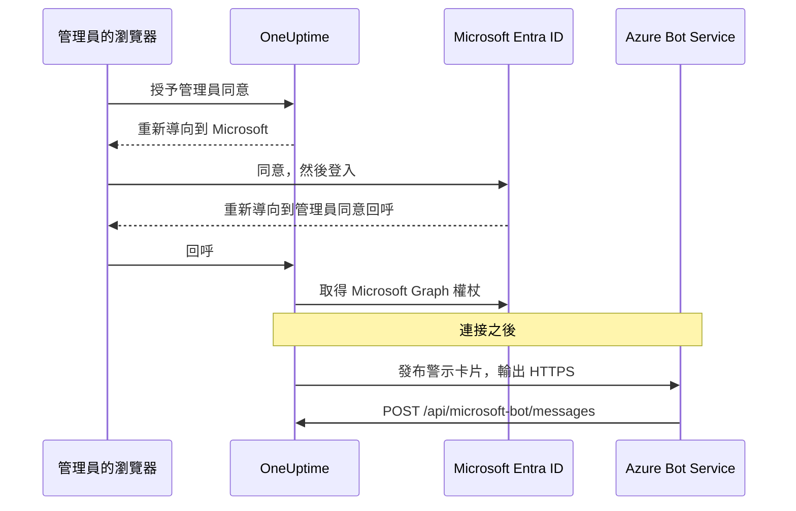
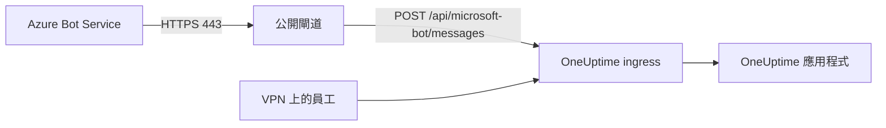

# Microsoft Teams 整合

將你自行託管的 OneUptime 連接到 Microsoft Teams。你需要在 Microsoft Entra ID 中註冊一個應用程式，為它建立一個 Azure Bot，把應用程式的認證資訊交給 OneUptime，然後安裝伺服器產生的 Teams 應用程式套件。之後，OneUptime 會把警示和事件發布到你的頻道和聊天中，你的團隊可以直接在 Teams 裡處理。

本頁面向維運 OneUptime 伺服器的人員。Teams 連接後，通知規則按專案設定：請參閱 [Microsoft Teams](/docs/workspace-connections/microsoft-teams)。

:::cards
- [設定整合](#設定整合): 九個步驟，從 Azure 入口網站到你的第一個團隊。
- [環境變數](#環境變數): OneUptime 需要從應用程式註冊中取得的三個值。
- [網路存取](#網路存取): Microsoft 必須能夠連到的機器人端點。
- [疑難排解](#疑難排解): 無法連到的端點、缺少的安裝和失敗的連接。
:::

## 運作方式

OneUptime 使用 Azure Bot 實現 Teams 整合。流量是雙向的，而且兩個方向彼此獨立：OneUptime 呼叫 Microsoft 來發布訊息；當有人按下按鈕、傳訊息給機器人或把它新增到聊天時，Azure Bot Service 會呼叫你的伺服器。



Incoming Webhook 或 Teams 工作流程 URL 都無法取代此機器人的訊息端點。

視訊通話（為事件召開的 Teams 會議）不使用此機器人：它需要另外的應用程式註冊，詳見 [視訊通話](/docs/workspace-connections/video-calls#one-click-connect-on-a-self-hosted-server)。

## 開始之前

- 一個 Azure 訂用帳戶，用於 Azure Bot 資源。
- 一個可以在 Microsoft Entra ID 中建立應用程式註冊的帳號，以及一位可以授予管理員同意的 Microsoft 365 管理員。
- 一個 Azure Bot Service 能夠連到的 OneUptime 公開 HTTPS 主機名稱。請參閱 [網路存取](#網路存取)。
- 伺服器設定的存取權：Docker Compose 下的 `config.env`，或 Kubernetes 下的 Helm values。
- 要連接專案，需要在該專案中具備 **Project Owner**、**Project Admin** 或 **Project Member** 角色。

## 設定整合

:::steps
### 第 1 步：建立 Azure 應用程式註冊

在 [Azure 入口網站](https://portal.azure.com) 中開啟 **App registrations**，選擇 **New registration**。依下列方式填寫表單：

- **Name:** oneuptime
- **Supported account types:** Accounts in this organizational directory only (Single tenant)
- **Redirect URI:** Web - `https://your-oneuptime-domain.com/api/microsoft-teams/auth`

選擇 **Register**，然後新增第二個 Web 重新導向 URI：`https://your-oneuptime-domain.com/api/microsoft-teams/admin-consent/callback`。記下 **Application (client) ID** 和 **Directory (tenant) ID**：之後兩者都會用到。

> [!NOTE]
> **為什麼是單一租用戶：** 自行託管的 OneUptime 部署服務一個組織，它的機器人是為你在 `MICROSOFT_TEAMS_APP_TENANT_ID`（第 6 步）中設定的那一個租用戶註冊的。把應用程式註冊為多租用戶並不會擴大這個範圍，反而會多出一種失敗情形：主要 Microsoft 租用戶與你不同的來賓 / B2B 使用者會帶著他們自己的租用戶 ID 連到機器人，而 OneUptime 無法把它對應到你的專案。如果你已經註冊了多租用戶應用程式，它仍然可以運作；只要確保 `MICROSOFT_TEAMS_APP_TENANT_ID` 是你自己的租用戶，並預期來賓帳號需要在你的租用戶中擁有帳號才能使用機器人。

### 第 2 步：設定應用程式權限

在應用程式註冊中開啟 **API permissions**，選擇 **Add a permission**，然後選擇 **Microsoft Graph**。

**新增委派權限**（代表已登入的使用者執行操作時）：

- **User.Read** - 在 OAuth 流程中取得已驗證使用者的設定檔資訊（顯示名稱、電子郵件）所必需
- **Team.ReadBasic.All** - 使用者選擇要連接哪個團隊時，列出其所屬團隊所必需
- **Channel.ReadBasic.All** - 讀取頻道資訊並列出團隊中的頻道以傳遞通知所必需
- **ChannelMessage.Send** - 向 Teams 頻道傳送警示和事件通知所必需

**新增應用程式權限**（應用程式以自身身分執行操作、沒有已登入的使用者時）：

- **Team.ReadBasic.All** - 授予管理員同意後列出組織中所有團隊所必需
- **Channel.ReadBasic.All** - 確認頻道是否存在並取得其詳細資料所必需
- **TeamsAppInstallation.ReadForTeam.All** - 診斷所必需。它讓 OneUptime 讀取團隊中實際安裝的是哪個應用程式套件，並與此部署的用戶端 ID 比較，這樣傳送失敗時就能告訴你是可能原因中的 *哪一個*。沒有它，OneUptime 無法區分「未安裝」和「已安裝，但那是別人的套件」，只能轉述 Microsoft 的說法，而這正是偵錯此整合要花好幾天而不是幾分鐘的主要原因。請授予它。
- **Chat.ReadBasic.WhereInstalled** - 選用。它讓 OneUptime 讀取 OneUptime 應用程式所在的每個聊天的名稱。沒有它時，每個聊天透過資訊清單中的 **ChatSettings.Read.Chat** 權限（見下文）授予這項能力，而以舊資訊清單新增的聊天，要等其中的應用程式更新後才會具備該權限。

`ChannelMessage.Send` 只有委派權限；[Microsoft Graph 權限參考](https://learn.microsoft.com/en-us/graph/permissions-reference#channelmessagesend) 中沒有對應的應用程式權限。請把它保留在上面的委派權限清單中。

接著為你的組織選擇 **Grant admin consent**。

機器人本身使用 Teams 應用程式資訊清單中定義的資源特定同意（RSC）權限。這些權限在應用程式安裝到團隊或聊天、或在其中更新時授予，而不是在 Entra ID 中授予：

- **ChannelMessage.Send.Group** - 允許機器人傳送訊息到團隊頻道
- **ChannelMessage.Read.Group** - 允許機器人讀取頻道訊息以支援互動式命令
- **Channel.Create.Group** - 允許機器人在需要時建立頻道
- **ChatMessage.Read.Chat** - 允許機器人讀取它所加入的聊天中的訊息（用於互動式命令）
- **ChatMember.Read.Chat** - 允許機器人讀取它所加入的聊天的成員（用於在 OneUptime 中為聊天命名）
- **ChatSettings.Read.Chat** - 允許 OneUptime 讀取應用程式所加入的群組聊天的名稱。Teams 不會可靠地把群組聊天的名稱傳給機器人，因此沒有它時，有名稱的群組聊天會以其成員的名字顯示
- **TeamsAppInstallation.Read.Group** - 允許 OneUptime 確認應用程式已安裝在它即將發布訊息的團隊中

如果你是在這些權限出現之前上傳應用程式資訊清單，請從 **專案設定 > 工作區 > Microsoft Teams** 重新下載，並以 OneUptime 應用程式更新的形式上傳到 Teams。Teams 會在應用程式安裝到某個團隊或聊天、或在其中更新時授予團隊和聊天權限，因此請在每個已有該應用程式的團隊和聊天中接受更新。關於聊天，請參閱 [群組聊天以成員的名字顯示](#群組聊天以成員的名字顯示)。

### 第 3 步：建立用戶端密碼

在應用程式註冊中開啟 **Certificates & secrets**，選擇 **New client secret**。新增描述，選擇到期時間（24 個月是合理的選擇），然後選擇 **Add**。立即複製密碼的值：Azure 只會顯示一次。

> [!IMPORTANT]
> 複製密碼的 **Value**，而不是它的 **Secret ID**。值是較長的那個字串。

### 第 4 步：建立 Bot Service

在 Azure 入口網站中建立一個 **Azure Bot** 資源：

- **Bot handle:** oneuptime-bot
- **Subscription** 和 **Resource group:** 你自己的
- **Pricing tier:** 測試用 F0 (Free) 即可
- **Type of App:** Single Tenant，使用現有的應用程式註冊：第 1 步中的 **Application (client) ID** 和 **Directory (tenant) ID**

選擇 **Review + create**，然後選擇 **Create**。機器人部署完成後，開啟它的 **Configuration** 頁面，將 **Messaging endpoint** 設定為 `https://your-oneuptime-domain.com/api/microsoft-bot/messages` 並儲存。

**繼續之前先驗證端點。** Azure Bot Service 從公開網際網路呼叫此 URL，所以請從你的網路之外的某處檢查：不要在叢集內部檢查，也不要透過一個能看到該主機、而 Azure 看不到的 VPN 檢查：

```bash
curl -sS -i https://your-oneuptime-domain.com/api/microsoft-bot/messages
```

請使用 `-i`，不要只看狀態碼：遇到 404 時，**只有回應本文能告訴你它是誰產生的**，而這個區別就是全部的診斷。

- **405** 是正確的結果，表示你已完成。此端點只接受 POST，所以 GET 會收到 `405 Method Not Allowed`，並附上 `Allow: POST` 和端點說明。能連到它，正是這裡要測試的內容。
- **本文為 JSON `{"message":"Page not found - /api/microsoft-bot/messages"}` 的 404** 來自 OneUptime，所以請求 *確實* 到達了。要嘛此部署早於上面的 405 回應（舊版本只為 POST 提供此路由，所以 GET 會落入通用的「not found」處理常式），要嘛 OneUptime 前面的某個元件改寫了路徑，在應用程式看到之前去掉了 `/api` 前置詞（常見的罪魁禍首是設定了 `rewrite-target: /` 的 Kubernetes ingress）。
- 來自 nginx、你的 ingress 或負載平衡器的 **帶有 HTML 錯誤頁面的 404** 代表相反的情況：請求從未到達 OneUptime，前面的元件沒有把 `/api` 路由到應用程式。
- **TLS 錯誤、逾時或連線被拒** 代表 Azure 也無法連到。請參閱下方的 [訊息端點疑難排解](#卡片按鈕顯示-unable-to-reach-app聊天始終沒有出現)。

### 第 5 步：為機器人新增 Microsoft Teams 頻道

在 Azure Bot 資源中開啟 **Channels**，新增 **Microsoft Teams**。除非有特殊需求，否則保留預設的傳訊選項，然後儲存。沒有這個頻道，機器人永遠不會被佈建到 Teams 交談中。

### 第 6 步：設定 OneUptime 環境變數

把應用程式的認證資訊交給 OneUptime：

:::tabs
@tab Docker Compose
```bash title="config.env"
MICROSOFT_TEAMS_APP_CLIENT_ID=YOUR_TEAMS_APP_CLIENT_ID
MICROSOFT_TEAMS_APP_CLIENT_SECRET=YOUR_TEAMS_APP_CLIENT_SECRET
MICROSOFT_TEAMS_APP_TENANT_ID=YOUR_MICROSOFT_TENANT_ID
```

使用會重新建立容器的 `npm run start` 套用變更。`docker compose restart` 不會重新讀取 `config.env`。
@tab Kubernetes
```yaml title="values.yaml"
microsoftTeamsApp:
  clientId: YOUR_TEAMS_APP_CLIENT_ID
  clientSecret: YOUR_TEAMS_APP_CLIENT_SECRET
  tenantId: YOUR_MICROSOFT_TENANT_ID
```

如需把這些值保存在你自行管理的 Kubernetes Secret 中，請改為設定 `microsoftTeamsApp.existingSecret`：它的 `name` 以及鍵 `clientIdKey`、`clientSecretKey` 和 `tenantIdKey`。使用 `helm upgrade` 套用變更。
:::

OneUptime 重新執行後，**專案設定 > 工作區 > Microsoft Teams** 會顯示 **授予管理員同意** 卡片，而不是設定指南。

### 第 7 步：在 OneUptime 中授予管理員同意

開啟 **專案設定 > 工作區 > Microsoft Teams**，選擇 **授予管理員同意**。以 Microsoft 365 管理員身分登入 Microsoft 並接受權限。Microsoft 會把你送回同一個頁面，卡片顯示 **Admin Consent Completed**：專案現在已連接到你的租用戶。

接著選擇 **Connect my account with Microsoft Teams** 連結你自己的帳號。其他專案成員在 **使用者設定 > 工作區 > Microsoft Teams** 中執行相同的操作。

### 第 8 步：上傳 Teams 應用程式資訊清單

授予管理員同意後，**專案設定 > 工作區 > Microsoft Teams** 會顯示 **Action Required: Install This Deployment's App on Microsoft Teams** 卡片。選擇 **下載應用程式資訊清單 Zip**：該套件帶有此部署的機器人 ID。

在 Microsoft Teams 中開啟 **Apps > Manage your apps**，選擇 **Upload an app**，然後選擇 **Upload a custom app**，並選擇你下載的 zip 檔案。

> [!WARNING]
> 對於自行託管的部署，不要從 Microsoft Teams 市集安裝「OneUptime」。市集中的應用程式指向 OneUptime Cloud 的機器人，因此 Teams 會接受它，然後拒絕此部署傳送的每一則訊息。

### 第 9 步：將 OneUptime 新增到每個團隊（必要）

上傳資訊清單只是為 **你自己** 安裝了應用程式。它 **不會** 讓機器人存取任何團隊的頻道。Microsoft 只接受發往已新增該應用程式的團隊的訊息，所以你必須在每個需要通知的團隊中執行此操作：

1. 在 Microsoft Teams 中，按一下 **團隊名稱**（不是頻道名稱）旁邊的「...」
2. 選擇 **Manage team** > **Apps** > **More apps**
3. 搜尋 **OneUptime** 並按一下 **Add**

注意事項：

- 為你自己安裝 OneUptime，或將其新增到聊天中，是 **另一種** 安裝。兩者都無法讓它在團隊的頻道中發布訊息。
- **私人頻道** 需要在頻道本身安裝應用程式：開啟頻道 > 「...」 > **Manage channel** > **Apps** > **Add an app**。團隊層級的安裝不涵蓋私人頻道。
- **共用頻道** 完全無法接收通知：Microsoft Teams 不支援共用頻道中的機器人。OneUptime 會在頻道選擇器中隱藏它們。
- 如果 **Manage team > Apps > More apps** 是空的或呈現灰色，代表你的 Teams 應用程式設定原則封鎖了自訂應用程式。請在 Teams 系統管理中心的 **Teams apps > Manage apps** 和 **Setup policies** 中修正。
:::

## 環境變數

| Docker Compose (`config.env`) | Helm (`values.yaml`) | 值 |
| --- | --- | --- |
| `MICROSOFT_TEAMS_APP_CLIENT_ID` | `microsoftTeamsApp.clientId` | **Application (client) ID**。它也是 Teams 應用程式套件中的機器人 ID，因此必須是 GUID。 |
| `MICROSOFT_TEAMS_APP_CLIENT_SECRET` | `microsoftTeamsApp.clientSecret` | 用戶端密碼的 **Value**，而不是它的 ID。 |
| `MICROSOFT_TEAMS_APP_TENANT_ID` | `microsoftTeamsApp.tenantId` | **Directory (tenant) ID**。機器人在此租用戶中以單一租用戶應用程式的身分進行驗證。 |
| `HOST` | `host` | 你的公開主機名稱。重新導向 URI、訊息端點和 Teams 應用程式套件都以它為基礎產生。 |
| `HTTP_PROTOCOL` | `httpProtocol` | `https`。Azure Bot Service 只會呼叫 HTTPS 端點。 |

三個 `MICROSOFT_TEAMS_APP_*` 值都是必要的：

- 沒有用戶端 ID 時，Microsoft Teams 頁面會顯示設定指南，而不是 **授予管理員同意**。
- 沒有用戶端 ID 或密碼時，連接會以 **"此 OneUptime 伺服器未設定 Microsoft Teams。"** 結束。
- 沒有租用戶 ID 時，機器人無法進行驗證，因此發布訊息和機器人端點都會失敗。

## 網路存取

Microsoft 要求 [自行託管的機器人提供可公開存取的 HTTPS 端點](https://learn.microsoft.com/en-us/azure/bot-service/bot-service-resources-faq-security?view=azure-bot-service-4.0)。私人 IP 位址、內部 DNS 名稱或員工的 VPN 連線，都無法讓 Azure Bot Service 存取 OneUptime。

| 方向 | 目標 | 用途 |
| --- | --- | --- |
| 從 OneUptime 到 Microsoft | 透過 TCP 443 以 HTTPS 存取 Microsoft Graph、Microsoft 身分識別和 Bot Framework 服務 | 權杖交換、團隊和頻道查詢以及通知傳遞 |
| 從 Microsoft 到 OneUptime | `POST /api/microsoft-bot/messages` | 機器人訊息、交談安裝事件和卡片動作 |
| 從使用者的瀏覽器到 OneUptime | `/api/microsoft-teams/auth` 和 `/api/microsoft-teams/admin-consent/callback` | 登入和管理員同意的重新導向 |

應用程式註冊發往 `/api/microsoft-teams/auth` 和 `/api/microsoft-teams/admin-consent/callback` 的重新導向會經由使用者的瀏覽器返回。該瀏覽器必須能連到 OneUptime，例如透過企業網路或 VPN。機器人訊息和卡片動作來自 Microsoft 的伺服器，需要另外可連到的 ingress。僅有輸出的警示傳遞成功，並不能證明輸入連線正常。

### 從私人部署發布機器人端點



:::steps
1. 將 OneUptime 主機名稱的公開 DNS 指向面向網際網路的反向 Proxy 或負載平衡器。允許輸入的 TCP 443，並提供附完整憑證鏈的公開信任 TLS 憑證。
2. 將閘道直接或透過你自己的站對站 VPN / 私人連結連接到 OneUptime 的私人 ingress，並允許來源的服務連接埠。Kubernetes `ClusterIP` 服務需要一個可從閘道連到的 ingress 或其他路由。資料庫和其他內部服務維持私人狀態。
3. 透過該閘道發布 `/api/microsoft-bot/messages`，並將第 4 步中 Azure Bot 的 **Messaging endpoint** 設定為完整的公開 HTTPS URL。保留請求方法、`/api` 前置詞、查詢字串、本文和 `Authorization` 標頭。保留公開的 `Host`，並為公開主機和 HTTPS 通訊協定設定受信任的轉送標頭。不要在這條路由上加入重新導向、瀏覽器 SSO、CAPTCHA 或 Proxy 登入；OneUptime 的 Bot Framework 配接器必須接收並驗證該請求。
4. 如有需要，其他路由維持私人狀態。使用分割 DNS 時，員工可以透過企業網路或 VPN 把同一個主機名稱解析到私人 ingress。該 ingress 也必須以對該主機名稱有效的憑證提供 HTTPS，並允許上表中的瀏覽器重新導向。將對來源的存取限制為閘道和經授權的內部用戶端。
5. 在 Docker Compose 的 `config.env` 中設定 `HOST=oneuptime.example.com` 和 `HTTP_PROTOCOL=https`，或在 Helm values 中設定 `host: oneuptime.example.com` 和 `httpProtocol: https`。把範例換成你的網域，套用部署更新，並等待應用程式重新啟動。這些值只用於產生 URL；它們不會佈建 DNS、TLS 或網路存取。如果主機名稱有變更，請更新 Azure Bot 端點和應用程式註冊的重新導向，並重新下載、重新上傳 Teams 資訊清單。
:::

OneUptime 的 [私人網路存取設定](/docs/self-hosted/private-network-access) 管理的是發往內部服務的輸出請求。啟用 `ALLOW_PRIVATE_NETWORK_WEBHOOKS` 並不會讓 Microsoft 連到機器人端點。

### 輸出存取和 IP 限制

允許 OneUptime 應用程式進行 DNS 解析和輸出 HTTPS。使用 `graph.microsoft.com`、`login.microsoftonline.com`、Bot Framework 的驗證和頻道端點，以及為交談提供的連接器服務 URL。商業雲端的備援連接器是 `https://smba.trafficmanager.net/teams/`；交談的服務 URL 可能不同。請遵循 [Microsoft 的防火牆指引](https://learn.microsoft.com/en-us/azure/bot-service/bot-service-resources-faq-security?view=azure-bot-service-4.0)，並在測試期間檢查被封鎖的流量；這不是一份完整的主機名稱清單。

Microsoft 不支援為 Bot Framework 輸入流量使用固定的 IP 允許清單，因為其來源位址會變動。Teams 用戶端的媒體 IP 範圍並不代表機器人 Webhook 的來源。請保持 Bot Framework 驗證為啟用狀態，而不是把來源 IP 當作身分證明。

### 沒有輸入存取時的測試和部署

使用第 4 步，從你的網路和 VPN 之外驗證公開 DNS、TLS 和路由。接著連接 Teams，傳送一則測試通知，傳訊息給機器人，並按下卡片上的按鈕。在 OneUptime 中確認該動作，並將 Microsoft 的傳遞診斷與閘道和應用程式的記錄互相比對。單憑一個可連到的 GET 路由或一則已傳遞的通知，無法證明經過驗證的輸入機器人 POST。

用於開發時，[Microsoft 的 Teams 機器人本機測試指南](https://learn.microsoft.com/en-us/microsoftteams/platform/bots/how-to/authentication/add-authentication#testing-the-bot-locally-in-teams) 說明了如何用通道公開本機服務。請轉送到允許機器人端點的 Proxy，並使用 `/api/microsoft-bot/messages`，而不是 Microsoft 範例路徑 `/api/messages`。每當通道的公開 URL 變更時，都要更新已設定的主機名稱和 Azure Bot 端點；測試結束後停止通道；正式環境中使用穩定的 ingress。通道同樣會開啟輸入存取。

> [!WARNING]
> 如果原則禁止輸入連線，完整的 Teams 機器人整合就無法運作：命令、卡片動作和交談探索都仰賴 Microsoft 能連到 OneUptime。Azure Bot Private Endpoint 無法解決這項要求。Microsoft 的 [網路隔離說明](https://learn.microsoft.com/en-us/azure/bot-service/dl-network-isolation-how-to?view=azure-bot-service-4.0) 講的是 Direct Line 隔離，並指出停用公用網路存取會破壞 Teams 頻道的設定。完全中斷連線的安裝無法使用 Teams。

## 疑難排解

先做以下檢查：

- 應用程式註冊擁有上述權限，並且已授予管理員同意。
- 重新導向 URI 完全相符（將 `your-oneuptime-domain.com` 換成你的實際網域）。
- 環境變數已設定，而且設定之後已重新啟動 OneUptime。
- 機器人的訊息端點可從網際網路連到，而且機器人擁有 Microsoft Teams 頻道。
- 你上傳的 Teams 應用程式套件是從此部署下載的那一個。

### 卡片按鈕顯示 "Unable to reach app"，聊天始終沒有出現

這些症狀通常代表 **Azure Bot Service 無法將經過驗證的活動傳遞到你的訊息端點**。請檢查路由、機器人驗證和專案設定。

令人困惑的是，警示卡片仍然能送達 Teams，讓整合看起來幾乎正常。其實不然：兩個方向彼此獨立，只有其中一個在運作：

| 方向 | 傳輸方式 | Azure 需要連到你嗎？ |
| --- | --- | --- |
| OneUptime 在頻道中發布警示卡片 | OneUptime 使用你的用戶端密碼進行驗證並呼叫 Microsoft | **否** |
| 你按下該卡片上的按鈕 | Azure Bot Service 向 `/api/microsoft-bot/messages` 傳送 POST | **是** |
| 你傳送 `help` 給機器人 | Azure Bot Service 向 `/api/microsoft-bot/messages` 傳送 POST | **是** |
| 聊天被登記到 **Microsoft Teams Chats** 中 | Azure Bot Service 以 POST 將機器人活動傳送到 `/api/microsoft-bot/messages` | **是** |

因此，警示能送達只證明了那次輸出傳送；它不能證明每一項 Graph 權限或輸入的機器人端點都沒問題。互動功能需要輸入的機器人活動被成功處理。

OneUptime 根據機器人活動登記聊天，例如應用程式安裝、機器人被新增到交談，或在該聊天中傳給機器人的訊息。這些活動都經由同一個輸入端點到達。如果在新增應用程式並傳訊息給它之後，**Microsoft Teams Chats** 清單仍然是空的，代表該專案沒有登記任何聊天；請檢查輸入請求、驗證錯誤，以及租用戶與專案的對應。按一下 **Refresh Chats** 會重新讀取 OneUptime 已儲存的聊天，並從 Microsoft 重新讀取每個已儲存群組聊天的名稱。

**依下列順序診斷：**

1. **尋找 POST，而不是 404。** 大多數排查都在這裡走錯方向：

   ```bash
   grep 'POST /api/microsoft-bot/messages' <your access log>
   ```

   如果沒有 POST 行，請先確認正確的存取記錄正在記錄請求，然後檢查 Azure 中設定的端點和網路路徑。如果有 POST 到達，請檢查它們的回應，以及 OneUptime 的驗證或專案對應錯誤。傳回 404 的 `GET` 行是另一項獨立的檢查；請參閱下面的說明。

2. **從你的網路之外呼叫端點，** 就像第 4 步那樣，使用 `curl -i` 查看本文。`405` 證明該路由處於作用中，並且可以從你執行命令的地方連到。TLS 錯誤、逾時或連線被拒就是你的答案。

3. **檢查憑證鏈。** Azure 要求以公開信任憑證並附完整憑證鏈的 HTTPS。自我簽署憑證、內部 CA 或缺少的中繼憑證，會讓 TLS 交握在 OneUptime 看到請求之前就失敗，因此你的存取記錄一直是空的，看起來就像 Azure 從未嘗試過：

   ```bash
   openssl s_client -connect your-oneuptime-domain.com:443 -servername your-oneuptime-domain.com -verify_return_error </dev/null
   ```

4. **檢查主機名稱能否被公開解析。** 私人 DNS 名稱、分割水平（split-horizon）記錄或僅限內部的 ingress 對你和你的 VPN 可以連到，但對 Azure 仍然不可見。請從一個無法存取你的網路的網路上解析它。

5. **確認 Azure Bot 資源中的端點**：它必須與此部署完全一致，包括通訊協定和路徑：`https://your-oneuptime-domain.com/api/microsoft-bot/messages`。

**`GET /api/microsoft-bot/messages` 傳回 404 並不是故障，也不能證明 Azure 無法連到你。** 此端點一直只接受 POST，所以在此版本之前，來自瀏覽器的 GET 會落入 OneUptime 通用的「not found」處理常式，傳回 `{"message":"Page not found - /api/microsoft-bot/messages"}`。這看起來像是路由不存在，已經讓不只一位管理員去尋找一個並不存在的回歸問題；但看看它實際證明了什麼：是 OneUptime 產生了這個回應，所以請求已經到達應用程式。它的大小是 58 位元組，因此在存取記錄中顯示為 `"GET /api/microsoft-bot/messages HTTP/1.1" 404 58`。

此版本會以 `405 Method Not Allowed` 和一段自我說明回應 GET，所以這個區別不再需要解釋。如果你仍在使用舊版本，請依本文判斷 404：OneUptime 的 JSON 代表請求已到達；來自 Proxy 的 HTML 錯誤頁面代表請求沒有到達。

### 群組聊天以成員的名字顯示

Teams 不會可靠地把群組聊天的名稱傳給機器人，所以 OneUptime 從 Microsoft Graph 讀取名稱。這需要資訊清單中的 **ChatSettings.Read.Chat** 權限，每個聊天會在 OneUptime 應用程式安裝到其中或在其中更新時授予該權限。以舊資訊清單新增了應用程式的聊天沒有該權限，**Refresh Chats** 會標記出這些聊天。用以下兩種方式之一修正：

1. 從 **專案設定 > 工作區 > Microsoft Teams** 重新下載資訊清單，以 OneUptime 應用程式更新的形式上傳到 Teams，在每個相關聊天中接受更新，然後按一下 **Refresh Chats**。
   - 只有當上傳的版本高於已安裝的版本時，Teams 才會把它當作更新接受。發行映像根據 `APP_VERSION` 設定版本。沒有 `APP_VERSION` 的建置使用一個固定的備援值，只有當 OneUptime 修改資訊清單時才會變動；如果 Teams 表示該套件不是較新的版本，請在上傳前提高資訊清單中的 `version`。
   - 如果你的租用戶只允許預先核准的應用程式使用聊天權限，請先把 **ChatSettings.Read.Chat** 加入 OneUptime 的預先核准原則（例如 `Update-MgBetaTeamAppPreapproval -TeamsAppId <app id> -ResourceSpecificApplicationPermissionsAllowedForChats @('ChatMember.Read.Chat','ChatMessage.Read.Chat','ChatSettings.Read.Chat')`），否則更新後的應用程式無法新增到聊天中。
2. 或者，為應用程式註冊授予應用程式權限 **Chat.ReadBasic.WhereInstalled**（第 2 步）並授予管理員同意，然後按一下 **Refresh Chats**。這樣不必逐一更新每個聊天，就能一次涵蓋應用程式所在的每個聊天。OneUptime 會繼續使用目前的 Microsoft Graph 權杖直到它到期，因此新授予的權限最多可能需要一小時才會生效。

在 Teams 中沒有名稱的群組聊天會以其成員的名字顯示，這是刻意的設計。在 Teams 中重新命名的聊天，會在下次有人按一下 **Refresh Chats** 時採用新名稱。

### 檢查此部署的機器人設定

```bash
curl -sS https://your-oneuptime-domain.com/api/microsoft-bot/test | jq
```

它會回報 OneUptime 在本機能看到的內容：`MICROSOFT_TEAMS_APP_CLIENT_ID` 和 `MICROSOFT_TEAMS_APP_CLIENT_SECRET` 是否已設定、此部署預期的訊息端點，以及最有用的一項：你的 Teams 應用程式套件必須帶有的 **機器人 ID**。

它只讀取環境變數，別無其他。它不會呼叫 Azure，因此無法告訴你 Azure Bot 資源是否存在、其訊息端點是否指向這裡、Teams 頻道是否已啟用、密碼是否仍然有效，或 Azure 能否連到你。回應本身會說明這一點，列出它檢查了什麼、沒有檢查什麼，以免被誤認為一切正常。

它能做的唯一決定性檢查是：將它傳回的 `botId` 與 Teams 中已安裝的 OneUptime 應用程式的機器人 ID 互相比較。如果兩者不同，該套件就無法接收來自此部署的訊息；請參閱第 8 步。

### "The OneUptime app is not installed in the Microsoft Teams team ..."

OneUptime 已透過 Microsoft Graph 檢查，該團隊中（如果是私人頻道，則是該頻道中）確實沒有這個應用程式。請完成上面的 **第 9 步**。OneUptime 可以透過 Graph 應用程式權限列出你租用戶中的每個頻道，但只能在應用程式是其成員的團隊中 *發布訊息*。

### "Microsoft Teams refused the message ... because the OneUptime bot is not a member of that conversation"

Microsoft 拒絕了這次發布（用它自己的話說是 `BotNotInConversationRoster`），而 OneUptime **無法** 確認應用程式確實不存在，所以不要做這樣的假設。請依下面的順序排查原因；從 Teams 的角度看，前兩種情況與正確的設定完全一樣。

1. **團隊中的應用程式是另一個套件。** 在 **Manage team > Apps** 中看到一個名為「OneUptime」的圖示並不夠：關鍵在於該套件的機器人 ID 是否為 *此* 部署的 `MICROSOFT_TEAMS_APP_CLIENT_ID`。Teams 市集中的公開 OneUptime 應用程式指向 OneUptime Cloud 的機器人，永遠不會接受來自你自行託管部署的發布。只有從 **專案設定 > 工作區 > Microsoft Teams**（第 8 步）下載的資訊清單是為你的部署製作的。如有疑問，請從團隊中移除該應用程式，重新上傳你自己的資訊清單，然後新增它。
2. **Azure Bot 沒有 Microsoft Teams 頻道。** 請完成 **第 5 步**。沒有它，機器人永遠不會被佈建到 Teams 交談中，所以即使應用程式安裝順利、應用程式清單看起來也正確，機器人也不在任何頻道的成員清單中。
3. **應用程式安裝給了你自己或某個聊天，但沒有安裝到團隊中。** 請完成 **第 9 步**。
4. **頻道是私人頻道。** 團隊層級的安裝不涵蓋私人頻道；請參閱第 9 步的注意事項。

授予 **TeamsAppInstallation.ReadForTeam.All**（第 2 步），這樣 OneUptime 會告訴你是哪一種情況，而不是把它們全部列出來。

### 通知在一個團隊中有效，在另一個團隊中無效

安裝是以團隊為單位。把 OneUptime 新增到一個團隊對其他團隊沒有任何作用，連接整合也一樣：連接授予的是整個租用戶範圍的 Graph *讀取* 存取權，這就是為什麼頻道選擇器可能會顯示機器人無法發布訊息的團隊中的頻道。請在每個需要通知的團隊中完成 **第 9 步**。

### "測試規則" 成功，但真正的通知始終沒有送達

檢查該規則實際啟用了哪些目標。規則只會檢驗它所設定的內容：啟用 **Create Microsoft Teams Channel** 時，測試會建立一個頻道並在其中發布訊息，這只能證明機器人可以 *在建立該頻道的團隊中* 發布訊息，對其他團隊則說明不了任何事。**專案設定 > 通知 > 通知日誌** 會記錄每一次測試傳送，失敗時還會包含 Microsoft 傳回的原始錯誤。

### "Sorry, I couldn't find your project configuration"

機器人活動所來自的 Microsoft 租用戶，並不是任何 OneUptime 專案所連接的租用戶。在伺服器記錄中檢查租用戶 ID：

```bash
grep "Project auth not found for tenant ID" <your app logs>
```

將它與為該專案儲存的租用戶互相比較：

```sql
SELECT "projectId", "workspaceProjectId"
FROM "WorkspaceProjectAuthToken"
WHERE "workspaceType" = 'MicrosoftTeams';
```

如果兩者不一致，代表傳訊息給機器人的使用者登入的是另一個 Microsoft 租用戶（通常是主要租用戶不是你的租用戶的來賓 / B2B 帳號）。請該使用者改用已連接租用戶中的帳號，或者在已連接團隊的頻道中 @提及機器人，而不是在 1:1 聊天中。

### "This Microsoft 365 organization is connected to more than one OneUptime project"

兩個或更多 OneUptime 專案連接了同一個 Microsoft 租用戶。機器人訊息只帶有租用戶 ID，因此 OneUptime 無法知道你指的是哪個專案，於是選擇拒絕而不是猜測。請從除了一個專案以外的所有專案中中斷 Microsoft Teams 的連接。

### "Microsoft Teams App Client ID must be a valid GUID"

當 `MICROSOFT_TEAMS_APP_CLIENT_ID` 不是 GUID 時，**下載應用程式資訊清單 Zip** 會拒絕產生套件，因為 Teams 要求應用程式 ID 和機器人 ID 必須是 GUID。請從應用程式註冊的概觀頁面重新複製 **Application (client) ID**，設定它並套用設定。

### 連接未完成

當 Microsoft 把你送回來、但連接沒有建立時（授予管理員同意或使用 Microsoft 登入時），你開始操作的那個 Microsoft Teams 頁面（**專案設定 > 工作區 > Microsoft Teams**，或者如果你在連接自己的帳號，則是你自己的 **使用者設定 > 工作區 > Microsoft Teams**）會顯示 **Microsoft Teams 未連接**，並附上一句以你的語言說明原因的話。頁面的其餘部分照常載入，所以你可以就地重試。它從不顯示 Microsoft 本身的回覆（例如 `AADSTS` 代碼）：那些內容連同原因一起記錄在 OneUptime 的伺服器記錄中。

| 頁面顯示 | 處理方式 |
| --- | --- |
| **"此連接連結無效、已過期或已被使用。請重新開始。"** | 該連結只能在發起它的瀏覽器中、在 15 分鐘內使用一次。請從 Microsoft Teams 頁面重新開始，並在同一個瀏覽器中於 15 分鐘內完成。 |
| **"您沒有將此專案連接到 Microsoft Teams 的權限。"** | 為專案授予管理員同意需要 **Project Owner**、**Project Admin** 或 **Project Member**。Microsoft 把你送回來時會再次檢查。 |
| **"您已不再是此專案的成員。"** | 要連接你自己的 Microsoft 帳號，在 Microsoft 把你送回來時你必須是該專案的成員。 |
| **"您登入的 Microsoft 365 組織與此連接所針對的組織不同。"** | 請使用授予了管理員同意的 Microsoft 365 組織（或專案所連接的組織）中的帳號登入。 |
| **"您的 Microsoft 365 組織尚無任何團隊。"** | 在 Microsoft Teams 中建立一個團隊，然後再次授予管理員同意。 |
| **"連接已取消，因此沒有任何變更。"** | 沒有在 Microsoft 中授予同意。請重新開始並接受它。 |
| **"此 OneUptime 伺服器未設定 Microsoft Teams。"** | 設定 Microsoft Teams 應用程式的用戶端 ID 和密碼（請參閱 [第 6 步](#第-6-步設定-oneuptime-環境變數)），然後重新啟動 OneUptime。 |
| **"OneUptime 無法完成連接。請再試一次。"** | Microsoft 傳回了錯誤，或者在完成連接時某個請求或寫入失敗。OneUptime 的伺服器記錄會說明是哪一種。請重試；如果問題持續發生，請檢查記錄和應用程式註冊的設定。 |

我們希望改善這項整合，歡迎將你的意見回饋寄至 [hello@oneuptime.com](mailto:hello@oneuptime.com)。

## 後續步驟

:::cards
- [Microsoft Teams](/docs/workspace-connections/microsoft-teams): 為專案建立通知規則和摘要。
- [Slack 整合](/docs/self-hosted/slack-integration): 也在你的伺服器上設定 Slack 應用程式。
- [私有網路存取](/docs/self-hosted/private-network-access): 讓工作流程和 Webhook 連到內部工具。
:::
