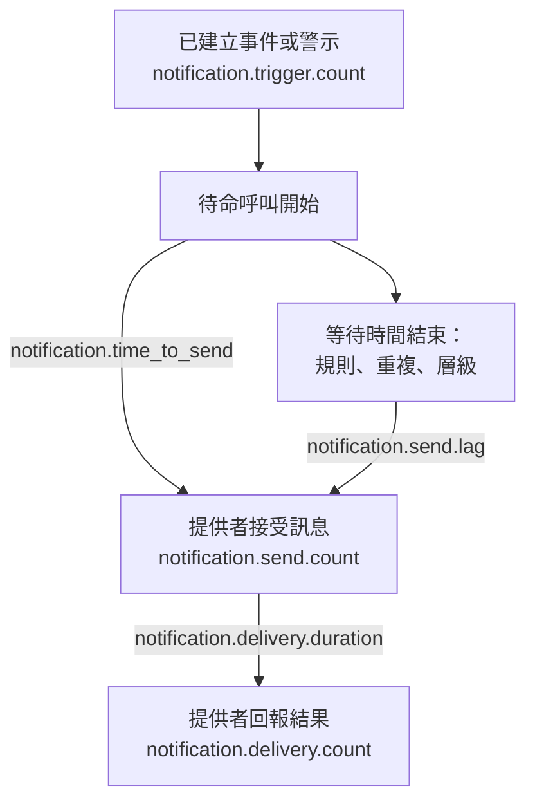

# 通知傳遞指標

OneUptime 會記錄它傳送的通知情況如何：有多少事件和警示需要通知、每則訊息是否送達提供者、一次待命呼叫花了多久才發出，以及它是否送達手機。將 OneUptime 本身的遙測資料傳送到一個 OneUptime 專案或任何 OpenTelemetry 後端，即可為您的安裝所服務的人設定傳遞目標，並檢查您是否達成這些目標。

:::cards
- [啟用它們](#啟用它們): 兩項設定，沒有它們就什麼都不會記錄。
- [指標](#指標): 七個指標，從觸發到手機。
- [呼叫如何計時](#呼叫如何計時): 傳送耗時與傳送延遲從何時開始計算。
- [入門 SLO](#入門-slo): 四個目標，逐一說明每個查詢。
:::

## 運作方式



每則訊息都會計入 `notification.send.count`，涵蓋每個管道，而不只是待命呼叫。兩個時間指標 `notification.time_to_send` 和 `notification.send.lag` 只涵蓋待命呼叫。

## 啟用它們

在 OneUptime 擁有 OpenTelemetry 匯出器之前，什麼都不會記錄：沒有匯出器時，這些指標不會產生任何成本，也不會儲存在任何地方。將它指向一個 OneUptime 專案，並使用該專案的 Server [擷取金鑰](/docs/telemetry/ingestion-keys)，或指向任何透過 HTTP 接收 OTLP 的後端。

:::tabs
@tab Kubernetes
```yaml
openTelemetryExporter:
  endpoint: https://oneuptime.example.com/otlp
  headers: x-oneuptime-token=YOUR_INGESTION_KEY
```
由 `app` 和 `worker` 部署傳送它們：請將 `app.disableTelemetryCollection` 和 `worker.disableTelemetryCollection` 保持為預設值 `false`。
@tab Docker Compose
```bash
OPENTELEMETRY_EXPORTER_OTLP_ENDPOINT=https://oneuptime.example.com/otlp
OPENTELEMETRY_EXPORTER_OTLP_HEADERS=x-oneuptime-token=YOUR_INGESTION_KEY
DISABLE_TELEMETRY_FOR_APP=false
```
在 `config.env` 中設定它們，然後執行 `npm start`。`DISABLE_TELEMETRY_FOR_APP` 預設為 `true`，此時不會傳送任何內容。
:::

OneUptime 需要同時設定端點和標頭：沒有標頭時它什麼都不傳送。每個標頭寫成 `name=value`，多個標頭之間以 `;` 分隔。值中可以包含 `=`。OneUptime 會自行在端點後加上 `/v1/metrics`，同樣的設定也會傳送它自己的追蹤和日誌。每個指標會在 OneUptime 第一次記錄它時出現：`notification.send.count` 會在傳送第一則訊息時出現。

### 向 OneUptime 專案傳送差量

OneUptime 依 OpenTelemetry 的預設方式傳送計數器和直方圖：每個資料點保存的是該伺服器程序啟動以來的累計總數。指標瀏覽器會把圖表每個步長內的資料點相加，因此只有從差量，也就是保存自上一個資料點以來所發生情況的資料點中，它才能準確讀出一個時間範圍的計數和百分位數。當指標送往 OneUptime 專案時，請傳送差量：

:::tabs
@tab Kubernetes
```yaml
extraEnv:
  - name: OTEL_EXPORTER_OTLP_METRICS_TEMPORALITY_PREFERENCE
    value: delta
```
服務自己的清單會取代整個 Chart 的清單：如果您設定了 `app.extraEnv` 或 `worker.extraEnv`，也要在那裡加上它。
@tab Docker Compose
```yaml title="docker-compose.override.yml"
services:
  app:
    environment:
      OTEL_EXPORTER_OTLP_METRICS_TEMPORALITY_PREFERENCE: delta
```
在 `docker-compose.yml` 旁邊建立該檔案，或將這些內容加到您已有的檔案中，然後執行 `npm start`。
:::

這適用於 OneUptime 傳送的關於自身的每個指標。像 Prometheus 這樣自行讀取累計總數的後端不需要任何變更。

## 指標

| 指標 | 類型 | 單位 | 它回答的問題 |
| --- | --- | --- | --- |
| `notification.trigger.count` | 計數器 | `1` | 有多少筆記錄需要通知 |
| `notification.send.count` | 計數器 | `1` | 交給提供者的每則訊息結果如何 |
| `notification.send.duration` | 直方圖 | `ms` | 提供者接收它花了多久 |
| `notification.time_to_send` | 直方圖 | `ms` | 呼叫在觸發後多久送達其提供者 |
| `notification.send.lag` | 直方圖 | `ms` | 稍後傳送的通知在到期後多久送達其提供者 |
| `notification.delivery.count` | 計數器 | `1` | 提供者接受的訊息最終結果如何 |
| `notification.delivery.duration` | 直方圖 | `ms` | 訊息在提供者接受後多久結束 |

每個屬性都只取少數幾個固定值之一，絕不會是專案、人員、電話號碼或記錄。唯一的例外是自訂管道的 ID 和名稱：一個安裝只有寥寥幾個，而把它們區分開來正是目的所在。

### 通知人員的記錄

`notification.trigger.count` 會在每個事件、警示、事件片段和警示片段建立時對其計數。

| 屬性 | 值 |
| --- | --- |
| `notification.trigger.type` | `incident`、`alert`、`incident_episode`、`alert_episode` |
| `notification.trigger.source` | 由 OneUptime 依監測器或規則建立時為 `automatic`；由人員或 API 建立時為 `manual` |
| `monitor.type` | 建立事件或警示的監測器類型，例如 `Incoming Request`、`Logs` 或 `Metrics`；沒有監測器建立時省略 |

### 交給提供者的訊息

`notification.send.count` 統計交給提供者的每則訊息，`notification.send.duration` 則為呼叫提供者的耗時計時。兩者都帶有下列屬性：

| 屬性 | 值 |
| --- | --- |
| `notification.channel` | `email`、`sms`、`call`、`whatsapp`、`telegram`、`push`、`webhook`、`slack`、`microsoft_teams`、`mattermost`、`custom_channel` |
| `notification.provider` | `twilio`、`sms_and_call_gateway`、`smtp`、`sendgrid`、`amazon_ses`、`mailgun`、`postmark`、`resend`、`microsoft_graph`、`expo`、`push_relay`、`web_push`、`meta_whatsapp`、`telegram_bot_api`、`slack`、`microsoft_teams`、`mattermost`、`webhook`、`custom_channel`，或在什麼都沒有交出時為 `none` |
| `notification.provider.config` | 安裝自己的帳戶和設定為 `global`；專案自己的 Twilio 帳戶、SMTP 伺服器、Webhook 或工作區連線為 `project`，其故障由專案自行修正 |
| `notification.on_call_page` | 待命呼叫的通知為 `true`，否則為 `false` |
| `outcome` | `success`、`failure` 或 `not_sent`，見下文 |
| `notification.destination` | Slack、Microsoft Teams 和 Mattermost：傳給某個人的為 `direct_message`，發到頻道或 Teams 群組聊天的為 `channel`，發到傳入 Webhook（例如狀態頁訂閱者的）的為 `incoming_webhook`。Webhook：發到狀態頁訂閱者自己的 Webhook 的為 `status_page_subscriber`。個人的 Webhook 和其他所有管道都不帶此屬性 |
| `notification.custom_channel.id`、`notification.custom_channel.name` | 僅限自訂管道：管道的 ID，以及截斷為 100 個字元的名稱 |

- `success`：提供者接受了該訊息。
- `failure`：提供者拒絕了它或無法連線，或是傳送失敗。找不到的聊天頻道算作沒有耗時的失敗。
- `not_sent`：刻意不傳送。專案關閉了該管道、餘額不足或已被封鎖，此伺服器上關閉了推播，或自訂管道已關閉、已刪除或不在授權範圍內。成功率不包含這些：它們是設定在發揮作用，而不是平台出了故障。

發給狀態頁訂閱者自己的 Webhook 的訊息只計一次，無論嘗試了多少次：端點以 2xx 狀態回應時為 `success`；以其他狀態回應、無法連線或其位址不被允許時為 `failure`。

### 送達手機的內容

`notification.delivery.count` 依照提供者稍後回報的結果，統計提供者接受的每則訊息最終如何結束，每則訊息計一次。`notification.delivery.duration` 為提供者接受之後的耗時計時。兩者都帶有 `notification.channel`、`notification.provider`、`notification.provider.config`、`notification.on_call_page` 和最終狀態 `outcome`：

| 管道 | 提供者 | `outcome` | 耗時 |
| --- | --- | --- | --- |
| `sms` | `twilio` | `delivered`、`undelivered`、`failed` | 直到 Twilio 回報狀態 |
| `call` | `twilio` | `answered`、`not_answered`、`failed` | 直到電話被接聽，否則直到通話結束 |
| `push` | `expo`、`push_relay` | `delivered`、`undelivered`、`failed` | 不計時：回條只說明 Apple 或 Google 是否收下了推播，不說明何時 |
| `whatsapp` | `meta_whatsapp` | `delivered`、`failed` | 直到 Meta 回報狀態 |

響鈴無人接、忙線或被拒接的電話為 `not_answered`。傳給已不存在之 App 的推播為 `undelivered`，已讀的 WhatsApp 訊息算作已傳遞。只有透過專案自己的 Twilio 帳戶傳送的簡訊和電話，`notification.provider.config` 才為 `project`。

只有在提供者能夠回報的地方才會收到狀態：

- 簡訊和電話：透過 Twilio，前提是 Twilio 能透過 `HOST` 連到您的伺服器（請參閱 [Twilio 整合](/docs/self-hosted/twilio-integration#3-設定網路存取)）。簡訊與電話閘道不回報任何狀態。
- WhatsApp：當 Meta 的 Webhook 已為您的安裝設定好時。
- 推播：來自 Expo 的回條，OneUptime 會在推播約 15 分鐘後讀取，經由推播中繼傳送的也一樣。由傳送該推播的安裝對其計數。
- 電子郵件、Telegram、Webhook、聊天和自訂管道不回報最終狀態。

## 呼叫如何計時

### 傳送耗時

`notification.time_to_send` 從呼叫的觸發開始，到提供者接受通知為止。它只為呼叫開始時就到期的通知計時：第一條上報規則中的人員依其不需等待的待命規則收到的通知，以及呼叫因沒有聯絡到任何人而立即轉入的任何層級。待命設定要求的等待不是平台的延遲，因此不計入：它們計入[傳送延遲](#傳送延遲)。只有提供者接受的通知才會計時；失敗會顯示在 `notification.send.count` 中。

| 屬性 | 值 |
| --- | --- |
| `notification.channel` | 與 `notification.send.count` 相同 |
| `notification.page.start` | 時間從何時開始計算，見下文 |
| `notification.trigger.type` | 呼叫所針對的記錄：`incident`、`alert`、`incident_episode`、`alert_episode` |
| `notification.custom_channel.id`、`notification.custom_channel.name` | 僅限自訂管道 |

| `notification.page.start` | 時間的起點 |
| --- | --- |
| `monitor_data_received` | OneUptime 收到觸發監測器的資料之時：一個傳入請求、一份伺服器代理程式報告、一封傳入郵件、一次探針檢查、一個 SNMP Trap 或一次網路裝置輪詢。其中包含資料在佇列中等待評估的時間。 |
| `record_created` | 事件、警示或片段建立之時：由遙測監測器、規則或人員建立，以及針對缺席的檢查，例如停止的心跳。 |
| `page_started` | 呼叫稍後開始之時：由人員、工作流程或現在相符的規則啟動，或是直接呼叫。對於被其待命規則或 OneUptime AI 暫緩的呼叫，是暫緩結束之時，如果它更早開始，則是開始之時。對於再次呼叫，是確認後逾時到期之時。因此，遲遲才處理其中任何一種的工作程序會反映在這段時間中。 |

對於傳入請求，時間從端點收到的最新請求開始計算，因此讀數可能略短。

### 傳送延遲

`notification.send.lag` 從稍後傳送的通知到期的那一刻開始，到提供者接受它為止。由兩個工作程序傳送這些通知，每個每分鐘執行一次，因此準時的工作程序最多顯示約一分鐘，而落後的工作程序會顯示落後了多少。

| `notification.schedule` | 到期時間 |
| --- | --- |
| `rule_wait` | 某人會等待的待命規則，例如「10 分鐘後打電話給我」：在此人被呼叫後經過該時長之時。絕不會早於工作程序上次處理其規則之時，因此稍後新增或變更的規則從那時起算。 |
| `repeat` | 在有人確認之前一直重複的推播：每次其間隔用完之時。 |
| `escalation` | 後面的上報層級：前一個層級結束等待之時，或在有人把呼叫轉交出去時立即到期。 |
| `policy_repeat` | 政策從第一個層級重新開始：其最後一個層級的等待結束之時。 |

它也帶有 `notification.channel`、`notification.trigger.type`，對於自訂管道還有 `notification.custom_channel.id` 和 `notification.custom_channel.name`。在呼叫開始時就到期的通知絕不會出現在其中，即使工作程序在暫緩之後或作為再次呼叫而遲遲才開始該呼叫也是如此：它在傳送耗時中。

### 直方圖分桶

每個直方圖都有自己的分桶邊界，單位為毫秒，設定成讓目標可以在邊界處讀出：

| 直方圖 | 分桶邊界（毫秒） |
| --- | --- |
| `notification.send.duration` | `5, 10, 25, 50, 100, 250, 500, 1000, 2500, 5000, 10000, 30000, 60000, 120000` |
| `notification.time_to_send` | `250, 500, 1000, 2000, 5000, 10000, 15000, 30000, 60000, 120000, 300000, 600000, 1800000, 3600000` |
| `notification.send.lag` | `1000, 5000, 10000, 15000, 30000, 45000, 60000, 75000, 90000, 120000, 180000, 300000, 600000, 1800000, 3600000` |
| `notification.delivery.duration` | `500, 1000, 2000, 5000, 10000, 15000, 30000, 60000, 120000, 300000, 600000, 1800000, 3600000, 14400000, 86400000` |

百分位數由分桶計算得出，並繪製為它所落入分桶的中點。因此請將它與分桶邊界比較：`notification.time_to_send` 的 P95 等於或低於 30000，表示 95% 的呼叫用時 30 秒或更短。

## 入門 SLO

四個大多數安裝都能承諾的目標，每個都由接收指標之專案的指標瀏覽器中的一到兩個查詢建立。當指標以差量形式送達時，它們能準確讀出一個時間範圍：請參閱[向 OneUptime 專案傳送差量](#向-oneuptime-專案傳送差量)。

### 在指標瀏覽器中建立目標

:::steps
1. 開啟專案的[指標瀏覽器](/docs/telemetry/metrics-explorer)，按一下目標的第一個指標。它的查詢是 `a`。
2. 在 **Aggregate by** 下選擇其彙總方式。接著開啟 **Filters & grouping**，在 **Filter by attributes** 下新增它的每個條件。
3. 若要第二個查詢，按一下 **新增指標**，並以同樣方式設定 `b`。
4. 若要公式，按一下 **新增公式**，並在 **公式** 中寫入它。
5. 若要在目標未達成時收到通知，按一下 **操作 → 從此檢視建立監測器**，並在值越過目標時發出警示：請參閱[指標監控](/docs/monitor/metrics-monitor)。
:::

若要以錯誤預算在 30 天內追蹤一個目標，請將該監測器連結到一個 [SLO](/docs/slo/introduction)：它會統計目標未達成的時間。

### 待命簡訊送達 Twilio

透過安裝自己的 Twilio 帳戶傳送的待命簡訊最多 1% 失敗，也就是 99% 被接受。

| 查詢 | 指標 | 彙總 | 條件 |
| --- | --- | --- | --- |
| `a` | `notification.send.count` | **總和** | `notification.channel = sms`、`notification.on_call_page = true`、`notification.provider.config = global`、`outcome != not_sent` |
| `b` | `notification.send.count` | **總和** | 相同條件，再加上 `outcome = failure` |

公式 `$b / $a * 100` 是失敗的比例，只要它維持在 1 或以下，目標就算達成。沒有失敗的步長不會繪製資料點，因為 `b` 沒有資料點。`outcome != not_sent` 排除了被專案本身設定擋下的內容，`global` 排除了專案自己的 Twilio 帳戶。在透過自己的簡訊與電話閘道傳送簡訊的安裝中，同樣的查詢衡量的是該閘道。若是其他管道，請把 `sms` 改為 `call`、`push` 或 `email`。

### 呼叫在 30 秒內發出

95% 的待命呼叫在觸發後 30 秒內送達其提供者。

| 查詢 | 指標 | 彙總 | 條件 |
| --- | --- | --- | --- |
| `a` | `notification.time_to_send` | **P95** | `notification.page.start != page_started` |

只要 `a` 維持在 30000 或以下，目標就算達成。稍後開始的呼叫是從開始或到期之時而不是從觸發計時，因此不計入。依 `notification.page.start` 分組可以把監測器的佇列（`monitor_data_received`）與其餘部分分開檢視，依 `notification.channel` 分組可以找出較慢的管道。

### 稍後傳送的通知在 90 秒內發出

在等待之後傳送的通知中，99% 在到期後 90 秒內送達其提供者。

| 查詢 | 指標 | 彙總 | 條件 |
| --- | --- | --- | --- |
| `a` | `notification.send.lag` | **P99** | — |

只要 `a` 維持在 90000 或以下，目標就算達成。依 `notification.schedule` 分組可以看出是哪個工作程序落後了：`rule_wait` 和 `repeat` 屬於一個工作程序，`escalation` 和 `policy_repeat` 屬於另一個。

### 待命簡訊送達手機

Twilio 為安裝自己的帳戶接受的待命簡訊中，最多 5% 未能傳遞。

| 查詢 | 指標 | 彙總 | 條件 |
| --- | --- | --- | --- |
| `a` | `notification.delivery.count` | **總和** | `notification.channel = sms`、`notification.on_call_page = true`、`notification.provider.config = global` |
| `b` | `notification.delivery.count` | **總和** | 相同條件，再加上 `outcome != delivered` |

公式 `$b / $a * 100` 是未傳遞的比例。其中一部分由電信業者和關機的手機決定，因此請依幾週內看到的情況設定目標。若是電話，請使用 `call` 和 `outcome != answered`。Twilio 必須能夠連到您的伺服器：請參閱[送達手機的內容](#送達手機的內容)。

## 疑難排解

:::details 沒有收到通知指標
檢查 `OPENTELEMETRY_EXPORTER_OTLP_ENDPOINT` 和 `OPENTELEMETRY_EXPORTER_OTLP_HEADERS` 是否都已設定，在 Docker Compose 中還要檢查 `DISABLE_TELEMETRY_FOR_APP` 是否為 `false`，然後重新啟動 OneUptime。OneUptime 啟動時，如果有無法讀取的標頭，或者它什麼都不傳送，會在日誌中記錄一則警告。指標只有在記錄了內容之後才會出現，因此請先傳送一則通知。
:::

:::details 計數只增不減，或百分位數幾乎不動
指標以累計總數的形式送達。請傳送差量：請參閱[向 OneUptime 專案傳送差量](#向-oneuptime-專案傳送差量)。
:::

:::details 沒有收到最終狀態
最終狀態稍後來自提供者，而且只在它們能夠回報的地方：請參閱[送達手機的內容](#送達手機的內容)。在 Twilio 無法連到的安裝上，簡訊和電話會計為已傳送，但永遠不會計為已傳遞。
:::

## 後續步驟

:::cards
- [指標瀏覽器](/docs/telemetry/metrics-explorer): 繪製、組合並比較任何指標。
- [指標監控](/docs/monitor/metrics-monitor): 在目標未達成時發出警示。
- [Twilio 整合](/docs/self-hosted/twilio-integration): 讓 Twilio 回報送達手機的內容。
- [上報規則](/docs/on-call/escalation-rules): 傳送延遲從中開始計算的等待。
:::
