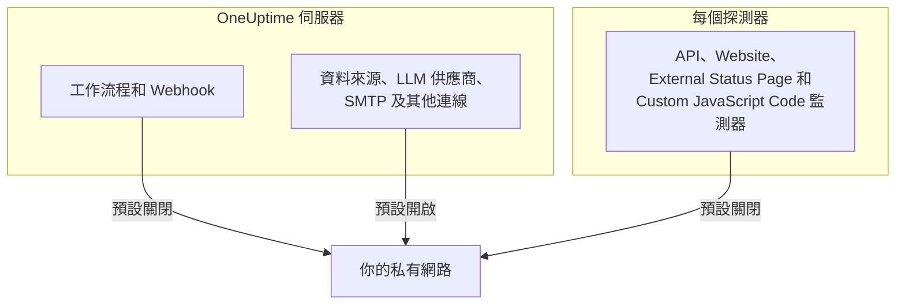

# 私有網路存取

OneUptime 會拒絕向解析到私有、回送或連結本機範圍的主機傳送某些對外請求。如果你曾嘗試讓工作流程指向內部工具，應該看過這則訊息：

> Webhook URL resolves to a private, loopback, or link-local address and is not allowed

對託管產品來說，這個預設行為是正確的：任何人都能註冊，Webhook 的目標是不可信任的輸入。但在自行託管的執行個體上，它會妨礙一件很普通的事：把警示傳送到只存在於你自己網路中的自行託管 Mattermost、Jira 或工單系統。

本頁說明如何刻意且在盡可能小的範圍內允許這種存取。由三個開關決定，每個開關負責一類連線，並分別在不同的機器上設定：

| 你想在內部存取的對象 | 設定所在位置 | 自行託管安裝的預設值 |
| --- | --- | --- |
| 工作流程、專案 Webhook、待命使用者 Webhook | **API 伺服器**的環境 | 拒絕私有位址 |
| 資料來源、LLM 供應商、SMTP 伺服器、OIDC 探索及其他連線 | **API 伺服器**的環境 | 允許私有位址 |
| API、Website、External Status Page 和 Custom JavaScript Code **監測器** | **探測器**本身的環境 | 拒絕私有位址 |



Ping、Port、SSL 憑證、DNS、DNSSEC、SNMP / 網路裝置、SQL 查詢、資料庫健康狀態、Synthetic 和 Network Path 等網路原生監測器類型使用各自的傳輸方式。本頁的設定管理的是會把任意回應內容傳回給專案的 HTTP 傳輸，也就是 API、Website、External Status Page 和 Custom JavaScript Code 監測器。

:::cards
- [Webhook 和工作流程](#webhook-和工作流程): 允許 Webhook 向你的網路內傳送請求。
- [其他對外連線](#其他對外連線): 資料來源、LLM 供應商和郵件伺服器。
- [探測器和監測器](#探測器和監測器): 讓探測器檢查私有網站。
- [驗證是否生效](#驗證是否生效): 看懂拒絕訊息指向的是哪個開關。
:::

## 哪些會被封鎖，哪些可以解除封鎖

被封鎖的目標分為兩個層級。

| 層級 | 範圍 | 能否允許？ |
| --- | --- | --- |
| **私有** | RFC-1918（`10.0.0.0/8`、`172.16.0.0/12`、`192.168.0.0/16`）、CGNAT（`100.64.0.0/10`）、IPv6 唯一本機（`fc00::/7`）和站台本機（`fec0::/10`） | 能 |
| **禁止** | 回送（`127.0.0.0/8`、`::1`）、未指定位址、連結本機（`169.254.0.0/16`、`fe80::/10`）、多點傳送、保留位址、廣播，以及名稱 `localhost` 和 `metadata.google.internal` | 只能在 Webhook 允許清單中寫明確切的主機或 CIDR。監測器永遠不能。 |

雲端中繼資料端點 `169.254.169.254` 被放在禁止層級是有原因的。在雲端虛擬機器上，它會把執行個體的 IAM 憑證交給任何能從這台機器發出 HTTP 請求的東西，因此任何全面性的設定都永遠不會開放它。

在內部攜帶 IPv4 目標的 IPv6 寫法（IPv4 對應（`::ffff:10.0.0.5`）、NAT64、6to4、Teredo）會依照實際到達的 IPv4 位址分類，因此無法借助這些寫法繞過私有層級的放行，把禁止的位址偷渡進來。

## Webhook 和工作流程

以下目標受到管控，因為目標是專案中經過驗證的成員所寫的 URL：

- 工作流程 **API** 元件（GET / POST / PUT / PATCH / DELETE）
- 工作流程 **Custom JavaScript** 元件發出的 HTTP 請求
- 專案 Webhook 通知（事件、警示、監測器、待命、排定維護、狀態頁面事件）
- 待命**使用者 Webhook**

**不**受此管控、將來也不會受此管控的是 **狀態頁面訂閱者 Webhook**。任何造訪公開狀態頁面的人都能註冊一個，因此放寬這個目標會讓網際網路上的任何人都能讓你的伺服器向你的私有網路傳送 POST 請求。這一點無法設定。

不是 Webhook 的對外連線（外部資料來源、LLM 供應商、SMTP 伺服器（專案的 SMTP 設定和工作流程 **Email** 元件）、SMTP OAuth 權杖端點、OIDC 探索和 Runbook HTTP 步驟）由 `DATA_SOURCE_BLOCK_PRIVATE_ADDRESSES` 另外管理，在自行託管安裝中已經允許私有範圍。請參閱[其他對外連線](#其他對外連線)。

### 設定 API 伺服器

在 API 伺服器上設定以下其中一項或兩項，然後重新啟動。它們預設為關閉，因此兩項都沒有設定的執行個體，行為與以前完全相同。

| 變數 | Helm 值 | 允許的內容 |
| --- | --- | --- |
| `ALLOW_PRIVATE_NETWORK_WEBHOOKS` | `webhooks.allowPrivateNetwork` | 設為 `true` 時，整個私有層級。 |
| `PRIVATE_NETWORK_WEBHOOK_ALLOWLIST` | `webhooks.privateNetworkAllowlist` | 其中列出的主機和 CIDR，不論屬於哪個層級。 |

:::tabs
@tab Docker Compose
```bash title="config.env"
ALLOW_PRIVATE_NETWORK_WEBHOOKS=true
PRIVATE_NETWORK_WEBHOOK_ALLOWLIST=mattermost.internal,*.svc.cluster.local,10.20.0.0/16
```
@tab Kubernetes
```yaml title="values.yaml"
webhooks:
  allowPrivateNetwork: true
  privateNetworkAllowlist: "mattermost.internal,10.20.0.0/16"
```
:::

在 Docker Compose 中，`config.env` 裡有一行 `ALLOW_PRIVATE_NETWORK_WEBHOOKS=false`：請修改這一行，而不是再新增一行，然後執行 `npm run start`。在 Kubernetes 中，升級發行版本。

允許清單的項目可以用逗號、空格或換行分隔，每個項目可以是：

- 主機名稱 — `mattermost.internal`
- 萬用字元 — `*.svc.cluster.local`（比對子網域，不比對後綴本身）
- IPv4 或 IPv6 位址 — `10.20.30.40`、`fd00::1`
- CIDR — `10.20.0.0/16`、`fd12:3456::/32`

項目中的配置、連接埠、路徑或使用者資訊會被移除，因此直接貼上你已有的 Webhook URL 也行得通。

允許清單中寫明的主機名稱會 **不經 DNS 檢查** 直接受到信任，這正是寫明它的用意，因為預期它會解析到封鎖清單會拒絕的位址。位址項目會與 URL 中的字面值，以及 DNS 為其傳回的每個位址進行比對。

> [!CAUTION]
> **切勿將 `169.254.169.254` 或任何包含它的範圍放入允許清單。** 在雲端虛擬機器上，這會把你執行個體的 IAM 憑證交給每一位專案成員。

## 其他對外連線

第二道防護涵蓋由專案成員選擇目標、但不是 Webhook 的對外連線：

- 外部資料來源（PostgreSQL、MySQL、SQL Server、ClickHouse、Elasticsearch 和 REST API 連線）、Splunk 等安全性事件連線，以及威脅情報來源
- LLM 供應商，包括自行託管的 Ollama 或 vLLM
- SMTP 伺服器（專案的 SMTP 設定和工作流程 **Email** 元件），以及 SMTP 和工作流程的 OAuth 權杖 URL
- 用於單一登入的 OIDC 探索
- 狀態頁面和儀表板的自訂網域驗證
- Runbook HTTP 步驟
- 匯入時讀取的 Grafana OnCall API URL（**專案設定** > **基礎** > **從其他工具匯入**）

這道防護的方向與 Webhook 設定相反。在自行託管安裝中，它預設**允許**私有層級，因為這些連線所連到的資料庫、郵件伺服器或模型伺服器通常就在你自己的網路中。禁止層級（回送、連結本機和雲端中繼資料端點）無論如何都會被拒絕，而且沒有針對它的允許清單。

`DATA_SOURCE_BLOCK_PRIVATE_ADDRESSES` 會收緊這道防護。將它設為 `true`，這些連線也會拒絕私有層級，例如當你執行個體上的專案屬於不應存取你內部網路的人時：

:::tabs
@tab Docker Compose
```bash title="config.env"
DATA_SOURCE_BLOCK_PRIVATE_ADDRESSES=true
```
@tab Kubernetes
```yaml title="values.yaml"
outboundConnections:
  blockPrivateNetwork: true
```
:::

此設定不適用於全域 LLM 供應商，它由管理員而不是專案設定（透過 `GLOBAL_LLM_PROVIDER_*` 變數、Helm chart 的 `vllm.globalProvider`，或在管理員儀表板的 **設定** > **全域 LLM 供應商** 中設定）：這樣的供應商仍然可以存取私有位址，不過回送和連結本機對它同樣維持拒絕。

只有確切的值 `true` 才會開啟它。在 `BILLING_ENABLED=true` 的執行個體上，無論你如何設定，它都一律開啟。它不會改變上方的 Webhook 設定或下方的探測器設定允許哪些目標；每道關卡都各自設定。但它會改變拒絕訊息的措辭，Webhook 和工作流程請求也一樣：開啟後，被拒絕的主機名稱在回報時不會說明它解析到什麼（請參閱[驗證是否生效](#驗證是否生效)）。

在 Docker Compose 中，`config.env` 裡有一行 `DATA_SOURCE_BLOCK_PRIVATE_ADDRESSES=false`（如果你的 `config.env` 比它更早，請新增這一行）。把這一行改為 `true`，而不是再新增一行，然後執行 `npm run start`，以新值重新建立容器；`docker compose restart` 不會重新讀取 `config.env`。在 Kubernetes 中，在 values 檔案中設定它並升級發行版本；chart 會把它傳給 app 和 worker 的 Pod。

開啟後，被拒絕的主機名稱在回報時不會說明它解析到什麼，例如 _"LLM provider host ollama.internal could not be reached."_ 這樣的訊息。完全無法解析的名稱也會得到相同的訊息，因此專案成員無法利用這些欄位查出有哪些內部名稱存在。以 IP 形式輸入的位址仍會連同原因一起列出，例如 _"LLM provider host 10.0.4.12 is not allowed: private network address."_ 這樣的訊息。設定 `LOG_LEVEL=DEBUG` 後，應用程式會記錄每個被拒絕的名稱所解析到的位址。

## 探測器和監測器

受影響的監測器類型有四種：**API**、**網站**、**External Status Page** 和 **Custom JavaScript Code**。在預設的探測器上，它們可以存取公開的 HTTP(S) 目標，但會拒絕私有位址空間。API、Website 和 External Status Page 監測器會為每個連線驗證並固定 DNS 結果，並重新驗證每一次重新導向；Custom JavaScript Code 則在其沙箱橋接中套用相同的位址政策。

這個開關由 **探測器處理程序從它自己的環境中** 讀取，而不是從 API 伺服器的環境中讀取，而且每個探測器都會讀取它：Docker Compose 隨附的探測器、Helm chart 部署的探測器，以及你自行執行的任何[自訂探測器](/docs/probe/custom-probe)。誰部署探測器，誰就控制它的環境，也是知道該探測器能看到哪個網路的一方：自訂探測器通常是另一台機器，往往由另一個人執行，而且它從不讀取 API 伺服器的設定。

:::tabs
@tab Docker Compose
`config.env` 中已經有一行 `PROBE_ALLOW_PRIVATE_NETWORK_MONITORS=false`：請把這一行改為 `true`，而不是再新增一行，因為同一個變數出現兩次時，以後面那一行為準。然後執行 `npm run start`，它會以新值重新建立容器；`docker compose restart` 不會重新讀取 `config.env`。每個隨附的探測器都讀取這一行，因此它適用於 `probe-1`，如果你的部署還執行第二個探測器，也適用於 `probe-2`。

```bash title="config.env"
PROBE_ALLOW_PRIVATE_NETWORK_MONITORS=true
```
@tab Kubernetes
在 values 檔案中為每個探測器分別設定，然後升級發行版本。`probes:` 下的每個項目都是個別的探測器，因此請在每個需要存取私有位址的探測器上設定：

```yaml title="values.yaml"
probes:
  one:
    allowPrivateNetworkMonitors: true
```
:::

在自訂探測器上，於該探測器自己的環境中設定 `PROBE_ALLOW_PRIVATE_NETWORK_MONITORS=true` 並重新啟動它。值必須正好是 `true`；其他任何值，例如 `TRUE` 或 `1`，都會讓開關維持關閉，而且無論 `LOG_LEVEL` 設為什麼，探測器都會在啟動警告中說明這一點。

隨附的探測器是**全域探測器**：它們使用執行個體的 `REGISTER_PROBE_KEY` 自行註冊，執行個體上的每個專案都能選擇它們。因此，為隨附的探測器開啟開關，會讓**執行個體上的每個專案**的監測器都能透過它存取私有位址。單一團隊的安裝通常正需要這樣。如果專案之間不應共用這種存取範圍（例如不同的團隊，或你託管的客戶），請在隨附的探測器上維持關閉，改為在每個網路內部署一個私有（自訂）探測器，只在那裡開啟。

有一個例外。使用 `REGISTER_PROBE_KEY` 自行註冊、且自身環境中有 `BILLING_ENABLED=true` 的探測器（也就是開放註冊的託管產品中的全域探測器，任何人都能註冊，所有專案共用全域探測器）即使開啟了開關也只存取公開網路，並會在啟動時記錄一則警告，說明它忽略了該開關。Docker Compose 和 Helm chart 隨附的探測器會自動取得執行個體的 `BILLING_ENABLED`；請也把它提供給你為這類執行個體執行的其他任何 `REGISTER_PROBE_KEY` 探測器。探測器沒有其他方法得知自己是全域探測器，因此在管理員儀表板中建立、並以 `PROBE_ID` 和 `PROBE_KEY` 執行的全域探測器，會像私有探測器一樣遵循開關：如果專案之間不應共用該探測器的網路，就不要在那裡開啟它。私有探測器在任何執行個體上都遵循開關。

每個探測器在啟動時都會記錄其生效的私有網路政策：私有網路監測是開啟還是關閉，以及原因。被忽略的值，以及開關向所有專案開放的全域探測器，會在任何 `LOG_LEVEL` 下以警告形式記錄。例行的開啟或關閉日誌行，以及在 `privateNetworkMonitors` 下記錄同一決定的 "Probe environment" JSON，會在 `LOG_LEVEL=INFO`（Helm chart 的預設值）下記錄；Docker Compose 預設使用 `LOG_LEVEL=ERROR`，因此要在那裡看到它們，請設定 `LOG_LEVEL=INFO`。如果你剛修改過的探測器上的監測器仍被拒絕，請先查看這份日誌。

開啟開關**不會**開放回送、連結本機或雲端中繼資料端點。它們在每個探測器上都維持拒絕，這對執行於不屬於監測器作者之網路中的探測器最為重要。

> [!WARNING]
> 對於你代表其他人營運的探測器，請維持關閉。

## 驗證是否生效

再次執行工作流程或監測器。如果仍被拒絕，錯誤訊息會指出是哪道關卡關閉了：

- _"...points to a private network address and is not allowed. Self-hosted instances can allow this by setting `ALLOW_PRIVATE_NETWORK_WEBHOOKS`..."_ — 缺少 API 伺服器設定。
- _"...private network address... Set PROBE_ALLOW_PRIVATE_NETWORK_MONITORS=true on the probe running this monitor to allow it."_ — 執行該監測器的是私有（自訂）探測器，且它的開關是關閉的。請注意，這項設定是在探測器上，而不是在 API 伺服器上。
- _"...private network address... Set PROBE_ALLOW_PRIVATE_NETWORK_MONITORS=true on the probe running this monitor to allow it (probes.<name>.allowPrivateNetworkMonitors in the Helm chart). This is a global probe, so that allows it for every project on this instance; otherwise, select a private probe deployed on that network."_ — 執行該監測器的是隨附（全域）探測器，且它的開關是關閉的。如果執行個體上的每個專案都可以存取那個網路，請依上文所述為該探測器開啟開關；否則，請在監測器上選擇一個私有探測器。
- _"...Global probes cannot monitor private network addresses. Deploy and select a private probe for this target."_ — 執行該監測器的是環境中有 `BILLING_ENABLED=true` 的全域探測器。在那裡，自動註冊的全域探測器無論開關如何設定都只存取公開網路；請在目標網路內部署一個私有探測器，並在監測器上選擇它。
- _"Monitor target host ... could not be reached."_ — 目標為**主機名稱**的 API、Website 或 External Status Page 監測器，在名稱解析到被拒絕的位址時和 DNS 失敗時都會回報這則訊息，這樣監測器就無法被用來探查有哪些內部名稱存在。隨之顯示的錯誤詳細資料在兩種情況下都會提到 `PROBE_ALLOW_PRIVATE_NETWORK_MONITORS`，但不會說明屬於哪種情況。如果該名稱指向私有位址，請在探測器的啟動日誌中查看其私有網路政策；如果它是關閉的，解決方法與上面的訊息相同。設定 `LOG_LEVEL=DEBUG` 後，探測器還會記錄每個被拒絕名稱的確切原因。
- _"Request URL could not be reached."_ — **Custom JavaScript Code** 監測器也遵循相同的規則：請求**主機名稱**的指令碼，在名稱解析到被拒絕的位址時和 DNS 失敗時都會收到這則訊息。設定 `LOG_LEVEL=DEBUG` 後，探測器會記錄確切原因。
- _"Webhook URL could not be reached."_ 或者，來自工作流程的 _"Request URL could not be reached."_ — 執行個體以 `DATA_SOURCE_BLOCK_PRIVATE_ADDRESSES=true`（或 `BILLING_ENABLED=true`）執行，因此被拒絕的**主機名稱**不會得到解釋：它要麼解析到被拒絕的位址，要麼根本沒有解析成功。設定 `LOG_LEVEL=DEBUG` 後，app 或 worker 會記錄是哪一種情況以及位址。
- _"...points to a private, loopback, or link-local address and is not allowed."_ — 目標位於禁止層級。對於 Webhook，如果確實需要，請在 `PRIVATE_NETWORK_WEBHOOK_ALLOWLIST` 中寫明確切的主機或 CIDR。對於監測器，沒有任何例外。
- _"...hostname could not be resolved via DNS."_ — 容器無法解析該名稱。請檢查它是否與目標共用網路。

## 安全性注意事項

開放這項存取會實實在在地改變你的 OneUptime 執行個體能被用來存取的範圍，因此值得審慎對待：

- **優先使用允許清單，而不是全面性的布林開關。** 寫明 `mattermost.internal` 的授權範圍，遠小於開放所有 RFC-1918 位址。
- **任何能建立工作流程，或建立 API、Website、External Status Page、Custom JavaScript Code 監測器的人，都能存取你允許的一切。** 請據此看待這些專案的成員資格。
- **回應本文會被傳回。** 工作流程 API 元件會把狀態、標頭和本文傳回到工作流程日誌中，因此被允許的主機不僅可寫入，也可讀取。
- **Webhook 請求從不跟隨重新導向。** 因此被允許的公開主機無法在第二個躍點把伺服器轉向內部主機。
- **盡可能以探測器劃定範圍，而不是整個執行個體。** 部署在單一網路內的探測器，比開放 API 伺服器的對外流量授權範圍更窄。

## 後續步驟

:::cards
- [自訂探測器](/docs/probe/custom-probe): 在需要檢查的網路內執行探測器。
- [工作流程設定](/docs/workflows/configuration): 工作流程步驟能存取什麼、能做什麼。
- [LLM 提供者](/docs/ai/llm-provider): 將 OneUptime AI 連線到你網路中的模型。
- [架構](/docs/self-hosted/architecture): 自行託管安裝的哪個部分建立了哪種連線。
:::
