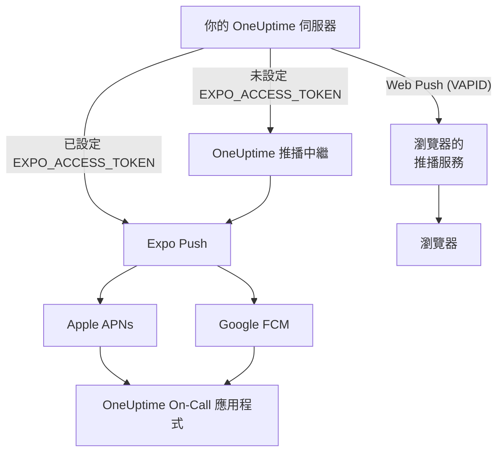
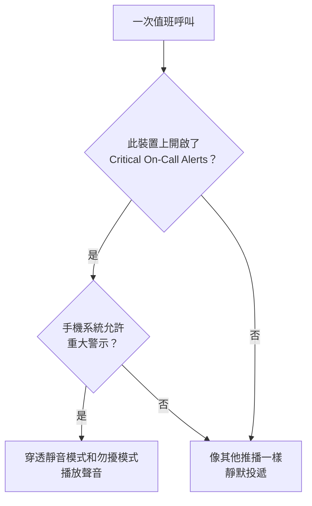

# 推播通知

OneUptime 透過 **OneUptime On-Call** 行動應用程式在手機上呼叫人員，並透過 Web Push 在瀏覽器中呼叫。行動推播由 **Expo Push** 提供：自架執行個體預設透過 OneUptime 的推播中繼傳送，因此它只需要能對外連到中繼，不需要自己的 Expo、Apple 或 Google 憑證。

:::cards
- [選擇推播的傳送方式](#自架設定): 推播中繼，或你自己的 Expo 存取權杖。
- [開放防火牆](#網路存取): 你的伺服器和團隊成員的裝置會連到的位址。
- [穿透靜音模式](#重大值班警示穿透靜音模式): 讓值班呼叫在靜音的手機上也能響起。
- [修正一直收不到的推播](#疑難排解): Expo 的每個錯誤代表什麼。
:::

## 運作方式



OneUptime 行動應用程式會向後端註冊一個 Expo Push 權杖。後端透過 OneUptime 的推播中繼傳送通知，設定了 `EXPO_ACCESS_TOKEN` 時則直接傳送給 Expo。Expo 再把訊息轉送給 Apple APNs 或 Google FCM，投遞到裝置上。

Web 推播通知仍然使用 VAPID 金鑰與 Web Push 通訊協定。

## 自架設定

使用官方行動應用程式和預設中繼時，伺服器不需要 Expo 憑證。若要透過 Expo 直接投遞，請以適合你應用程式之 Expo 專案的憑證設定 `EXPO_ACCESS_TOKEN`。Web Push 需要 `VAPID_PUBLIC_KEY`、`VAPID_PRIVATE_KEY` 和 `VAPID_SUBJECT`。

| 變數 | Helm 值 | 預設值 | 作用 |
| --- | --- | --- | --- |
| `PUSH_NOTIFICATION_RELAY_URL` | `pushNotification.relayUrl` | `https://oneuptime.com/api/notification/push-relay/send` | 在未設定 `EXPO_ACCESS_TOKEN` 時，行動推播送往的位址。 |
| `EXPO_ACCESS_TOKEN` | `expo.accessToken` | 空 | 使用你的 Expo 專案權杖，把行動推播直接傳送給 Expo。 |
| `VAPID_PUBLIC_KEY` | `vapid.publicKey` | 空 | 瀏覽器訂閱時使用的金鑰組的公開部分。 |
| `VAPID_PRIVATE_KEY` | `vapid.privateKey` | 空 | 私密部分，用於為每則 Web 推播簽署。 |
| `VAPID_SUBJECT` | `vapid.subject` | `mailto:support@oneuptime.com` | 瀏覽器推播服務可以聯絡到你的聯絡位址。 |

用 `npx web-push generate-vapid-keys` 產生一次 VAPID 金鑰組並妥善保存：以某個金鑰組訂閱的瀏覽器，會在金鑰組變更後收不到推播。

:::tabs
@tab Docker Compose
```bash title="config.env"
VAPID_PUBLIC_KEY=your-public-key
VAPID_PRIVATE_KEY=your-private-key
VAPID_SUBJECT=mailto:oncall@example.com
# Leave unset to send mobile pushes through the push relay.
EXPO_ACCESS_TOKEN=
```
@tab Kubernetes
```yaml title="values.yaml"
vapid:
  publicKey: your-public-key
  privateKey: your-private-key
  subject: mailto:oncall@example.com
# Leave empty to send mobile pushes through the push relay.
expo:
  accessToken:
```
:::

## 網路存取

| 方向 | 目標 | 通訊協定 / 連接埠 | 何時需要 |
| --- | --- | --- | --- |
| OneUptime → 預設推播中繼 | `https://oneuptime.com/api/notification/push-relay/send`, `https://oneuptime.com/api/notification/push-relay/receipts` | HTTPS / TCP 443 | 未設定 `EXPO_ACCESS_TOKEN` 時的行動推播。 |
| OneUptime → Expo | `https://exp.host/--/api/v2/push/send`, `https://exp.host/--/api/v2/push/getReceipts` | HTTPS / TCP 443 | 設定了 `EXPO_ACCESS_TOKEN` 時的直接行動推播。 |
| OneUptime → 瀏覽器推播服務 | 瀏覽器推播訂閱中儲存的 HTTPS 端點 | HTTPS / 通常為 TCP 443 | Web Push。 |
| 行動應用程式或瀏覽器 → OneUptime | 你的 OneUptime 主機名稱 | HTTPS / TCP 443 | 登入、註冊裝置並開啟通知連結。 |

如果你變更了 `PUSH_NOTIFICATION_RELAY_URL`，請允許其目標主機名稱和設定的連接埠。自訂中繼必須實作 OneUptime 的中繼 API。這些預設值以及中繼與直接投遞之間的切換，定義在 [OneUptime 的設定](https://github.com/OneUptime/oneuptime/blob/master/config.example.env) 和 [推播服務](https://github.com/OneUptime/oneuptime/blob/master/packages/Common/Server/Services/PushNotificationService.ts) 中。直接送往 Expo 的請求使用 [Expo 傳送指南](https://docs.expo.dev/push-notifications/sending-notifications/) 中記載的端點。OneUptime 在同一位址把 `/send` 換成 `/receipts`，從中繼讀取投遞回執。沒有該路由的中繼仍會投遞推播；但這時，應用程式已被移除的裝置只有在之後送往它的推播被拒絕時才會被發現。

對於 Web Push，請允許你的團隊所用瀏覽器的實際訂閱端點主機。OneUptime 接受 `fcm.googleapis.com`、`android.googleapis.com`、`push.services.mozilla.com`、`notify.windows.com` 和 `push.apple.com`，包括它們的子網域。典型的例子有 `updates.push.services.mozilla.com` 和 `web.push.apple.com`。目標由 [瀏覽器的推播訂閱](https://developer.mozilla.org/en-US/docs/Web/API/PushSubscription) 提供；只允許 Expo 或 OneUptime 的中繼並不能啟用 Web Push。

請允許傳送通知的 OneUptime 處理程序進行 DNS 解析和對外 TLS。它的信任存放區必須能驗證目標的憑證，代理必須在不需要互動式驗證的情況下放行 API 請求。推播供應商不會呼叫你的 OneUptime 伺服器上的 Webhook，因此只要使用者裝置能透過 VPN 或其他私有連線存取伺服器，伺服器就可以保持私有。無法存取其中繼或外部推播服務的伺服器無法投遞這些通知。

裝置的連線能力是另一項要求。iOS 裝置需要存取 APNs，通常是 TCP 5223，並以 TCP 443 作為備援；目標位址範圍請參閱 [Apple 目前的網路需求](https://support.apple.com/en-us/102266)。Android 裝置需要透過 TCP 5228–5230 和 443 存取 FCM；請參考 [Google 目前的主機與防火牆指引](https://firebase.google.com/docs/cloud-messaging/network-configuration)。這些裝置連接埠不需要在 OneUptime 上開放傳入，伺服器端的行動推播流程使用中繼或 Expo，而不是直接連線到 APNs/FCM。

:::steps
1. 從傳送通知的容器或 Pod 檢查到你的投遞方式目標（中繼、Expo 或某個瀏覽器的推播服務）的 DNS 和 HTTPS。
2. 在 **使用者設定 > 通知方式 > Push Notifications** 中用 **測試通知** 傳送一次測試，並確認它到達已註冊的裝置。對於 Web Push，請分別測試每個瀏覽器。
3. 在 OneUptime 記錄中檢查中繼、Expo 或 Web 推播的錯誤；僅僅成功提交到 API，並不能確認已投遞到裝置。
:::

對於行動推播，OneUptime 也會在每次推播約 15 分鐘後讀取 Expo 的投遞回執：從未到達裝置的推播隨後會在推播記錄中顯示為未投遞；如果是值班呼叫，還會顯示在值班時間軸上。

## 重大值班警示（穿透靜音模式）

預設情況下，推播通知服從手機的設定：靜音的手機保持安靜，勿擾模式會攔下通知。對值班人員來說，凌晨 3 點這樣的預設行為是錯誤的，因此行動應用程式提供了依裝置設定的 **Settings > Notifications > Critical On-Call Alerts**，讓*僅值班呼叫*能夠穿透這兩者發出聲音。

範圍是刻意縮小的。只有值班通知規則產生的呼叫才符合條件。擁有者訂閱、發布備註的提醒、狀態變更更新和監視器通知，無論這項設定如何，都不會被升級。



呼叫要穿透靜音模式，必須同時滿足三個條件。只要缺少任何一個，呼叫仍會投遞——只是靜默投遞。

1. **值班人員在該裝置上開啟了它。** 依裝置儲存在 `UserPush.isCriticalAlertEnabled` 中，預設關閉。同一個人的手機和平板是分別決定的。
2. **伺服器把呼叫標記為重大。** 它為 iOS 傳送 APNs 的重大聲音承載以及 `interruptionLevel: critical`，並為 Android 指定 `oncall_critical` 通知頻道。
3. **作業系統允許它**，這正是兩個平台的不同之處。

:::tabs
@tab iOS
iOS 上的重大警示需要 `com.apple.developer.usernotifications.critical-alerts` 權限（entitlement），Apple 會應申請依開發者帳號授予那些就緊急事件通知使用者的應用程式。請透過 [Apple 的 Critical Alerts 申請表](https://developer.apple.com/contact/request/notifications-critical-alerts-entitlement/) 申請。

App Store 上的官方 **OneUptime On-Call** 應用程式從 **1.5.0 版** 起帶有該權限。更早的版本沒有，iOS 也從不為它們提供重大警示，所以在開啟這項設定之前，請先更新應用程式。

如果你自己建置應用程式，該權限是選用的。佈建描述檔無法攜帶未授予該團隊的權限，而宣告了無法攜帶之權限的建置會**簽署失敗**。只有 `packages/MobileApp/eas.json` 中的 `production` 設定檔開啟了它，因為 Apple 已將其授予發布官方應用程式的團隊。使用自己的 Apple 團隊簽署的分支，必須移除該 `env` 項目，直到 Apple 也向該團隊授予此權限。獲得授予後，在建置時開啟它：

```bash
EXPO_IOS_CRITICAL_ALERTS_ENTITLEMENT=true npx expo prebuild
```

或者在 `packages/MobileApp/eas.json` 中建置設定檔的 `env` 區塊裡新增 `EXPO_IOS_CRITICAL_ALERTS_ENTITLEMENT: "true"`。

在裝置上，於應用程式中開啟 **Settings > Notifications > Critical On-Call Alerts**，並在 iOS 詢問時允許重大警示。只有在應用程式要求了權限之後，iOS 才會在 iOS 設定的 **Settings > Notifications > OneUptime On-Call** 下為應用程式新增 **Critical Alerts** 開關，因此在你於應用程式中開啟這項設定之前，那個開關並不存在。如果你拒絕了要求，之後仍可以在 iOS 設定中用那個開關允許重大警示。

在沒有該權限的建置上，iOS 既不顯示要求也不顯示開關，應用程式的設定畫面會說明此版本的應用程式無法接收重大警示。它不會讓值班人員去找一個 iOS 根本沒有顯示的開關。
@tab Android
Android 沒有廠商審核步驟，但略過勿擾模式要由使用者在系統畫面中授予，而不是透過應用程式內的要求。值班人員開啟這項設定時，應用程式會為其開啟 **Settings > Notifications > Do Not Disturb access**，並在其返回時再次檢查。

這裡有兩種機制在運作，它們涵蓋不同的情況：

- `oncall_critical` 通知頻道要求 `bypassDnd`，它涵蓋勿擾模式，並需要上述存取權限。
- 同一頻道使用**鬧鐘**音訊串流，在僅僅把鈴聲靜音的手機上也能聽到。這一半完全不需要任何權限。

Android 會在頻道首次建立時凍結其設定，因此無法透過應用程式更新來變更——只能發布一個新的頻道 id。
:::

要檢查它是否生效，請從 **使用者設定 > 通知方式 > Push Notifications** 向裝置傳送一則測試通知。當裝置開啟了重大警示時，測試也會作為重大警示傳送——所以先把手機靜音，你就能聽出真正的呼叫是否能到達你。

## 疑難排解

### 推播通知沒有到達

- 確保行動應用程式是用 EAS Build 建置的（Expo Go 不支援推播通知）
- 檢查裝置是否已註冊在資料庫的 `UserPush` 資料表中
- 在 OneUptime 伺服器記錄中檢查 Expo Push API 錯誤
- 確認裝置有可用的網際網路連線，並已啟用通知權限
- 檢查 **使用者設定 > 通知方式 > Push Notifications**：標記為 **未收到通知** 的裝置已停止接收通知，需要重新註冊（見下文）

### iOS 設定中沒有 Critical Alerts 開關

- 從 App Store 更新 OneUptime On-Call。1.5.0 之前的版本在建置時沒有 Apple 的重大警示權限，iOS 完全不會為它們顯示 Critical Alerts 開關
- 在應用程式中開啟 **Settings > Notifications > Critical On-Call Alerts**。只有在應用程式要求權限之後，iOS 才會把這個開關新增到它自己的設定中，而應用程式會在這項設定開啟時要求權限
- 刪除再重新新增值班通知規則或推播裝置，並不會改變這一點。這項設定屬於裝置上的應用程式，而不是某條規則

### 重大警示沒有穿透靜音模式

- 檢查**那台**裝置上的開關是否已開啟——這項設定依裝置區分，重新安裝或從頭設定的新手機會建立新的裝置註冊（從舊手機備份還原的手機，會在舊手機不再接收通知時接管舊手機的註冊，並保留應用程式原有的設定）
- **iOS**：確認建置帶有 Apple 的重大警示權限（見上文），並且已在 iOS Settings > Notifications > OneUptime On-Call 下允許 Critical Alerts
- **Android**：確認應用程式在 Settings > Notifications > Do Not Disturb access 下擁有勿擾存取權限
- 設定畫面會說明缺少的是哪一項；它會從作業系統讀回目前狀態，而不是相信應用程式上一次要求的內容

### 標記為「未投遞」的推播

Expo 接受了推播，並不表示推播已到達裝置：Apple 或 Google 仍可能拒絕它。OneUptime 會在傳送每則行動推播約 15 分鐘後讀取其投遞回執；未設定 `EXPO_ACCESS_TOKEN` 時，透過推播中繼讀取。當回執回報錯誤時，推播記錄和該呼叫的值班時間軸會從已傳送變為 **Push notification not delivered**，並附上 Expo 的錯誤代碼：

- `DeviceNotRegistered`：行動應用程式已從裝置上移除，或其推播權杖已失效。請參閱下一節。
- `MessageRateExceeded`：短時間內向裝置傳送了太多通知。之後送往它的推播會照常傳送。
- `MessageTooBig`：通知超出了推播服務接受的大小。OneUptime 會縮短通知以符合大小，所以這種情況不應發生；如果發生了，請告訴我們。
- `InvalidCredentials` 或 `MismatchSenderId`：傳送該推播的 Expo 專案的推播憑證無效。使用 `EXPO_ACCESS_TOKEN` 時，請檢查你的 Expo 專案的推播憑證；使用預設中繼時，請聯絡 OneUptime 支援。

當 Expo 當場拒絕推播時，推播記錄會立即給出原因。透過推播中繼也一樣：中繼會傳回 Expo 的錯誤代碼，而不是以伺服器錯誤回應。

### 記錄中的「DeviceNotRegistered」錯誤

當行動應用程式已從裝置上移除，或裝置的推播權杖已失效時，Expo 會回報 `DeviceNotRegistered`。它通常在推播的投遞回執中說明這一點，OneUptime 會在推播約 15 分鐘後讀取該回執；有時 Expo 也會當場拒絕推播。無論哪種情況，OneUptime 都會停止向該裝置傳送。該裝置會被標記為不再接收通知，而不是被刪除，因此它的通知規則會保留，而未到達的那次呼叫的推播記錄和值班時間軸會說明原因。**使用者設定 > 通知方式 > Push Notifications** 會將其顯示為 **未收到通知**。其擁有者的其他裝置和通知方式仍會收到呼叫。

要恢復該裝置，請在登入狀態下在其上開啟行動應用程式。應用程式會重新註冊，從而在 Expo 處更新其推播權杖，裝置會依照其規則重新接收通知。如果應用程式已被移除，請重新安裝並登入。應用程式重新註冊之前所傳推播的回執不會標記該裝置。當最新的行動應用程式從舊手機的備份還原到新手機上時，它會把之前的推播權杖告訴 OneUptime；如果舊手機的裝置不再接收通知，新手機就會連同其規則一起接管它。

透過推播中繼（未設定 `EXPO_ACCESS_TOKEN`）時也是如此：中繼在傳送推播時回報 `DeviceNotRegistered`，並讀取你的執行個體向它查詢的投遞回執。

如果以上都沒有幫助，請附上 OneUptime 記錄中的錯誤，透過 [hello@oneuptime.com](mailto:hello@oneuptime.com) 聯絡我們。

## 後續步驟

:::cards
- [行動應用程式](/docs/mobile-desktop-apps/index): 安裝 OneUptime On-Call 應用程式並登入。
- [行動應用程式疑難排解](/docs/mobile-desktop-apps/faq-troubleshooting): 解決手機上的登入和通知問題。
- [升級規則](/docs/on-call/escalation-rules): 決定呼叫誰，以及何時呼叫。
- [私有網路存取](/docs/self-hosted/private-network-access): 你的伺服器在你自己的網路中可以連到什麼。
:::
