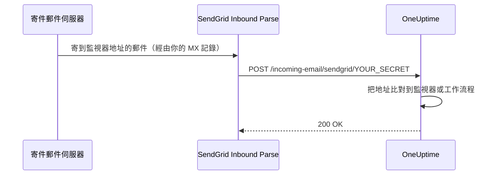

# SendGrid 傳入郵件

OneUptime 的 **Incoming Email Monitor** 讓你可以根據寄到唯一、依監視器區分的電子郵件地址的郵件來建立和解決警示。這對於整合舊系統、警示工具或任何能夠寄送郵件的服務都很有用。

同樣的設定也讓工作流程可以接收郵件：帶有 **Incoming Email** 觸發器的工作流程會在同一個網域上取得自己的地址，寄到該地址的每封郵件都會啟動該工作流程。請參閱[觸發器](/docs/workflows/triggers#incoming-email)。

本指南說明如何設定 SendGrid Inbound Parse，把傳入郵件轉寄到你的自架 OneUptime 執行個體。OneUptime Cloud 不需要這些設定：它的地址開箱即用。

:::cards
- [開始之前](#先決條件): 一個 SendGrid 帳號、一個網域和一個公開的 HTTPS 位址。
- [進行設定](#設定說明): 從 MX 記錄到測試郵件的七個步驟。
- [環境變數](#環境變數參考): 三項設定及其預設值。
- [疑難排解](#疑難排解): 一直收不到的郵件和失敗的 Webhook。
:::

## 運作方式



1. 你在 OneUptime 中建立一個 **Incoming Email Monitor**
2. OneUptime 為該監視器產生一個唯一的電子郵件地址（例如 `monitor-abc123@inbound.yourdomain.com`）
3. 當有郵件寄到該地址時，SendGrid 接收它並透過 Webhook 轉寄給 OneUptime
4. OneUptime 依照你設定的條件評估該郵件，以建立或解決警示

## 先決條件

- 一個可以使用 Inbound Parse 的 SendGrid 帳號
- 一個由你控制、可以修改 DNS 設定的網域
- 一個把 SendGrid Webhook 轉寄到你的 OneUptime 執行個體的公開 HTTPS 端點

## 網路存取

使用 Inbound Parse 時，是 SendGrid 主動連線到 OneUptime。只允許 OneUptime 對外存取網際網路是不夠的。

| 方向 | 目標 | 通訊協定 / 連接埠 | 用途 |
| --- | --- | --- | --- |
| SendGrid → OneUptime | `https://your-oneuptime-domain.com/incoming-email/sendgrid/YOUR_SECRET` | HTTPS / TCP 443 | 以 multipart POST 投遞解析後的郵件。 |
| 寄件郵件伺服器 → SendGrid | `mx.sendgrid.net`，由你的傳入網域的公開 MX 記錄選定 | SMTP / TCP 25 | 在 SendGrid 接收郵件；此連線不會到達你的 OneUptime 伺服器。 |
| OneUptime → SendGrid，僅在另外設定了透過 SendGrid 供應商寄送郵件時 | `api.sendgrid.com` | HTTPS / TCP 443 | 透過 Mail Send API 寄送通知郵件。 |

為 Webhook 主機名稱發布 DNS，並提供公用用戶端信任的憑證。私有部署的 OneUptime 可以只透過一個能從內部連到 OneUptime 的公用反向代理或閘道公開 Webhook 路徑。保留路徑、密鑰、內容類型和 multipart 請求本文，並讓 POST 無需互動式登入或瀏覽器驗證即可通過。OneUptime 伺服器不需要傳入的 SMTP 接聽程式。請參閱 [SendGrid 的 Inbound Parse 設定](https://www.twilio.com/docs/sendgrid/for-developers/parsing-email/setting-up-the-inbound-parse-webhook)。

把 `INBOUND_EMAIL_WEBHOOK_SECRET` 設為一個強隨機值，並用該值取代 URL 中的 `YOUR_SECRET`。該路由要求包含最後一個路徑區段。設定了密鑰時，OneUptime 會檢查它的值；把變數留空則會關閉這項檢查。請對完整 URL 和監視器的電子郵件地址保密，包括在代理記錄中。OneUptime 目前不驗證 SendGrid 簽署的 Inbound Parse 標頭或 OAuth 權杖。如果你需要這些機制，請依照 [SendGrid 的 Webhook 安全性文件](https://www.twilio.com/docs/sendgrid/for-developers/parsing-email/securing-your-parse-webhooks) 設定一個閘道，在轉寄給 OneUptime 之前先驗證它們。

SendGrid 沒有為 Inbound Parse 提供可靠的靜態來源 IP 清單。它寄送郵件所用的 IP，以及 `mx.sendgrid.net` 解析出的位址，都不能作為 Webhook 的允許清單。請遵循 [SendGrid 的防火牆指引](https://support.sendgrid.com/hc/en-us/articles/44375457225371-How-to-Configure-Firewall-Settings-for-SendGrid-Webhook-and-Inbound-Parse-IPs)，而不是固定一個目前的 DNS 結果。

Inbound Parse 與對外郵件寄送是分開的。接收監視器郵件不需要 OneUptime 呼叫 SendGrid API。如果你也選擇 SendGrid 寄送通知，請允許 DNS 解析以及到 `api.sendgrid.com` 的對外 HTTPS；[Mail Send](https://www.twilio.com/docs/sendgrid/api-reference/mail-send/mail-send) 提交時不需要任何傳入回呼。如果改用 SMTP，請允許在 OneUptime 中設定的 SMTP 伺服器和連接埠。

## 設定說明

:::steps
### 選擇你的傳入郵件網域

選擇一個專門用於為 OneUptime 接收郵件的子網域，例如 `inbound.yourdomain.com`、`email.yourdomain.com` 或 `monitor.yourdomain.com`。它只用於寄給 OneUptime 監視器和工作流程的郵件，因此你的任何信箱都不在它上面。

### 把它的 MX 記錄指向 SendGrid

新增一筆 MX 記錄，把該子網域的郵件路由到 SendGrid：

| 類型 | 主機/名稱 | 優先順序 | 值 |
| --- | --- | --- | --- |
| MX | inbound | 10 | mx.sendgrid.net |

如果你的網域是 `example.com`，而你使用 `inbound.example.com`，記錄如下：

```text
inbound.example.com.  IN  MX  10  mx.sendgrid.net.
```

DNS 變更最多可能需要 48 小時才能傳播，但通常在幾小時內完成。

### 在 SendGrid 中驗證網域

接收網域必須屬於你在 [SendGrid 中已驗證的網域](https://www.twilio.com/docs/sendgrid/ui/account-and-settings/inbound-parse)之一。在 [SendGrid 主控台](https://app.sendgrid.com)中，前往 **Settings** > **Sender Authentication**，點選 **Authenticate Your Domain**，並新增它要求的 DNS 記錄（用於 DKIM 的 CNAME 記錄）。

### 新增 Inbound Parse Webhook

在 SendGrid 主控台中，前往 **Settings** > **Inbound Parse** 並點選 **Add Host & URL**。依下表填寫，然後點選 **Add**：

| 欄位 | 值 |
| --- | --- |
| **Receiving Domain** | 你的傳入子網域（例如 `inbound.yourdomain.com`） |
| **Destination URL** | `https://your-oneuptime-domain.com/incoming-email/sendgrid/YOUR_SECRET` |
| **Check incoming emails for spam** | 選用——視需要啟用 |
| **Send raw, full MIME message** | 保持不勾選（不需要） |
| **POST the raw, full MIME message** | 保持不勾選（不需要） |

### 設定 OneUptime

設定傳入郵件變數，密鑰與 Destination URL 中的相同：

:::tabs
@tab Docker Compose
```bash title="config.env"
INBOUND_EMAIL_PROVIDER=SendGrid
INBOUND_EMAIL_DOMAIN=inbound.yourdomain.com
INBOUND_EMAIL_WEBHOOK_SECRET=replace-with-a-strong-random-secret
```
@tab Kubernetes
```yaml title="values.yaml"
inboundEmail:
  provider: "SendGrid"
  domain: "inbound.yourdomain.com"
  webhookSecret: "replace-with-a-strong-random-secret"
```
:::

然後套用它們：在 Docker Compose 上執行 `npm run start`，它會用新值重新建立容器；在 Kubernetes 上則升級 Helm 發行版本。

### 建立 Incoming Email 監視器

[建立 Incoming Email 監視器](/docs/monitor/incoming-email-monitor#建立傳入郵件監測器)。它的 **概覽** 頁面會顯示它的地址，例如 `monitor-abc123def456@inbound.yourdomain.com`，它的條件決定哪些郵件建立警示、哪些郵件解決警示。

工作流程使用同一個網域。把 **Incoming Email** 觸發器新增到工作流程並點選它：它的地址（`workflow-…@inbound.yourdomain.com`）顯示在其設定的頂部。在設定上面的傳入郵件變數之前，觸發器會提示伺服器尚未設定為接收郵件。

### 寄送測試郵件

寄一封主旨符合其條件的郵件到監視器的地址。監視器的摘要會顯示這封郵件，條件相符時會建立警示。
:::

## 環境變數參考

| 變數 | Helm 值 | 說明 | 必要 | 預設值 |
| --- | --- | --- | --- | --- |
| `INBOUND_EMAIL_PROVIDER` | `inboundEmail.provider` | 傳入郵件供應商。只有 SendGrid 一種。 | 否 | `SendGrid` |
| `INBOUND_EMAIL_DOMAIN` | `inboundEmail.domain` | 為傳入郵件設定的子網域。設定之前，傳入郵件處於關閉狀態。 | 是 | 空 |
| `INBOUND_EMAIL_WEBHOOK_SECRET` | `inboundEmail.webhookSecret` | 與 Webhook URL 最後一段 `/incoming-email/sendgrid/YOUR_SECRET` 比較的密鑰。為公開端點設定它；空值會關閉驗證。 | 建議 | 空 |

Incoming Email 監視器可以依據哪些內容進行比對——主旨、寄件者、本文、收件者，以及郵件是否準時到達——請參閱[可用的篩選器類型](/docs/monitor/incoming-email-monitor#可用的篩選器類型)。

## 疑難排解

:::details 收不到郵件
1. **檢查 DNS 傳播：** `dig MX inbound.yourdomain.com` 應傳回 `mx.sendgrid.net`。
2. **核對 SendGrid Inbound Parse 設定：** 在 SendGrid 主控台的 **Settings** > **Inbound Parse** 下，檢查你的網域和 Webhook URL。
3. **檢查 OneUptime 記錄：** 在 OneUptime `app` 服務的記錄中尋找傳入郵件 Webhook 請求及任何錯誤。SendGrid 不為 Inbound Parse 保留詳細記錄，因此這些記錄就是到達內容的紀錄。
:::

:::details Webhook 失敗
1. **檢查公開的 Webhook 路由：** 包含密鑰的完整 URL 必須能從網際網路連到 OneUptime。缺少最後一個密鑰區段的 URL 不符合該路由。
2. **檢查防火牆規則：** 允許寄往 Webhook 路徑的 HTTPS POST 請求，不要有登入重新導向或瀏覽器驗證，也不要把 SendGrid 的郵件寄送 IP 當作 Webhook 來源允許清單。
3. **核對 SSL 憑證：** 為 Webhook 主機名稱使用有效且受公眾信任的憑證，並包含其憑證鏈。
:::

:::details 監視器不建立警示
1. **核對條件：** 檢查你的警示建立條件是否與郵件內容相符，在使用模式比對之前先用精確字串測試。
2. **檢查監視器：** 確認它沒有被停用，並且類型是 Incoming Email。
3. **查看監視器的摘要：** 檢查郵件是否已接收並處理，並閱讀評估記錄，了解條件是如何相符的。
:::

:::details 觸發器提示伺服器尚未設定為接收郵件
伺服器上的 `INBOUND_EMAIL_DOMAIN` 為空。設定它，套用變更，然後重新開啟工作流程的觸發器。
:::

## 安全性最佳做法

1. **使用 HTTPS：** Webhook 端點一律使用 HTTPS
2. **Webhook 密鑰：** 設定 `INBOUND_EMAIL_WEBHOOK_SECRET`，並把它包含在 Webhook URL 中（例如 `/incoming-email/sendgrid/your-secret`）作為額外驗證
3. **網域驗證：** 在 SendGrid 中驗證你的網域，以提高郵件安全性
4. **限制存取：** 只為可信任的郵件來源建立監視器
5. **監控記錄：** 定期檢查傳入郵件記錄，留意可疑活動

## 後續步驟

:::cards
- [Incoming Email Monitor](/docs/monitor/incoming-email-monitor): 條件、地址格式和範例。
- [工作流程觸發器](/docs/workflows/triggers): 透過郵件啟動工作流程。
- [私有網路存取](/docs/self-hosted/private-network-access): 你的伺服器在你自己的網路中可以連到什麼。
- [架構](/docs/self-hosted/architecture): 在自架安裝中 Webhook 到達哪裡。
:::
