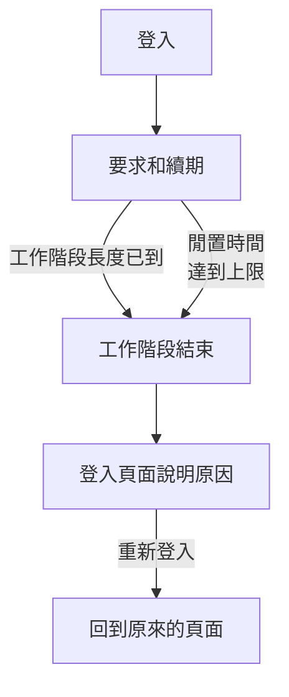

# 工作階段長度

選擇使用者在需要重新登入之前保持登入 OneUptime 的時間：登入後的固定時間、未使用的時間，或兩者都設。它適用於每一次登入儀表板、Admin Dashboard 和行動應用程式，無論使用密碼、通行密鑰、Microsoft 登入還是單一登入。SSO 登入可以有自己的時間。

> [!NOTE]
> 工作階段長度是 [OneUptime Enterprise Edition](/docs/self-hosted/enterprise) 的一部分。Community Edition 沒有 **工作階段長度** 頁面，每次登入的時間如 [無限制](#無限制) 所述。

:::cards
- [設定工作階段長度](#設定工作階段長度)：Admin Dashboard 中的兩項設定。
- [工作階段如何結束](#工作階段如何結束)：伺服器計算什麼，以及何時計算。
- [SSO 登入](#sso-登入)：單一登入自己的時間。
- [哪些不算登入](#哪些不算登入)：API 金鑰、MCP 連線和狀態頁面的讀者。
:::

## 無限制

在您設定時間之前，登入沒有時間限制。它的存取權杖有效 15 分鐘，並在背景以重新整理權杖續期；重新整理權杖有效 30 天，每次使用都會重新計時。至少每 30 天開啟一次 OneUptime 的人會保持登入，沒有開啟的人需要重新登入。

## 設定工作階段長度

:::steps
### 開啟工作階段長度
在 Admin Dashboard 中開啟 **設定**，然後在側邊選單中開啟 **工作階段長度**。

### 選擇時間
- **自動登出時間**：從登入那一刻起，無論使用者多麼活躍，登入能持續多久。
- **閒置自動登出時間**：使用者在 OneUptime 中不點按、不輸入、不捲動可以持續多久。

每次選擇都會立即儲存。

### 確認哪些人會被登出
更短的時間會套用到目前所有已登入的人。如果它會讓一些人立即被登出，OneUptime 會先告訴您人數，以及您是否在其中。選擇 **儲存並讓他們登出** 即可繼續。
:::

| 設定 | 可選範圍 | 預設值 |
| --- | --- | --- |
| **自動登出時間** | 1 小時到 90 天 | **無限制** |
| **閒置自動登出時間** | 15 分鐘到 14 天 | 30 天，也是最長時間 |

透過 API，在伺服器的全域設定中，`sessionLengthInMinutes` 接受 15 到 525600（一年）之間的任意整數分鐘，`sessionIdleTimeoutInMinutes` 接受 15 到 43200（30 天）。留空即為預設值。

## 工作階段如何結束

- 伺服器根據工作階段本身計算這兩個時間：它何時登入，以及它的使用者最後一次活躍是什麼時候。伺服器會在每次要求、每次續期和每次即時更新時檢查它們，從不把登出交給瀏覽器。
- 閒置時間從儀表板或 Admin Dashboard 任一分頁中最後一次點按、按鍵或捲動開始計算。只是開著的分頁不會讓工作階段保持有效。
- 行動應用程式每次被使用時都算作活躍。
- 工作階段結束時，瀏覽器會轉到登入頁面，並說明原因。重新登入後，使用者會回到原來所在的頁面。

| 變更 | 目前已登入的人會怎樣 |
| --- | --- |
| 更短的工作階段長度或閒置時間 | 已經超過的人會立即被登出，其他人在達到時被登出 |
| 更長的時間，或不限制 | 沒有人會被登出，工作階段從下一次續期起持續更久 |

## SSO 登入

透過單一登入的登入也遵循同樣的兩項設定。若要為它們單獨設定時間，請在 **工作階段長度** 頁面上開啟 **更多設定**，然後開啟 **為 SSO 登入單獨設定時間**。之後，它下方的兩項設定會套用到透過專案的 SAML 或 OpenID Connect 提供者，或透過伺服器本身的 [全域 SSO](/docs/identity/global-sso) 的登入，而頁面頂端的兩項設定套用到其他所有登入。

此外，要求 SSO 的專案只在工作階段的 SSO 登入仍然有效時才允許其進入，而這段時間不會超過 SSO 登入所遵循的時間。

透過 API，該開關是 `useSeparateSsoSessionLengths`，SSO 登入的時間是 `ssoSessionLengthInMinutes` 和 `ssoSessionIdleTimeoutInMinutes`，範圍相同。

## 哪些不算登入

- **API 金鑰** 保留您為其設定的有效期限。
- **MCP 連線**，即透過 OAuth 連線的 AI 助理，保留它們自己的有效期限。在要求 SSO 的專案中，連線的有效時間不會超過核准它時所用的 SSO 登入。
- **私人狀態頁面** 為其讀者設有自己的時間：請參閱 [私人使用者](/docs/status-pages/index#私人使用者)。

## 沒有授權時

試用期或寬限期結束後，如果沒有有效的授權，或授權不包含工作階段長度，就無法設定或變更時間。已設定的時間仍會讓使用者登出，您仍可以將其移除。使用 Community Edition 映像檔時不套用任何時間：這些值保留在資料庫中，切換回來後會再次生效。

## 後續步驟

:::cards
- [SSO](/docs/identity/sso)：讓使用者透過您的身分識別提供者登入。
- [全域 SSO](/docs/identity/global-sso)：整個伺服器使用一個身分識別提供者。
- [Enterprise Edition](/docs/self-hosted/enterprise)：Enterprise Edition 增加了什麼，以及它的授權。
:::
