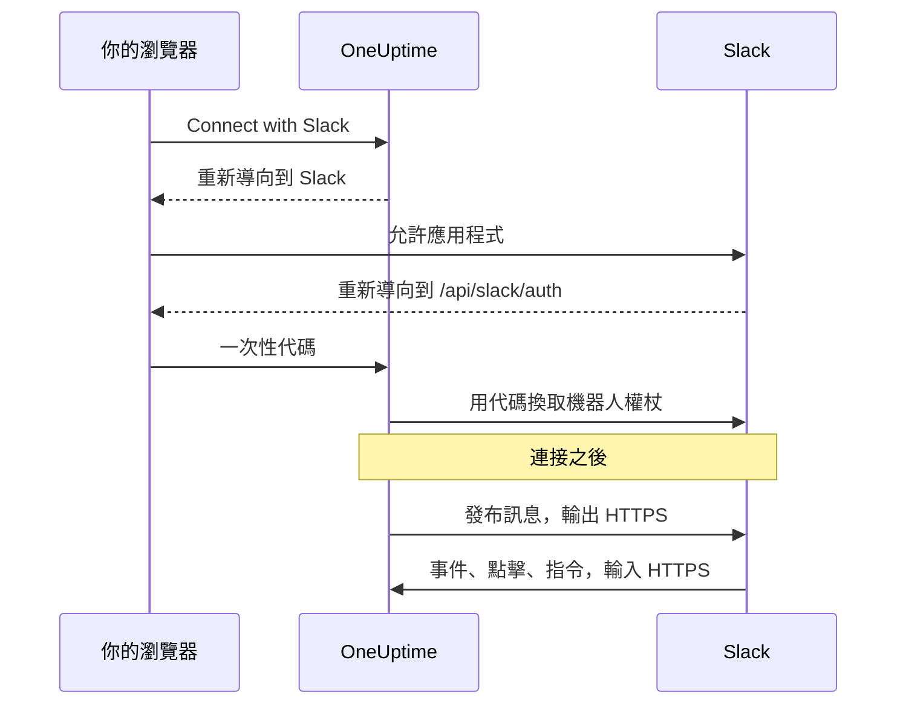
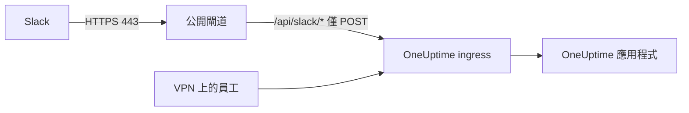

# Slack 整合

將你自行託管的 OneUptime 連接到 Slack。你用伺服器產生的資訊清單建立一個 Slack 應用程式，把應用程式的認證資訊交給 OneUptime，再把每個專案連接到一個工作區。之後，OneUptime 會把事件、警示和排定的維護發布到你的頻道，團隊可以直接在 Slack 中處理它們。

本頁面向執行 OneUptime 伺服器的人員。Slack 連接後，通知規則依專案設定：請參閱 [Slack](/docs/workspace-connections/slack)。

:::cards
- [設定 Slack 應用程式](#設定-slack-應用程式): 用你的資訊清單建立應用程式，並連接一個專案。
- [環境變數](#環境變數): OneUptime 需要從應用程式取得的三個值。
- [網路存取](#自行託管部署的網路存取): Slack 必須能夠連到的回呼。
- [疑難排解](#疑難排解): Slack 頁面上的訊息代表什麼，以及該怎麼做。
:::

## 運作方式

Slack 應用程式屬於你：它安裝在你的工作區中，只與你的伺服器通訊。流量是雙向的，每個方向都需要各自的網路存取。



- **輸出**：OneUptime 呼叫 Slack 的 Web API 來發布訊息、建立頻道和上傳圖片。
- **輸入**：Slack 呼叫你伺服器上的四個路由，用於事件、按鈕點擊、選單和斜線指令。每個請求都以應用程式的 signing secret 簽署。簽章不符或時間戳記超過五分鐘的請求，會被 OneUptime 拒絕。

## 開始之前

- 一個你可以在其中建立和安裝應用程式的 Slack 工作區。
- 一個 Slack 能連到的 OneUptime 公開 HTTPS 主機名稱。請參閱 [網路存取](#自行託管部署的網路存取)。
- 伺服器設定的存取權限：Docker Compose 使用 `config.env`，Kubernetes 使用你的 Helm values。
- 要連接專案，需要在該專案中具備 **Project Owner**、**Project Admin** 或 **Project Member** 角色。

## 設定 Slack 應用程式

:::steps
### 設定公開 URL

OneUptime 依據 `HOST` 和 `HTTP_PROTOCOL` 產生應用程式資訊清單和每個回呼 URL。將它們設為 Slack 會透過 HTTPS 呼叫的主機名稱：

:::tabs
@tab Docker Compose
```bash title="config.env"
HOST=oneuptime.example.com
HTTP_PROTOCOL=https
```
@tab Kubernetes
```yaml title="values.yaml"
host: oneuptime.example.com
httpProtocol: https
```
:::

這些值只用來產生 URL，不會建立 DNS 記錄、憑證或防火牆規則。

### 複製應用程式資訊清單

開啟 **專案設定 > 工作區 > Slack**。在伺服器上設定好 Slack 之前，該頁面會顯示 **Integrating Slack with your OneUptime Project**，以及為你的主機名稱產生的資訊清單。資訊清單也可以從 `https://oneuptime.example.com/api/slack/app-manifest` 取得。

確認資訊清單中的每個 URL 都以你的公開主機名稱開頭。如果不是，請先修正 `HOST` 和 `HTTP_PROTOCOL` 並套用變更。

### 建立 Slack 應用程式

在 [api.slack.com/apps](https://api.slack.com/apps) 上從資訊清單建立新的應用程式，選擇你的工作區並貼上資訊清單。請一律使用你自己的伺服器產生的資訊清單，這樣其中的 URL 才會與你的主機名稱一致。

### 複製應用程式的認證資訊

在應用程式的 **Basic Information** 頁面中，於 **App Credentials** 下複製 **Client ID**、**Client Secret** 和 **Signing Secret**。

### 將認證資訊加入 OneUptime

:::tabs
@tab Docker Compose
```bash title="config.env"
SLACK_APP_CLIENT_ID=YOUR_SLACK_APP_CLIENT_ID
SLACK_APP_CLIENT_SECRET=YOUR_SLACK_APP_CLIENT_SECRET
SLACK_APP_SIGNING_SECRET=YOUR_SLACK_APP_SIGNING_SECRET
```
@tab Kubernetes
```yaml title="values.yaml"
slackApp:
  clientId: "YOUR_SLACK_APP_CLIENT_ID"
  clientSecret: "YOUR_SLACK_APP_CLIENT_SECRET"
  signingSecret: "YOUR_SLACK_APP_SIGNING_SECRET"
```

若要把這些值保存在你自行管理的 Kubernetes Secret 中，請改為設定 `slackApp.existingSecret`：它的 `name`，以及金鑰 `clientIdKey`、`clientSecretKey` 和 `signingSecretKey`。
:::

### 套用設定

:::tabs
@tab Docker Compose
```bash
npm run start
```

這會用新的 `config.env` 重新建立容器。`docker compose restart` 不會重新讀取它。
@tab Kubernetes
```bash
helm upgrade my-oneuptime oneuptime/oneuptime -f values.yaml
```
:::

OneUptime 恢復執行後，**專案設定 > 工作區 > Slack** 會顯示 **Connect with Slack** 按鈕，而不是資訊清單。

### 驗證事件請求 URL

在 Slack 應用程式的 **Event Subscriptions** 中驗證請求 URL。只有在設定 signing secret 之後，OneUptime 才會回應 Slack 的 challenge，所以如果在建立應用程式時驗證失敗，請重試。

### 連接專案

在 **專案設定 > 工作區 > Slack** 中選擇 **Connect with Slack**，並在 Slack 中允許該應用程式。Slack 會把你送回同一頁面，頁面上現在會顯示你的工作區。

### 連接你自己的 Slack 帳號

按鈕、表單和指令會以與使用它們的 Slack 帳號連結的 OneUptime 使用者身分執行。每個人開啟 **使用者設定 > 工作區 > Slack** 並選擇 **Connect my account with Slack**。尚未連接帳號的人，會收到應用程式傳來的私人訊息，請他們完成連接。
:::

## 環境變數

| Docker Compose (`config.env`) | Helm (`values.yaml`) | 必要 | 值 |
| --- | --- | --- | --- |
| `SLACK_APP_CLIENT_ID` | `slackApp.clientId` | 是 | 應用程式的 **Client ID**。沒有它時，Slack 頁面會顯示設定指南，而不是 **Connect with Slack**。 |
| `SLACK_APP_CLIENT_SECRET` | `slackApp.clientSecret` | 是 | 應用程式的 **Client Secret**，用來把 Slack 傳回的代碼換成權杖。 |
| `SLACK_APP_SIGNING_SECRET` | `slackApp.signingSecret` | 是 | 應用程式的 **Signing Secret**。來自 Slack 的每個請求都用它檢查。 |
| `HOST` | `host` | 是 | 你的公開主機名稱，不含協定。 |
| `HTTP_PROTOCOL` | `httpProtocol` | 是 | `https`。Slack 只會呼叫 HTTPS URL。 |

## 應用程式能做什麼

資訊清單會設定以下功能。每項功能都透過所示的路由連到你的伺服器，因此只有在 Slack 能連到該路由時才能運作。

| 功能 | 作用 | 路由 |
| --- | --- | --- |
| `/incident` 和 **Create New Incident** 捷徑 | 從 Slack 宣告事件 | `POST /api/slack/interactive` |
| `/maintenance` 和 **Create Scheduled Event** 捷徑 | 從 Slack 排定維護 | `POST /api/slack/interactive` |
| `/oneuptime` | 向 OneUptime AI 詢問你的日誌、追蹤、指標、事件和監控 | `POST /api/slack/command` |
| OneUptime 訊息中的按鈕和表單 | 確認、解決、新增備註、變更狀態、執行值班政策 | `POST /api/slack/interactive` 和 `POST /api/slack/options-load` |
| 事件 | 提及、訊息、表情回應和釘選，例如把一則訊息儲存為備註 | `POST /api/slack/events` |

### 訊息中的圖片

事件和警示的描述可以包含螢幕截圖，例如合成監控的截圖（請參閱 [合成監控](/docs/monitor/incident-alert-templating#合成監控)）。OneUptime 會把每張截圖當作私人檔案上傳到你的工作區，藉此在 Slack 訊息中顯示，這需要機器人權限範圍 `files:write`。產生的資訊清單已包含它。

如果你的 Slack 應用程式是用較舊的資訊清單建立的，請在 **OAuth & Permissions > Bot Token Scopes** 下新增 `files:write`（或用目前的資訊清單更新應用程式）。然後在 **專案設定 > 工作區 > Slack** 中再次選擇 **Connect with Slack**，以授予新的權限範圍。在那之前，每張截圖都會以其替代文字顯示。

## 自行託管部署的網路存取

### 流量方向與端點

| 流量 | 所需存取 |
| --- | --- |
| OneUptime 到 Slack | DNS，以及透過 TCP 443 到 `slack.com` 的輸出 HTTPS，用於 Web API 呼叫和 OAuth 權杖交換；使用時，還需要到 `hooks.slack.com` 的存取，用於指令的回應 URL 和傳入 Webhook 通知 |
| Slack 到 OneUptime | 透過 TCP 443 到下列四個 POST 路由的公開 HTTPS，用於完整的整合 |
| 使用者瀏覽器到 OneUptime | 儀表板存取，以及到 `/api/slack/auth/:projectId/:userId` 和 `/api/slack/auth/:projectId/:userId/user` 的 OAuth 重新導向；這些可以維持只透過使用者的 VPN 存取 |

輸出網域描述的是 OneUptime 的 Slack 整合，而不是 Slack 用戶端或每項 Slack 功能的完整允許清單。Slack 的*傳入 Webhook* 由 Slack 託管：OneUptime 向它傳送訊息，所以它不是你伺服器上的輸入端點。請參閱 Slack 的 [傳入 Webhook 指南](https://docs.slack.dev/messaging/sending-messages-using-incoming-webhooks/)。

透過 ingress 將下列回呼轉送到 OneUptime：

| 方法與路徑 | 用途 |
| --- | --- |
| `POST /api/slack/events` | Events API 驗證、表情回應、釘選、提及和訊息 |
| `POST /api/slack/interactive` | 按鈕、捷徑、互動視窗提交、`/incident` 和 `/maintenance` |
| `POST /api/slack/options-load` | 互動式選單的選項請求 |
| `POST /api/slack/command` | `/oneuptime` 指令 |

OAuth 是 [瀏覽器重新導向，接著在伺服器端交換權杖](https://docs.slack.dev/authentication/installing-with-oauth/)。資訊清單將 `/api/slack/auth` 註冊為重新導向 URL 的前置詞，OneUptime 在開始授權時會加上專案和使用者路徑。只有瀏覽器存取，並不能讓 Slack 遞送事件或按鈕點擊。

### 私人部署與回呼安全性



使用公開 DNS，以及一個具有公開受信任 HTTPS 憑證、完整憑證鏈和通往 OneUptime ingress 私人路由的閘道。允許到閘道的輸入 TCP 443，並只轉送上述四個回呼路由。私人的 `ClusterIP`、內部 DNS 名稱或員工的 VPN 連線，Slack 都無法連到。使用分割 DNS，可以在同一個主機名稱下讓儀表板和 OAuth 路由維持私人。

變更主機名稱後，請重新產生資訊清單並更新 Slack 應用程式。

經過閘道時，請保留：

- 方法、路徑、查詢字串和原始本文；
- `Content-Type`、`X-Slack-Signature` 和 `X-Slack-Request-Timestamp`；
- 公開主機和 HTTPS 協定，透過受信任的代理標頭傳遞。

讓回呼路由免除瀏覽器 SSO、CAPTCHA 和代理登入頁面，並保留 OneUptime 的 signing secret 與時間戳記檢查。讓伺服器時鐘保持同步：偏差超過五分鐘的請求會被拒絕。Slack 文件說明了 [請求簽章驗證](https://docs.slack.dev/authentication/verifying-requests-from-slack/)；檢查來源 IP 無法取代它。

### 驗證存取並了解限制

:::steps
1. 在 Slack 應用程式的 **Event Subscriptions** 中驗證請求 URL。Slack 會傳送 [POST challenge 並檢查 TLS](https://docs.slack.dev/apis/events-api/using-http-request-urls/)。
2. 傳送一則測試通知，執行一個斜線指令，按下事件訊息上的按鈕，並觸發一個已訂閱的事件。
3. 檢查閘道和 OneUptime 的日誌中是否有遞送失敗，但不要記錄密鑰。
:::

Slack 期望快速確認，包括 [在三秒內回應互動](https://docs.slack.dev/interactivity/handling-user-interaction/)。瀏覽器 GET 或成功送出的輸出訊息，並不能驗證這些 POST 回呼。

> [!WARNING]
> 如果禁止所有輸入連線，已授權的應用程式仍可透過輸出 HTTPS 傳送訊息，但事件、按鈕、捷徑和指令都無法運作。OneUptime 的資訊清單使用 HTTP 回呼並停用 Socket Mode；開啟 Slack 的 Socket Mode 並不是這些路由受支援的替代方案。

[私有網路存取設定](/docs/self-hosted/private-network-access) 控制傳往私人目的地的輸出請求，並不會把回呼公開給 Slack。

## 疑難排解

### 連接沒有完成

當 Slack 把你送回而連接沒有建立時，你開始操作的 Slack 頁面（**專案設定 > 工作區 > Slack**，或在連接自己的帳號時，你自己的 **使用者設定 > 工作區 > Slack**）會顯示 **Slack 未連接**，並以你的語言用一句話說明原因。頁面的其餘部分照常載入，所以你可以直接在那裡重新連接。頁面從不顯示 Slack 本身的回覆：它和原因一起記錄在 OneUptime 伺服器日誌中。

| 頁面顯示 | 該怎麼做 |
| --- | --- |
| **"此連接連結無效、已過期或已被使用。請重新開始。"** | 連結只能在發起它的瀏覽器中使用一次，有效 15 分鐘。從 Slack 頁面重新開始，並在 15 分鐘內用同一個瀏覽器在 Slack 中完成。 |
| **"您沒有將此專案連接到 Slack 的權限。"** | 在 Slack 中安裝 OneUptime 需要 **Project Owner**、**Project Admin** 或 **Project Member**。Slack 把你送回時會再次檢查，因此在這段期間被撤銷的角色也會在這裡結束連接。 |
| **"您已不再是此專案的成員。"** | 要連接你自己的 Slack 帳號，在 Slack 把你送回時你必須是專案成員。 |
| **"此專案尚未連接到 Slack 工作區。"** | 先從 **專案設定 > 工作區 > Slack** 把 OneUptime 安裝到 Slack，再連接你自己的帳號。 |
| **"您登入的 Slack 工作區與此專案所連接的工作區不同。"** | 在登入安裝了該專案的 Slack 工作區的狀態下連接你的帳號。 |
| **"連接已取消，因此沒有任何變更。"** | 請求沒有在 Slack 中獲得允許。重新開始並允許它。 |
| **"此 OneUptime 伺服器未設定 Slack。"** | 設定 `SLACK_APP_CLIENT_ID` 和 `SLACK_APP_CLIENT_SECRET`（請參閱 [環境變數](#環境變數)），然後重新啟動 OneUptime。 |
| **"OneUptime 無法完成連接。請再試一次。"** | Slack 回傳了錯誤，或在完成過程中某個請求或寫入失敗。OneUptime 伺服器日誌會說明是哪一種。請再試一次；如果問題持續，請檢查日誌和 Slack 應用程式的設定。 |

### 其他問題

:::details Slack 無法驗證事件請求 URL
只有在設定了 `SLACK_APP_SIGNING_SECRET` 且請求能送達時，OneUptime 才會回應 Slack 的 challenge。設定 signing secret，套用設定，然後重試驗證。如果仍然失敗，請檢查 `POST /api/slack/events` 是否能從網際網路以公開受信任的憑證連到。
:::

:::details 按鈕和斜線指令沒有反應，但通知會送達
通知是輸出的，所以不需要輸入存取也能運作。按鈕、捷徑和指令是輸入的：請檢查 Slack 能否連到 `POST /api/slack/interactive` 和 `POST /api/slack/command`，以及閘道是否保留了本文和 `X-Slack-Signature`、`X-Slack-Request-Timestamp` 標頭。
:::

:::details 應用程式說我的 Slack 帳號沒有連接到 OneUptime
按鈕、表單和指令需要你的 Slack 帳號與你的 OneUptime 使用者連結。開啟 **使用者設定 > 工作區 > Slack** 並選擇 **Connect my account with Slack**。如果你已被移出專案，應用程式會改為告訴你這件事，並拒絕來自 Slack 的操作。
:::

:::details 截圖顯示為文字
Slack 應用程式缺少 `files:write` 權限範圍。請參閱 [訊息中的圖片](#訊息中的圖片)。
:::

## 後續步驟

:::cards
- [Slack](/docs/workspace-connections/slack): 為專案建立通知規則和摘要。
- [Microsoft Teams 整合](/docs/self-hosted/microsoft-teams-integration): 也在你的伺服器上設定 Teams 機器人。
- [私有網路存取](/docs/self-hosted/private-network-access): 讓工作流程和 Webhook 連到內部工具。
:::
