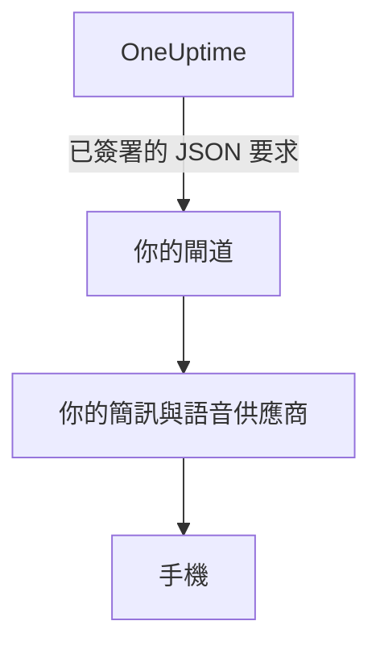

# 簡訊與電話閘道

OneUptime 可以透過你自己營運的閘道傳送簡訊和撥打電話，而不是透過 Twilio。當你的規定要求每則訊息都必須經過你自己的簡訊與語音供應商，或經過一個在訊息離開你的網路前先加以檢查的系統時，就可以使用它。OneUptime 會將每則簡訊和每通電話以已簽署的 JSON 要求傳送到你的閘道，再由你的閘道送達。

:::cards
- [設定閘道](#設定閘道): 一個 URL，以及為你產生的簽署密鑰。
- [你的閘道會收到什麼](#你的閘道會收到什麼): 每則簡訊或每通電話對應一個已簽署的 JSON 要求。
- [處理呼叫](#處理呼叫): 透過電話或回覆來確認、升級或解決。
- [傳遞與重試](#傳遞與重試): 你的閘道停擺時會發生什麼。
:::

## 運作方式



對於原本會透過伺服器自己的 Twilio 帳戶傳送的一切，閘道都會取而代之：待命呼叫、通知、驗證碼，以及狀態頁面訂閱者的簡訊。在 **專案設定 > 通知 > 通知設定** 中的 **Twilio 設定** 卡片上加入自己 Twilio 設定的專案，仍會透過該設定傳送。每個專案的簡訊與電話開關，以及啟用計費時的餘額，都會像使用 Twilio 時一樣受到檢查。

## 設定閘道

:::steps
1. 在 Admin Dashboard 中，前往 **設定 > 通話和簡訊**，然後在 **SMS and Call Provider** 卡片上按一下 **Edit Provider**。
2. 選擇 **Your own gateway**，並輸入 **Gateway URL**。閘道可以位於你的私有網路中。
3. 儲存。OneUptime 會為你產生一個簽署密鑰。從卡片複製它，並設定到你的閘道中。
4. 按一下 **Send Test**。你的閘道應以 2xx 狀態回應，且不傳送任何內容。
:::

若要更換密鑰，請在 **更多欄位** 下清空 **Signing Secret** 並儲存：OneUptime 會產生新的密鑰。若要改回 Twilio，請選擇 **Twilio** 並儲存。

## 你的閘道會收到什麼

每則簡訊和每通電話都是一個帶有 JSON 本文和以下標頭的 `POST` 要求：

| 標頭 | 值 |
| --- | --- |
| `Content-Type` | `application/json` |
| `X-OneUptime-Event` | `sms`、`call` 或 `test` |
| `X-OneUptime-Signature` | `sha256=` 後接用簽署密鑰計算出的要求本文 HMAC-SHA256 十六進位值 |
| `User-Agent` | `OneUptime-CallAndSmsGateway/1.0` |

```json title="An on-call page by SMS"
{
  "version": 1,
  "event": "sms",
  "id": "7c5b0d0e-3e5f-4d1a-9a4f-2b8e6c1d9f00",
  "sentAt": "2026-10-27T09:30:00.000Z",
  "to": "+15551234567",
  "message": "OneUptime: A new alert has been created. Alert #42: Database is down…",
  "isSensitive": false,
  "project": {
    "id": "0f6b8c3a-1d2e-4f5a-8b9c-0d1e2f3a4b5c",
    "name": "Production"
  },
  "actions": {
    "acknowledge": "https://oneuptime.example.com/api/custom-notification-channel/page/5f2c…/acknowledge?token=…",
    "escalate": "https://oneuptime.example.com/api/custom-notification-channel/page/5f2c…/escalate?token=…",
    "resolve": "https://oneuptime.example.com/api/custom-notification-channel/page/5f2c…/resolve?token=…"
  }
}
```

| 欄位 | 說明 |
| --- | --- |
| `version` | 此格式一律為 `1`。只會在其中新增欄位。 |
| `event` | `sms`、`call` 或 `test`，與 `X-OneUptime-Event` 相同。 |
| `id` | 此訊息獨有，且在每次嘗試送達時都相同：用它來略過你已經傳送過的訊息。 |
| `sentAt` | OneUptime 傳送它的時間，採用 ISO 8601 格式。 |
| `to` | 電話號碼，採用 E.164 格式。測試中為 `null`。 |
| `message` | 簡訊內容，或電話中要說的內容。一則簡訊最多 1,600 個字元，電話的文字最多 16,384 個字元。更長的文字會被截斷，並以一段說明其餘內容在 OneUptime 中的附註結尾。 |
| `isSensitive` | 驗證碼為 `true`。請勿將該訊息寫入你自己的日誌。 |
| `project` | 專案的 `id` 和 `name`，如果不是由專案傳送則為 `null`。 |
| `actions` | 對於待命呼叫，是用於處理該呼叫的連結。其他情況下為 `null`。 |

電話以描述而非腳本的形式傳送：`message` 是電話中要說的內容，不含 Twilio 的「按 1 確認」。請以你自己的方式提供這些動作，例如按鍵，並呼叫對應的連結。

### 驗證簽章

在剖析之前，計算原始要求本文的 HMAC，並與標頭比較。這項驗證與 [自訂管道](/docs/self-hosted/custom-notification-channels#驗證簽章) 相同，因此一個驗證函式就能同時用於兩者：

```javascript title="Node.js"
const crypto = require("crypto");

function isFromOneUptime(rawBody, signatureHeader, secret) {
  const expected =
    "sha256=" + crypto.createHmac("sha256", secret).update(rawBody).digest("hex");
  const received = String(signatureHeader || "");

  return (
    received.length === expected.length &&
    crypto.timingSafeEqual(Buffer.from(received), Buffer.from(expected))
  );
}
```

## 處理呼叫

當對方在通話中或以回覆做出回應時，你的閘道會向 `actions` 中對應的連結傳送 `POST` 要求。這些連結的運作方式與自訂管道的連結相同：不需要 API 金鑰，每個連結都帶有僅適用於該次呼叫、有效期 7 天的權杖，而動作會記錄為由被呼叫的人執行。每個動作及其回應請參閱 [處理呼叫](/docs/self-hosted/custom-notification-channels#處理呼叫)。

```bash title="Acknowledge a page"
curl -X POST "https://oneuptime.example.com/api/custom-notification-channel/page/5f2c…/acknowledge?token=…"
```

## 傳遞與重試

當你的閘道在 10 秒內以 2xx 狀態回應時，要求即視為已傳遞。閘道沒有回應，或以 408、429 或 5xx 狀態回應的要求，會在 1 秒後以及再過 4 秒後重新傳送：總共嘗試三次。其他任何 4xx 狀態都不會重新傳送。

簡訊或通話日誌，以及待命呼叫中此人的待命日誌，會顯示 `Sent to the SMS and call gateway (HTTP 200).` 或未傳遞的原因，但絕不會顯示 URL。OneUptime 無法得知訊息是否已到達手機，因此只要你的閘道接受了簡訊，該簡訊就會顯示為已傳送，而傳出該簡訊的號碼會留空。

## 測試要求

**Send test** 會傳送一個 `event` 設為 `test`，且 `to`、`project` 和 `actions` 設為 `null` 的要求。請以 2xx 狀態回應，並且不要傳送任何內容。

## 後續步驟

:::cards
- [自訂通知管道](/docs/self-hosted/custom-notification-channels): 透過你自己的應用程式呼叫人員。
- [推播通知](/docs/self-hosted/push-notifications): 為整個伺服器關閉推播。
- [Twilio 整合](/docs/self-hosted/twilio-integration): 改為透過 Twilio 傳送。
- [私有網路存取](/docs/self-hosted/private-network-access): 你的伺服器可以在你自己的網路上存取哪些內容。
:::
