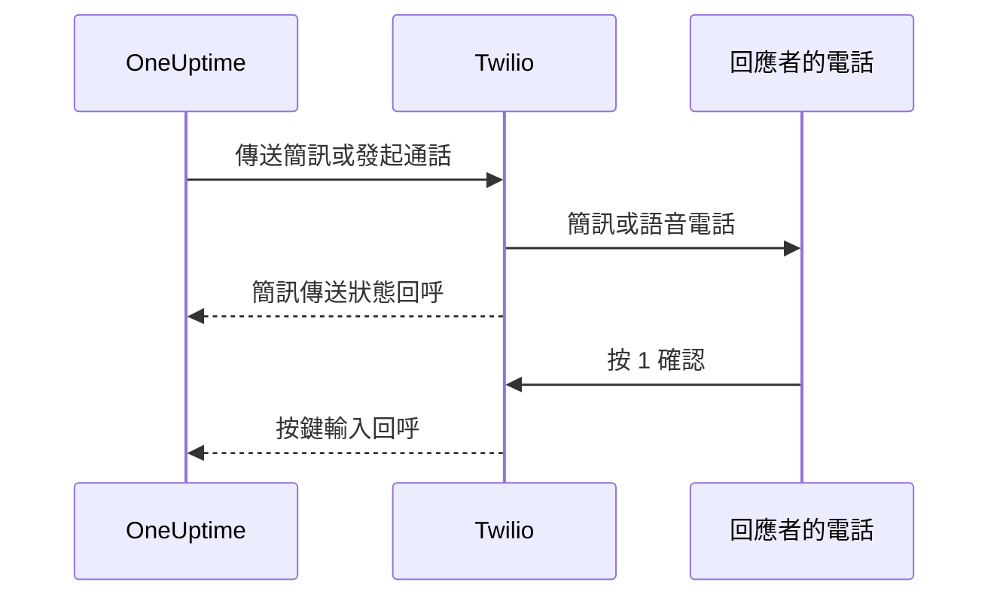

# Twilio 整合

自行託管的 OneUptime 透過您自己的 Twilio 帳戶傳送簡訊和語音警示，費用由您直接支付給 Twilio。Twilio 認證資訊儲存在 OneUptime 的儀表板中，而不是環境變數中：通知傳送會讀取已儲存的設定，Helm Chart 中也沒有 Twilio 認證資訊的值。

> [!NOTE]
> 一次舊的移轉匯入了 `TWILIO_ACCOUNT_SID`、`TWILIO_AUTH_TOKEN` 和 `TWILIO_PHONE_NUMBER`；修改這些變數並無法更新現有安裝的認證資訊。

:::cards
- [準備 Twilio 帳戶](#1-準備-twilio-帳戶): 認證資訊、電話號碼和帳戶的限制。
- [儲存認證資訊](#2-在-oneuptime-中儲存認證資訊): 為一個專案儲存，或為整個安裝儲存。
- [設定網路存取](#3-設定網路存取): Twilio 需要在何時存取您伺服器上的哪些路徑。
- [驗證電話號碼](#5-驗證團隊成員的電話號碼): 團隊成員的號碼如何驗證。
:::

## 1. 準備 Twilio 帳戶

:::steps
### 複製認證資訊

開啟 [Twilio Console](https://console.twilio.com/)，複製您的 **Account SID** 和 **Auth Token**。

### 取得電話號碼

取得一個具備所需簡訊和/或語音功能的 Twilio 電話號碼。傳送方和接收方號碼都使用包含國碼的 E.164 格式。

### 檢查帳戶限制

檢查帳戶餘額、目的地國家權限以及適用的傳送方註冊要求。試用帳戶在接收方、地區等方面有限制，可能導致 OneUptime 的真實警示無法送達；測試前請閱讀 [Twilio 關於帳戶和試用的文件](https://www.twilio.com/docs/usage/tutorials/how-to-use-your-free-trial-account)。正式環境請使用已升級的帳戶。
:::

## 2. 在 OneUptime 中儲存認證資訊

為一個專案儲存認證資訊，或為整個安裝儲存一次：

| | 專案設定 | 整個安裝的設定 |
| --- | --- | --- |
| 位置 | **專案設定 > 通知 > 通知設定** 中的 **Twilio 設定** 卡片 | **Admin Dashboard > 設定 > 通話和簡訊** |
| 誰可以設定 | **Project Owner**、**Project Admin**，或自訂角色中的 **Create Call and SMS** | 主管理員 |
| 用於 | 作為專案預設設定期間傳給專案成員的簡訊和電話、指派給它的狀態頁面，以及使用它的來電原則 | 傳給任何沒有預設設定的專案成員的簡訊和電話 |

新增專案設定：

:::steps
1. 前往 **專案設定 > 通知 > 通知設定**。
2. 在 **Twilio 設定** 中選擇 **建立Twilio 設定**。
3. 輸入名稱、**Twilio 帳戶 SID**、**Twilio 驗證權杖** 和 **Twilio 主要電話號碼**。如有需要，再為其他國家輸入以逗號分隔的 **Twilio 次要電話號碼**。
4. 專案的第一個設定會預設開啟 **設為專案預設**，因此傳給專案成員的簡訊和電話（包括值班通知）在儲存後立即透過它傳送。如果這個帳戶只用於狀態頁面或來電，請關閉它。之後新增的設定開關預設關閉：開啟開關，或在該設定列的選單中選擇 **設為專案預設**，即可把這些訊息轉到它上面。省略 `isProjectDefault` 的 API 要求也以同樣方式處理。
5. 儲存。每個專案只能有一個預設設定。狀態頁面使用明確指派給各個狀態頁面的設定。

> [!IMPORTANT]
> **SMS** 和 **語音電話** 在每個專案中預設關閉，開啟之前，專案中的任何人都無法為它們新增電話號碼。專案擁有者、**Billing Admin** 或擁有 **Manage Billing** 權限的人可以在同一頁面的 **通知管道** 卡片中開啟它們。
:::

如果要設定整個安裝的預設設定，管理員可以改為開啟 **Admin Dashboard > 設定 > 通話和簡訊**，編輯 Twilio 認證資訊和電話號碼並儲存。當成員所在的專案沒有預設設定時，傳給他們的通知會使用這個全域設定。請對 Auth Token 保密。

## 3. 設定網路存取

只要有輸出存取即可傳送。傳送狀態更新、按鍵確認和來電則需要 Twilio 能存取您的伺服器。

私有部署需要 DNS 解析，以及透過 TCP 443 連到 Twilio 的輸出 HTTPS，才能送出簡訊和電話。由於 Twilio 的 API 位址是動態的，Twilio 建議允許連到 `*.twilio.com` 的輸出 HTTPS；請參閱 [Twilio IP 位址](https://help.twilio.com/articles/115015934048-All-About-Twilio-IP-Addresses)。請將其套用到 OneUptime 應用程式工作負載的輸出流量上，包括 Kubernetes NetworkPolicy 和外部防火牆。

是否需要輸入存取取決於功能：

| 功能 | Twilio 是否需要存取 OneUptime？ |
| --- | --- |
| 送出簡訊 | 否。不過傳送狀態更新需要回呼。 |
| 簡單的測試語音電話 | 否。OneUptime 在輸出 API 要求中附帶語音指令。 |
| 按 1 確認值班警示 | 是。Twilio 把按鍵輸入送給 OneUptime。 |
| 來電原則 | 是。Twilio 要求通話指令並回報撥號結果。 |

以下是經過 OneUptime Nginx 閘道的外部路徑。預留位置因通知而異：

| 方法 | 路徑 | 用途 |
| --- | --- | --- |
| POST | `/notification/sms/status-callback/:smsLogId/:token` | 簡訊傳送狀態 |
| POST | `/api/user-notification-log-timeline/call/gather-input/:itemId?token=...` | 按鍵確認 |
| POST | `/notification/incoming-call/voice` | 選用：來電指令 |
| POST | `/notification/incoming-call/dial-status/:callLogId/:callLogItemId` | 選用：來電路由結果 |

OneUptime 會自動產生簡訊和確認的 URL。不要用固定的 webhook URL 取代其中的權杖。來電請依照[來電原則](/docs/on-call/incoming-call-policy)操作，連結號碼時會為該號碼設定 webhook。

Twilio 要求 [webhook URL 可被公開存取](https://www.twilio.com/docs/usage/webhooks/webhooks-overview)。請使用公開信任的 TLS 憑證，並在經過代理時保留原始的主機、通訊協定、路徑、查詢參數、本文和 `X-Twilio-Signature` 標頭。來電處理常式會驗證 Twilio 簽章；簡訊傳送使用每則訊息專屬的 URL 權杖，按鍵確認使用已簽署的查詢權杖。不要在共用記錄或螢幕截圖中暴露權杖。請參閱 [Twilio webhook 安全性](https://www.twilio.com/docs/usage/webhooks/webhooks-security)。

### 從私有部署發布回呼

:::steps
1. 為您的 OneUptime 主機名稱（例如 `oneuptime.example.com`）發布 DNS，指向面向網際網路的反向代理或負載平衡器。允許輸入 TCP 443，並設定具備完整憑證鏈的公開信任憑證。私有 IP、僅限內部的 DNS 或管理員的 VPN 連線都無法讓 Twilio 連通。
2. 為該閘道提供一條通往 OneUptime 私有 ingress 的網路路由，可以直連，也可以經過您自己的站對站 VPN 或私人連結。放行上游服務連接埠。Kubernetes `ClusterIP` 服務需要一個可存取的 ingress，或從閘道出發的其他路由。資料庫和其他內部服務保持私有。
3. 只發布上表中您用到的回呼路徑。透過 OneUptime 的 Nginx 閘道轉送它們，該閘道把外部的 `/notification` 前置詞對應到應用程式。按鍵確認的路由保留 `/api`。保留 HTTP 方法和要求資料；不要重新導向到其他 URL。保留公開的 `Host`，並在代理上為公開主機和 HTTPS 配置設定受信任的轉送標頭。
4. 讓這些路由免於瀏覽器 SSO、CAPTCHA 和代理登入頁面。保持 OneUptime 的回呼驗證開啟。只允許閘道和經授權的內部用戶端存取私有來源。
5. 在 Docker Compose 的 `config.env` 中設定 `HOST=oneuptime.example.com` 和 `HTTP_PROTOCOL=https`，或在 Helm values 中設定 `host: oneuptime.example.com` 和 `httpProtocol: https`。套用部署變更並等待應用程式重新啟動。這些設定只產生 URL，不會建立 DNS、憑證或防火牆規則。OneUptime 沒有單獨的 Twilio 回呼主機名稱設定。如果主機名稱變更，也要更新現有 Twilio 電話號碼的 webhook。
:::

儀表板可以繼續留在私有 ingress 上：使用分割 DNS 時，員工透過公司網路或 VPN 把同一主機名稱解析到該 ingress，而 Twilio 將其解析到閘道。兩條路徑上都要提供對該主機名稱有效的憑證。OneUptime 的[私人網路存取設定](/docs/self-hosted/private-network-access)管理送往內部服務的輸出要求；`ALLOW_PRIVATE_NETWORK_WEBHOOKS` 不會發布輸入端點。

### IP 限制與沒有輸入存取的部署

Twilio 一般 webhook 的來源位址會變化，因此不要把 SIP 或媒體 IP 範圍用作回呼的允許清單。符合資格的 Twilio 版本提供 [Static Proxy for Webhooks](https://www.twilio.com/docs/iam/twilio-editions/twilio-static-proxy)。請確認您的版本是否符合資格以及支援哪些產品，並用 Twilio 目前公布的位址範圍設定防火牆；即使使用它，也要繼續驗證回呼。

> [!WARNING]
> 如果原則禁止輸入連線，送出簡訊和簡單的內嵌語音播放可以透過輸出 HTTPS 運作。簡訊傳送更新、按鍵確認和來電路由在回呼無法存取時無法運作。完全斷網的安裝無法使用 Twilio。

開發時，Twilio 的 [webhook 測試指南](https://www.twilio.com/docs/usage/webhooks/webhook-testing)說明如何使用公開通道：把它轉送到只允許所需路由的代理，依上述方式設定得到的主機名稱，測試後停止通道。通道同樣會開放輸入存取。

## 4. 分別測試傳送和回呼

:::steps
1. 在公司網路和 VPN 之外，確認回呼主機名稱解析到公開閘道並提供有效的 TLS 憑證。瀏覽器發出的 GET 無法測試這些 POST 回呼。
2. 在專案的 Twilio 設定上使用 **發送測試簡訊** 和 **發送測試通話**，並在目的地電話上確認收到。兩者都需要新增 Twilio 設定的權限：**Project Owner**、**Project Admin**，或自訂角色中的 **Create Call and SMS** 和 **Read Call and SMS**。
3. 為使用者設定已驗證的簡訊或電話聯絡方式和通知規則，然後觸發一次受控的值班警示。按 1，並在 OneUptime 中確認已被確認。如果您使用來電原則，請撥打設定的號碼，並檢查其路由和通話記錄。
4. 在 OneUptime 和 Twilio 的訊息記錄中確認簡訊的傳送狀態。傳送被接受並不代表已送達；[Twilio 會透過回呼回報之後的狀態變化](https://www.twilio.com/docs/messaging/guides/track-outbound-message-status)。
:::

| 症狀 | 排查位置 |
| --- | --- |
| 什麼都沒有送出 | 認證資訊、號碼的功能、帳戶限制和輸出連線。 |
| 簡訊或電話已送達，但狀態或確認沒有更新 | 回呼 URL 和公開 ingress 的記錄。Twilio 的 [HTTP 擷取失敗指南](https://www.twilio.com/docs/api/errors/11200)可以協助診斷無法存取的回呼、TLS 問題和 HTTP 錯誤。 |

僅憑測試電話成功，並不能證明回呼可以存取。

## 5. 驗證團隊成員的電話號碼

為簡訊或電話新增電話號碼時，系統會立即傳送驗證碼，並開啟驗證對話方塊。對話方塊顯示驗證碼的傳送時間和有效期限，並會依要求傳送新的驗證碼，但每分鐘最多一次。驗證之前不需要重新傳送任何內容。

無法傳送驗證碼時，對話方塊會說明原因，而不是聲稱已經傳送：例如，在專案預設設定或上述整個安裝的設定存在之前，會提示沒有設定 Twilio 帳戶。第一個驗證碼無法傳送的號碼不會被新增，表單會顯示原因，例如 Twilio 拒絕了某個目的地國家。

為簡訊驗證過的號碼同時也為電話驗證，不需要第二個驗證碼。透過電話驗證不會驗證簡訊，因為能接聽電話的號碼（例如市話）不一定能接收簡訊。如果 Twilio 接受了一個始終沒有送達的驗證碼，專案的簡訊記錄會顯示它的傳送狀態。

## 後續步驟

:::cards
- [來電原則](/docs/on-call/incoming-call-policy): 讓來電者透過 Twilio 號碼聯絡到您的值班工程師。
- [升級規則](/docs/on-call/escalation-rules): 決定每一級透過簡訊、電話或其他方式通知誰。
- [SMTP](/docs/emails/smtp): 也透過您自己的郵件伺服器傳送電子郵件。
- [私人網路存取](/docs/self-hosted/private-network-access): 讓工作流程和 webhook 能存取內部工具。
:::
