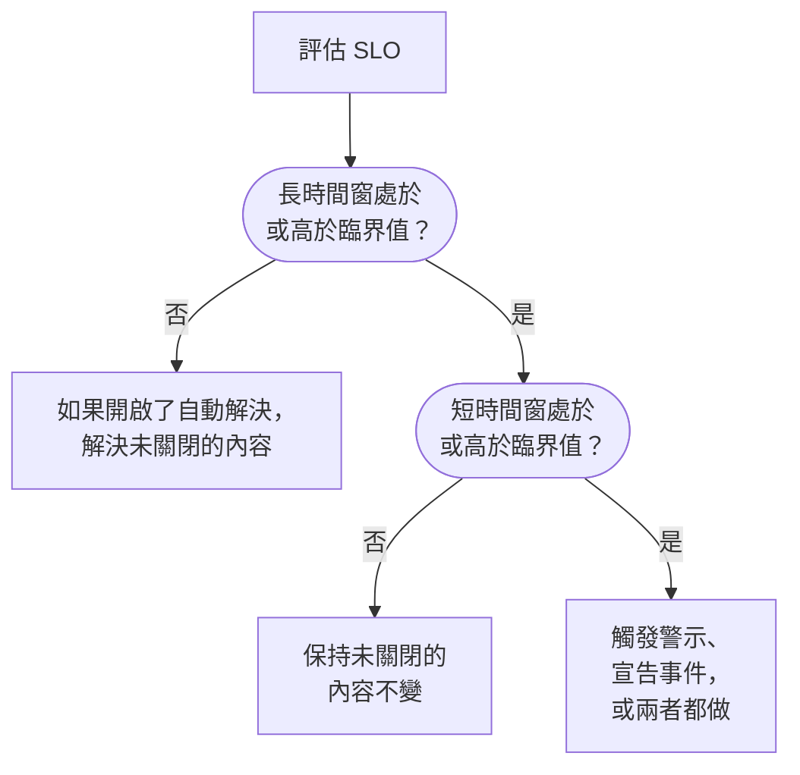

# 消耗率警示與事件

錯誤預算告訴您現在的位置；消耗率規則告訴您什麼時候該起床。當 SLO 花錯誤預算的速度快到值得注意時，消耗率規則會觸發警示、宣告事件或兩者都做，並帶有您自己的標題和描述、嚴重性、擁有者、標籤、待命上報和工作區通知。

:::cards
- [規則如何決定觸發](#規則如何決定觸發): 兩個時間窗，都高於臨界值。
- [預設規則](#預設規則): Fast burn、Slow burn 和 Slow leak，依 SLO 的時間窗調整。
- [建立規則](#建立或編輯規則): 在 SLO 的 Burn Rate Rules 頁面上的五個步驟。
- [範本變數](#每個警示和事件的內容): 撰寫您自己的標題和描述。
:::

## 消耗率的意義

消耗率是與等速相比，您花錯誤預算的速度：

```text
burn rate = (share of time that was bad) ÷ (share of time the target allows to be bad)
```

消耗率為 1 時，您恰好在整個時間窗內花完預算，達成目標且一點不剩。數值越高，預算用完得越早。對於 30 天內 99.9% 的 SLO：

| 消耗率（如果持續） | 預算用完需要 |
| --- | --- |
| 1 | 30 天 |
| 2 | 15 天 |
| 6 | 5 天 |
| 14.4 | 約 2 天（50 小時） |

消耗率與剩餘多少預算無關。它回答的是「現在有多糟？」，而這正是決定是否呼叫某人所需要知道的。

若要改為依剩餘預算行動，例如在預算只剩四分之一時只發布可靠性工作，請為 SLO 設定 [錯誤預算策略](/docs/slo/error-budget-policy)。

## 規則如何決定觸發

OneUptime 在每次評估 SLO 時（每 5 分鐘）檢查每條已啟用的消耗率規則。每條規則在兩個時間窗上測量消耗率，只有兩者都處於或高於其臨界值時才會觸發：

- **長時間窗**（例如 1 小時）表示消耗是持續且顯著的，而不是一次檢查失敗。
- **短時間窗**（例如 5 分鐘）表示它仍在發生。沒有它，一小時前的尖峰會在恢復後很長一段時間仍持續發出警示。

這是 Google SRE Workbook 中的多時間窗、多消耗率模式，OneUptime 會為您設定好。



在 SLO 擁有完整一個長時間窗的監控歷史之前，規則無法觸發：否則監測器的第一次檢查失敗除以幾分鐘的歷史，會得到一個巨大的消耗率。因此新 SLO 在第一個小時內無法觸發 **Fast burn** 規則，在前六個小時內無法觸發 **Slow burn** 規則，在前三天內無法觸發 **Slow leak** 規則。如果之後 SLO 不再有那麼多歷史，例如其監測器被換成新的之後，規則會解決它開啟的內容，而不是讓其懸而未決。當 SLO 的任一監測器處於排定的維護中時，規則也不會觸發：請參閱[排定的維護](#排定的維護)。

## 預設規則

每個新 SLO 都會取得三條消耗率規則。對於 30 天時間窗：

| 規則 | 臨界值 | 長時間窗 | 短時間窗 | 觸發條件 |
| --- | --- | --- | --- | --- |
| **Fast burn** | 14.4× | 1 小時 | 5 分鐘 | 約 2% 的預算在一小時內消耗：大約 2 天就會用完。 |
| **Slow burn** | 6× | 6 小時 | 30 分鐘 | 約 5% 的預算在六小時內消耗：大約 5 天就會用完。 |
| **Slow leak** | 1× | 3 天 | 6 小時 | 約 10% 的預算在三天內消耗：到時間窗結束時就會用完。 |

Fast burn 和 Slow burn 屬於呼叫等級：它們以專案中最高的警示嚴重性觸發警示。Slow leak 屬於工單等級：它以專案中最低的警示嚴重性觸發警示。它能發現另外兩條規則永遠不會觸發的持續消耗：在 3× 時，99.9% 的預算 10 天就會用完，但只有 Slow leak 會觸發。它的警示解決後，會等待 24 小時（而不是其 3 天的長時間窗）才觸發下一個警示。

這些臨界值是依 30 天的預算計算的，因此 OneUptime 會依您的 SLO 時間窗進行調整。Fast burn 和 Slow burn 一律分別表示「1 小時內消耗 2% 的預算」和「6 小時內消耗 5% 的預算」：

| SLO 的時間窗 | Fast burn 臨界值 | Slow burn 臨界值 |
| --- | --- | --- |
| 7 天 | 3.36× | 1.4× |
| 28 天 | 13.44× | 5.6× |
| 30 天 | 14.4× | 6× |
| 90 天 | 43.2× | 18× |

Slow leak 一律表示「在其長時間窗內消耗 10% 的預算」。在 30 天或更長的時間窗上，它的長時間窗和短時間窗維持為 3 天和 6 小時，臨界值隨時間窗增大。在較短的時間窗上，它的長時間窗是 SLO 時間窗的十分之一，短時間窗又是長時間窗的十二分之一，因此臨界值維持在 1×。如果維持 3 天不變，臨界值會低於 1×，導致它在一個可望達成目標的 SLO 上觸發。

| SLO 的時間窗 | Slow leak 臨界值 | 長時間窗 | 短時間窗 |
| --- | --- | --- | --- |
| 7 天 | 1× | 16.8 小時 | 84 分鐘 |
| 28 天 | 1× | 2.8 天 | 5.6 小時 |
| 30 天 | 1× | 3 天 | 6 小時 |
| 90 天 | 3× | 3 天 | 6 小時 |

日曆月 SLO 使用 30 天的值。這些規則使用預設標題和描述，自動解決它們的警示，並且不新增擁有者或標籤。它們都不會宣告事件，因此升級 OneUptime 永遠不會開始替您宣告事件。您可以編輯、刪除它們，或新增自己的規則。

### 為現有 SLO 新增推薦規則

在引入 Slow leak 之前建立的 SLO 只有 Fast burn 和 Slow burn：升級 OneUptime 永遠不會自行新增一條會開始觸發警示的規則。只要 SLO 缺少三條預設規則中的任一條，其 **消耗速率規則** 頁面就會在表格上方的提示中列出缺少的規則。按一下提示中的 **新增推薦規則** 即可確切看到它要新增的內容（已依 SLO 的時間窗調整），然後確認。它只會新增缺少的規則，再按一下也不會新增任何內容。

如果 SLO 已有一條同名的規則，或一條長時間窗相同的規則，無論其處於開啟還是關閉狀態，該規則都算已存在。因此，您重新命名或調整過的預設規則永遠不會被重複新增。如果不想要某條預設規則，又不希望提示繼續推薦它，請保留該規則並將其停用，而不是刪除。您需要建立 SLO 消耗率規則的權限。它新增的每條規則都會發布到 SLO 的動態中，並記錄在其稽核日誌中，就像您自己建立的規則一樣。

### 一次為多個 SLO 新增推薦規則

若要為多個 SLO 新增推薦規則，請從 SLO 清單著手，而不是逐一開啟每個 SLO 自己的頁面。

:::steps
#### 選取 SLO

開啟 **SLOs**，選取要更新的 SLO。若要選取篩選器顯示的所有 SLO，請先選取整頁，再選取清單提供的全部相符項目。

#### 選擇新增推薦規則

開啟 **批次動作**，選擇 **新增推薦規則**。

#### 檢查要新增的內容並確認

在新增任何內容之前，確認對話方塊會統計所選 SLO 中有多少個會取得每條規則，這些規則已依各 SLO 自己的時間窗調整。如果時間窗不同的 SLO 取得的同一條規則形式不同，例如 7 天和 30 天 SLO 上的 Slow leak，確認對話方塊會列出每種形式及其臨界值、時間窗，以及取得該形式的 SLO。它也會說明有多少個 SLO 已擁有全部推薦規則，以及有多少個無法讀取。按一下 **新增推薦規則** 即可新增。
:::

每個 SLO 只會取得它缺少的規則，與它自己的 **消耗速率規則** 頁面新增時完全相同：以同樣的方式判斷規則是否已存在，並為每條規則發布一則動態、記錄一筆稽核日誌。結果會針對每個 SLO 說明是新增了規則、它已擁有全部推薦規則，還是未被變更以及原因，例如您無權變更的 SLO。某個 SLO 未被變更絕不會妨礙其他 SLO，對相同的 SLO 再次執行也不會新增任何內容。已封存的 SLO 不在清單中，也永遠不會被推薦這些規則，因為它們不會被評估：請先取消封存該 SLO。

指令碼也可以使用專案的 [API 金鑰](/docs/api-reference/api-reference) 透過 API 完成同樣的操作。針對單一 SLO 的要求接收 `{ "serviceLevelObjectiveId": "..." }`，並在 `rules` 中傳回規則。批次要求接收 `{ "serviceLevelObjectiveIds": ["..."] }`，每個要求最多 100 個 SLO，並在 `results` 中依要求的順序為每個 SLO 傳回一個項目：

| 要求 | 作用 |
| --- | --- |
| `POST /api/service-level-objective-burn-rate-rule/recommended-rules` | 列出 SLO 缺少的推薦規則。不寫入任何內容。 |
| `POST /api/service-level-objective-burn-rate-rule/recommended-rules/add` | 新增這些規則，並列出新增的內容。再次要求不會新增任何內容。 |
| `POST /api/service-level-objective-burn-rate-rule/recommended-rules/bulk` | 說明每個 SLO 缺少什麼：`Missing` 及缺少的規則、`NothingMissing`，或對您無權讀取的 SLO 傳回 `Refused`。不寫入任何內容。 |
| `POST /api/service-level-objective-burn-rate-rule/recommended-rules/bulk/add` | 逐一為每個 SLO 新增它缺少的規則：`Added` 及新增的規則、`NothingMissing`、`Refused`，或 `Failed` 及失敗前已新增的規則。再次要求只會新增仍然缺少的內容。 |

## 建立或編輯規則

您需要建立 SLO 消耗率規則的權限。

:::steps
### 開啟 Burn Rate Rules

開啟 SLO，在其側邊選單的 **規則** 區塊中前往 **消耗速率規則**，按一下 **建立SLO 消耗速率規則**，或編輯一條預設規則。

### 為規則命名

在 **規則** 中輸入 **名稱**，例如「Fast burn」。新規則為開啟狀態；之後若要讓它停止觸發，請在其編輯表單中關閉 **已啟用**。

### 設定消耗時間窗

在 **消耗視窗** 中設定 **消耗速率閾值**（例如 `14.4`）、**長視窗（分鐘）** 和 **短視窗（分鐘）**，還可以設定 **重複觸發抑制（分鐘）**。

### 選擇它宣告什麼

在 **宣告內容** 中回答 **觸發時**：**建立警示**（預設）、**宣告事件** 或 **兩者**。**將 SLO 擁有者新增為擁有者** 還會讓 SLO 的擁有者成為規則所建立一切內容的擁有者。

### 描述警示和事件

**警示** 和 **事件** 步驟只會針對規則會宣告的內容出現。每個步驟都有標題和嚴重性，以及摺疊的區段：**描述**、**擁有權與標籤**、**待命** 和 **更多欄位**，後者包含自動解決、隱私和修復說明。新規則從預設標題和描述開始，可直接編輯。在最後一步按一下 **建立SLO 消耗速率規則**。
:::

OneUptime 在儲存規則時會檢查其數值：

| 設定 | 必須 |
| --- | --- |
| **消耗速率閾值** | 大於 0。 |
| **短視窗（分鐘）** | 大於 0。 |
| **長視窗（分鐘）** | 比短時間窗長。 |
| **重複觸發抑制（分鐘）** | 0 或更大。留空表示長時間窗的時長。 |

**觸發時** 的每個答案都會建立內容。既不建立警示也不宣告事件的規則會被 API 拒絕，因為它會在每次評估時被檢查卻從不宣告任何內容。

規則表格會顯示每條規則的臨界值、時間窗和抑制、它宣告的內容（以及警示或事件是否只能手動解決或是否為私人）、嚴重性、待命政策、擁有者和標籤。

> [!TIP]
> 一個好的起點：保留三條預設規則，把快速消耗規則以高嚴重性傳送到會呼叫人的待命政策，讓慢速消耗規則為上班時間觸發嚴重性較低的警示，並把慢速洩漏規則留作負責團隊的工單。如果您的團隊以事件方式運作，請為快速消耗規則選擇 **宣告事件**，若還想收到警示，就選擇 **兩者**。

## 規則宣告什麼

|  | **警示** | **事件** |
| --- | --- | --- |
| 由哪個答案建立 | **建立警示**（預設）或 **兩者** | **宣告事件** 或 **兩者** |
| 性質 | 輕量訊號：進入警示清單。 | 重量訊號：取得事件編號並啟動整個回應流程。 |
| 標題和描述 | 自訂，或預設文字 | 自訂，或預設文字 |
| 嚴重性 | **警示嚴重性**：留空時為專案中最高的 | **事件嚴重性**：留空時為專案中最高的 |
| 上報 | **警示待命策略** | **事件待命策略** |
| 擁有者和標籤 | **警示擁有者** 和 **警示標籤** | **事件擁有者** 和 **事件標籤** |
| 私人 | 關閉 | 關閉 |
| 自動解決 | 開啟 | 開啟 |
| 狀態頁 | 從不發布 | 從不發布 |

由於兩者分別設定，您可以把簡短的警示傳給負責團隊的輪值，把詳細的事件傳給重大事件的輪值。它們也各自獨立：每個都個別去重複、解決和抑制，因此解決事件不會重設警示的抑制，反之亦然。

### SLO 是受影響的資源

消耗率規則建立的每個警示和事件都會在 **受影響的資源** 下列出其 SLO 並連結到它。警示和事件清單的 **受影響的資源** 篩選器可將其限定為某個 SLO，SLO 的 **警示** 和 **事件** 頁面會列出它們，側邊選單中的徽章統計未關閉的數量。這個連結由 OneUptime 自行建立，編輯警示或事件永遠不會移除它。

### 消耗率事件保持內部

快速消耗的錯誤預算是給工程團隊的訊號，而不是已宣告的中斷。消耗率事件從不顯示在狀態頁上，也從不通知狀態頁訂閱者。它也不會連結任何監測器，否則解決它會改寫 SLO 賴以測量的那份監測器狀態歷史。

如果您手動解決這樣的事件，在消耗恢復且規則真正再次觸發之前，什麼都不會再次宣告它，因此您在處理事件時永遠不必和規則角力。

## 每個警示和事件的內容

新規則的警示和事件都從預設標題和描述開始。清空標題或描述即可恢復預設文字。預設標題為：

```text
SLO burn rate: {{sloName}} — {{ruleName}}
```

預設描述會寫出規則名稱、兩個時間窗的消耗率與臨界值的對照，以及剩餘的錯誤預算。

要自行撰寫，請在標題、描述和修復說明中使用範本變數。每個欄位都會在 **範本變數** 下列出這些變數：按一下即可插入到游標處，也可以在欄位中輸入 `{{` 再選擇。描述和修復說明的工具列中還有 **插入變數**。變數會在規則觸發時填入：

| 變數 | 包含內容 | 範例 |
| --- | --- | --- |
| `{{sloName}}` | SLO 的名稱。 | `Checkout availability` |
| `{{sloId}}` | SLO 的 ID。 | `b7f4c2d8-1f3e-4a5b-9c6d-7e8f9a0b1c2d` |
| `{{sloLink}}` | OneUptime 儀表板中該 SLO 的連結。 | `https://oneuptime.com/dashboard/project-id/slos/slo-id` |
| `{{sloStatus}}` | 本次評估後 SLO 的狀態。 | `At Risk` |
| `{{ruleName}}` | 觸發的消耗率規則名稱。 | `Fast burn` |
| `{{burnRateThreshold}}` | 規則的消耗率臨界值（可持續速度的倍數）。 | `14.4` |
| `{{longWindowBurnRate}}` | 在規則的長時間窗上測得的消耗率。 | `21.5` |
| `{{shortWindowBurnRate}}` | 在規則的短時間窗上測得的消耗率。 | `36` |
| `{{longWindowInMinutes}}` | 規則長時間窗的時長，以分鐘計。 | `60` |
| `{{shortWindowInMinutes}}` | 規則短時間窗的時長，以分鐘計。 | `5` |
| `{{targetPercentage}}` | SLO 的目標，以百分比表示。 | `99.9` |
| `{{currentSliPercentage}}` | 在 SLO 合規時間窗上測得的 SLI，以百分比表示。 | `99.87` |
| `{{errorBudgetRemainingPercentage}}` | 仍可用的錯誤預算所占比例，以百分比表示。預算超支時為負數。 | `42.5` |
| `{{errorBudgetRemaining}}` | 仍可用的錯誤預算，以時長表示。預算超支時以負號開頭。 | `18m 22s` |
| `{{errorBudgetRemainingMinutes}}` | 仍可用的錯誤預算，以分鐘計。 | `18.37` |
| `{{windowDescription}}` | 以文字描述的 SLO 合規時間窗。 | `rolling 30-day window` |
| `{{policyTier}}` | 本次評估後 SLO 所在的錯誤預算策略級別名稱。不在任何級別時為「None」。 | `Reliability first` |
| `{{policyTierThresholdPercentage}}` | 該級別的剩餘預算臨界值，以百分比表示。SLO 不在任何級別時為空。 | `25` |
| `{{policyTierWhatWeDo}}` | 團隊約定在該級別要做的事，與級別中寫的相同。SLO 不在任何級別時為空。 | `Only reliability work and critical fixes ship.` |

例如，標題 `{{ruleName}}: {{sloName}} is burning {{longWindowBurnRate}}x` 會變成 `Fast burn: Checkout availability is burning 21.5x`。

:::details 變數如何填入
- 數字四捨五入到小數點後兩位。
- 大括號內的空格沒有影響：`{{ sloName }}` 也能使用。
- 拼錯的變數會原樣保留，這樣拼字錯誤會出現在警示中，而不是無聲無息地消失。
- 標題最多 500 個字元，描述和修復說明最多 50,000 個字元。填入變數後超過 500 個字元的標題會合併為一行並以省略號截短，因此警示或事件仍會被建立。
- 如果規則觸發時無法產生 SLO 的連結，`{{sloLink}}` 會維持空白，警示或事件仍會被建立。
:::

## 擁有者、標籤和隱私

- **警示擁有者** 和 **事件擁有者** 是透過 **新增擁有者** 從同一份清單中選擇的人員和團隊。它們會在警示或事件建立後立即被新增，並收到通知。人員必須是專案成員。
- **將 SLO 擁有者新增為擁有者** 還會把 SLO 的擁有者（其擁有者使用者和擁有者團隊的成員）新增到規則建立的一切內容中。SLO 的擁有者本來就會收到 SLO 本身狀態變化的通知，因此這可能會讓他們收到兩次通知。預設為關閉。
- 每位擁有者只會新增一次：已經是警示或事件擁有者的使用者（例如透過專案的擁有者規則），或屬於某個已新增擁有者團隊的使用者，不會被重複新增。
- **警示標籤** 和 **事件標籤** 會加到警示或事件上，讓篩選器、擁有者規則和工作區通知規則可以比對它們。
- 私人警示或事件只對其擁有者、專案管理員和專案擁有者可見。

標籤、擁有者團隊和待命政策必須屬於 SLO 所在的專案。

## 解決與重複觸發抑制

- **解決會跟隨長時間窗。** 開啟自動解決時（預設），一旦長時間窗的消耗率降到臨界值以下，OneUptime 就會解決規則的警示和事件。依短時間窗解決會導致來回跳動：時斷時續的中斷會在安靜五分鐘後被解決，然後整夜反覆呼叫人。
- **關閉自動解決。** 關閉 **自動解決警示** 或 **自動解決事件** 後，該記錄會一直維持未關閉，直到有人解決它，即使消耗已經恢復。規則不會在其上再開啟一個，一旦被手動解決且長時間窗低於臨界值，規則在抑制期過後可以再次觸發。
- **重複觸發抑制。** 記錄解決後，規則在抑制期內（預設為長時間窗的時長）不會再次宣告同類記錄。這樣正在恢復的系統就有時間恢復，而不會因殘留的雜訊呼叫任何人。Slow leak 建立時的抑制期是 24 小時，而不是其 3 天的長時間窗，因此再次出現的洩漏會在隔天再次被回報。

有些變更一定會解決規則開啟的內容，無論其自動解決設定為何，以免因一條已無法自圓其說的規則而持續上報：

- 變更 **觸發時** 以拿掉警示或事件，會關閉該輸出開啟的內容；
- 關閉或刪除規則；
- 關閉 SLO 的評估、封存 SLO 或刪除它；
- SLO 變為 **已暫停** 或 **設定錯誤**，因為此時它不測量任何內容；
- 規則失去其臨界值或時間窗，或 SLO 不再擁有完整一個長時間窗的歷史。

## 排定的維護

當 SLO 的某個監測器處於進行中的維護事件時，其消耗率規則不會觸發警示，也不會宣告事件：計畫內的工作不應呼叫任何人。規則已經開啟的內容仍會照常解決。這段時間仍會依 SLO 的停機狀態計入錯誤預算。

## SLO 的動態

SLO 的 **動態** 會發布規則觸發的每個警示和宣告的每個事件，附帶連結和解釋它的消耗率，並在每個被自動或手動解決時發布。因為仍未關閉而被規則重新接手的記錄不會發布兩次。建立、編輯和刪除規則也會被發布，並記錄在 SLO 的 **稽核日誌** 中。請參閱 [SLO 動態與稽核日誌](/docs/slo/feed-and-audit-logs)。

## 疑難排解

:::details 建立 SLO 後規則沒有立即觸發
只有當 SLO 擁有完整一個長時間窗的監控歷史時，規則才會觸發：預設快速消耗規則為一小時，慢速消耗規則為六小時，慢速洩漏規則為三天（SLO 時間窗短於 30 天時為 SLO 時間窗的十分之一）。
:::

:::details 中斷仍在持續時警示被解決了
自動解決會跟隨長時間窗：一旦長時間窗的消耗率降到臨界值以下，警示就會被解決。為規則設定更長的長時間窗，或關閉 **自動解決警示** 並手動解決警示。
:::

:::details 維護事件期間什麼都沒有觸發
當 SLO 的任一監測器處於進行中的維護事件時，消耗率規則保持靜默。停機時間仍會計入預算。
:::

:::details 有最小樣本數嗎？
對於以監測器可用性測量的 SLO 沒有。可用性以秒為單位測量，因此時間窗中的每一秒都是一個樣本，不存在需要防範的低流量情況。最小樣本數只對以事件為基礎的 SLI 有意義，而這類 SLI 目前尚未提供。
:::

## 後續步驟

:::cards
- [錯誤預算](/docs/slo/error-budget): 預算是什麼以及能撐多久。
- [錯誤預算策略](/docs/slo/error-budget-policy): 依剩餘預算逐級行動。
- [上報規則](/docs/on-call/escalation-rules): 呼叫誰，以及依什麼順序。
- [SLO 動態與稽核日誌](/docs/slo/feed-and-audit-logs): 規則觸發的每個警示和事件。
:::
