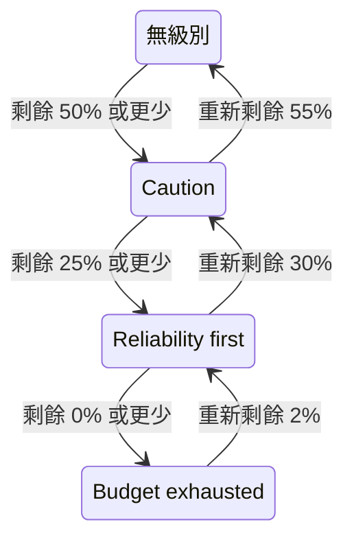

# 錯誤預算策略

錯誤預算策略寫下團隊約定在 SLO 的錯誤預算減少時要做的事，例如在用掉一半時審查有風險的變更，或在全部用完時凍結發布。OneUptime 會把 SLO 放到其預算已到達的策略級別，在 SLO 的頁面上顯示團隊對該級別的約定，可以在 SLO 進入某個級別時觸發警示或宣告事件，把每次級別變化發布到你選擇的 Slack、Microsoft Teams 或 Mattermost 頻道，並告訴你的 CI/CD 管線是否要暫緩發布。這是 [Google SRE Workbook](https://sre.google/workbook/error-budget-policy/) 中的錯誤預算策略實務。

:::cards
- [級別如何運作](#級別如何運作): 哪個級別生效，以及 SLO 何時離開它。
- [設定策略](#設定策略): 從建議策略開始，或撰寫自己的級別。
- [警示和事件](#警示和事件): 在 SLO 進入某個級別時通知團隊。
- [發布到 Slack、Microsoft Teams 和 Mattermost](#發布到-slackmicrosoft-teams-和-mattermost): 在 SLO 進入某個級別時告知頻道，不呼叫任何人。
- [部署閘門](#部署閘門): 在某個級別凍結部署期間，讓 CI/CD 暫緩發布。
- [透過 API 讀取級別](#透過-api-讀取級別): 從 CI 和指令碼檢查級別。
:::

## 級別如何運作

策略是一組級別。每個級別有三個欄位：

| 欄位 | 內容 |
| --- | --- |
| **名稱** | 團隊為級別取的名字，例如「Reliability first」。 |
| **剩餘預算閾值 (%)** | 剩餘錯誤預算的比例等於或低於此值時，該級別生效。範圍為 0 到 100，可以有小數。SLO 的每個級別都有自己的臨界值。 |
| **我們的做法** | SLO 處於該級別期間團隊約定要做的事，使用 Markdown。必填，最多 10,000 個字元。 |

只要剩餘預算等於或低於某個級別的臨界值，該級別就生效，因此 0% 的級別就是預算耗盡時的級別。多個級別同時生效時，SLO 處於臨界值最低的級別，也就是最嚴重的級別。沒有級別生效時，SLO 不在任何級別。如果有 50%、25% 和 0% 三個級別，剩餘 30% 預算的 SLO 處於 50% 的級別，剩餘 10% 的 SLO 處於 25% 的級別。

級別還可以在 SLO 處於其中期間凍結部署：請參閱 [部署閘門](#部署閘門)。

### 進入和離開級別

級別跟隨剩餘預算的方式與 SLO 的狀態相同：

- 進入級別是立即的：發現預算等於或低於某個級別臨界值的那次評估會把 SLO 放進該級別。一次跌破多個臨界值的預算會直接進入最嚴重的級別。
- 離開某個級別、進入較輕的級別，要等到預算明顯恢復。0% 的級別在預算重新剩餘 2% 時離開。其他級別在預算比其臨界值高出 5 個百分點時離開。

因此，0% 的級別與 **預算已耗盡** 狀態同步變化，位於 SLO 風險臨界值的級別與 **有風險** 同步變化：請參閱 [狀態變化與風險臨界值](/docs/slo/error-budget#狀態變化與風險臨界值)。在臨界值附近來回波動的滾動時間範圍不會讓級別來回切換。



## 設定策略

你需要建立 SLO 錯誤預算策略級別的權限。

:::steps
### 開啟 錯誤預算策略

開啟 SLO，在其側邊選單的 **規則** 區段中前往 **錯誤預算策略**。該頁面列出 SLO 的級別，每個級別都會顯示名稱、生效時的剩餘預算，以及團隊要做的事。

### 從建議策略開始

只要 SLO 還沒有級別，頁面就會提供 **使用推薦的策略**。按一下它，檢查它列出的三個級別，然後確認。之後再把每個級別的文字改成團隊自己的約定。

### 或者自行新增級別

按一下 **建立SLO 錯誤預算策略級別**。輸入 **名稱** 和 **剩餘預算閾值 (%)**，並在 **我們的做法** 中寫下團隊的約定。如果管線應在 SLO 處於該級別期間暫緩發布，請開啟 **凍結部署**。

### 選擇級別要觸發什麼

級別會記錄並顯示約定。若還要在 SLO 進入該級別時通知某人，請開啟摺疊的警示和事件設定，開啟警示、事件或兩者。兩者預設都是關閉的。請參閱 [警示和事件](#警示和事件)。
:::

新增、編輯或刪除級別會立即生效：OneUptime 會在大約一分鐘內重新評估 SLO。如果預算已經等於或低於某個級別的臨界值，SLO 隨即進入該級別，該級別會觸發它被設定要觸發的內容。關閉或刪除某個級別會解決它觸發的內容，SLO 會轉到其預算所在的級別。關閉某個級別的警示或事件會解決該警示或事件。

### 建議策略

**使用推薦的策略** 會在預算的一半、四分之一和零處新增三個級別，使用以下英文文字：

| 級別 | 生效條件 | 團隊要做的事 | 部署 |
| --- | --- | --- | --- |
| **Caution** | 剩餘 50% 或更少 | Half of the error budget is spent. Review risky changes before they ship, and find out what has been spending the budget. | 允許 |
| **Reliability first** | 剩餘 25% 或更少 | Reliability comes first. Only reliability improvements and critical fixes ship until the budget recovers. | 允許 |
| **Budget exhausted** | 剩餘 0% 或更少 | The error budget is spent. Freeze non-critical releases: only fixes for this SLO's reliability and security fixes ship until the budget is back. | 已凍結 |

在你開啟之前，它們都不會觸發警示或宣告事件。**Budget exhausted** 會凍結部署，正如它的約定所說，確認視窗中也會如此標示它：請參閱 [部署閘門](#部署閘門)。在部署閘門推出之前新增的級別不會凍結任何部署，除非你為它們開啟該開關。只會新增 SLO 還沒有的級別：名稱相同或臨界值相同的級別，無論開啟與否，都算已存在。因此，從第二個分頁或透過 API 要求兩次，也不會重複新增任何內容。如果其中某個級別無法新增，就一個也不會新增：SLO 保持原樣，你可以再試一次。以這種方式新增的每個級別，都會在 SLO 的稽核日誌中記錄為由你新增。

## 級別顯示在哪裡

- SLO 的 **概覽** 顯示它所處的級別，以及團隊在那裡約定要做的事，讓每個開啟 SLO 的人都能看到目前有效的約定。當該級別凍結部署時，其名稱下方的紅色徽章會顯示從何時開始凍結。
- **錯誤預算燃盡** 圖表會在每個級別的臨界值處畫一條附標籤的線，與風險臨界值的線並列。
- SLO 的 **動態** 會發布每次級別變化：SLO 離開的級別和進入的級別、剩餘預算、團隊約定在新級別要做的事，以及這次變化是凍結了部署還是重新允許了部署。
- 你的規則指定的 Slack、Microsoft Teams 和 Mattermost 頻道會收到同樣的訊息：請參閱 [發布到 Slack、Microsoft Teams 和 Mattermost](#發布到-slackmicrosoft-teams-和-mattermost)。
- SLO 的 **稽核日誌** 會把每次級別變化，以及每次部署被凍結或重新被允許，記錄為 OneUptime 自身做出的變更，因此只有在開啟 **儲存系統事件** 時才會顯示：請參閱 [開啟稽核日誌](/docs/slo/feed-and-audit-logs#開啟稽核日誌)。新增、編輯和移除級別會以操作者本人的名義記錄。
- SLO 的讀取 API 會傳回級別，以及是否允許部署：請參閱 [透過 API 讀取級別](#透過-api-讀取級別) 和 [部署閘門](#部署閘門)。

## 警示和事件

每個級別都可以在 SLO 進入它時觸發警示、宣告事件或兩者都做。它們的選項與消耗率規則的警示和事件相同：嚴重性、待命策略、標題、描述和修復說明的範本、私密、自動解決、標籤、擁有者團隊和擁有者使用者，以及把 SLO 的擁有者新增為擁有者。請參閱 [規則宣告什麼](/docs/slo/burn-rate-alerts#規則宣告什麼)。兩者預設都是關閉的，因此在你開啟其中一個之前，級別不會通知任何人。

- 進入更嚴重的級別會解決上一個級別觸發的內容，無論其自動解決設定如何，因為新級別取代了它。因此，同一時間最多只有一個級別的警示和事件處於開啟狀態，而且它們屬於 SLO 所處的級別。
- 恢復到較輕的級別或離開所有級別時，如果該級別的自動解決已開啟（預設開啟），它們會被解決。自動解決關閉時，它們會一直保持開啟，直到有人解決。
- 沒有重複觸發抑制。級別只有在 SLO 明顯離開它、然後再次進入之後才會再次觸發，因此不會反覆跳動。如果在 SLO 仍處於該級別時有人手動解決了它觸發的內容，該內容會保持已解決。
- 只要 SLO 的任何監測器處於排定的維護中，級別就不會觸發任何內容。級別本身仍會變化，已開啟的內容也仍會被解決。如果維護結束時 SLO 仍處於該級別，級別會在那時觸發它被設定要觸發的內容。

與消耗率規則一樣，級別觸發的警示或事件會在 **受影響的資源** 下列出 SLO，而且事件永遠不會顯示在狀態頁上。SLO 的動態會發布每一個警示和事件，以及它們何時被解決。

### 它們的內容

級別的標題、描述和修復說明可以使用範本變數，與規則相同：請參閱 [每個警示和事件的內容](/docs/slo/burn-rate-alerts#每個警示和事件的內容)。級別的欄位提供 SLO 及其預算的變數，以及級別自己的三個變數：`{{sloName}}`、`{{sloId}}`、`{{sloLink}}`、`{{sloStatus}}`、`{{policyTier}}`、`{{policyTierThresholdPercentage}}`、`{{policyTierWhatWeDo}}`、`{{targetPercentage}}`、`{{currentSliPercentage}}`、`{{errorBudgetRemainingPercentage}}`、`{{errorBudgetRemaining}}`、`{{errorBudgetRemainingMinutes}}` 和 `{{windowDescription}}`。規則自己的變數，例如 `{{ruleName}}` 和消耗率，不會提供，在級別的範本中為空。

這三個級別變數在消耗率規則的範本中同樣可用：

| 變數 | 內容 |
| --- | --- |
| `{{policyTier}}` | 評估後 SLO 所處級別的名稱，不在任何級別時為 `None`。 |
| `{{policyTierThresholdPercentage}}` | 該級別的臨界值，例如 `25`。SLO 不在任何級別時為空。 |
| `{{policyTierWhatWeDo}}` | 團隊約定在該級別要做的事。SLO 不在任何級別時為空。 |

標題留空的級別會使用內建標題：

```text
SLO error budget policy: {{sloName}} — {{policyTier}}
```

內建描述會說明級別，把剩餘預算與級別的臨界值比較，並說明團隊約定在該級別要做的事。

## 發布到 Slack、Microsoft Teams 和 Mattermost

規則可以把 SLO 錯誤預算策略的每次變化發布到團隊關注的 Slack、Microsoft Teams 或 Mattermost 頻道，而不呼叫任何人：在 SLO 進入某個級別、恢復到較輕的級別或離開所有級別時，以及在其部署被凍結或重新被允許時。每條規則各自選擇適用於哪些 SLO、要發布哪些變化。請先把工作區連接到專案：請參閱 [Slack](/docs/workspace-connections/slack)、[Microsoft Teams](/docs/workspace-connections/microsoft-teams) 或 [Mattermost](/docs/workspace-connections/mattermost)。

:::steps
### 開啟 SLOs 選單的工作區區段

前往 **SLOs** → **工作區** → **Slack**、**Microsoft Teams** 或 **Mattermost**。 **工作區** 區段只列出你的專案已連接的聊天工作區。

### 建立規則

按一下 **建立SLO 通知規則**，並為它填寫 **規則名稱**。在 **哪些 SLO** 下，保留 **所有 SLO**，或選擇 **僅符合條件的 SLO** 並新增條件：請參閱 [規則比對什麼](#規則比對什麼)。

### 選擇發布位置

在 **然後，在 Slack 中** 下，填寫規則要發布到的頻道名稱。在 Microsoft Teams 中，選擇一個團隊及其頻道，或已新增 OneUptime 應用程式的聊天。SLO 不會有專屬的頻道，因此規則只會發布到你已有的頻道和聊天。
:::

訊息會用 SLO 的 **動態** 中的措辭說明這次變化：SLO 離開的級別和進入的級別、部署如何變化、剩餘錯誤預算、新級別的臨界值，以及團隊約定在該級別要做的事，與團隊所寫的原文一致。該約定中的提及（例如 `<!channel>`）會以文字發布，不會通知任何人。

- 每次變化只發布一次，在產生它的那次評估儲存之後發布。未儲存的評估不會發布任何內容，下一次評估會發布這次變化。
- 只要 SLO 停留在其級別中，無論預算在臨界值附近徘徊多久，都不會發布任何內容：請參閱 [進入和離開級別](#進入和離開級別)。
- 為 SLO 所處的級別開啟或關閉 **凍結部署**，會另外發布一則訊息。
- 已暫停、設定錯誤、已停用或已封存的 SLO 會保留其級別，不會發布任何內容。
- 無法傳送的訊息會記錄在日誌中，評估、SLO 的動態以及級別觸發的內容都會照常進行，不受影響。

### 規則比對什麼

| 條件 | 比對內容 |
| --- | --- |
| **SLOs** | 你選擇的 SLO，或除了它們以外的所有 SLO。 |
| **SLO 標籤** | SLO 的標籤：包含你選擇的標籤中的任一個、全部，或都不包含。 |
| **SLO 名稱** | SLO 的名稱：等於或不等於你的文字、包含或不包含它、以它開頭或結尾。 |
| **錯誤預算策略變更** | 發生了什麼變化：**進入更嚴重的級別**、**恢復到較輕的級別**、**離開所有級別**、**部署已凍結** 或 **部署已重新允許**。 |
| **SLO 擁有者** | 登記為 SLO 擁有者的人員和團隊：包含你選擇的任一個，或都不包含。屬於擁有該 SLO 的團隊並不算數。 |

凍結了部署或重新允許了部署的級別變化只發一則訊息，它同時算作這兩種變化。因此，針對 **部署已凍結** 的規則也會發布進入凍結部署級別的那次變化：負責版本發布的頻道會得知每一次凍結。

## 預算未被測量時

- **已暫停** 或 **設定錯誤** 的 SLO 不測量預算，因此它的級別保持不變，級別觸發的內容也會保持開啟，直到恢復測量。消耗率規則則相反，此時會解決它們已開啟的內容。
- 關閉 SLO 的評估或封存 SLO，會解決其級別觸發的內容。SLO 所處的級別保持不變。
- 刪除 SLO 會刪除其級別，並解決它們觸發的內容。
- 在以上每種情況下，SLO 都會保留它對部署給出的答覆，因為它保留了自己的級別：請參閱 [部署閘門](#部署閘門)。

## 部署閘門

級別可以凍結部署。當 SLO 處於開啟了 **凍結部署** 的級別時，SLO 的 `deploymentsAllowed` 欄位為 `false`，因此在發布前檢查它的 CI/CD 管線會暫緩這次發布。其他情況下它為 `true`：SLO 沒有策略時、其預算高於所有級別時，以及處於不凍結部署的級別時。建議策略中的 **Budget exhausted** 級別會凍結部署。

:::steps
### 開啟 凍結部署

開啟 SLO 的 **錯誤預算策略**，編輯該級別，開啟 **凍結部署** 並儲存。表格中該級別的 **部署** 欄會顯示 **已凍結**。

### 給管線一把金鑰

建立一把能讀取該 SLO 的專案 [API 金鑰](/docs/api-reference/api-reference)，並把它存為管線中名為 `ONEUPTIME_API_KEY` 的機密。

### 在發布前檢查 SLO

把下面的檢查新增為部署步驟之前的一個步驟，並用 SLO 的 ID 取代 `<slo-id>`。
:::

:::tabs
@tab Shell
```bash
ALLOWED=$(curl -sS -X POST 'https://oneuptime.com/api/service-level-objective/<slo-id>/get-item' \
  -H "ApiKey: $ONEUPTIME_API_KEY" \
  -H 'Content-Type: application/json' \
  -d '{ "select": { "deploymentsAllowed": true } }' | jq -r '.deploymentsAllowed')
[ "$ALLOWED" = "true" ]
```
@tab GitHub Actions
```yaml title=".github/workflows/deploy.yml"
name: Deploy
on:
  push:
    branches: [main]

jobs:
  deploy:
    runs-on: ubuntu-latest
    steps:
      - uses: actions/checkout@v4
      - name: Stop while the error budget policy freezes deployments
        env:
          ONEUPTIME_API_KEY: ${{ secrets.ONEUPTIME_API_KEY }}
          SLO_ID: <slo-id>
        run: |
          SLO=$(curl -sS -X POST "https://oneuptime.com/api/service-level-objective/$SLO_ID/get-item" \
            -H "ApiKey: $ONEUPTIME_API_KEY" \
            -H 'Content-Type: application/json' \
            -d '{ "select": { "deploymentsAllowed": true, "currentErrorBudgetPolicyTierName": true } }')
          if [ "$(echo "$SLO" | jq -r '.deploymentsAllowed')" != "true" ]; then
            echo "Not deploying: $SLO"
            exit 1
          fi
      - name: Deploy
        run: ./deploy.sh
```
@tab GitLab CI
```yaml title=".gitlab-ci.yml"
error-budget-gate:
  stage: test
  image: alpine:3.20
  variables:
    SLO_ID: <slo-id>
  before_script:
    - apk add --no-cache curl jq
  script:
    - >
      SLO=$(curl -sS -X POST "https://oneuptime.com/api/service-level-objective/$SLO_ID/get-item"
      -H "ApiKey: $ONEUPTIME_API_KEY"
      -H 'Content-Type: application/json'
      -d '{ "select": { "deploymentsAllowed": true, "currentErrorBudgetPolicyTierName": true } }')
    - echo "$SLO"
    - test "$(echo "$SLO" | jq -r '.deploymentsAllowed')" = "true"
```
:::

只有當答覆為 `true` 時，檢查才會通過。被凍結的 SLO、不含該欄位的答覆（金鑰無法讀取該 SLO，或 ID 錯誤）以及完全沒有答覆，都會讓該步驟停止，因此管線絕不會依據它沒有取得的答覆進行發布。在 GitLab CI 中，該工作在 test 階段執行，因此被凍結的 SLO 會讓其後的 deploy 階段停止；請把 `ONEUPTIME_API_KEY` 新增為已遮罩的 CI/CD 變數。在自行託管的安裝上，請改用它自己的位址，而不是 oneuptime.com。

SLO 以兩個欄位作答，使用 SLO 自身的讀取權限讀取：

| 欄位 | 內容 |
| --- | --- |
| `deploymentsAllowed` | SLO 處於凍結部署的級別時為 `false`，否則為 `true`。 |
| `deploymentsFrozenAt` | 部署被凍結的時間。允許部署期間為空。 |

答覆如何變化：

- 把 SLO 放進凍結部署的級別的那次評估會凍結部署，把它帶出該級別的那次評估會重新允許部署，並沿用該級別自己的恢復餘裕：請參閱 [進入和離開級別](#進入和離開級別)。從一個凍結部署的級別轉到另一個凍結部署的級別時，部署保持凍結，`deploymentsFrozenAt` 也保留原來的時間。
- 為 SLO 所處的級別開啟或關閉 **凍結部署**，會在大約一分鐘內生效。若要在預算恢復之前發布，請關閉它：這次變更會以你的名義記錄在 SLO 的稽核日誌中。
- **已暫停** 或 **設定錯誤** 的 SLO 會保留原有的答覆，就像它保留自己的級別一樣：讓所有監測器都暫停的維護時段既不會解除凍結，也不會開始凍結。已停用或已封存的 SLO 根本不會被評估，因此也會保留它的答覆。
- 部署被凍結期間，SLO 的 **概覽** 會顯示從何時開始凍結，其 **動態** 會說明部署何時被凍結、何時重新被允許。

## 透過 API 讀取級別

SLO 自身的讀取 API 會傳回它所處的級別，讓 CI 工作或指令碼可以在行動之前檢查它，例如在發布之前。只要 SLO 不在任何級別，這三個欄位都為空：

| 欄位 | 內容 |
| --- | --- |
| `currentErrorBudgetPolicyTierId` | 級別的 ID。 |
| `currentErrorBudgetPolicyTierName` | 級別的名稱。 |
| `currentErrorBudgetPolicyTierEnteredAt` | SLO 進入該級別的時間。 |

這些欄位使用 SLO 自身的讀取權限讀取，與讀取其預算所需的權限相同。例如，使用專案的 [API 金鑰](/docs/api-reference/api-reference)：

```bash
curl -X POST 'https://oneuptime.com/api/service-level-objective/<slo-id>/get-item' \
  -H "ApiKey: $ONEUPTIME_API_KEY" \
  -H 'Content-Type: application/json' \
  -d '{ "select": { "name": true, "errorBudgetRemainingPercentage": true, "currentErrorBudgetPolicyTierName": true, "currentErrorBudgetPolicyTierEnteredAt": true } }'
```

級別本身是一個獨立的資源 `/api/service-level-objective-error-budget-policy-tier`，具有每個資源都有的列出、讀取、建立、變更和刪除要求。另有兩個要求用於建議策略。兩者都接收 `{ "serviceLevelObjectiveId": "..." }`，並在 `tiers` 中傳回級別：

| 要求 | 作用 |
| --- | --- |
| `POST /api/service-level-objective-error-budget-policy-tier/recommended-policy` | 列出 SLO 缺少的建議級別。不寫入任何內容。 |
| `POST /api/service-level-objective-error-budget-policy-tier/recommended-policy/add` | 新增這些級別，並列出新增的內容。再次要求不會新增任何內容。 |

## 權限

| 權限 | 允許角色 |
| --- | --- |
| **Read SLO Error Budget Policy Tier** | 檢視 SLO 的級別。 |
| **Create SLO Error Budget Policy Tier** | 手動或透過 **使用推薦的策略** 新增級別。 |
| **Edit SLO Error Budget Policy Tier** | 變更級別，並開啟或關閉它們。 |
| **Delete SLO Error Budget Policy Tier** | 移除級別。 |

這些權限位於角色的 SLO 群組中。Project Owner 和 Project Admin 角色擁有全部權限，Project Member 和 Viewer 角色可以讀取級別。

## 尚未提供

錯誤預算策略的部分功能尚未提供：每個級別專屬的工作流程觸發器、由多個 SLO 共用的策略、確認某個級別或為其設定例外，以及依據預算剩餘時間而非剩餘預算的級別。OneUptime 不會自行阻止發布：阻止發布的是檢查 `deploymentsAllowed` 的管線，正如 [部署閘門](#部署閘門) 所示。

## 後續步驟

:::cards
- [錯誤預算](/docs/slo/error-budget): 預算是什麼，以及狀態如何跟隨預算。
- [消耗率警示與事件](/docs/slo/burn-rate-alerts): 在預算消耗過快時通知團隊。
- [SLO 動態與稽核日誌](/docs/slo/feed-and-audit-logs): 每次級別變化，以及級別觸發的內容。
:::
