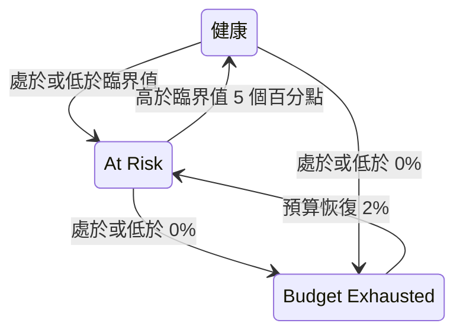

# 錯誤預算

錯誤預算是 SLO 目標所允許的停機時間。99.9% 的目標並不代表「永不停機」，而是代表「30 天內最多可以停機 43 分鐘，所以要花得明智」。本頁說明 OneUptime 如何計算預算、預算能撐多久、如何恢復，以及誰會收到通知。

:::cards
- [預算如何計算](#預算如何計算): 計算公式以及常見目標的預算。
- [預算剩餘時間](#預算剩餘時間): 照目前速度預算還能撐多久。
- [預算如何恢復](#預算如何恢復): 滾動時間窗和日曆月。
- [擁有者通知](#擁有者通知): 預算不足時誰會收到通知。
:::

## 預算如何計算

總預算是時間窗中您的目標沒有承諾的部分：

```text
total budget = (100% − target) × window length
```

| 目標 | 7 天時間窗 | 28 天時間窗 | 30 天時間窗 | 90 天時間窗 |
| --- | --- | --- | --- | --- |
| 99% | 1 小時40 分鐘48 秒 | 6 小時43 分鐘12 秒 | 7 小時12 分鐘 | 21 小時36 分鐘 |
| 99.5% | 50 分鐘24 秒 | 3 小時21 分鐘36 秒 | 3 小時36 分鐘 | 10 小時48 分鐘 |
| 99.9% | 10 分鐘5 秒 | 40 分鐘19 秒 | 43 分鐘12 秒 | 2 小時9 分鐘36 秒 |
| 99.95% | 5 分鐘2 秒 | 20 分鐘10 秒 | 21 分鐘36 秒 | 1 小時4 分鐘48 秒 |
| 99.99% | 1 分鐘0 秒 | 4 分鐘2 秒 | 4 分鐘19 秒 | 12 分鐘58 秒 |

SLO 的 **設定** 頁面會在目標旁顯示它允許的預算，例如「每個 30 天視窗 43 分鐘12 秒 停機時間」。

### 多監測器 SLO 的預算

在 **任一監測器停機** 模式下，無論 SLO 測量多少個監測器，預算都是 `(100% − target) × window`：時間窗是一條時間軸。

在 **監測器秒數平均** 模式下，預算以所有監測器合計的監測器秒計算，因此會隨監測器數量增加：一個包含三個監測器、30 天內 99.9% 的 SLO，預算約為 129 分鐘，而不是 43 分鐘。百分比（SLI、剩餘預算、消耗率）的意義不變，只有時長會改變。

### 日曆月的預算

日曆月 SLO 從第一天起就擁有整個月的預算：在 31 天的月份裡，99.9% 的 SLO 在 1 日就擁有全部 44 分鐘38 秒。預算不會按當月已過去的部分折算，因此 1 日早上一分鐘的中斷就會花掉當月預算中的一分鐘。

## 剩餘預算

隨著停機時間累積，**概覽** 會在 **剩餘錯誤預算** 圖塊中顯示剩餘預算：

- 以占總預算的百分比顯示，這也決定了 SLO 的狀態並填滿進度列。進度列在 SLO 的風險臨界值處有一個標記；
- 以時長顯示，例如 "43 分鐘12 秒 中剩餘 31 分鐘4 秒"。

預算用完時，圖塊顯示 **預算已用完**。停機時間超出預算時，圖塊顯示 **已超出預算** 以及以時間表示的超支量，例如 "超出預算 4 天23 分鐘 · 允許 5 分鐘47 秒"：SLO 用完了全部 5 分 47 秒的預算，還多用了 4 天 23 分鐘。進度列維持空白並顯示為紅色。

剩餘預算以帶正負號的數字儲存，用於計算和歷史圖表，因此在那裡超支的預算會顯示為負百分比。很大的負百分比表示超支量相對於預算很大；它並不是服務停機時間所占的比例。

哪些秒計為停機，取決於 SLO 的停機狀態，對於多監測器 SLO 還取決於其多監測器模式，兩者都在 **設定** → **停機時間計算方式** 中。請參閱 [SLO 概觀](/docs/slo/introduction)。

## 預算剩餘時間

**概覽** 上的 **預算可撐時長** 圖塊回答「照這樣下去，預算什麼時候用完？」。它用剩餘預算除以過去 60 分鐘的消耗率：

```text
runway = budget left ÷ (burn rate × (100% − target))
```

| 圖塊顯示 | 意義 |
| --- | --- |
| 一個時長，例如 **~2 天5 小時** | 照目前速度，預算大約在這麼長時間後用完。顯示為琥珀色，剩一天或更少時為紅色。**不到 1 分鐘** 表示不到一分鐘。 |
| **未消耗** | 過去 60 分鐘沒有花掉任何預算。 |
| **可持續** | 僅限滾動時間窗：剩餘時間至少有一個完整時間窗，因此預算的花費速度不快於舊停機時間移出時間窗的速度。照這個速度它不會用完。 |
| **可撐到重設** | 僅限日曆月：預算會在用完之前於下個月初重設。 |
| **已超支** | 預算已經花完。圖塊會顯示超支了多少。 |

對於日曆月 SLO，圖塊還會顯示預算何時重設。

剩餘時間是一個直線預測。在滾動時間窗中，移出時間窗的舊停機時間會把預算還回來，而預測忽略了這一點：請把它理解為您至少還有的時間。它在第一次評估之前不會顯示，對於預算以監測器秒而非實際時間計算的 **監測器秒數平均** 模式 SLO 也不會顯示。

## 錯誤預算燃盡

**概覽** 上的 **錯誤預算燃盡** 圖表以百分比繪製目前合規時間窗中的剩餘預算：

- 0% 處的一條線標出預算用完的位置，一條虛線標出 SLO 的風險臨界值。
- 當 SLO 有錯誤預算策略時，每個級別的臨界值處也會有一條附標籤的線：請參閱 [錯誤預算策略](/docs/slo/error-budget-policy)。
- 對於日曆月 SLO，一條淺色線從月初的滿預算等速下降到重設時的零預算。低於這條線，代表本月花預算的速度太快。
- 每次評估（每 5 分鐘）記錄一個點，因此新 SLO 的圖表在第一次評估之前是空的。
- 在圖表上拖曳可以放大時間窗的一部分。按兩下或按一下 **重設縮放** 可回到整個時間窗。

**開啟指標** 會開啟 SLO 的 **指標** 頁面，其 **錯誤預算歷史** 分頁最多可回溯 400 天。請參閱 [SLO 指標與儀表板](/docs/slo/metrics)。

## 預算如何恢復

預算如何回來取決於 SLO 的時間窗類型：

:::tabs
@tab Rolling
滾動時間窗總是從現在起回看同樣長的時間，因此停機時間終究會移出時間窗：一次中斷在發生後恰好一個時間窗長度時就不再計入。6 月 1 日的 30 分鐘中斷會在 7 月 1 日移出 30 天 SLO 的計算，預算會隨著每一秒停機時間離開時間窗而逐漸回來，而不是一次全部回來。

所以恢復是靠累積換來的，無法預約。如果小的中斷不斷發生，舊的停機時間移出的同時新的又進來，預算就會停滯不前而不是恢復。
@tab Calendar Month
日曆月 SLO 在其時區的每月 1 日午夜重設。全部預算一次回來，上個月隨之結束。任何方向上都不會跨月結轉：糟糕的月份不會影響下個月，表現很好的月份也不會給下個月留下餘裕。
:::

### 新 SLO

比自身時間窗還新的滾動時間窗 SLO 會依據目前已有的資料測量，總預算也隨之增加：一週前建立的 30 天 SLO 目前只有 7 天的預算。在時間窗填滿之前，**概覽** 會用 **視窗已填充 23%** 指示器以及 **剩餘錯誤預算** 圖塊中的相同說明顯示時間窗的填充程度。隨著時間窗填滿，數字會逐漸穩定下來。

## 狀態變化與風險臨界值

剩餘預算決定 SLO 的狀態：

| 狀態 | 條件 |
| --- | --- |
| **健康** | 剩餘預算多於風險臨界值。 |
| **有風險** | 剩餘預算處於或低於風險臨界值：預設為 20%。 |
| **預算已耗盡** | 剩餘預算為零或更低。 |

在 **設定** → **目標** 中設定風險臨界值。

滾動時間窗每次恢復一秒，因此接近邊界的 SLO 可能會在兩個狀態之間來回跳動。為了讓每次狀態變化都有意義，SLO 只有在明顯越過邊界時才會離開目前的狀態：



在預設 20% 的臨界值下，處於風險的 SLO 在剩餘預算達到 25% 時恢復健康，預算耗盡的 SLO 在 2% 時回到風險狀態。每次狀態變化都會出現在 SLO 的 **動態** 中，並附有解釋它的 SLI、預算和消耗率。

狀態只說明還剩多少預算，不說明團隊要為此做什麼。若要為每個剩餘預算水準寫下要做的事，例如在風險臨界值時或預算耗盡時，請為 SLO 設定 [錯誤預算策略](/docs/slo/error-budget-policy)。

## 擁有者通知

當 SLO 變為 **有風險** 或 **預算已耗盡** 時，OneUptime 會通知其擁有者：

- 擁有者是 SLO **擁有者** 頁面上仍是專案成員的使用者和團隊成員。沒有擁有者的 SLO 會改為通知專案擁有者。
- 每位擁有者預設會收到電子郵件，並在 **使用者設定** → **通知設定** → **監控** 中為 **SLO 狀態已變更** 開啟的其他管道上收到通知。
- 郵件主旨包含狀態和 SLO，例如 `[SLO At Risk] API Availability`。

為了不讓接近邊界的 SLO 反覆發送通知，其擁有者每小時最多收到一次通知。變為 **預算已耗盡** 的通知一定會發送，即使在這一小時之內。

> [!TIP]
> 擁有者通知讓 SLO 的負責人知道其預算出了問題。要透過上報政策呼叫您的待命團隊，請使用[消耗率警示與事件](/docs/slo/burn-rate-alerts)。消耗率規則還可以把 SLO 的擁有者新增到它建立的每個警示和事件中。

## 後續步驟

:::cards
- [消耗率警示與事件](/docs/slo/burn-rate-alerts): 當預算消耗過快時提醒您的團隊。
- [錯誤預算策略](/docs/slo/error-budget-policy): 寫下預算減少時團隊要做的事。
- [SLO 指標與儀表板](/docs/slo/metrics): 繪製預算隨時間變化的圖表。
- [SLO 概觀](/docs/slo/introduction): 目標、時間窗和停機狀態。
:::
