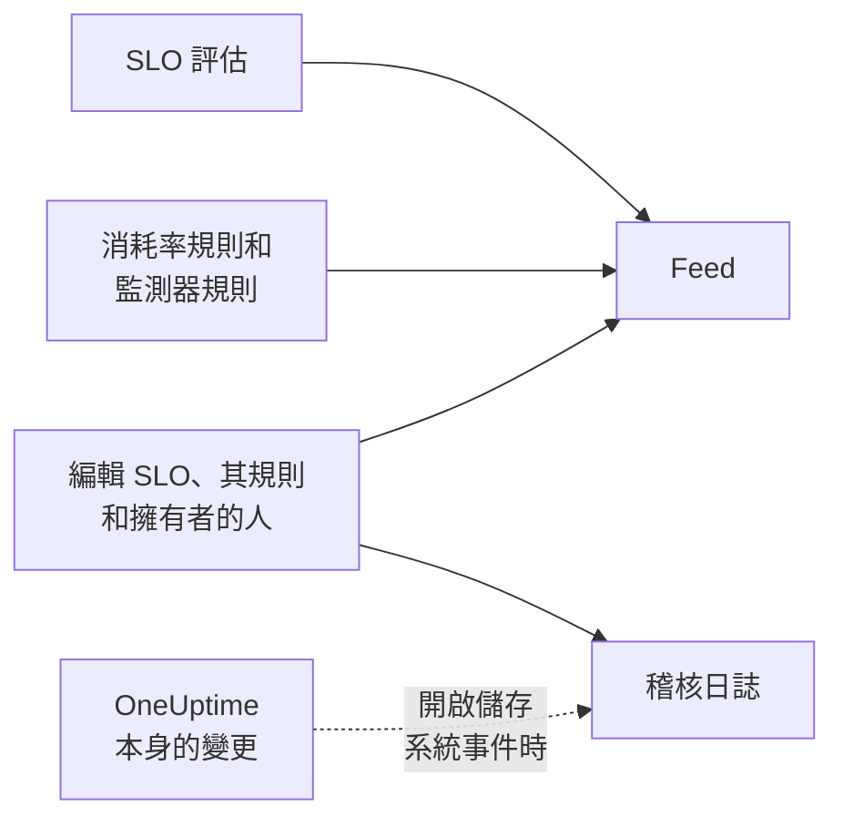

# SLO 動態與稽核日誌

SLO 保留兩份歷史記錄，它們回答不同的問題。**Feed** 回答「這個 SLO 發生了什麼事？」，是寫給照看它的人看的。**稽核日誌** 逐一欄位地回答「到底是誰改了什麼？」，用於審查和法規遵循。

## 動態還是稽核日誌？

| | **Feed** | **稽核日誌** |
| --- | --- | --- |
| 回答的問題 | SLO 發生了什麼事 | 誰在何時改了什麼 |
| 記錄內容 | 狀態變化、消耗率警示和事件，以及對 SLO、其規則、監測器和擁有者的變更 | 人員對 SLO、其消耗率規則、監測器規則和擁有者所做的每項變更，包括舊值和新值 |
| 是否包含 OneUptime 本身的操作 | 是：評估以及連結監測器的監測器規則 | 僅在 **儲存系統事件** 開啟時 |
| 方案 | 所有方案 | OneUptime Cloud 上的 Enterprise 方案，或自行託管安裝上的 Enterprise Edition |
| 保留時間 | OneUptime Cloud 上三年 | 預設 7 天，最多 180 天 |

## SLO 的動態

動態位於 SLO 的 **Feed** 頁面，最新項目會顯示在 SLO **概覽** 的 **Recent activity** 中。項目會連結到其中提到的 SLO、監測器、警示和事件，大多數項目都有一個 **More Information** 區段，顯示相關數字或舊值和新值。

| 事件 | 發布時機 |
| --- | --- |
| SLO 已建立 | 建立 SLO 時。列出其目標、合規時間窗、SLI、風險臨界值、描述以及建立時附帶的預設消耗率規則。 |
| SLO 已更新 | 名稱、描述、標籤、目標、合規時間窗、時區、風險臨界值、多監測器模式或停機狀態變更時。顯示每個舊值和新值。 |
| SLO 已啟用或已停用 | 評估被開啟或關閉時。 |
| SLO 已封存或已還原 | SLO 被封存或取消封存時。 |
| 狀態已變更 | 某次評估使 SLO 進入新狀態時。顯示解釋它的 SLI、錯誤預算、消耗率和風險臨界值，以及 **已暫停** 或 **Misconfigured** 的原因。 |
| 已觸發消耗率警示 | 消耗率規則建立警示時。連結到該警示並顯示觸發它的消耗率。 |
| 已宣告消耗率事件 | 消耗率規則宣告事件時。連結到該事件並顯示觸發它的消耗率。 |
| 消耗率警示或事件已解決 | 規則的警示或事件被關閉時：自動解決，或在自動解決關閉期間手動解決。 |
| 消耗率規則已新增、變更或移除 | 有人建立、編輯或刪除消耗率規則時。新 SLO 的預設規則則會出現在其「SLO 已建立」項目中。 |
| 監測器規則已新增、變更或移除 | 有人建立、編輯或刪除監測器規則時。沒有任何實質變更的儲存不會發布。 |
| 監測器已連結或已取消連結 | 監測器被手動或由監測器規則新增到 SLO 或從 SLO 中移除時。較長的清單會列出前幾個監測器並註明「及其他 N 個」。 |
| 擁有者已新增或已移除 | 使用者或團隊被新增到 SLO 的擁有者中或從中移除時。 |
| 已套用標籤規則 | 標籤規則在 SLO 建立時或有人執行該規則時為 SLO 加上了標籤。列出符合的規則。請參閱[標籤與擁有者規則](/docs/slo/label-and-owner-rules)。 |
| 已套用擁有者規則 | 擁有者規則為 SLO 新增了擁有者。列出符合的規則；它新增的每位擁有者還會各自取得一個「擁有者已新增」項目。 |

一些細節：

- 由人做出的變更，項目會註明是誰。OneUptime 本身做出的變更（例如評估，或監測器規則連結監測器），以及透過 API 或自動化做出的變更，不帶使用者。
- 規則因仍未關閉而重新接手的警示或事件不會發布兩次。
- 對於私人警示或事件，項目會省略其標題、編號和連結，因為任何能讀取 SLO 的人都能讀取其動態。但它仍會說明建立了一筆私人記錄，並顯示觸發它的消耗率。
- 任何人都無法編輯或刪除動態項目。在 OneUptime Cloud 上，超過三年的項目會被移除。

## 稽核日誌

SLO 的 **稽核日誌** 頁面會列出對以下內容所做的變更：

- SLO 本身：其詳細資訊、設定、標籤、監測器和封存；
- 其消耗率規則；
- 其監測器規則；
- 其擁有者使用者和擁有者團隊。

對規則和擁有者的變更會記錄在規則或擁有者上，並彙整到 SLO，因此 SLO 的頁面能在一個地方顯示其完整歷史，每個項目都會連結到它所屬的頁面。標籤和監測器等相關項目會連同名稱一起記錄，而不只是 ID。

有兩類內容不在其中：

- **評估結果。** SLI、錯誤預算、消耗率、狀態和評估時間每隔幾分鐘就會變化。它們的歷史在 **概覽**、**指標** 頁面和 **Feed** 中。
- **OneUptime 本身做出的變更**，例如監測器規則連結或取消連結監測器，除非專案開啟了 **儲存系統事件**。無論如何，**Feed** 都會記錄監測器的連結和取消連結。

### 開啟稽核日誌

稽核日誌是 Enterprise 功能：需要 OneUptime Cloud 上的 **Enterprise** 方案，或自行託管安裝上的 Enterprise Edition。在其他方案上，SLO 的 **稽核日誌** 頁面會說明如何取得。在自行託管的安裝上，沒有有效授權時稽核日誌會停止記錄（14 天試用期結束後，或授權過期 30 天後），一旦啟用授權就會恢復（請參閱 [When a license expires or is missing](/docs/self-hosted/enterprise#when-a-license-expires-or-is-missing)）。**稽核日誌** 頁面會在未記錄時予以提示。

稽核日誌在每個專案中預設也是關閉的。要開啟它們：

:::steps
### 開啟稽核日誌設定

前往 **專案設定**，在側邊選單中開啟 **稽核日誌**，然後按一下 **設定**。

### 編輯設定

按一下 **Edit Audit Log Settings**，開啟 **啟用稽核日誌**。

### 選擇保留內容

將 **保留時間（天）** 設定為 7（預設值）到 180 之間，並開啟 **儲存系統事件** 以同時記錄 OneUptime 本身做出的變更。儲存。變更約在一分鐘內生效。
:::

稽核日誌關閉期間，SLO 的 **稽核日誌** 頁面會顯示 **Audit logging is off** 以及開啟它的連結。關閉之前記錄的項目仍然可見。專案完整的稽核日誌（涵蓋所有資源）位於 **專案設定** → **稽核日誌** → **稽核日誌**。

## 後續步驟

:::cards
- [SLO 概觀](/docs/slo/introduction): SLO 擁有的每個頁面。
- [監測器與監測器規則](/docs/slo/monitor-rules): 是什麼連結和取消連結監測器。
- [消耗率警示與事件](/docs/slo/burn-rate-alerts): 是什麼觸發和解決動態中的警示和事件。
- [標籤與擁有者規則](/docs/slo/label-and-owner-rules): 是什麼自動新增標籤和擁有者。
:::
